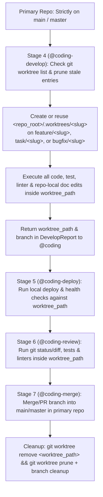

# ADR-011: Worktree-Based Development Lifecycle (`.worktrees/<slug>` Isolation)

## Context

In the `agentic` multi-repository workspace, feature, task, and bugfix branches were previously checked out directly in each repository's primary working tree during Stage 4 ([`@coding-develop`](file:///Users/gpfister/Development/Projects/gpfister/agentic/agentic-coding-plugin/agents/coding-develop/agent.md)). This caused several operational issues:

1. **Working Tree Contamination & Branch Collisions**: Switching branches in the primary working tree disrupts parallel sessions, risks uncommitted-state conflicts, and leaves the main workspace off its reference branch (`main` or `master`).
2. **Inconsistent Downstream Targeting**: Downstream lifecycle agents (`@coding-deploy`, `@coding-review`, `@coding-merge`) operated against the primary working tree rather than an isolated, task-scoped working directory.
3. **Lack of Automated Worktree Cleanup**: Without an explicit worktree lifecycle contract, temporary worktrees could accumulate or leave stale metadata behind.

### Alternatives Considered

1. **Continue Checking Out Branches in the Primary Working Tree**:
   - *Rejection Rationale*: Fails to isolate concurrent sessions and leaves the primary repository off `main`/`master` during development, deployment, and review.
2. **Clone Separate Repository Copies per Task**:
   - *Rejection Rationale*: Duplicates `.git` object databases, wastes disk space, and complicates local branch/remote synchronization compared to native Git worktrees.
3. **Per-Repository Isolated Git Worktrees (`.worktrees/<slug>`) with Orchestrator `worktree_path` Propagation (Selected)**:
   - *Rationale*: Native `git worktree` shares the local object database, keeps the primary repository working tree strictly on `main`/`master` at all times, enables concurrent tasks via distinct `.worktrees/<slug>` directories, and integrates cleanly with `@coding-merge` cleanup.

---

## Decision

We formalize the **Worktree-Based Development Lifecycle** across `agentic-coding-plugin` and the root `agentic` workspace:

### Key Architectural Rules

1. **Primary Repository Invariant**: The primary repository working tree **MUST** remain checked out on its reference/main branch (`main` or `master`) at all times during development, deployment, and review. No agent may switch the primary working tree to a feature, task, or bugfix branch during development.
2. **Worktree Creation & Execution (`@coding-develop`)**:
   - `@coding-develop` checks `git worktree list` (and runs `git worktree prune` if stale metadata exists), then creates or reuses `<repo_root>/.worktrees/<slug>` via `git worktree add` branching from `main`/`master` into `feature/<slug>`, `task/<slug>`, or `bugfix/<slug>`.
   - `.worktrees/` **MUST** be ignored by Git (via `.gitignore` or `.git/info/exclude`).
   - All code edits, test updates, linter runs, and repository-local documentation edits occur exclusively inside `<worktree_path>`.
   - For multi-repo tasks, `@coding-develop` creates a `.worktrees/<slug>` worktree in each modified repository and reports all `worktree_path` mappings and `branch` names in `DevelopReport`.
3. **Orchestrator Propagation (`@coding`)**: `@coding` captures `worktree_path` from `@coding-develop`'s `DevelopReport` and passes it explicitly to `@coding-deploy`, `@coding-review`, and `@coding-merge`.
4. **Downstream Targeting (`@coding-deploy` & `@coding-review`)**:
   - `@coding-deploy` executes all local deployments, build commands, and health checks against `worktree_path`.
   - `@coding-review` inspects `git status` / `git diff` and executes tests/linters inside `worktree_path`.
5. **Merge & Worktree Cleanup (`@coding-merge`)**:
   - Merges `<branch>` into `<base>` in the primary repository working tree (or creates/syncs the remote PR and fast-forward syncs `<base>` post-merge).
   - Removes the isolated worktree via `git worktree remove <worktree_path>` (or `--force` only after merge confirmation if untracked build/test artifacts remain), followed by `git worktree prune` and local/remote branch cleanup.

---

## Consequences

- **Positive:**
  - Keeps primary repository working trees clean and permanently on `main`/`master`.
  - Enables parallel development sessions on the same repository without branch checkout collisions.
  - Provides deterministic targeting (`worktree_path`) for deployment, review, and merge stages.
- **Negative:**
  - Slightly longer Stage 4 setup and Stage 7 teardown due to `git worktree add` / `remove` / `prune`.
- **Risks:**
  - *Risk*: `.worktrees/` showing as untracked in the primary repository if `.gitignore` is missing the entry.
  - *Mitigation*: `@coding-develop` verifies `.worktrees/` is ignored in `.gitignore` (or `.git/info/exclude`) upon worktree creation, and root `agentic/.gitignore` explicitly ignores `.worktrees/`.
