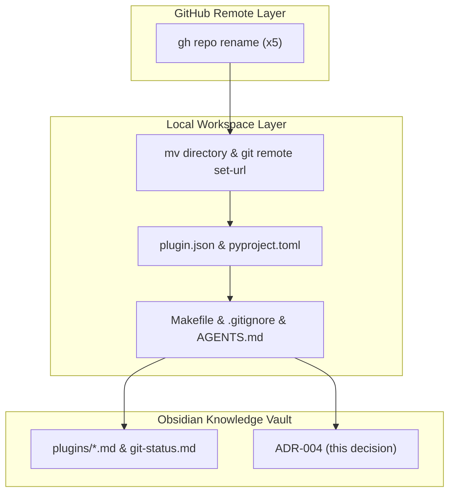

# ADR-004: Standardize Antigravity Plugin Repository Names to Descriptive Action Grammar

## Context

Following the standardization of subagent invocation handles under the `@coding-*` namespace ([[architecture/adr-001-standardize-agent-handles|ADR-001]]) and agent display header formatting ([[architecture/adr-002-agent-display-names-and-plugin-renames|ADR-002]]), the workspace repositories exhibited naming inconsistencies.

Specifically:
- Two plugins adopted expanded, descriptive action names:
  - [`agentic-coding-plugin`](file:///Users/gpfister/Development/Projects/gpfister/agentic/agentic-coding-plugin)
  - [`agentic-project-grooming-plugin`](file:///Users/gpfister/Development/Projects/gpfister/agentic/agentic-project-grooming-plugin)
- The remaining 5 companion plugins used abbreviated or clipped stems:
  - `agentic-triage-plugin` (noun / clipped)
  - `agentic-investigate-plugin` (verb root)
  - `agentic-monitor-plugin` (noun/verb root)
  - `agentic-research-plugin` (noun/verb root)
  - `agentic-document-plugin` (verb root)

This divergence created cognitive dissonance across GitHub repository listings, local folder hierarchies, package manifests, and documentation indexes. A unified naming grammar—`agentic-<action-descriptor>-plugin`—was requested to make all companion plugins explicitly self-describing while preserving system stability.

---

## Decision

We establish the following architectural decisions to standardize plugin repository naming across the `agentic` workspace:

### 1. Canonical Plugin Repository Rename Matrix
All 5 companion plugin repositories are renamed across remote GitHub repositories, local filesystem paths, and package configurations:

| Current Repository Name | New Canonical Repository Name | GitHub Remote Target (`gpfister/`) | Primary Role / Capability |
| :--- | :--- | :--- | :--- |
| `agentic-triage-plugin` | `agentic-prompt-triage-plugin` | `agentic-prompt-triage-plugin` | Prompt intent classification & routing |
| `agentic-investigate-plugin` | `agentic-issue-investigation-plugin` | `agentic-issue-investigation-plugin` | Autonomous root-cause investigation |
| `agentic-monitor-plugin` | `agentic-task-monitoring-plugin` | `agentic-task-monitoring-plugin` | Telemetry & stream surveillance |
| `agentic-research-plugin` | `agentic-topic-researching-plugin` | `agentic-topic-researching-plugin` | Deep web & technical literature research |
| `agentic-document-plugin` | `agentic-project-documenting-plugin` | `agentic-project-documenting-plugin` | Autonomous documentation & Obsidian vault curation |

Repositories that remain unchanged:
- `agentic-coding-plugin` (already conforms to grammar)
- `agentic-project-grooming-plugin` (already conforms to grammar)
- `agentic-obsidian` (dedicated documentation vault, not a plugin)
- `agentic` (central orchestrator root workspace)

### 2. Strict Subagent Technical Handle & Skill Invariance
To protect prompt contracts, system prompt routing, and test assertions from breaking:
- **Subagent Invocation Handles Unchanged**: `@coding-document`, `@coding-investigate`, `@coding-monitor`, `@coding-research`, and `@coding` remain invariant.
- **Agent Metadata Identifiers Unchanged**: Frontmatter `name: coding-*` in `agents/*.md` remains strictly unchanged.
- **Skill Directories & Identifiers Unchanged**: Skill folder paths (`skills/coding-document/`, `skills/coding-investigate/`, etc.) and skill manifest names remain strictly unchanged.

> [!IMPORTANT]
> The renaming operation applies exclusively to the repository folder, package distribution manifest (`plugin.json`), Python package configuration (`pyproject.toml`), and workspace coordination layers. Agent dispatch contracts are fully decoupled from repository directory names.

### 3. Synchronized GitHub Remote & Local Workspace Migration
The transition follows a synchronized 7-stage pipeline:
1. **GitHub Remote Renames**: Execute `gh repo rename <new-name> --repo gpfister/<old-name> --yes` for all 5 repositories.
2. **Local Directory & Git Remotes**: Atomically move sub-repository folders (`mv <old> <new>`) and update Git tracking remotes (`git remote set-url origin git@github.com:gpfister/<new-name>.git`).
3. **Internal Sub-Repo Manifests**: Update `"name"` in `plugin.json` and `pyproject.toml` to match new directory names; update internal `README.md` and `rules/AGENTS.md`.
4. **Root Workspace Automation**: Update `REPOS` list in [`Makefile`](file:///Users/gpfister/Development/Projects/gpfister/agentic/Makefile), `.gitignore` directory exclusions in [`.gitignore`](file:///Users/gpfister/Development/Projects/gpfister/agentic/.gitignore), and workspace documentation in [`README.md`](file:///Users/gpfister/Development/Projects/gpfister/agentic/README.md) and [`AGENTS.md`](file:///Users/gpfister/Development/Projects/gpfister/agentic/AGENTS.md).
5. **Companion Plugin References**: Update cross-plugin companion mentions in `agentic-coding-plugin` and `agentic-project-grooming-plugin`.
6. **Obsidian Documentation Vault**: Rename documentation notes under `agentic-obsidian/plugins/`, update `git-status.md`, update architecture guides, and refactor vault wikilinks.
7. **Verification & Delivery**: Validate workspace state via `make status` and commit changes to `master` across all repositories.

---

## Consequences

### Positive
- **Grammatical Uniformity**: All Antigravity plugins across the workspace follow an expressive, uniform naming convention (`agentic-<descriptor>-plugin`).
- **Clear Intent & Discoverability**: Repository and package names self-describe their operational capabilities in GitHub and package registries.
- **Zero Runtime Regressions**: Preserving `@coding-*` handles and skill paths guarantees complete backward compatibility for agent interactions, prompts, and automated tests.
- **Clean Workspace Orchestration**: `Makefile`, `scripts/worktree.py`, and `.gitignore` maintain an accurate, clean mapping of all active repositories.

### Negative
- **Local Workspace Migration Required**: Existing local checkouts must update their directory structures (`mv`) and git remote URLs (`git remote set-url`).
- **Cross-Repository Commits**: Synchronized changes across 8 repositories require atomic verification to prevent dirty workspace states.

### Risks & Mitigations
- **Staged Git Leaks**: Renaming directories could cause the root `agentic` Git repository to track unignored sub-repo contents.  
  *Mitigation*: Update `.gitignore` simultaneously with directory renames and verify using `git status -s`.
- **Remote Redirect Latency**: GitHub maintains temporary redirects for renamed repos, but relying on them risks silent failures in CI.  
  *Mitigation*: Explicitly set Git origin URLs to the canonical new URLs immediately after directory rename.
- **Dangling Obsidian Wikilinks**: Changing plugin note names could orphan links in session logs or architecture records.  
  *Mitigation*: Perform global vault refactoring of wikilinks and retain aliases in note frontmatter.

---

## References

- **Approved Technical Specification**: `SPEC-2026-PLUGIN-RENAME-001` ([`specification.md`](file:///Users/gpfister/.gemini/antigravity/brain/bd5f3041-e39c-44cf-aa85-5d9a61505746/specification.md))
- **Vault Archived Specification**: [`sessions/attachments/bd5f3041-e39c-44cf-aa85-5d9a61505746/specification.md`](file:///Users/gpfister/Development/Projects/gpfister/agentic/agentic-obsidian/sessions/attachments/bd5f3041-e39c-44cf-aa85-5d9a61505746/specification.md)
- **Approved Implementation Plan**: [`plan.md`](file:///Users/gpfister/.gemini/antigravity/brain/80a30eee-9259-426c-acbb-1d07be48f302/plan.md)
- **Vault Archived Plan**: [`sessions/attachments/80a30eee-9259-426c-acbb-1d07be48f302/plan.md`](file:///Users/gpfister/Development/Projects/gpfister/agentic/agentic-obsidian/sessions/attachments/80a30eee-9259-426c-acbb-1d07be48f302/plan.md)
- **Feature Note**: [[features/rename-plugin-repositories|Rename Plugin Repositories to Descriptive Action-Oriented Names]]
- **Related ADRs**:
  - [[architecture/adr-001-standardize-agent-handles|ADR-001: Standardize Subagent Handles, Aliases, and Skill Identifiers to Coding Namespace]]
  - [[architecture/adr-002-agent-display-names-and-plugin-renames|ADR-002: Agent Display Names Standardization & Dual Plugin Repository Rename]]
  - [[architecture/adr-003-project-grooming-plugin|ADR-003: Project Grooming Architecture, Skill-Only Execution, Grilling Protocol, Interactive Approval Gate, and Cross-Plugin Delegation]]
