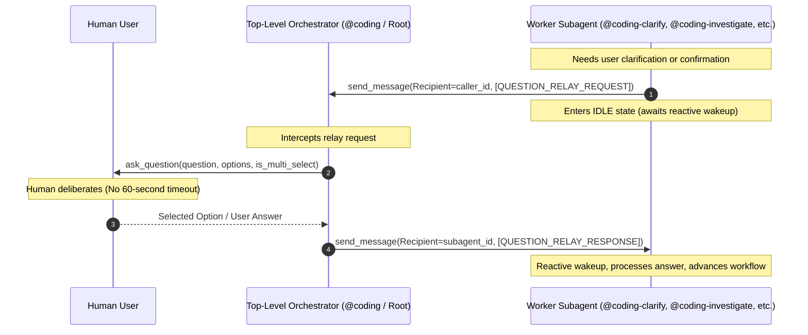

# ADR-005: Question Relay Protocol for Subagent User Inquiries

## Context

In the Google Antigravity multi-agent orchestration architecture, worker subagents spawned via `invoke_subagent` run in background processes managed by the host runtime. When a worker subagent attempts to interrogate or clarify decisions with a human user by executing `ask_question` directly, the runtime enforces a rigid **60-second execution timeout** on the turn.

If the human user deliberates, reviews options, or fails to select an answer within 60 seconds, the tool call throws a timeout exception, aborting the active turn and causing the subagent workflow (such as Phase 1 clarification grilling, monitoring anomaly pause gates, issue assessment remediation gates, or project grooming interviews) to fail catastrophically.

Conversely, top-level orchestrators (`@coding`) and root user conversation sessions run without background execution timeouts and can await user input via `ask_question` indefinitely.

### Alternatives Considered

1. **Direct `ask_question` with Client-Side Warning (Status Quo)**:
   - *Description*: Allow subagents to continue invoking `ask_question` directly while warning users to respond quickly within 60 seconds.
   - *Rejection Rationale*: Unacceptable user experience; human decision-making and architecture reviews routinely take minutes or hours; leads to non-deterministic workflow terminations.

2. **Filesystem Mailbox / Polling Protocol**:
   - *Description*: Subagents write question files to disk (`.questions/`), sleep or poll repeatedly, while a daemon or top-level agent presents the question.
   - *Rejection Rationale*: Polling violates Antigravity messaging paradigms, burns session tokens, introduces race conditions, and conflicts with reactive wakeup models.

3. **Question Relay Protocol via Top-Level Orchestrator (Option 3)**:
   - *Description*: Subagents never call `ask_question` while under orchestrator control; instead, they send structured `[QUESTION_RELAY_REQUEST]` messages to the parent caller via `send_message`. The orchestrator executes `ask_question` in the root turn (no 60s timeout), captures the user's choice, and returns `[QUESTION_RELAY_RESPONSE]` to the subagent via `send_message`. The subagent wakes up reactively and resumes work.
   - *Evaluation*: Clean separation of concerns, zero timeouts, fully event-driven, compatible with existing Antigravity inter-agent messaging.

---

## Decision

We adopt **Option 3: Question Relay Protocol** as the workspace-wide standard for all subagent human-in-the-loop inquiries across all companion plugins.



### 1. Protocol Message Envelopes & Schemas

The protocol defines two structured envelopes:

#### Request Envelope: `[QUESTION_RELAY_REQUEST]`
Dispatched by the worker subagent to the parent orchestrator (`caller_id`):

```text
[QUESTION_RELAY_REQUEST]
```
```json
{
  "type": "QUESTION_RELAY_REQUEST",
  "questions": [
    {
      "question": "Which architecture pattern should we follow for the relay handler?",
      "options": [
        "(Recommended) Event-driven message listener hook in orchestrator loop",
        "Synchronous subagent blocking loop with sleep",
        "Direct callback via shared memory"
      ],
      "is_multi_select": false
    }
  ],
  "context": "Clarification needed for orchestrator-subagent interaction design."
}
```

*Rules*:
- `questions` array MUST contain exactly one question object to strictly maintain the "one question at a time" Matt Pocock clarification rule.
- `options` MUST include clear choices with `(Recommended)` prefixing the recommended option.
- `is_multi_select` defaults to `false`.

#### Response Envelope: `[QUESTION_RELAY_RESPONSE]`
Dispatched by the orchestrator back to the worker subagent (`subagent_id`):

```text
[QUESTION_RELAY_RESPONSE]
```
```json
{
  "type": "QUESTION_RELAY_RESPONSE",
  "answers": [
    "(Recommended) Event-driven message listener hook in orchestrator loop"
  ],
  "status": "COMPLETED"
}
```

*Rules*:
- `answers` contains the array of user-selected strings or raw text input.
- `status` can be `"COMPLETED"`, `"REJECTED"`, or `"CANCELLED"`.

---

### 2. Subagent Classification & Operational Modes

Subagents are categorized into two execution tiers:

| Tier | Agents | Operating Protocol | Tooling Permissions |
| :--- | :--- | :--- | :--- |
| **Pure Subagents** | `@coding-clarify`<br>`@coding-deploy`<br>`@coding-review` | Strictly run under `@coding`. **NEVER** call `ask_question`. Always dispatch `[QUESTION_RELAY_REQUEST]` to `caller_id`. | `send_message`<br>(Do not declare `ask_question`) |
| **Dual-Mode Agents** | `@coding-investigate`<br>`/project-grooming` (`@coding-groom`)<br>`@coding-monitor`<br>`@coding-research` | **Parent Caller Present**: Dispatch `[QUESTION_RELAY_REQUEST]` via `send_message`.<br>**Standalone / Root**: Invoke `ask_question` directly. | Both `send_message` and `ask_question` |

---

### 3. Orchestrator Responsibilities

Top-level orchestrators (`@coding` and workspace entrypoint agents) must:
1. **Intercept**: Detect incoming messages bearing the `[QUESTION_RELAY_REQUEST]` header.
2. **Execute**: Call `ask_question` in the root turn with parameters extracted from the request payload.
3. **Relay**: Package the user's response into `[QUESTION_RELAY_RESPONSE]` and dispatch via `send_message(Recipient=sender_id)`.
4. **Yield**: Allow the subagent to continue its execution reactively upon message receipt.

---

### 4. Multi-Repository Work Breakdown

The implementation spans 6 repositories:

1. **`agentic-coding-plugin`**:
   - Update `agents/coding-clarify/agent.md`: Add `send_message`, replace direct `ask_question` with `[QUESTION_RELAY_REQUEST]`.
   - Update `agents/coding/agent.md`: Add Question Relay Handler protocol to intercept requests and relay responses.
   - Update `agents/coding-deploy/agent.md` & `agents/coding-review/agent.md`: Relay deployment and review confirmation prompts.
   - Update `skills/coding-orchestrator/SKILL.md` and `rules/AGENTS.md`.
   - Update `tests/test_plugin.py` to validate relay message contracts and tool configurations.

2. **`agentic-issue-investigation-plugin`**:
   - Update `agents/coding-investigate/agent.md`, `skills/coding-investigate/SKILL.md`, and `rules/AGENTS.md` for dual-mode question handling and remediation gates.
   - Update `tests/test_plugin.py`.

3. **`agentic-project-grooming-plugin`**:
   - Update `agents/coding-groom/agent.md`, `skills/project-grooming/SKILL.md`, and `rules/AGENTS.md` for dual-mode Matt Pocock single-question grilling.
   - Update `tests/test_plugin.py`.

4. **`agentic-task-monitoring-plugin`**:
   - Update `agents/coding-monitor/agent.md`, `skills/coding-monitor/SKILL.md`, and `rules/AGENTS.md` for dual-mode anomaly detection pause gates.
   - Update `tests/test_plugin.py`.

5. **`agentic-topic-researching-plugin`**:
   - Update `agents/coding-research/agent.md`, `skills/coding-research/SKILL.md`, and `rules/AGENTS.md` for dual-mode research scope formulation.
   - Update `tests/test_plugin.py`.

6. **`agentic` (Root Workspace)**:
   - Update [`AGENTS.md`](file:///Users/gpfister/Development/Projects/gpfister/agentic/AGENTS.md) Section 3 (Cross-Plugin Interoperability) and Section 4 (Flowchart).
   - Update [`README.md`](file:///Users/gpfister/Development/Projects/gpfister/agentic/README.md).

---

## Consequences

### Positive
- **Eliminates 60s Host Timeouts**: Subagent turns never fail due to human deliberation time, as the prompt executes at the top-level turn.
- **Preserves Interactive Human Oversight**: Maintains interactive grilling, confirmation gates, and multiple-choice decision points.
- **Event-Driven & Token Efficient**: Leverages reactive wakeups via `send_message`, avoiding wasteful polling loops.
- **Standardized Contract**: A single envelope specification across all 5 specialized subagents and top-level orchestrators.

### Negative
- **Latency Overhead**: Introduces an extra message round-trip between subagent and orchestrator.
- **Orchestrator Complexity**: Orchestrators must implement a message interception and relay loop to handle subagent inquiries.

### Risks & Mitigations
- **Risk: Subagent unable to identify caller ID**:
  - *Mitigation*: Dual-mode subagents verify caller ID availability; if absent, securely fall back to direct `ask_question`.
- **Risk: Violation of single-question rule**:
  - *Mitigation*: Schema validation in orchestrator ensures exactly one question per request envelope.
- **Risk: Malformed JSON payload**:
  - *Mitigation*: Orchestrators support both JSON-structured payloads and parsed markdown key-value blocks, returning an error response on syntax failures.
