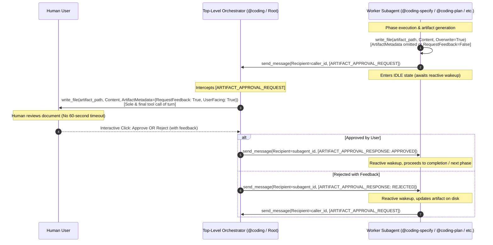

# ADR-006: Artifact Approval Relay Protocol for Subagent Approval Gates

## Context

In the Google Antigravity multi-agent orchestration architecture, worker subagents spawned via `invoke_subagent` run inside background processes managed by the host runtime. These worker subagents are subject to a rigid **60-second execution timeout** on each turn.

The workspace previously addressed interactive user inquiries by establishing the **Question Relay Protocol** ([[architecture/adr-005-question-relay-protocol|ADR-005]]), which routes `ask_question` calls to the top-level orchestrator turn where execution can await human deliberation without timeout limits.

However, a parallel failure mode occurs during interactive approval gates:
When worker subagents (`@coding-specify`, `@coding-plan`, `@coding-deploy`, `@coding-investigate`, `@coding-groom`, `@coding-research`) author milestone deliverables requiring human sign-off (`specification.md`, `plan.md`, `deployment-issue.md`, `issue-assessment.md`, `Project_Request_Grooming.md`, `research-report.md`) using `write_file` with `ArtifactMetadata={"RequestFeedback": True, "UserFacing": True}`, the interactive Approve/Reject buttons and feedback input box are rendered within the subagent's execution turn.

If human users review complex architectural specifications, multi-repository plans, root-cause diagnoses, or research reports for longer than 60 seconds before clicking **Approve** or submitting revision feedback, the runtime throws a 60-second execution timeout exception. This prematurely aborts the subagent's turn, corrupts workflow state, and discards uncommitted work. Furthermore, nested approval gates can suffer from UI visibility degradation in deep multi-agent hierarchies.

Conversely, top-level orchestrators (`@coding` and root conversational turns) run without background tool execution timeouts and can await human interaction indefinitely.

### Alternatives Considered

1. **Direct `write_file(RequestFeedback=True)` with Fast-User Deliberation (Status Quo)**:
   - *Description*: Allow subagents to continue presenting interactive artifacts directly while advising users to approve or reject within 60 seconds.
   - *Rejection Rationale*: Thorough architectural and specification reviews inherently take minutes or hours. Forcing a 60-second countdown leads to workflow aborts, frustration, and loss of progress.

2. **Filesystem Polling / Mailbox Protocol**:
   - *Description*: Subagents write artifacts to disk, enter a polling loop checking for a user-authored `.approved` flag file, while an external daemon presents the gate.
   - *Rejection Rationale*: Polling violates Antigravity event-driven messaging principles, exhausts session step budgets, burns tokens, and introduces filesystem concurrency race conditions.

3. **Artifact Approval Relay Protocol via Top-Level Orchestrator (Option 3 - Recommended)**:
   - *Description*: Subagents author the deliverable directly to disk (`<appDataDir>/brain/<conversation-id>/<artifact_name>`) with `Overwrite=True` and omit `RequestFeedback=True` (or set it to `False`). Subagents then dispatch a standardized `[ARTIFACT_APPROVAL_REQUEST]` envelope to their caller orchestrator via `send_message` and enter an idle state. The top-level orchestrator reads the artifact, calls `write_file` with `ArtifactMetadata={"RequestFeedback": True, "UserFacing": True}` as the sole and final tool call of its root turn (no 60-second timeout), and awaits user input. Upon approval or rejection with feedback, the orchestrator dispatches an `[ARTIFACT_APPROVAL_RESPONSE]` envelope back to the subagent via `send_message`, reactively waking it up to complete or rework the deliverable.
   - *Evaluation*: Mirrors the proven Question Relay Protocol ([[architecture/adr-005-question-relay-protocol|ADR-005]]), completely eliminates 60-second timeouts, preserves native Antigravity UI Approve/Reject buttons, and maintains clean separation of concerns.

---

## Decision

We adopt **Option 3: Artifact Approval Relay Protocol** as the workspace-wide standard for all subagent artifact approval gates across all companion plugins.



### 1. Protocol Message Envelopes & Schemas

The protocol defines two structured envelopes:

#### Request Envelope: `[ARTIFACT_APPROVAL_REQUEST]`
Dispatched by the worker subagent to the parent orchestrator (`caller_id`):

```text
[ARTIFACT_APPROVAL_REQUEST]
```
```json
{
  "type": "ARTIFACT_APPROVAL_REQUEST",
  "artifact_name": "specification.md",
  "artifact_path": "/Users/user/.gemini/antigravity/brain/<session-id>/specification.md",
  "stage": "SPECIFICATION",
  "summary": "Detailed technical specification for feature XYZ",
  "user_facing": true
}
```

##### Field Specifications
| Field | Type | Required | Description |
| :--- | :--- | :--- | :--- |
| `type` | string | Yes | Fixed value `"ARTIFACT_APPROVAL_REQUEST"`. |
| `artifact_name` | string | Yes | Base file name (e.g. `specification.md`, `plan.md`, `issue-assessment.md`, `research-report.md`, `Project_Request_Grooming.md`, `deployment-issue.md`). |
| `artifact_path` | string | Yes | Absolute path on filesystem located in `<appDataDir>/brain/<conversation-id>/`. |
| `stage` | string | Yes | Workflow stage identifier (`"SPECIFICATION"`, `"PLANNING"`, `"DEPLOYMENT_ISSUE"`, `"INVESTIGATION"`, `"GROOMING"`, `"RESEARCH"`). |
| `summary` | string | Yes | Multi-line descriptive summary passed into `ArtifactMetadata.Summary`. |
| `user_facing` | boolean | Yes | Defaults to `true`. |

#### Response Envelope: `[ARTIFACT_APPROVAL_RESPONSE]`
Dispatched by the orchestrator back to the worker subagent (`subagent_id`):

```text
[ARTIFACT_APPROVAL_RESPONSE]
```
```json
{
  "type": "ARTIFACT_APPROVAL_RESPONSE",
  "artifact_name": "specification.md",
  "status": "APPROVED",
  "feedback": ""
}
```

##### Field Specifications
| Field | Type | Required | Description |
| :--- | :--- | :--- | :--- |
| `type` | string | Yes | Fixed value `"ARTIFACT_APPROVAL_RESPONSE"`. |
| `artifact_name` | string | Yes | The file name matching the corresponding request. |
| `status` | string | Yes | Outcome status: strictly `"APPROVED"` or `"REJECTED"`. |
| `feedback` | string | No | User-provided revision comments, objections, or adjustment instructions when `status == "REJECTED"`. Empty string when `status == "APPROVED"`. |

---

### 2. Subagent Classification & Operational Modes

Subagents are categorized into two execution tiers:

| Tier | Agents | Operating Protocol | Tooling Permissions & Behavior |
| :--- | :--- | :--- | :--- |
| **Pure Subagents** | `@coding-specify`<br>`@coding-plan`<br>`@coding-deploy` | Strictly run under `@coding`. **NEVER** call `write_file(RequestFeedback=True)`. Author artifact on disk, then dispatch `[ARTIFACT_APPROVAL_REQUEST]` to `caller_id`. | `write_file(Overwrite=True)` without feedback metadata + `send_message` |
| **Dual-Mode Agents** | `@coding-investigate`<br>`/project-grooming` (`@coding-groom`)<br>`@coding-research` | **Parent Caller Present**: Author file to disk without feedback gate; dispatch `[ARTIFACT_APPROVAL_REQUEST]` via `send_message`.<br>**Standalone / Root**: Directly execute `write_file(RequestFeedback=True)` as sole & final call of turn. | `write_file` with conditional `ArtifactMetadata` + `send_message` |

---

### 3. Orchestrator Responsibilities

Top-level orchestrators (`@coding` and root session turns) must:
1. **Intercept**: Detect incoming messages bearing the `[ARTIFACT_APPROVAL_REQUEST]` header.
2. **Read & Present**: Verify artifact existence on disk, read its contents, and call `write_file(Path=artifact_path, Content=..., ArtifactMetadata={"RequestFeedback": True, "UserFacing": True, "Summary": ...})` as the **sole and final tool call** of that turn.
3. **Handle User Gate**: Upon user action (Approve or Reject with feedback), package the decision into `[ARTIFACT_APPROVAL_RESPONSE]` and dispatch via `send_message(Recipient=subagent_id)`.
4. **Yield**: Allow the subagent to continue its execution reactively upon message receipt.

---

### 4. Multi-Repository Work Breakdown

The implementation spans 5 repositories:

1. **`agentic` (Root Workspace Orchestrator)**:
   - Add Section 3.3 ("Artifact Approval Relay Protocol") to [`AGENTS.md`](file:///Users/gpfister/Development/Projects/gpfister/agentic/AGENTS.md).
   - Update Section 4 ("Coding Workflow Pipeline & Decision Flowchart") reflecting root orchestrator gate presentation for Phase 2 (`specification.md`), Phase 3 (`plan.md`), and Phase 5 (`deployment-issue.md`).
2. **`agentic-coding-plugin`**:
   - Update `rules/AGENTS.md` (add Section 7 for Artifact Approval Relay Protocol).
   - Update `skills/coding-orchestrator/SKILL.md` to intercept `[ARTIFACT_APPROVAL_REQUEST]` and return `[ARTIFACT_APPROVAL_RESPONSE]`.
   - Update `agents/coding-specify/agent.md`, `agents/coding-plan/agent.md`, and `agents/coding-deploy/agent.md` to author artifacts without `RequestFeedback=True` and dispatch relay requests.
   - Update `agents/coding/agent.md` and `agents/agent.md`.
   - Update unit tests in `tests/test_plugin.py`.
3. **`agentic-issue-investigation-plugin`**:
   - Update `rules/AGENTS.md`, `skills/coding-investigate/SKILL.md`, `agents/coding-investigate/agent.md`, and `agents/agent.md` for dual-mode `issue-assessment.md` authoring.
   - Update unit tests in `tests/test_plugin.py`.
4. **`agentic-project-grooming-plugin`**:
   - Update `rules/AGENTS.md`, `skills/project-grooming/SKILL.md`, `agents/coding-groom/agent.md`, and `agents/agent.md` for dual-mode `Project_Request_Grooming.md` authoring.
   - Update unit tests in `tests/test_plugin.py`.
5. **`agentic-topic-researching-plugin`**:
   - Update `rules/AGENTS.md`, `skills/coding-research/SKILL.md`, `agents/coding-research/agent.md`, and `agents/agent.md` for dual-mode `research-report.md` authoring.
   - Update unit tests in `tests/test_plugin.py`.

---

## Consequences

### Positive
- **Eliminates 60s Approval Timeouts**: Human users can deliberate, read documentation, and provide feedback over hours without premature background turn timeouts.
- **Preserves Native Antigravity Gate UX**: Interactive Approve / Reject buttons and revision text inputs continue to render natively in the chat UI at the root turn.
- **Unified Communication Model**: Symmetrically mirrors the Question Relay Protocol ([[architecture/adr-005-question-relay-protocol|ADR-005]]), creating a cohesive architectural standard across the entire multi-agent ecosystem.
- **Full Rework Traceability**: Rejection feedback is passed directly in structured JSON envelopes back to the authoring subagent, allowing targeted, iterative document revisions.

### Negative
- **Extra Message Round-Trip**: Adds an asynchronous message cycle between worker subagent and caller orchestrator.
- **Orchestrator Protocol Handling**: The root orchestrator must parse incoming requests, verify disk artifacts, execute root gate calls, and dispatch response envelopes.

### Risks & Mitigations
- **Risk: Artifact file not flushed to disk before request dispatch**:
  - *Mitigation*: Subagents must call `write_file` synchronously and confirm write completion before invoking `send_message`.
- **Risk: Rejection with empty feedback**:
  - *Mitigation*: The subagent inspects the `feedback` field. If empty on rejection, the subagent dispatches a clarification inquiry via `[QUESTION_RELAY_REQUEST]` asking the user what adjustments are required.
- **Risk: Concurrency on multiple artifacts**:
  - *Mitigation*: Orchestrators handle artifacts sequentially, presenting one gate turn at a time.

---

## Implementation & Verification Status

| Repository | Scope | Verification Status | Target Branch | Tests Passing |
| :--- | :--- | :--- | :--- | :--- |
| **`agentic` (root)** | Ecosystem coordination in `AGENTS.md` (Sections 3.3 and 4) | Planned | `feature/artifact-approval-relay` | Documentation audit |
| **`agentic-coding-plugin`** | Pure subagents (`@coding-specify`, `@coding-plan`, `@coding-deploy`), `@coding` relay loop, rules, skill, tests | Planned | `feature/artifact-approval-relay` | Pending Phase 4 |
| **`agentic-issue-investigation-plugin`** | Dual-mode `@coding-investigate`, rules, skill, `issue-assessment.md`, tests | Planned | `feature/artifact-approval-relay` | Pending Phase 4 |
| **`agentic-project-grooming-plugin`** | Dual-mode `@coding-groom`, rules, skill, `Project_Request_Grooming.md`, tests | Planned | `feature/artifact-approval-relay` | Pending Phase 4 |
| **`agentic-topic-researching-plugin`** | Dual-mode `@coding-research`, rules, skill, `research-report.md`, tests | Planned | `feature/artifact-approval-relay` | Pending Phase 4 |

> [!NOTE] Current Milestone: Approved / Pending Development
> Technical Specification `SPEC-2026-RELAY-002` and Implementation Plan have been approved. Proceeding to Phase 4 (Parallel Development) across all 5 repositories on `feature/artifact-approval-relay`.
