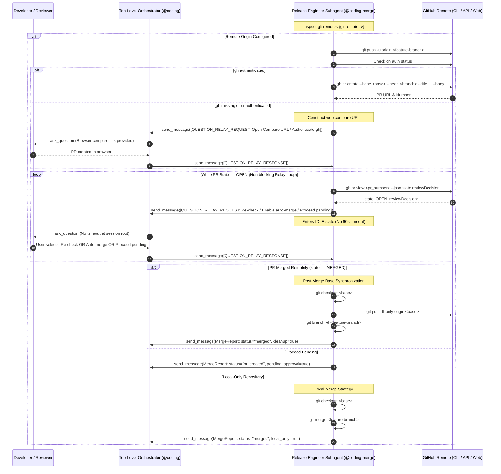

# ADR-007: Remote PR Creation, Question Relay Waiting Gate, and Post-Merge Synchronization for `@coding-merge`

## Context

In the `agentic-coding-plugin` software development lifecycle, Stage 7 (`@coding-merge`) serves as the designated release engineer subagent, responsible for integrating verified feature branches into base branches (`main` or `master`) and finalizing release deliverables.

However, several architectural gaps and runtime constraints existed in the initial implementation:

1. **Lack of Remote PR Lifecycle Management**: When a remote repository is configured (`git remote -v`), `@coding-merge` attempted branch pushing and PR creation, but had no structured protocol to wait for human code review, external CI/CD checks, and remote merge completion.
2. **60-Second Host Subagent Timeout Risk**: In Google Antigravity, background worker subagents spawned via `invoke_subagent` are subject to a rigid **60-second execution timeout** on each turn. If `@coding-merge` executes a blocking polling loop (`sleep`) or calls interactive prompting tools (`ask_question`) directly to wait for a Pull Request to be reviewed and merged, the turn terminates prematurely with a timeout exception whenever human review takes longer than 60 seconds.
3. **Missing GitHub CLI Fallback Strategy**: When the GitHub CLI (`gh`) is not installed or unauthenticated (`gh auth status` failure), `@coding-merge` failed without providing the developer a web-based fallback URL (`https://github.com/<owner>/<repo>/compare/<base>...<branch>?expand=1`) to open and complete PR creation in their browser.
4. **Post-Merge Workspace Drift**: Following remote PR merge, the local workspace remained unaligned: the base branch was not fast-forward updated with the upstream merge commit, and obsolete local feature branches remained unpruned.
5. **Tooling & Pure Subagent Misalignment**: `coding-merge` omitted `send_message` from its frontmatter `tools` declaration and was not classified as a Pure Subagent in the workspace Question Relay Protocol matrix.

### Alternatives Considered

1. **Synchronous Polling Loop in Worker Subagent (`sleep` loop)**:
   - *Description*: `@coding-merge` repeatedly executes `gh pr view` interspersed with 10-second `sleep` calls until the PR state transitions to `MERGED`.
   - *Rejection Rationale*: Directly triggers Antigravity's 60-second subagent execution timeout; blocks system resources; causes catastrophic workflow failure during normal developer review latency.

2. **Direct `ask_question` Prompting Inside Worker Subagent**:
   - *Description*: `@coding-merge` calls `ask_question` directly to ask the user whether the PR has been reviewed and merged.
   - *Rejection Rationale*: Subagent-invoked `ask_question` also inherits the 60-second execution timeout in background turns, failing if the user deliberates for more than a minute.

3. **Hybrid Check & Question Relay Waiting Gate via Parent Orchestrator (Selected)**:
   - *Description*: `@coding-merge` checks status non-blockingly via `gh pr view`. If `state == "OPEN"`, it delegates the waiting gate to the parent orchestrator (`@coding`) using the **Question Relay Protocol** (`[QUESTION_RELAY_REQUEST]`). `@coding` presents the options to the user at the session root without any 60-second timeout. Once the PR is merged remotely, `@coding-merge` switches to the base branch, fast-forwards remote commits (`git pull --ff-only origin <base>`), safely deletes the local branch (`git branch -d <branch>`), and emits a structured `MergeReport`.
   - *Evaluation*: Completely avoids execution timeouts, supports auto-merge and manual browser compare workflows, guarantees local workspace synchronization, and maintains clean event-driven separation of concerns.

---

## Decision

We adopt **Option 3: Hybrid Check & Question Relay Waiting Gate with Post-Merge Synchronization** as the architectural standard for `@coding-merge` across `agentic-coding-plugin` and workspace guidelines.



### 1. Remote Detection & Release Strategies

`@coding-merge` inspects `git remote -v` or `git remote get-url origin`:
- **Local-Only Strategy**: If no remote is configured, `@coding-merge` checks out `<base>`, executes `git merge <branch>`, and finalizes with `status: "merged"`.
- **Remote PR Strategy**: If `origin` is present, `@coding-merge` pushes the branch, ensures PR creation (via `gh pr create` or fallback compare URL), executes the waiting gate, and synchronizes the local workspace upon merge.

### 2. GitHub CLI Fallback via Web Compare URL

If `gh auth status` fails or `gh` is not installed:
- `@coding-merge` parses the repository slug (`<owner>/<repo>`) from `git remote get-url origin`.
- Constructs the web compare URL:
  `https://github.com/<owner>/<repo>/compare/<base>...<branch>?expand=1`
- Relays a `[QUESTION_RELAY_REQUEST]` containing the clickable URL to the user, offering:
  1. `(Recommended) PR created in browser; check if merged`
  2. `Re-check gh auth status`
  3. `Proceed without waiting (mark pending)`

### 3. Subagent-Safe Waiting Gate via Question Relay Protocol

When `gh pr view` reports `state == "OPEN"`:
- `@coding-merge` halts execution and dispatches a structured `[QUESTION_RELAY_REQUEST]` to `caller_id` via `send_message`:
  ```json
  {
    "type": "QUESTION_RELAY_REQUEST",
    "questions": [
      {
        "question": "Pull Request #<number> is currently OPEN (reviewDecision: <decision>). How would you like to proceed?",
        "options": [
          "(Recommended) Re-check PR status",
          "Enable GitHub auto-merge (gh pr merge --auto --merge) and re-check",
          "Proceed without waiting (mark PR pending)"
        ],
        "is_multi_select": false
      }
    ],
    "context": "Feature branch pushed and PR created. Awaiting code review, CI approval, and merge."
  }
  ```
- The parent orchestrator (`@coding`) prompts the user at the session root via `ask_question`. Because the prompt executes in the root session, human deliberation can take minutes or hours without triggering subagent background timeouts.
- When the user selects an option, `@coding` wakes `@coding-merge` reactively with `[QUESTION_RELAY_RESPONSE]`.

### 4. Post-Merge Base Synchronization & Local Branch Cleanup

Upon detecting `state == "MERGED"`:
1. `git checkout <base>`: Switches working directory to base branch (`main` or `master`).
2. `git pull --ff-only origin <base>`: Pulls upstream merge commits cleanly without creating local merge bubbles.
3. `git branch -d <branch>`: Safely deletes the local feature branch (using safe delete `-d`, never force delete `-D`).
4. Generates a structured `MergeReport` payload returned to `@coding`.

### 5. Pure Subagent Tooling & Classification

- Update `agents/coding-merge/agent.md` frontmatter tools to include `send_message`:
  ```yaml
  tools:
    - run_command
    - read_file
    - list_dir
    - ask_question
    - send_message
  ```
- Classify `@coding-merge` alongside `@coding-clarify`, `@coding-deploy`, and `@coding-review` as a **Pure Subagent** in Section 6 of `agentic-coding-plugin/rules/AGENTS.md` and Section 3.2.4 of workspace `AGENTS.md`. Pure Subagents must strictly relay questions to `caller_id` when running under orchestrator control.

---

## Multi-Repository Work Breakdown & Deliverables

1. **`agentic-coding-plugin`** (Commit [`486131c`](file:///Users/gpfister/Development/Projects/gpfister/agentic/agentic-coding-plugin/) on `feature/coding-merge-pr-waiting-gate`):
   - `agents/coding-merge/agent.md`: Added `send_message` to tools list. Added instructions for remote detection, `gh auth status` check, `gh pr create`, fallback compare URL, waiting gate via `[QUESTION_RELAY_REQUEST]`, post-merge checkout, fast-forward pull, and safe branch cleanup.
   - `agents/agent.md`: Updated `@coding-merge` tools list and Stage 7 workflow description.
   - `skills/coding-orchestrator/SKILL.md`: Updated Stage 7 lifecycle instructions and Question Relay Protocol integration.
   - `rules/AGENTS.md`: Updated Section 6 to list `@coding-merge` as a Pure Subagent.
   - `tests/test_plugin.py`: Added unit test assertions for `send_message` tooling, Question Relay contracts, PR waiting gate instructions, and post-merge cleanup commands (**17/17 tests passing**).
2. **`agentic` (Workspace Root)** (Commit [`1aa5e88`](file:///Users/gpfister/Development/Projects/gpfister/agentic/) on `feature/coding-merge-pr-waiting-gate`):
   - `AGENTS.md`: Updated Section 2.3 catalog, Section 3.2.4 subagent matrix, and Section 4 workflow lifecycle to include `@coding-merge` PR creation, waiting gate, and post-merge synchronization. All links and guidelines verified.

---

## Consequences

### Positive
- **Guarantees Subagent Timeout Immunity**: Eliminates 60-second runtime timeouts during Pull Request reviews and external CI check waits by offloading interactive gating to the session root.
- **Resilient Developer Experience**: Supports both CLI-driven (`gh pr create`) and browser-driven (compare URL fallback) workflows.
- **Prevents Workspace Drift**: Automatically synchronizes local base branches and prunes merged feature branches, keeping developers' workspaces clean.
- **Unified Architectural Consistency**: Brings `@coding-merge` into full conformance with the Question Relay Protocol matrix alongside companion subagents.

### Negative / Trade-Offs
- **Subagent Invocations**: Multi-turn waiting gates introduce message hops between orchestrator and subagent.
- **Dependency on Git State**: Requires clean working tree before switching to base branch and pulling upstream commits.

### Risks & Mitigations
- **Risk: Upstream base branch divergence**: If remote base cannot fast-forward cleanly, `git pull --ff-only` will fail without modifying working tree. `@coding-merge` catches this error, preserves branch state, and alerts user in `MergeReport`.
- **Risk: Local feature branch deletion failure**: If `git branch -d` fails due to unmerged commits, `@coding-merge` logs a warning and leaves the branch intact rather than forcing deletion.
- **Risk: Auto-merge not configured on GitHub repository**: If `gh pr merge --auto` fails, `@coding-merge` handles the exit code gracefully and prompts the user with manual status re-checks.

---

## Related Notes & Specifications

- **Technical Specification**: [`specification.md`](file:///Users/gpfister/.gemini/antigravity/brain/7408dcce-9644-4ba0-af51-bd171ed61a54/specification.md) ([Vault Archive](file:///Users/gpfister/Development/Projects/gpfister/agentic/agentic-obsidian/sessions/attachments/7408dcce-9644-4ba0-af51-bd171ed61a54/specification.md))
- **Implementation Plan**: [`plan.md`](file:///Users/gpfister/.gemini/antigravity/brain/7408dcce-9644-4ba0-af51-bd171ed61a54/plan.md) ([Vault Archive](file:///Users/gpfister/Development/Projects/gpfister/agentic/agentic-obsidian/sessions/attachments/7408dcce-9644-4ba0-af51-bd171ed61a54/plan.md))
- **Architecture Plan Note**: [[architecture/coding-merge-remote-pr-and-sync|Remote PR Creation, Waiting Gate, and Post-Merge Synchronization Architecture Plan]]
- **Feature Specification**: [[features/coding-merge-remote-pr-and-sync|Feature: Remote PR Creation, Question Relay Waiting Gate, and Post-Merge Synchronization for @coding-merge]]
- **Related ADRs**:
  - [[architecture/adr-005-question-relay-protocol|ADR-005: Question Relay Protocol for Subagent User Inquiries]]
  - [[architecture/adr-006-artifact-approval-relay-protocol|ADR-006: Artifact Approval Relay Protocol for Subagent Approval Gates]]
