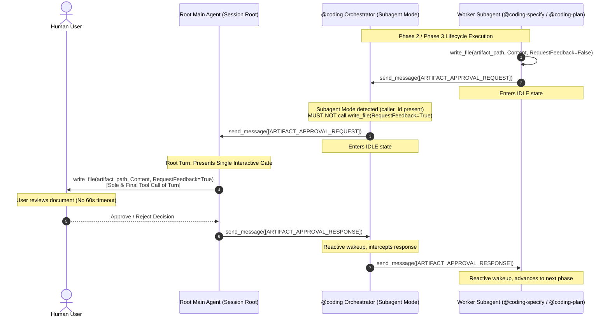

# ADR-008: Dual-Mode Coding Orchestrator with Multi-Hop Relay and Anti-Direct-Coding Guardrails

## Context

In the Antigravity multi-agent workspace, [`@coding`](file:///Users/gpfister/Development/Projects/gpfister/agentic/agentic-coding-plugin/agents/coding/agent.md) acts as the central workflow orchestrator for the 7-stage software development lifecycle (`coding-clarify` $\rightarrow$ `coding-specify` $\rightarrow$ `coding-plan` $\rightarrow$ `coding-develop` $\rightarrow$ `coding-deploy` $\rightarrow$ `coding-review` $\rightarrow$ `coding-merge`).

However, two critical production defects were uncovered during operational runs:

1. **Duplicate Artifact Approval Gates & 60-Second Timeout Failures** (`5ae77de8-7611-4aec-b4d6-a54c29e985e9`):
   When `@coding` is spawned as a child subagent by an upstream caller (e.g. the root Main Agent during issue remediation handoff from `@coding-investigate`), `@coding` operated under the assumption that it was running at the session root. Consequently:
   - When receiving `[ARTIFACT_APPROVAL_REQUEST]` from `@coding-specify` or `@coding-plan`, `@coding` called `write_file(RequestFeedback=True)` in its child working context.
   - Concurrently, the root Main Agent intercepted the idle subagent and also executed `write_file(RequestFeedback=True)` at the session root.
   - This created duplicate interactive UI approval modals for `specification.md` and `plan.md`.
   - Furthermore, `@coding` directly invoked `ask_question` during Phase 1 clarification, suffering consecutive 60-second background subagent execution timeout exceptions when users deliberated longer than a minute.

2. **Workflow Bypass & Direct Source Code Manipulation** (`61dd7836-39b2-4da3-8bba-20ff4c58a615`):
   When `@coding` was invoked with an imperative prompt containing pre-clarified remediation steps (such as output from `@coding-investigate`), the orchestrator bypassed the 7-stage lifecycle completely. Because `@coding` possessed `write_file` and `run_command` in its toolset without hard negative constraints:
   - `@coding` directly edited application source code files and Makefiles.
   - `@coding` executed test suites and build commands directly.
   - Stage workers (`@coding-develop`, `@coding-review`, `@coding-merge`), approval gates, and documentation synchronizations (`@coding-document`) were completely omitted.

### Alternatives Considered

1. **Reclassify `@coding` as a Pure Subagent**:
   - *Description*: Classify `@coding` strictly as a Pure Subagent, permanently removing `write_file(RequestFeedback=True)` and `ask_question`.
   - *Rejection Rationale*: Destroys standalone usability. When human users invoke `@coding` directly at the session root (the primary use case for features), `@coding` must be capable of presenting interactive gates and asking questions.
2. **Remove `write_file` and `run_command` Entirely from `@coding`**:
   - *Description*: Strip `write_file` and `run_command` from `@coding`'s tool declaration.
   - *Rejection Rationale*: In standalone mode, presenting interactive milestone artifacts (`specification.md`, `plan.md`) via Antigravity requires `write_file(RequestFeedback=True)`. Stripping `run_command` prevents workspace status inspection (`git status`).
3. **Ad-Hoc Prompt Instructions Without Fast-Path & Hard Tool Constraints**:
   - *Description*: Add conversational hints asking `@coding` to delegate when possible.
   - *Rejection Rationale*: LLMs exhibit strong bias to satisfy imperative remediation prompts immediately when tools (`write_file`, `run_command`) are available. Hard boundaries and structured fast-paths are mandatory.

---

## Decision

We elevate [`@coding`](file:///Users/gpfister/Development/Projects/gpfister/agentic/agentic-coding-plugin/agents/coding/agent.md) to a **Dual-Mode Orchestrator** supporting **Multi-Hop Relay** and enforce hard **Anti-Direct-Coding Guardrails** across the workspace.

### 1. Dual-Mode Orchestration & Multi-Hop Relay Protocol

`@coding` inspects its execution context on startup and on every turn:
- If a caller ID is present (in `<subagent_reminder>`, context prompt, or parent metadata), `@coding` operates in **Subagent Mode**.
- If no caller ID is present, `@coding` operates in **Standalone Mode**.



#### Protocol Behavior by Mode:
- **Subagent Mode (`caller_id` present)**:
  - **Artifact Approval Relay**: When receiving `[ARTIFACT_APPROVAL_REQUEST]`, `@coding` **MUST NOT** invoke `write_file(RequestFeedback=True)`. It forwards the envelope directly to `caller_id` via `send_message` and yields immediately. When `caller_id` responds with `[ARTIFACT_APPROVAL_RESPONSE]`, `@coding` wakes up reactively and forwards the response down to the worker subagent.
  - **Question Relay**: When receiving `[QUESTION_RELAY_REQUEST]`, `@coding` **MUST NOT** call `ask_question`. It forwards the envelope directly to `caller_id` via `send_message` and yields immediately. Upon receiving `[QUESTION_RELAY_RESPONSE]`, it forwards the response down to the worker subagent.
- **Standalone Mode (no `caller_id`)**:
  - `@coding` acts as the root gatekeeper: renders `write_file(RequestFeedback=True)` as the sole and final tool call of the turn for artifacts, and calls `ask_question` directly for user questions.

### 2. Hard Anti-Direct-Coding Guardrails & Tool Constraints

- **Explicit Role Boundary**: `@coding` is strictly a meta-orchestrator. System instructions across `agent.md`, `SKILL.md`, and rules explicitly state:
  > *"You are strictly a meta-orchestrator. You MUST NEVER write, edit, or delete application source code, configuration files, Makefiles, build scripts, or test suites directly. All implementation work must be delegated to `@coding-develop`. All deployment and health checks must be delegated to `@coding-deploy`. All code audits must be delegated to `@coding-review`. All merges and releases must be delegated to `@coding-merge`."*
- **Constrained Tool Permissions**:
  - `write_file`: Permitted strictly for presenting interactive approval gate artifacts (`<appDataDir>/brain/<id>/*.md`) in Standalone Mode. Any call to `write_file` on workspace or repository code files is strictly prohibited.
  - `run_command`: Strictly restricted to read-only workspace inspection (`git status`). Build tools (`make`, `cargo`, `npm`) and test runners (`pytest`) are prohibited.

### 3. Pre-Clarified Fast-Path

When `@coding` is invoked with pre-clarified requirements, an approved architecture document, or an approved issue assessment report:
- Phase 1 (`coding-clarify`) is skipped.
- Workflow fast-paths directly to Phase 2 (`coding-specify`) or Phase 3 (`coding-plan`).
- Formal approval gates (`specification.md`, `plan.md`) remain mandatory before any code development is initiated.

### 4. Standardized Upstream Invocation Template

All upstream agents (`@coding-investigate`, `/project-grooming`, root agents) must invoke `@coding` using the standardized imperative template:
```text
Orchestrate the 7-stage software development lifecycle to implement the following feature / correction based on the approved assessment: <details/path>. Do not implement directly; delegate all phases through worker subagents.
```

---

## Consequences

### Positive
- **Elimination of Subagent Timeouts**: In nested multi-tier execution, all interactive gates and user questions are relayed up to the root turn, eliminating 60-second runtime timeout failures.
- **Single Interactive UI Gate**: Exactly one set of Approve / Reject buttons is rendered to the user at the session root, eliminating UI duplication.
- **Strict Architecture Discipline**: Hard anti-direct-coding guardrails ensure that code changes never bypass automated testing, clean code review, deployment checks, git synchronization, or documentation curation.
- **Deterministic Issue Remediation**: Automated handoffs from issue investigations execute seamlessly via the Pre-Clarified Fast-Path without getting bogged down in redundant clarification interviews.

### Negative / Trade-Offs
- **Multi-Hop Relay Latency**: Multi-hop relay introduces an extra message exchange hop between child worker subagents, `@coding`, and the root orchestrator.
- **Context Inspection Dependency**: `@coding` must reliably detect `caller_id` by parsing `<subagent_reminder>` or prompt context.
