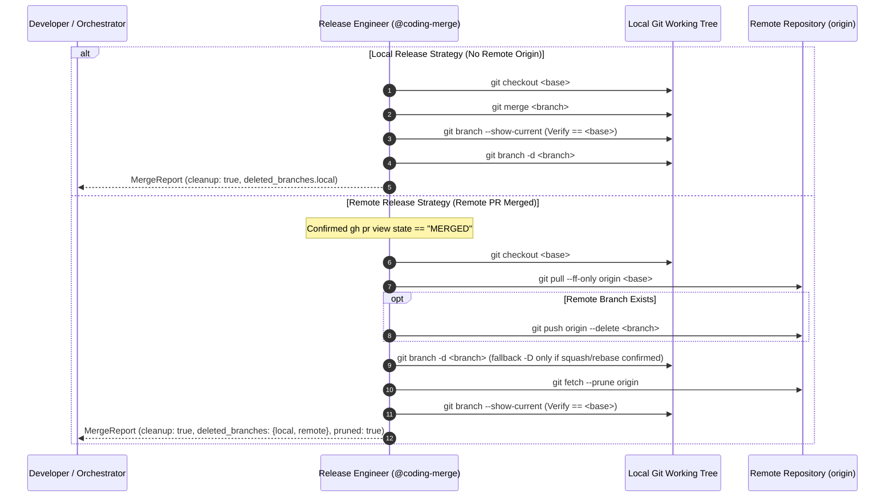

# ADR-009: Complete Branch Cleanup, Base Branch Checkout, and Remote Tracking Prune for `@coding-merge`

## Context

In the `agentic-coding-plugin` software development lifecycle, Stage 7 ([`@coding-merge`](file:///Users/gpfister/Development/Projects/gpfister/agentic/agentic-coding-plugin/agents/coding-merge/agent.md)) acts as the designated release engineer subagent, responsible for integrating verified feature branches into primary base branches (`main` or `master`) and finalizing workspace releases.

While [[architecture/adr-007-coding-merge-remote-pr-and-sync|ADR-007]] established remote Pull Request creation, the Question Relay waiting gate, and basic post-merge fast-forward pull, several critical post-merge lifecycle and hygiene gaps persisted:

1. **Local Release Strategy Leaves Stale Branches**: In local-only workflows (no remote origin configured), `@coding-merge` merged the feature branch into `<base>` but left the local feature branch intact (`cleanup: false` in `MergeReport`), causing local branch clutter across repositories over time.
2. **Remote Release Strategy Omits Remote Branch Deletion**: In remote PR workflows, after confirming that the PR is merged (`gh pr view` reports `state == "MERGED"`), `@coding-merge` pulled changes and deleted the local feature branch, but did **not** delete the remote branch on `origin` (`git push origin --delete <branch>`). Unless repository-level auto-delete was explicitly configured on GitHub/GitLab, obsolete feature branches accumulated on remotes.
3. **Dangling Remote-Tracking References**: Local git repositories did not prune obsolete remote-tracking branches (`git fetch --prune origin`). As a result, `.git/refs/remotes/origin/<branch>` lingered indefinitely, causing downstream tools (such as [`@coding-document`](file:///Users/gpfister/Development/Projects/gpfister/agentic/agentic-project-documenting-plugin/agents/coding-document/agent.md), `git branch -a`, and `git-status.md`) to report stale branch topologies.
4. **Non-Guaranteed Base Branch State**: Previous instructions did not formally verify that the working directory returned to and remained checked out on the base branch (`main` or `master`), risking detached or feature-branch execution in subsequent lifecycle tasks.

### Alternatives Considered

1. **Rely Exclusively on GitHub Repository-Level Auto-Delete Settings**:
   - *Description*: Rely on GitHub repository settings to automatically delete head branches upon PR merge.
   - *Rejection Rationale*: Fails in local-only environments, fails across GitLab/Bitbucket or self-hosted Git setups without default auto-delete, and still leaves local tracking branches unpruned (`origin/<branch>`).
2. **Destructive Pruning Without Ancestry Checks (`git branch -D`)**:
   - *Description*: Force delete all branches without verifying merge status or commit ancestry.
   - *Rejection Rationale*: Violates safety-first principles. Force deletion risks unrecoverable code loss if a branch was prematurely targeted before merge completion.
3. **Comprehensive Deterministic Cleanup & Remote Prune Protocol (Selected)**:
   - *Description*: Mandate that `@coding-merge` strictly switches back to the base branch in all execution paths, performs safe local branch deletion (`git branch -d`) across both Local and Remote release strategies, deletes remote branches idempotently (`git push origin --delete <branch>`), executes `git fetch --prune origin`, and emits comprehensive `MergeReport` metadata with `cleanup: true`, `deleted_branches`, and `pruned: true`.

---

## Decision

We formalize and mandate the **Complete Branch Cleanup, Base Branch Checkout, and Remote Tracking Prune Protocol** for Stage 7 ([`@coding-merge`](file:///Users/gpfister/Development/Projects/gpfister/agentic/agentic-coding-plugin/agents/coding-merge/agent.md)) across both Local and Remote release strategies.



### 1. Local Release Strategy Cleanup Specification

When no remote origin is configured (`git remote -v` is empty):
1. **Checkout Base Branch**: `git checkout <base>` (e.g. `main` or `master`).
2. **Merge Feature Branch**: `git merge <branch>`.
3. **Verify Working Tree**: Execute `git branch --show-current` to ensure the active branch is `<base>`.
4. **Delete Local Feature Branch**: Execute `git branch -d <branch>`.
5. **Emit Structured Report**: Return `MergeReport` with `cleanup: true`:
   ```json
   {
     "status": "merged",
     "strategy": "local",
     "base_branch": "<base>",
     "merged_branch": "<branch>",
     "cleanup": true,
     "deleted_branches": {
       "local": "<branch>"
     }
   }
   ```

### 2. Remote Release Strategy Complete Cleanup & Synchronization Specification

When a remote is configured (`origin`) and the Pull Request is confirmed merged (`gh pr view` reports `state == "MERGED"`):
1. **Checkout Base Branch**: `git checkout <base>`.
2. **Fast-Forward Remote Commits**: `git pull --ff-only origin <base>`.
3. **Delete Remote Feature Branch**:
   - Check if remote branch exists: `git ls-remote --heads origin <branch>`.
   - If present, delete remote branch: `git push origin --delete <branch>`.
   - If already deleted (e.g. by GitHub auto-delete head branches), handle idempotently without error.
4. **Delete Local Feature Branch**:
   - Safely delete local branch: `git branch -d <branch>`.
   - In squash-merge or rebase-merge PR scenarios where git cannot detect direct ancestry, fallback to `git branch -D <branch>` strictly after verifying that PR `state == "MERGED"` and the base branch has pulled the merged commit.
5. **Prune Remote-Tracking References**:
   - Execute `git fetch --prune origin` to purge stale `origin/<branch>` references from `.git/refs/remotes/origin/`.
6. **Verify Working Tree**: Execute `git branch --show-current` to ensure the active branch is `<base>`.
7. **Emit Structured Report**: Return `MergeReport` with `cleanup: true`, `deleted_branches`, and `pruned: true`:
   ```json
   {
     "status": "merged",
     "strategy": "remote_pr",
     "pr_number": "<pr_number>",
     "pr_url": "<pr_url>",
     "base_branch": "<base>",
     "merged_branch": "<branch>",
     "cleanup": true,
     "deleted_branches": {
       "local": "<branch>",
       "remote": "<branch>"
     },
     "pruned": true
   }
   ```

### 3. Safety Boundaries & Guardrails

- **Merge Confirmation Prerequisite**: No local or remote feature branch may be deleted before merge completion is definitively confirmed (`git merge` exit code 0 for local; `gh pr view` reports `state == "MERGED"` for remote).
- **Safe Deletion Precedence**: `git branch -d` must always be attempted first. Force deletion (`-D`) is restricted exclusively to confirmed squash/rebase PR merges where linear git history is rewritten.
- **Idempotent Operations**: Remote deletion and pruning must not fail the release pipeline if the remote branch was pre-deleted by remote repository automation or if network connectivity is intermittent.

---

## Consequences

### Positive
- **Zero Branch Accumulation**: Eliminates stale local and remote branch proliferation across all projects and companion plugins.
- **Accurate Git Status Tracking**: Running `git fetch --prune origin` guarantees that `git branch -a`, git status inspection, and `@coding-document` vault reports reflect true repository topologies.
- **Pristine Working Trees**: Enforces that repositories conclude on the primary base branch (`main`/`master`) in all paths, preventing downstream subagents from executing on obsolete feature branches.
- **Complete Auditability**: Structured `MergeReport` explicitly logs both local and remote branch deletion and remote prune status.

### Negative / Trade-Offs
- **Network Operations**: Adding `git push origin --delete` and `git fetch --prune origin` requires network I/O with the remote git host during the final phase.
- **Squash-Merge Handling**: Requires defensive fallback logic (`-D`) when git ancestry checks fail despite confirmed PR merge status.

---

## Related Notes & Documentation

- **Technical Specification**: [`specification.md`](file:///Users/gpfister/.gemini/antigravity/brain/c00e61a0-f612-484f-a3b5-8aba9aa3366a/specification.md) ([Vault Archive](file:///Users/gpfister/Development/Projects/gpfister/agentic/agentic-obsidian/sessions/attachments/c00e61a0-f612-484f-a3b5-8aba9aa3366a/specification.md))
- **Implementation Plan**: [`plan.md`](file:///Users/gpfister/.gemini/antigravity/brain/c00e61a0-f612-484f-a3b5-8aba9aa3366a/plan.md) ([Vault Archive](file:///Users/gpfister/Development/Projects/gpfister/agentic/agentic-obsidian/sessions/attachments/c00e61a0-f612-484f-a3b5-8aba9aa3366a/plan.md))
- **Architecture Plan Note**: [[architecture/coding-merge-complete-branch-cleanup-and-remote-sync|Complete Branch Cleanup & Remote Synchronization Architecture Plan]]
- **Feature Specification Note**: [[features/coding-merge-complete-branch-cleanup-and-remote-sync|Feature: Complete Branch Cleanup & Remote Synchronization for @coding-merge]]
- **Related ADRs**:
  - [[architecture/adr-007-coding-merge-remote-pr-and-sync|ADR-007: Remote PR Creation, Question Relay Waiting Gate, and Post-Merge Synchronization for @coding-merge]]
  - [[architecture/adr-008-dual-mode-coding-orchestrator|ADR-008: Dual-Mode Coding Orchestrator with Multi-Hop Relay and Anti-Direct-Coding Guardrails]]
