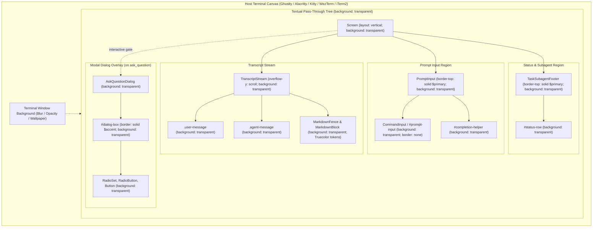

# ADR-009: TUI Transparent Pass-Through Rendering Architecture

> [!NOTE] Architecture Status: Accepted & Released in Master
> - **Status**: Accepted & Released
> - **Review Verdict**: **PASSED** (`[REVIEW_VERDICT_PASSED]`)
> - **Specification**: `SPEC-TUI-TRANSPARENCY-001`
> - **Target Repository**: [`agentic-coding-tui`](file:///Users/gpfister/Development/Projects/gpfister/agentic/agentic-coding-tui/) (branch: `master`, commits: [`4dea5b5`](file:///Users/gpfister/Development/Projects/gpfister/agentic/agentic-coding-tui/), [`e9e187f`](file:///Users/gpfister/Development/Projects/gpfister/agentic/agentic-coding-tui/))
> - **Verification**: 30/30 automated unit tests passing on `master` (100%), clean `ruff` linter/formatter.
> - **Release Tracking**: [[features/transparent-terminal-background|Feature Note]], [[changelog|Workspace Release Changelog]]

## Context

Developers running [`agentic-coding-tui`](file:///Users/gpfister/Development/Projects/gpfister/agentic/agentic-coding-tui/) frequently utilize GPU-accelerated, modern terminal emulators (e.g., Ghostty, Kitty, Alacritty, WezTerm, iTerm2) configured with customized background opacity and blur shaders. 

By default, Textual and Pygments render opaque background rectangles across the widget hierarchy:
1. `Screen` and scroll containers paint solid `$background` or `$surface` colors.
2. `MarkdownFence` and code block containers emit solid rectangular background blocks that obscure the underlying terminal canvas.
3. Input widgets (`Input`, `CommandInput`) paint solid backgrounds during idle and focus states.
4. Modal dialog screens (`ModalScreen`) draw dark semi-opaque dimming overlays that clip host terminal aesthetics.

To deliver a polished developer experience, the TUI must establish a unified **100% Transparent Pass-Through** rendering architecture while preserving Truecolor syntax highlighting, agent badge colors, and crisp spatial structure without solid box fills.

---

## Decision

We establish the following architectural invariants and styling standards for `agentic-coding-tui`:

### 1. 100% Pass-Through Transparency Across All Textual Widgets
All Textual screens, containers, scroll views, and interactive controls must explicitly declare `background: transparent;`. No widget may declare solid background colors (e.g. `$surface`, `$background`, `#1e1e1e`, `black`, `rgb(...)`, or `rgba(...)` with non-zero alpha).

### 2. Truecolor Syntax Highlighting Preservation
The TUI operates in 24-bit Truecolor mode (`ansi_color=False`). Textual `Markdown` and `MarkdownFence` components must override default theme background fills with `background: transparent;` without altering token foreground styles (keywords, strings, operators, comments). Code fences float directly over the terminal canvas without solid bounding boxes.

### 3. Structural Demarcation via Minimal Single-Line Dividers
In place of heavy container backgrounds, spatial layout is bounded solely by crisp single-character line borders:
- **`PromptInput`**: bounded by `border-top: solid $primary;`
- **`TaskSubagentFooter`**: bounded by `border-top: solid $primary;`
- **`AskQuestionDialog` (`#dialog-box`)**: bounded by `border: solid $accent;`
- **Input Fields (`#prompt-input`)**: borderless (`border: none;`) across both idle and `:focus` pseudo-classes to avoid rectangular focus boxes.

### 4. Minimalist Clean Aesthetics
Decorative icons and emojis are strictly avoided in headers, status bars, and notifications. Agent identities and workflow phases are represented using crisp typographic tokens (`$accent`, `$primary`, `$text`, `$text-muted`).

### 5. Automated Verification via Static CSS Contracts and Headless Pilot Tests
All styling rules are enforced and guarded against regression via automated test suites in [`tests/test_ui.py`](file:///Users/gpfister/Development/Projects/gpfister/agentic/agentic-coding-tui/tests/test_ui.py):
- Static CSS property inspection on `AgenticCodeTUIApp.CSS`, `TranscriptStream.DEFAULT_CSS`, `PromptInput.DEFAULT_CSS`, `TaskSubagentFooter.DEFAULT_CSS`, and `AskQuestionDialog.DEFAULT_CSS`.
- Asynchronous headless Textual lifecycle execution via `AgenticCodeTUIApp.run_test()` to verify clean widget mounting and layout calculations.

---

## Consequences

### Positive
- **Host Harmony**: Delivers seamless visual coherence with user-configured terminal opacity, blur shaders, and desktop themes across Ghostty, Kitty, Alacritty, and iTerm2.
- **Zero Solid Box Clipping**: Eliminates jarring opaque rectangles around syntax-highlighted code fences and input boxes.
- **Enhanced Focus**: Minimalist single-line borders maintain spatial orientation without visual clutter or distraction.
- **Architectural Traceability**: Formalized in `SPEC-TUI-TRANSPARENCY-001` and verified by automated unit tests.

### Negative & Mitigations
- **Variable Contrast Dependency**: Text legibility partially depends on the user's terminal emulator font contrast and desktop wallpaper luminance.
  - *Mitigation*: Text color tokens (`$text`, `$accent`, `$primary`) are selected for high luminance and contrast ratios, ensuring legibility on both dark and translucent backdrops.
- **CSS Precedence in Textual**: Built-in Textual widget defaults (such as `MarkdownFence` or `Input:focus`) can re-introduce background fills if selectors are not specific.
  - *Mitigation*: Explicit widget and ID selectors with automated CSS assertions in `tests/test_ui.py` prevent styling regressions.

---

## Related References
- Specification: `SPEC-TUI-TRANSPARENCY-001`
- Feature Note: [[features/transparent-terminal-background|Transparent Terminal Background in agentic-coding-tui]]
- Companion ADR: [[architecture/adr-008-agentic-code-tui-architecture|ADR-008: Agentic Coding TUI Architecture]]
- Target Repository: [`agentic-coding-tui`](file:///Users/gpfister/Development/Projects/gpfister/agentic/agentic-coding-tui/)
