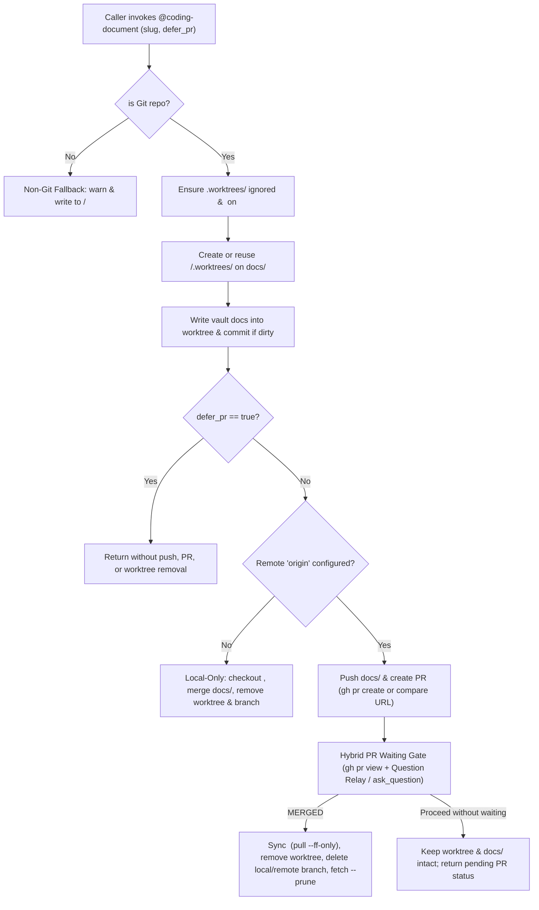

# ADR-016: Obsidian Vault Git Worktree & PR Lifecycle for `@coding-document`

## Context

Under [[architecture/adr-011-worktree-based-development-lifecycle|ADR-011]] and [[architecture/adr-012-exclusive-code-change-authority|ADR-012]], code repositories enforce isolated Git worktrees (`.worktrees/<slug>`) and a strict primary-repository invariant (`main`/`master` always checked out) via `@coding-develop` and `@coding-merge`. However, `@coding-document` (in `agentic-project-documenting-plugin`) previously wrote directly to the primary `*-obsidian/` working tree without worktree isolation, incremental commits, PR creation, or branch cleanup.

Writing directly to the primary `*-obsidian/` working tree caused dirty working trees on `main`/`master`, mixed documentation changes from concurrent or multi-phase tasks, and bypassed version-control review.

### Alternatives Considered

1. **Delegate `*-obsidian/` Git Operations to `@coding-merge`**:
   - *Rejection Rationale*: Couples `@coding-merge` (scoped to code repositories) with documentation-only vaults and breaks single-shot callers (`@coding-design`, `@coding-investigate`, `@coding-research`, `@coding-monitor`, direct user invocations) that do not run `@coding-merge`.
2. **Write Directly to `<vault_root>` Without Worktrees**:
   - *Rejection Rationale*: Violates the primary-repository `main`/`master` invariant and risks concurrent edit collisions.
3. **Self-Managed `*-obsidian/` Worktree & PR Lifecycle in `@coding-document` with `defer_pr` Accumulation (Selected)**:
   - *Rationale*: Keeps `<vault_root>` strictly on `main`/`master`, isolates edits in `<vault_root>/.worktrees/<slug>` on `docs/<slug>`, supports multi-phase `@coding` accumulation via `defer_pr`, handles single-shot callers immediately, and uses the Dual-Mode Question Relay Protocol (`[QUESTION_RELAY_REQUEST]` / `[QUESTION_RELAY_RESPONSE]`) for non-blocking PR waiting gates.

---

## Decision

We formalize the **Obsidian Vault Git Worktree & PR Lifecycle** in `agentic-project-documenting-plugin` and `agentic-coding-plugin`:

### Key Architectural Rules

1. **Self-Managed Ownership (`FR-1`)**: `@coding-document` self-manages the entire `*-obsidian/` Git lifecycle. `@coding-merge` remains scoped exclusively to code repositories.
2. **Worktree Isolation & Branching (`FR-2`)**:
   - `<vault_root>` (`*-obsidian/`) MUST remain checked out on `<base>` (`main` or `master`) at all times.
   - Isolated worktree path: `<vault_root>/.worktrees/<slug>` on branch `docs/<slug>`.
   - `.worktrees/` MUST be ignored via `.gitignore` or `.git/info/exclude`.
   - All `write_file` vault writes target `<vault_root>/.worktrees/<slug>/...` (except under Non-Git Fallback).
3. **Multi-Phase `@coding` Accumulation (`FR-3`, `defer_pr`)**:
   - `@coding` passes a consistent `slug` and `defer_pr=true` on **Post-Plan** and **Pre-Merge** hooks (commit incrementally, keep worktree, no push/PR), and `defer_pr=false` on the **Post-Merge** hook (commit final status/changelog and execute Release & Cleanup).
4. **Single-Shot Callers (`FR-4`)**: `@coding-design`, `@coding-investigate`, `@coding-research`, `@coding-monitor`, and direct user invocations default to `defer_pr=false` and execute the full Release & Cleanup Strategy in one invocation.
5. **Release & Cleanup Strategies (`FR-5`)**:
   - **Remote (`origin` configured)**: `git push -u origin docs/<slug>`, `gh pr create` (or GitHub compare URL fallback), **Hybrid PR Waiting Gate** (`gh pr view`, never `sleep`/poll), and **Post-Merge Base Sync & Cleanup** (`checkout <base>`, `pull --ff-only`, `worktree remove` + `worktree prune`, idempotent remote branch delete via `ls-remote`, `branch -d`, `fetch --prune`).
   - **Local-Only (no remote)**: `checkout <base>`, `merge docs/<slug>`, `worktree remove` + `prune`, `branch -d docs/<slug>`.
   - **Non-Git Fallback**: Emit warning and write directly to `<vault_root>/...`.
6. **Dual-Mode Question Relay (`FR-6`) & Tool Boundaries (`NFR-2`)**:
   - In Subagent Mode (`caller_id` present), `@coding-document` relays all prompts via `[QUESTION_RELAY_REQUEST]` / `[QUESTION_RELAY_RESPONSE]` (and `@coding` forwards them in multi-hop Subagent Mode or calls `ask_question` in Standalone Mode).
   - `edit_file` remains strictly prohibited on `@coding-document`; `run_command` is scoped to read-only code-repo inspection, `scripts/sync_sessions.py`, and `*-obsidian/` git/PR lifecycle commands.

---

## Consequences

- **Positive:**
  - Enforces the primary-repository `main`/`master` invariant across `*-obsidian/` vaults.
  - Consolidates multi-phase `@coding` documentation (Post-Plan, Pre-Merge, Post-Merge) into a single clean PR.
  - Prevents 60-second subagent timeouts via non-blocking Hybrid PR Waiting Gate and Question Relay.
- **Negative:**
  - Adds Git worktree/PR steps to `@coding-document` invocations when `*-obsidian/` is a Git repository.
- **Risks:**
  - *Risk*: Unmerged PRs when the user selects "Proceed without waiting" leave `.worktrees/<slug>` on disk.
  - *Mitigation*: `@coding-document` intentionally preserves the worktree/branch so the open PR is not orphaned and returns a structured `pending_approval: true` status with the PR URL and worktree path.
