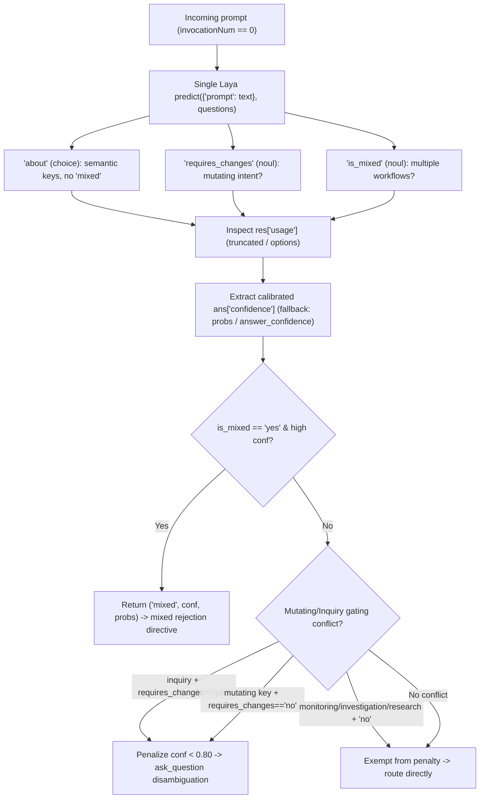

# ADR-017: Semantic Laya Triage & Parallel `choice` + `noul` Decomposition

## Context

[`agentic-prompt-triage-plugin`](file:///Users/gpfister/Development/Projects/gpfister/agentic/agentic-prompt-triage-plugin) routes incoming user prompts in [`hooks/prompt_triage.py`](file:///Users/gpfister/Development/Projects/gpfister/agentic/agentic-prompt-triage-plugin/hooks/prompt_triage.py) using Laya Router System 1 non-autoregressive classification. Previously, `evaluate_system1_triage` submitted a single `choice` question (`TRIAGE_QUESTION = "What is this prompt about ?"`) over opaque numbered criteria keys (`response 1` .. `response 9`), including a bloated `mixed` catch-all option.

This design exhibited five structural weaknesses:
1. **Opaque keys (`response 1`..`response 9`)** gave the model no semantic anchor and coupled option ordering to installed plugin combinations.
2. **Unanchored passive instruction** (`"What is this prompt about ?"`) did not reference the state key (`` `prompt` ``) or frame the decision around single-agent routing.
3. **Bloated `mixed` catch-all option** enumerated every active capability in a single long string, diluting probability mass and increasing token truncation risk.
4. **Single-question classification** could not independently verify whether a prompt requested file/code/design/doc mutations (`requires_changes`) or combined multiple workflows (`is_mixed`).
5. **Uninspected `usage` and uncalibrated confidence**: `res.get("usage", {})` was not checked for `truncated` or `options` collisions, and `probs.get(choice, ans.get("answer_confidence", 0.0))` was read before Laya's calibrated `confidence` field.

### Alternatives Considered

1. **Keep Numbered `response 1`..`response 9` Keys and Tune Descriptions**:
   - *Rejection Rationale*: Preserves opaque label-to-intent indirection, retains the token-heavy `mixed` catch-all inside `choice`, and cannot cross-check mutating vs. read-only intent.
2. **Sequential Multi-Turn Laya Calls (Classify Intent, Then Check `requires_changes` / `is_mixed`)**:
   - *Rejection Rationale*: Multiplies hook latency on every user prompt (`invocationNum == 0`).
3. **Semantic Criteria Keys + Single-Pass Parallel `choice` & `noul` Decomposition (Selected)**:
   - *Rationale*: Anchors Laya on meaningful semantic keys (`inquiry`, `coding`, `monitoring`, `investigation`, `research`, `documentation`, `grooming`, `design`), removes `mixed` from `choice`, evaluates `"about"` (`choice`), `"requires_changes"` (`noul`), and `"is_mixed"` (`noul`) in a **single** `self._router.predict({"prompt": text}, questions)` forward pass, and combines calibrated confidence + `usage` diagnostics in Python post-processing.

---

## Decision

We adopt **Semantic Laya Triage & Parallel `choice` + `noul` Decomposition** in `agentic-prompt-triage-plugin`:

### Key Architectural Rules

1. **Semantic `criteria` Keys & Action-Oriented Descriptions (`FR-1`)**:
   - Replace `response 1`..`response 9` with semantic keys: `inquiry` (always enabled, mapped to intent `"question"`), `coding`, `monitoring`, `investigation`, `research`, `documentation`, `grooming`, and `design`.
   - Remove `mixed` from `spec.responses` (`choice` criteria) while retaining `response_to_intent["mixed"] = "mixed"` and `response_to_directive["mixed"]`.
   - Update `_heuristic_system1_triage` and `triage()` fallback key from `"response 1"` to `"inquiry"`.
2. **Single-Pass Parallel `choice` + `noul` Decomposition (`FR-2`)**:
   - Submit `"about"` (`choice`), `"requires_changes"` (`noul`), and `"is_mixed"` (`noul`) in one `self._router.predict({"prompt": text}, questions)` call (omitting/ignoring `is_mixed` when `len(self.triage_responses) <= 1`).
   - Treat `is_mixed == "yes"` with high confidence (`>= CONFIDENCE_THRESHOLD`) as `"mixed"`.
   - Gate mutating keys (`MUTATING_AGENTS = frozenset({"coding", "documentation", "grooming", "design"})`) against `requires_changes == "no"`, and `inquiry` against `requires_changes == "yes"`, capping confidence below `CONFIDENCE_THRESHOLD` (`0.80`) to trigger `ask_question` disambiguation.
   - Exempt non-mutating specialized agents (`NON_MUTATING_AGENTS = frozenset({"monitoring", "investigation", "research"})`) from `requires_changes == "no"` gating.
3. **State-Key-Anchored Instructions (`FR-3`)**:
   - `TRIAGE_QUESTION = "Which single agent or action should handle `prompt`?"`
   - Both `noul` questions (`REQUIRES_CHANGES_QUESTION`, `IS_MIXED_QUESTION`) explicitly reference `` `prompt` ``.
4. **Usage Diagnostics, Calibrated Confidence & Model Selection (`FR-4`, `FR-5`)**:
   - Inspect `res.get("usage", {})` via `_inspect_usage` for `truncated` / `truncated_questions` and `options` collisions/mismatches, logging structured `logger.warning` messages.
   - Prefer `ans.get("confidence")` before falling back to `probs.get(choice, ans.get("answer_confidence", 0.0))`.
   - Empirical evaluation via `scripts/eval_laya_triage.py` selected the **`default` Laya Router (`Router(preload=False)`, `model=None`)** over `typed-decisions`; `LayaTriageEngine.__init__` is configured with `Router(preload=False)` as the default.

---

## Implementation & Verification

- **Pull Request / Commit**: Merged into `main` via [PR #2](https://github.com/gpfister/agentic-prompt-triage-plugin/pull/2) at `ff5a3ae` in [`agentic-prompt-triage-plugin`](file:///Users/gpfister/Development/Projects/gpfister/agentic/agentic-prompt-triage-plugin); `.worktrees/semantic-laya-triage` and `feature/semantic-laya-triage` (local & remote) cleaned up and pruned.
- **Unit & Plugin Tests (`uv run pytest -v`)**: `101/101` passed (`tests/test_plugin.py`: 12 passed; `tests/test_prompt_triage.py`: 89 passed).
- **CLI Smoke Test**: `echo '{"prompt": "Explain how prompt_triage.py works", "invocationNum": 0}' | uv run python hooks/prompt_triage.py` exited `0` (`{"injectSteps": []}`).
- **QA Review**: [`review-semantic-laya-triage.md`](file:///Users/gpfister/.gemini/antigravity/brain/d960a873-bd14-41ff-926f-3b099ca59e43/review-semantic-laya-triage.md) — **PASS** with zero unplanned changes.

---

## Consequences

- **Positive:**
  - Eliminates opaque numeric label coupling and removes the token-heavy `mixed` catch-all from `choice`.
  - Preserves single-forward-pass System 1 latency while adding independent verification of mutating intent and multi-workflow prompts.
  - Surfaces silent Laya prompt truncation and option collisions via `usage` warnings and improves confidence calibration.
  - Empirical evaluation confirmed `default` (`Router(preload=False)`) outperforms `typed-decisions`, avoiding unnecessary model overrides.
- **Negative:**
  - Adds two `noul` questions to each Laya `predict` call and required updating existing unit test assertions from `response 1`..`response 9` to semantic keys.
- **Risks:**
  - *Risk*: Older or mocked `laya` responses may omit `requires_changes`, `is_mixed`, or `ans["confidence"]`.
  - *Mitigation*: Missing `noul` answers are treated as neutral (no gating penalty or mixed override), and confidence extraction falls back cleanly to `probs.get(choice, ans.get("answer_confidence", 0.0))`.
