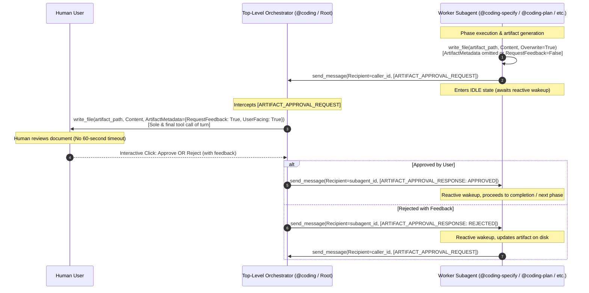
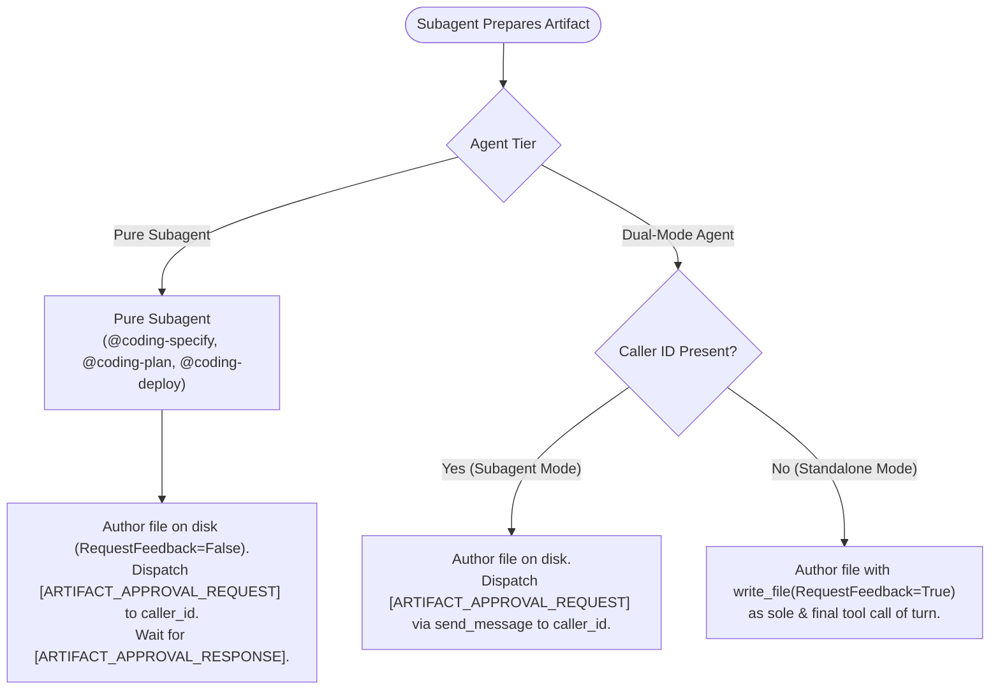

# Artifact Approval Relay Protocol Architecture & Implementation Plan

## 1. Executive Summary & Problem Formulation

### 1.1 Problem Statement
In Google Antigravity, background worker subagents spawned via `invoke_subagent` run in asynchronous execution turns managed by the host runtime. Subagents are bound by a rigid **60-second execution timeout** on each turn.

The workspace previously resolved interactive human-in-the-loop interrogation timeouts by introducing the **Question Relay Protocol** ([[architecture/adr-005-question-relay-protocol|ADR-005]]), ensuring that prompts requiring user deliberation are executed at the session root turn without timeout constraints.

However, an identical failure mode occurs during interactive approval gates:
When worker subagents (`@coding-specify`, `@coding-plan`, `@coding-deploy`, `@coding-investigate`, `@coding-groom`, `@coding-research`) author deliverables requiring human sign-off (`specification.md`, `plan.md`, `deployment-issue.md`, `issue-assessment.md`, `Project_Request_Grooming.md`, `research-report.md`) using `write_file` with `ArtifactMetadata={"RequestFeedback": True, "UserFacing": True}`, the interactive Approve/Reject buttons and feedback input box are rendered within the subagent's execution turn.

If human users review complex architectural specifications, plans, or research reports for longer than 60 seconds before clicking **Approve** or providing revision feedback, the runtime throws a timeout exception, prematurely terminating the workflow and losing intermediate progress. Furthermore, nested approval gates can suffer from UI visibility degradation in complex agent hierarchies.

Conversely, top-level orchestrators (`@coding` and root user conversation turns) run without background execution timeouts and can await user input indefinitely.

### 1.2 Proposed Architecture: Artifact Approval Relay Protocol
Standardize the **Artifact Approval Relay Protocol** across all agentic plugins and workspace guidelines, mirroring the proven architecture of the Question Relay Protocol:
1. Subagents author the deliverable directly to the session artifact directory (`<appDataDir>/brain/<conversation-id>/<artifact_name>`) **without** `RequestFeedback=True` (or with `ArtifactMetadata` omitted).
2. Subagents dispatch an `[ARTIFACT_APPROVAL_REQUEST]` envelope to their parent orchestrator (`caller_id`) via `send_message` and enter an idle state.
3. The parent orchestrator presents the artifact to the human user using `write_file` with `ArtifactMetadata={"RequestFeedback": True, "UserFacing": True}` as the sole and final tool call of its root turn. At the root level, Antigravity waits indefinitely for user interaction without background tool timeouts.
4. When the user approves or rejects the artifact, the parent orchestrator intercepts the decision and returns an `[ARTIFACT_APPROVAL_RESPONSE]` envelope to the subagent via `send_message`.
5. The subagent wakes up reactively:
   - On approval (`status: "APPROVED"`), the subagent finalizes its phase and signals completion.
   - On rejection/revisions (`status: "REJECTED"`), the subagent parses `feedback`, updates the file on disk, and re-dispatches `[ARTIFACT_APPROVAL_REQUEST]`.



---

## 2. Standardized Message Protocol

### 2.1 Request Envelope: `[ARTIFACT_APPROVAL_REQUEST]`
Dispatched by the worker subagent to the parent orchestrator (`caller_id`):

```text
[ARTIFACT_APPROVAL_REQUEST]
```
```json
{
  "type": "ARTIFACT_APPROVAL_REQUEST",
  "artifact_name": "specification.md",
  "artifact_path": "/Users/user/.gemini/antigravity/brain/<session-id>/specification.md",
  "stage": "SPECIFICATION",
  "summary": "Detailed technical specification for feature XYZ",
  "user_facing": true
}
```

#### Field Schema
| Field | Type | Required | Description |
| :--- | :--- | :--- | :--- |
| `type` | string | Yes | Fixed value `"ARTIFACT_APPROVAL_REQUEST"`. |
| `artifact_name` | string | Yes | Base file name (`specification.md`, `plan.md`, `deployment-issue.md`, `issue-assessment.md`, `Project_Request_Grooming.md`, `research-report.md`). |
| `artifact_path` | string | Yes | Absolute filesystem path in `<appDataDir>/brain/<conversation-id>/`. |
| `stage` | string | Yes | Stage identifier (`"SPECIFICATION"`, `"PLANNING"`, `"DEPLOYMENT_ISSUE"`, `"INVESTIGATION"`, `"GROOMING"`, `"RESEARCH"`). |
| `summary` | string | Yes | Summary text passed to `ArtifactMetadata.Summary`. |
| `user_facing` | boolean | Yes | Defaults to `true`. |

### 2.2 Response Envelope: `[ARTIFACT_APPROVAL_RESPONSE]`
Dispatched by the orchestrator back to the worker subagent (`subagent_id`):

```text
[ARTIFACT_APPROVAL_RESPONSE]
```
```json
{
  "type": "ARTIFACT_APPROVAL_RESPONSE",
  "artifact_name": "specification.md",
  "status": "APPROVED",
  "feedback": ""
}
```

#### Field Schema
| Field | Type | Required | Description |
| :--- | :--- | :--- | :--- |
| `type` | string | Yes | Fixed value `"ARTIFACT_APPROVAL_RESPONSE"`. |
| `artifact_name` | string | Yes | The file name matching the corresponding request. |
| `status` | string | Yes | Outcome status: strictly `"APPROVED"` or `"REJECTED"`. |
| `feedback` | string | No | User-provided revision feedback when `status == "REJECTED"`. Empty string if `APPROVED`. |

---

## 3. Subagent Execution Tiers & Behavioral Matrix



| Agent Handle / Capability | Classification | Subagent Mode (`caller_id` present) | Standalone Mode (Root Turn) |
| :--- | :--- | :--- | :--- |
| `@coding-specify` | Pure Subagent | Writes file on disk; relays via `[ARTIFACT_APPROVAL_REQUEST]`. Never calls `RequestFeedback=True`. | N/A (Always invoked by `@coding`). |
| `@coding-plan` | Pure Subagent | Writes file on disk; relays via `[ARTIFACT_APPROVAL_REQUEST]`. Never calls `RequestFeedback=True`. | N/A (Always invoked by `@coding`). |
| `@coding-deploy` | Pure Subagent | Writes deployment issue artifact on disk; relays via `[ARTIFACT_APPROVAL_REQUEST]`. | N/A (Always invoked by `@coding`). |
| `@coding-investigate` | Dual-Mode Agent | Relays via `[ARTIFACT_APPROVAL_REQUEST]` to orchestrator. | Directly authors `issue-assessment.md` with `RequestFeedback=True` as sole & final call. |
| `/project-grooming` (`@coding-groom`) | Dual-Mode Agent | Relays via `[ARTIFACT_APPROVAL_REQUEST]` to caller orchestrator. | Directly authors `Project_Request_Grooming.md` with `RequestFeedback=True` as sole & final call. |
| `@coding-research` | Dual-Mode Agent | Relays via `[ARTIFACT_APPROVAL_REQUEST]` to caller orchestrator. | Directly authors `research-report.md` with `RequestFeedback=True` as sole & final call. |
| `@coding` (Orchestrator) | Dual-Mode Orchestrator ([[architecture/adr-008-dual-mode-coding-orchestrator\|ADR-008]]) | In Subagent Mode (`caller_id` present), relays `[ARTIFACT_APPROVAL_REQUEST]` upward to `caller_id` via `send_message` without calling `write_file(RequestFeedback=True)` (Multi-Hop Relay). | In Standalone Mode (Root Turn), intercepts `[ARTIFACT_APPROVAL_REQUEST]`, renders `write_file` with `ArtifactMetadata={"RequestFeedback": True}`, awaits user gate, replies `[ARTIFACT_APPROVAL_RESPONSE]`. |

---

## 4. Local Deployment Assessment Across Repositories

| Repository | Assessment Details | Local Deployment Requirement |
| :--- | :--- | :--- |
| **Workspace Root (`agentic`)** | No Dockerfile, docker-compose, local scripts, or container definitions found. Automation targets git repo synchronization and session extraction. | **Not Required** |
| **`agentic-coding-plugin`** | Python/Antigravity plugin with pytest test suite. No Dockerfiles, Compose specs, or containerization present. | **Not Required** |
| **`agentic-issue-investigation-plugin`** | Python/Antigravity plugin with pytest test suite. No containerization or local deployment manifests present. | **Not Required** |
| **`agentic-project-grooming-plugin`** | Python/Antigravity plugin with pytest test suite. No local deployment infrastructure present. | **Not Required** |
| **`agentic-topic-researching-plugin`** | Python/Antigravity plugin with pytest test suite. No local deployment infrastructure present. | **Not Required** |

> [!NOTE] Local Deployment Verdict
> Because no local deployment instructions or container manifests exist across the affected repositories, the `coding-deploy` step is marked as **Not Required** for all repositories in Phase 5.

---

## 5. Multi-Repository Work Breakdown

### 5.1 Repository 1: Workspace Root (`agentic`)
- **Target Git Branch**: `feature/artifact-approval-relay`
- **Local Deployment**: Not Required

#### Files to Modify
- [`AGENTS.md`](file:///Users/gpfister/Development/Projects/gpfister/agentic/AGENTS.md)

#### Implementation Steps
1. **Add Section 3.3 ("Artifact Approval Relay Protocol")**:
   - Detail the 60-second background execution timeout root cause on `write_file(RequestFeedback=True)`.
   - Embed the sequence flow Mermaid diagram visualizing Orchestrator root presentation vs Subagent background idle states.
   - Define JSON schemas and examples for `[ARTIFACT_APPROVAL_REQUEST]` and `[ARTIFACT_APPROVAL_RESPONSE]`.
   - Include the classification matrix of Pure Subagents vs. Dual-Mode Subagents.
2. **Update Section 4 ("Coding Workflow Pipeline & Decision Flowchart")**:
   - Update flowchart and phase narratives (Phase 2 specify, Phase 3 plan, Phase 5 deploy error gate) reflecting that subagents emit `[ARTIFACT_APPROVAL_REQUEST]` and `@coding` orchestrator presents the interactive gate at root level.

#### Verification
- Run git diff to ensure clean syntax and alignment:
  ```bash
  git diff AGENTS.md
  ```

---

### 5.2 Repository 2: `agentic-coding-plugin`
- **Target Git Branch**: `feature/artifact-approval-relay`
- **Local Deployment**: Not Required

#### Files to Modify
- [`rules/AGENTS.md`](file:///Users/gpfister/Development/Projects/gpfister/agentic/agentic-coding-plugin/rules/AGENTS.md)
- [`skills/coding-orchestrator/SKILL.md`](file:///Users/gpfister/Development/Projects/gpfister/agentic/agentic-coding-plugin/skills/coding-orchestrator/SKILL.md)
- [`agents/agent.md`](file:///Users/gpfister/Development/Projects/gpfister/agentic/agentic-coding-plugin/agents/agent.md)
- [`agents/coding/agent.md`](file:///Users/gpfister/Development/Projects/gpfister/agentic/agentic-coding-plugin/agents/coding/agent.md)
- [`agents/coding-specify/agent.md`](file:///Users/gpfister/Development/Projects/gpfister/agentic/agentic-coding-plugin/agents/coding-specify/agent.md)
- [`agents/coding-plan/agent.md`](file:///Users/gpfister/Development/Projects/gpfister/agentic/agentic-coding-plugin/agents/coding-plan/agent.md)
- [`agents/coding-deploy/agent.md`](file:///Users/gpfister/Development/Projects/gpfister/agentic/agentic-coding-plugin/agents/coding-deploy/agent.md)
- [`tests/test_plugin.py`](file:///Users/gpfister/Development/Projects/gpfister/agentic/agentic-coding-plugin/tests/test_plugin.py)

#### Implementation Steps
1. **Update `rules/AGENTS.md`**:
   - Add Section 7 ("Artifact Approval Relay Protocol & Approval Gates") specifying that worker subagents (`@coding-specify`, `@coding-plan`, `@coding-deploy`) must author artifacts directly to disk without `RequestFeedback=True`, dispatch `[ARTIFACT_APPROVAL_REQUEST]` to `caller_id`, and wait for `[ARTIFACT_APPROVAL_RESPONSE]`.
2. **Update `skills/coding-orchestrator/SKILL.md`**:
   - Add handling for `[ARTIFACT_APPROVAL_REQUEST]` in orchestrator lifecycle: read artifact from disk, execute `write_file(Path=artifact_path, Content=..., ArtifactMetadata={"RequestFeedback": True, "UserFacing": True})` as sole and final tool call of turn, await user decision, and dispatch `[ARTIFACT_APPROVAL_RESPONSE]` to subagent via `send_message`.
3. **Update Subagent Prompts & Catalogs**:
   - `agents/agent.md`: Document `[ARTIFACT_APPROVAL_REQUEST]` and `[ARTIFACT_APPROVAL_RESPONSE]` protocol.
   - `agents/coding/agent.md`: Add orchestrator artifact gate presentation loop.
   - `agents/coding-specify/agent.md`: Update Phase 2 instructions to write `specification.md` without `RequestFeedback=True` and dispatch `[ARTIFACT_APPROVAL_REQUEST]`.
   - `agents/coding-plan/agent.md`: Update Phase 3 instructions to write `plan.md` without `RequestFeedback=True` and dispatch `[ARTIFACT_APPROVAL_REQUEST]`.
   - `agents/coding-deploy/agent.md`: Update error handling to write `deployment-issue.md` without `RequestFeedback=True` and dispatch `[ARTIFACT_APPROVAL_REQUEST]`.
4. **Update `tests/test_plugin.py`**:
   - Add unit tests verifying `[ARTIFACT_APPROVAL_REQUEST]` and `[ARTIFACT_APPROVAL_RESPONSE]` in `agents/coding-specify/agent.md`, `agents/coding-plan/agent.md`, `agents/coding-deploy/agent.md`, `agents/coding/agent.md`, `skills/coding-orchestrator/SKILL.md`, `rules/AGENTS.md`, and `agents/agent.md`.

#### Verification
- Run test suite:
  ```bash
  cd agentic-coding-plugin && uv run pytest
  ```

---

### 5.3 Repository 3: `agentic-issue-investigation-plugin`
- **Target Git Branch**: `feature/artifact-approval-relay`
- **Local Deployment**: Not Required

#### Files to Modify
- [`rules/AGENTS.md`](file:///Users/gpfister/Development/Projects/gpfister/agentic/agentic-issue-investigation-plugin/rules/AGENTS.md)
- [`skills/coding-investigate/SKILL.md`](file:///Users/gpfister/Development/Projects/gpfister/agentic/agentic-issue-investigation-plugin/skills/coding-investigate/SKILL.md)
- [`agents/coding-investigate/agent.md`](file:///Users/gpfister/Development/Projects/gpfister/agentic/agentic-issue-investigation-plugin/agents/coding-investigate/agent.md)
- [`agents/agent.md`](file:///Users/gpfister/Development/Projects/gpfister/agentic/agentic-issue-investigation-plugin/agents/agent.md)
- [`tests/test_plugin.py`](file:///Users/gpfister/Development/Projects/gpfister/agentic/agentic-issue-investigation-plugin/tests/test_plugin.py)

#### Implementation Steps
1. **Update `rules/AGENTS.md`**:
   - Update Section 2 to specify Dual-Mode Artifact Relay Protocol for `issue-assessment.md`: Subagent Mode (`caller_id` present) writes to disk without feedback gate and relays via `[ARTIFACT_APPROVAL_REQUEST]`; Standalone Mode authors directly with `RequestFeedback=True` as sole & final call.
2. **Update `skills/coding-investigate/SKILL.md`**:
   - Update Step 3 (Approval Gate Artifact) to detail dual-mode behavior and envelope parsing.
3. **Update `agents/coding-investigate/agent.md` and `agents/agent.md`**:
   - Align instructions with dual-mode relaying and envelope handling.
4. **Update `tests/test_plugin.py`**:
   - Add tests asserting presence of `[ARTIFACT_APPROVAL_REQUEST]` and `[ARTIFACT_APPROVAL_RESPONSE]` in `agents/coding-investigate/agent.md`, `skills/coding-investigate/SKILL.md`, `rules/AGENTS.md`, and `agents/agent.md`.

#### Verification
- Run test suite:
  ```bash
  cd agentic-issue-investigation-plugin && uv run pytest
  ```

---

### 5.4 Repository 4: `agentic-project-grooming-plugin`
- **Target Git Branch**: `feature/artifact-approval-relay`
- **Local Deployment**: Not Required

#### Files to Modify
- [`rules/AGENTS.md`](file:///Users/gpfister/Development/Projects/gpfister/agentic/agentic-project-grooming-plugin/rules/AGENTS.md)
- [`skills/project-grooming/SKILL.md`](file:///Users/gpfister/Development/Projects/gpfister/agentic/agentic-project-grooming-plugin/skills/project-grooming/SKILL.md)
- [`agents/coding-groom/agent.md`](file:///Users/gpfister/Development/Projects/gpfister/agentic/agentic-project-grooming-plugin/agents/coding-groom/agent.md)
- [`agents/agent.md`](file:///Users/gpfister/Development/Projects/gpfister/agentic/agentic-project-grooming-plugin/agents/agent.md)
- [`tests/test_plugin.py`](file:///Users/gpfister/Development/Projects/gpfister/agentic/agentic-project-grooming-plugin/tests/test_plugin.py)

#### Implementation Steps
1. **Update `rules/AGENTS.md`**:
   - Update Section 3 to document dual-mode approval gate protocol for `Project_Request_Grooming.md`.
2. **Update `skills/project-grooming/SKILL.md`**:
   - Update Step 3 with Subagent Mode relay flow (`[ARTIFACT_APPROVAL_REQUEST]`) and Standalone Mode direct authoring flow.
3. **Update `agents/coding-groom/agent.md` and `agents/agent.md`**:
   - Update instructions to detect caller context and relay artifact approval requests when invoked as a subagent.
4. **Update `tests/test_plugin.py`**:
   - Add tests asserting presence of `[ARTIFACT_APPROVAL_REQUEST]` and `[ARTIFACT_APPROVAL_RESPONSE]` in `rules/AGENTS.md`, `skills/project-grooming/SKILL.md`, `agents/coding-groom/agent.md`, and `agents/agent.md`.

#### Verification
- Run test suite:
  ```bash
  cd agentic-project-grooming-plugin && uv run pytest
  ```

---

### 5.5 Repository 5: `agentic-topic-researching-plugin`
- **Target Git Branch**: `feature/artifact-approval-relay`
- **Local Deployment**: Not Required

#### Files to Modify
- [`rules/AGENTS.md`](file:///Users/gpfister/Development/Projects/gpfister/agentic/agentic-topic-researching-plugin/rules/AGENTS.md)
- [`skills/coding-research/SKILL.md`](file:///Users/gpfister/Development/Projects/gpfister/agentic/agentic-topic-researching-plugin/skills/coding-research/SKILL.md)
- [`agents/coding-research/agent.md`](file:///Users/gpfister/Development/Projects/gpfister/agentic/agentic-topic-researching-plugin/agents/coding-research/agent.md)
- [`agents/agent.md`](file:///Users/gpfister/Development/Projects/gpfister/agentic/agentic-topic-researching-plugin/agents/agent.md)
- [`tests/test_plugin.py`](file:///Users/gpfister/Development/Projects/gpfister/agentic/agentic-topic-researching-plugin/tests/test_plugin.py)

#### Implementation Steps
1. **Update `rules/AGENTS.md`**:
   - Update Section 2 to specify dual-mode artifact relay protocol for `research-report.md`.
2. **Update `skills/coding-research/SKILL.md`**:
   - Update Step 4 with dual-mode relaying specifications.
3. **Update `agents/coding-research/agent.md` and `agents/agent.md`**:
   - Add `[ARTIFACT_APPROVAL_REQUEST]` dispatch in subagent mode and direct gate authoring in standalone mode.
4. **Update `tests/test_plugin.py`**:
   - Add tests asserting presence of `[ARTIFACT_APPROVAL_REQUEST]` and `[ARTIFACT_APPROVAL_RESPONSE]` across all documentation and agent files.

#### Verification
- Run test suite:
  ```bash
  cd agentic-topic-researching-plugin && uv run pytest
  ```

---

## 6. Acceptance Criteria & Verification Summary

- [x] **AC 1: Standardized Envelopes**: `[ARTIFACT_APPROVAL_REQUEST]` and `[ARTIFACT_APPROVAL_RESPONSE]` schemas documented across rules, manifests, and guides.
- [x] **AC 2: Pure Subagent Compliance**: `@coding-specify`, `@coding-plan`, and `@coding-deploy` omit `write_file(RequestFeedback=True)`; deliverables written directly to disk and relayed via `send_message`.
- [x] **AC 3: Dual-Mode Subagent Support**: `@coding-investigate`, `@coding-groom`, and `@coding-research` dynamically branch between artifact approval relaying (`[ARTIFACT_APPROVAL_REQUEST]`) in subagent mode and direct interactive authoring in standalone mode.
- [x] **AC 4: Orchestrator Relay Loop**: `@coding` orchestrator intercepts `[ARTIFACT_APPROVAL_REQUEST]`, verifies file on disk, presents interactive gate at the root turn (`RequestFeedback=True` as sole & final call), and returns `[ARTIFACT_APPROVAL_RESPONSE]`.
- [x] **AC 5: Ecosystem Test Suite**: 100% test pass rate across all 5 participating plugin repositories with assertions verifying new relay envelopes (60/60 tests passed across feature plugins, 158/158 tests workspace-wide).
- [x] **AC 6: Workspace Documentation Consistency**: Root `AGENTS.md`, Obsidian architecture, ADR-006, and feature specifications fully synchronized.

---

## 7. Pre-Merge Verification Ledger

| Repository | Branch | Commit | Unit Tests | Verification Result |
| :--- | :--- | :--- | :--- | :--- |
| **`agentic` (root)** | `feature/artifact-approval-relay` | [`419cd50`](file:///Users/gpfister/Development/Projects/gpfister/agentic/) | Documentation & rule audit | **PASS** (AC 1 & AC 6 verified) |
| **`agentic-coding-plugin`** | `feature/artifact-approval-relay` | [`8302109`](file:///Users/gpfister/Development/Projects/gpfister/agentic/agentic-coding-plugin/) | `uv run pytest` | **16/16 passed** (100%) |
| **`agentic-issue-investigation-plugin`** | `feature/artifact-approval-relay` | [`0939f82`](file:///Users/gpfister/Development/Projects/gpfister/agentic/agentic-issue-investigation-plugin/) | `uv run pytest` | **13/13 passed** (100%) |
| **`agentic-project-grooming-plugin`** | `feature/artifact-approval-relay` | [`2729c34`](file:///Users/gpfister/Development/Projects/gpfister/agentic/agentic-project-grooming-plugin/) | `uv run pytest` | **16/16 passed** (100%) |
| **`agentic-topic-researching-plugin`** | `feature/artifact-approval-relay` | [`5c0931f`](file:///Users/gpfister/Development/Projects/gpfister/agentic/agentic-topic-researching-plugin/) | `uv run pytest` | **15/15 passed** (100%) |

---

## 8. Phase 6: Merge & Release Ledger

| Repository | Merged Branch | Release Commit | Unit Tests | Release Status | Feature Branch |
| :--- | :--- | :--- | :--- | :--- | :--- |
| **`agentic` (root)** | `master` | [`419cd50`](file:///Users/gpfister/Development/Projects/gpfister/agentic/) | Rule & doc audit | **Merged & Released** | Deleted |
| **`agentic-coding-plugin`** | `master` | [`8302109`](file:///Users/gpfister/Development/Projects/gpfister/agentic/agentic-coding-plugin/) | `uv run pytest` (**16/16**) | **Merged & Released** | Deleted |
| **`agentic-issue-investigation-plugin`** | `master` | [`0939f82`](file:///Users/gpfister/Development/Projects/gpfister/agentic/agentic-issue-investigation-plugin/) | `uv run pytest` (**13/13**) | **Merged & Released** | Deleted |
| **`agentic-project-grooming-plugin`** | `master` | [`2729c34`](file:///Users/gpfister/Development/Projects/gpfister/agentic/agentic-project-grooming-plugin/) | `uv run pytest` (**16/16**) | **Merged & Released** | Deleted |
| **`agentic-topic-researching-plugin`** | `master` | [`5c0931f`](file:///Users/gpfister/Development/Projects/gpfister/agentic/agentic-topic-researching-plugin/) | `uv run pytest` (**15/15**) | **Merged & Released** | Deleted |

> [!NOTE] Release Outcome
> All acceptance criteria (AC 1 through AC 6) have been verified and all 5 participating repositories have merged `feature/artifact-approval-relay` into `master` with feature branches deleted. All 158/158 workspace-wide unit tests are passing cleanly. Recorded in [[changelog|Workspace Release Changelog]].
