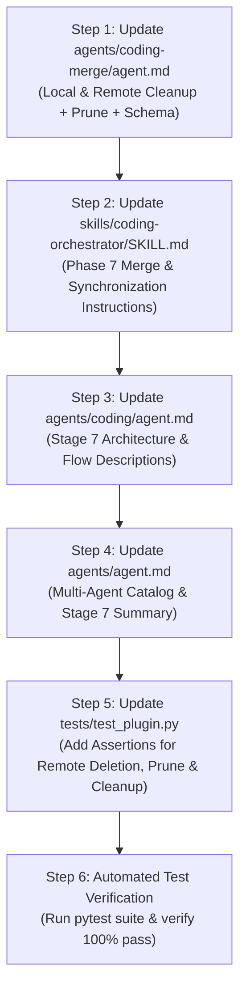

# Complete Branch Cleanup, Base Branch Checkout, and Remote Tracking Synchronization Architecture Plan

> [!NOTE] Release Status: Merged & Released (SPEC-2026-MERGE-002)
> - **Specification ID**: `SPEC-2026-MERGE-002`
> - **Architecture Decision Record**: [[architecture/adr-009-coding-merge-complete-branch-cleanup-and-remote-sync|ADR-009: Complete Branch Cleanup, Base Branch Checkout, and Remote Tracking Prune for @coding-merge]]
> - **Feature Specification Note**: [[features/coding-merge-complete-branch-cleanup-and-remote-sync|Feature: Complete Branch Cleanup & Remote Synchronization for @coding-merge]]
> - **Target Repository**: [`agentic-coding-plugin`](file:///Users/gpfister/Development/Projects/gpfister/agentic/agentic-coding-plugin)
> - **Current Phase**: Phase 7: Merge & Release Complete (Post-Merge Synchronized)
> - **Release Status**: **Completed / Released via PR #3** (Squash Commit [`b201d28`](file:///Users/gpfister/Development/Projects/gpfister/agentic/agentic-coding-plugin/))
> - **Implementation Commits**: [`9456228`](file:///Users/gpfister/Development/Projects/gpfister/agentic/agentic-coding-plugin/) / [`49fb98a`](file:///Users/gpfister/Development/Projects/gpfister/agentic/agentic-coding-plugin/)
> - **Verification**: 22/22 unit tests passing (100% pass rate)
> - **Branch Topology**: Feature branch `feature/merge-branch-cleanup-and-remote-sync` deleted locally and remotely; remote tracking references pruned (`git fetch --prune origin`); working tree active and clean on `main`.
> - **Approved Spec**: [`specification.md`](file:///Users/gpfister/.gemini/antigravity/brain/c00e61a0-f612-484f-a3b5-8aba9aa3366a/specification.md) ([Vault Archive](file:///Users/gpfister/Development/Projects/gpfister/agentic/agentic-obsidian/sessions/attachments/c00e61a0-f612-484f-a3b5-8aba9aa3366a/specification.md))
> - **Approved Plan**: [`plan.md`](file:///Users/gpfister/.gemini/antigravity/brain/c00e61a0-f612-484f-a3b5-8aba9aa3366a/plan.md) ([Vault Archive](file:///Users/gpfister/Development/Projects/gpfister/agentic/agentic-obsidian/sessions/attachments/c00e61a0-f612-484f-a3b5-8aba9aa3366a/plan.md))

---

## 1. Executive Summary & Problem Formulation

### 1.1 Problem Statement
Stage 7 ([`@coding-merge`](file:///Users/gpfister/Development/Projects/gpfister/agentic/agentic-coding-plugin/agents/coding-merge/agent.md)) integrates completed and reviewed feature branches into the target base branch (`main` or `master`). Currently, two distinct execution paths exhibit hygiene and synchronization deficiencies:

1. **Local Release Strategy**:
   - Merges the feature branch into `<base>` (`git merge <branch>`).
   - Does **not** delete the local feature branch (`cleanup: false` in `MergeReport`).
   - Leaves stale local branches accumulating across developer workspaces.
2. **Remote Release Strategy**:
   - Following PR merge confirmation (`gh pr view` reports `state == "MERGED"`), checks out `<base>`, fast-forwards remote commits (`git pull --ff-only origin <base>`), and deletes the local feature branch (`git branch -d <branch>`).
   - Does **not** delete the remote feature branch on `origin` (`git push origin --delete <branch>`).
   - Does **not** prune obsolete remote-tracking branches (`git fetch --prune origin`), leaving stale references in `.git/refs/remotes/origin/`.
   - Causes downstream inspection tools ([`@coding-document`](file:///Users/gpfister/Development/Projects/gpfister/agentic/agentic-project-documenting-plugin/agents/coding-document/agent.md), `git branch -a`, `git-status.md`) to report stale branch topologies.
3. **Working Tree State Assurance**:
   - Lacks an explicit verification step (`git branch --show-current`) ensuring the active working tree is checked out on the base branch across all release outcomes.

### 1.2 Architectural Solution
Upgrade `@coding-merge` to enforce complete branch hygiene:
- Switch to and verify base branch checkout in all paths.
- Local merges: safely delete local feature branch (`git branch -d <branch>`) and report `cleanup: true`.
- Remote PR merges: delete remote feature branch (`git push origin --delete <branch>`), delete local feature branch (`git branch -d <branch>`), and prune remote tracking references (`git fetch --prune origin`).
- Emit structured `MergeReport` metadata with `cleanup: true`, `deleted_branches: {local, remote}`, and `pruned: true`.

---

## 2. Multi-Repository Work Breakdown & Branch Strategy

### 2.1 Repository Isolation & Scope
- **Target Repository**: [`agentic-coding-plugin`](file:///Users/gpfister/Development/Projects/gpfister/agentic/agentic-coding-plugin)
- **Root Location**: `/Users/gpfister/Development/Projects/gpfister/agentic/agentic-coding-plugin`
- **Other Repositories**: None affected. Workspace multi-repo boundaries remain isolated.

### 2.2 Branch Conventions
- **Base Branch**: `main`
- **Feature Branch**: `feature/merge-branch-cleanup-and-remote-sync`
- **Branch Creation**:
  ```bash
  git checkout -b feature/merge-branch-cleanup-and-remote-sync origin/main
  ```

---

## 3. Local Deployment Assessment (`coding-deploy`)

A comprehensive inspection of [`agentic-coding-plugin`](file:///Users/gpfister/Development/Projects/gpfister/agentic/agentic-coding-plugin) confirms:
- **No Docker / Compose**: No `Dockerfile`, `docker-compose.yml`, or container manifests exist.
- **No Deployment Scripts**: No `./scripts/deployment_local.sh` or `./scripts/deploy_local.sh` exist.
- **No Infrastructure as Code**: No `terraform/`, `k8s/`, `helm/`, or cluster definitions exist.
- **Repository Nature**: `agentic-coding-plugin` is a pure Antigravity customization plugin comprising agent specifications (`.md`), skill runbooks (`.md`), rules, and Python unit tests (`pytest`).

> [!NOTE]
> **Local Deployment Assessment Verdict: Not Required**
> 
> Because this repository contains no long-running services, background processes, or containers, local deployment execution and telemetry surveillance (`coding-deploy`) are not required. Verification will be executed purely via automated unit testing (`pytest`).

---

## 4. Implementation Steps & Workflow Architecture



### Step 1: Update Agent Definition in `agents/coding-merge/agent.md`
- **File**: [`agents/coding-merge/agent.md`](file:///Users/gpfister/Development/Projects/gpfister/agentic/agentic-coding-plugin/agents/coding-merge/agent.md)
- **Modifications**:
  1. **Section 2 (Local Release Strategy)**:
     - Add step 3: Verify working tree checkout on `<base>` (`git branch --show-current`).
     - Add step 4: Safely delete local feature branch (`git branch -d <branch>`).
     - Update `MergeReport` schema to reflect `cleanup: true` and `deleted_branches: {"local": "<branch>"}`.
  2. **Section 5 (Post-Merge Base Synchronization & Complete Cleanup)**:
     - Rename section to *"Post-Merge Base Synchronization & Complete Cleanup"*.
     - Update sequence:
       1. Switch to base branch (`git checkout <base>`).
       2. Fast-forward remote pull (`git pull --ff-only origin <base>`).
       3. Delete remote feature branch (`git push origin --delete <branch>`) with idempotency check (`git ls-remote --heads origin <branch>`).
       4. Safely delete local feature branch (`git branch -d <branch>`) with documented squash/rebase fallback (`git branch -D <branch>`) strictly when PR is verified merged.
       5. Prune remote-tracking references (`git fetch --prune origin`).
       6. Verify working tree confirms base branch (`git branch --show-current`).
       7. Update `MergeReport` schema to include `cleanup: true`, `deleted_branches: {"local": "<branch>", "remote": "<branch>"}`, and `pruned: true`.

### Step 2: Update Orchestrator Skill in `skills/coding-orchestrator/SKILL.md`
- **File**: [`skills/coding-orchestrator/SKILL.md`](file:///Users/gpfister/Development/Projects/gpfister/agentic/agentic-coding-plugin/skills/coding-orchestrator/SKILL.md)
- **Modifications**:
  - In Section 5 (Phase 7 `coding-merge`):
    - Update Local Release: mandate local feature branch deletion (`git branch -d <branch>`).
    - Update Remote Release: document base checkout, fast-forward pull, remote branch deletion (`git push origin --delete <branch>`), local branch deletion (`git branch -d <branch>`), and remote pruning (`git fetch --prune origin`).

### Step 3: Update Orchestrator Agent in `agents/coding/agent.md`
- **File**: [`agents/coding/agent.md`](file:///Users/gpfister/Development/Projects/gpfister/agentic/agentic-coding-plugin/agents/coding/agent.md)
- **Modifications**:
  - In Section 4 (Architecture Diagram): update `ExecMerge` node description to reflect complete branch cleanup and remote pruning.
  - In Section 5 (Stage 7 `coding-merge`): document that `@coding-merge` returns repository to base branch, deletes local and remote feature branches, and runs `git fetch --prune origin`.

### Step 4: Update Subagent Catalog in `agents/agent.md`
- **File**: [`agents/agent.md`](file:///Users/gpfister/Development/Projects/gpfister/agentic/agentic-coding-plugin/agents/agent.md)
- **Modifications**:
  - Update Section 1.2 table: `@coding-merge` responsibility includes complete branch cleanup (local/remote) and remote tracking prune.
  - Update Section 2 (Stage 7 summary): detail local branch deletion on local merges, and remote deletion + local deletion + remote prune on remote PR merges.

### Step 5: Update Unit Tests in `tests/test_plugin.py`
- **File**: [`tests/test_plugin.py`](file:///Users/gpfister/Development/Projects/gpfister/agentic/agentic-coding-plugin/tests/test_plugin.py)
- **Modifications**:
  1. Enhance `test_coding_merge_pr_waiting_and_sync` to assert:
     - `git push origin --delete`
     - `git fetch --prune`
     - `cleanup: true` in local release strategy
     - `git checkout <base>` and `git branch -d`
  2. Add dedicated test `test_coding_merge_complete_branch_cleanup_and_prune` verifying all 4 target documentation files and `MergeReport` schema.

### Step 6: Automated Test Verification
- **Execution Command**:
  ```bash
  ./agentic-coding-plugin/.venv/bin/pytest agentic-coding-plugin/tests/test_plugin.py
  ```
- **Target Outcome**: 100% test pass (22+ unit tests).

---

## 5. Safety Boundaries & Risk Mitigations

| Risk | Impact | Mitigation |
| :--- | :--- | :--- |
| Premature branch deletion | Potential data loss if PR review was pending | Branch deletion only occurs after `gh pr view` reports `state == "MERGED"` (or `git merge` exit code 0). |
| Remote branch pre-deleted by GitHub auto-delete | Release process error | Execute `git ls-remote --heads origin <branch>` check first or handle remote deletion failure idempotently. |
| Rebase/Squash merges causing `git branch -d` ancestry warning | Deletion script blocks | Allow documented fallback to `git branch -D` strictly when PR status is verified `MERGED` and base branch has pulled the squash commit. |
| Stale remote-tracking branches remaining | Stale branch listings | Mandate `git fetch --prune origin` as standard post-merge hygiene. |

---

## 6. Definition of Done & Verifiable Deliverables

- [x] `agents/coding-merge/agent.md` documents local branch deletion, remote branch deletion, remote prune (`git fetch --prune origin`), and base checkout verification.
- [x] `skills/coding-orchestrator/SKILL.md` reflects complete branch cleanup and pruning instructions.
- [x] `agents/coding/agent.md` and `agents/agent.md` are aligned with Stage 7 cleanup procedures.
- [x] `tests/test_plugin.py` contains explicit assertions validating remote deletion, local deletion, pruning, and base checkout.
- [x] All automated unit tests pass cleanly with `pytest` (22/22 passed).
- [x] Obsidian vault records formalized in [[architecture/adr-009-coding-merge-complete-branch-cleanup-and-remote-sync|ADR-009]] and [[features/coding-merge-complete-branch-cleanup-and-remote-sync|Feature Specification]].

---

## 7. Post-Merge Release & Deployment Summary

- **Pull Request**: [PR #3](https://github.com/gpfister/agentic-coding-plugin/pull/3) merged into `main` via squash commit [`b201d28`](file:///Users/gpfister/Development/Projects/gpfister/agentic/agentic-coding-plugin/).
- **Branch Lifecycle Execution**:
  - Remote feature branch `origin/feature/merge-branch-cleanup-and-remote-sync` deleted.
  - Local feature branch `feature/merge-branch-cleanup-and-remote-sync` deleted.
  - Remote-tracking branches pruned (`git fetch --prune origin`).
  - Active branch switched to and verified on `main`.
- **Test Suite**: 22/22 tests passing (100% pass rate).
- **Status**: **Phase 7: Merge & Release Complete (Post-Merge Synchronized)**.
