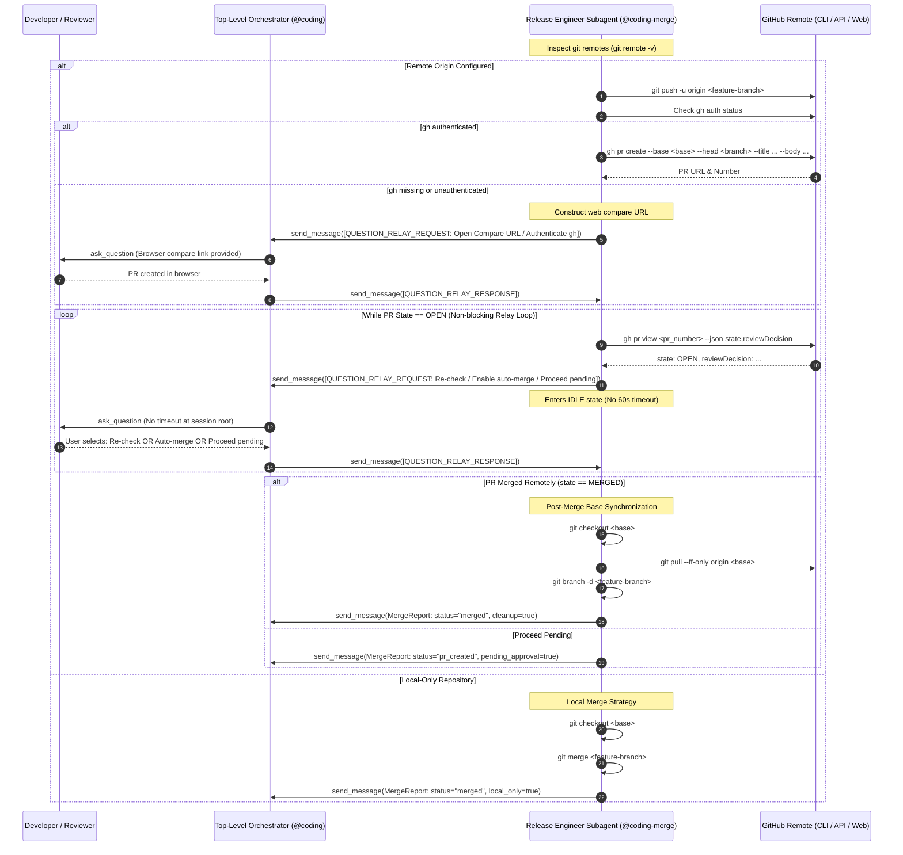
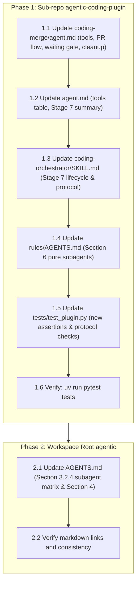

# Remote PR Creation, Question Relay Waiting Gate, and Post-Merge Synchronization Architecture & Implementation Plan

> [!NOTE] Implementation Milestone: Phase 5 (Pre-Merge Documentation Gate)
> - **Specification ID**: `SPEC-2026-MERGE-001`
> - **Architecture Decision Record**: [[architecture/adr-007-coding-merge-remote-pr-and-sync|ADR-007: Remote PR Creation, Question Relay Waiting Gate, and Post-Merge Synchronization for @coding-merge]]
> - **Feature Specification Note**: [[features/coding-merge-remote-pr-and-sync|Feature: Remote PR Creation, Question Relay Waiting Gate, and Post-Merge Synchronization for @coding-merge]]
> - **Target Branch**: `feature/coding-merge-pr-waiting-gate`
> - **Current Phase**: Phase 5: Review / Pre-Merge Documentation Gate (Call 2/3)
> - **Delivered Commits**:
>   - `agentic-coding-plugin`: [`486131c`](file:///Users/gpfister/Development/Projects/gpfister/agentic/agentic-coding-plugin/) — `feat(coding-merge): add PR creation, Question Relay waiting gate, and post-merge branch synchronization`
>   - `agentic` (root): [`1aa5e88`](file:///Users/gpfister/Development/Projects/gpfister/agentic/) — `docs(agents): update AGENTS.md for coding-merge remote PR waiting gate and sync`
> - **Verification Verdict**: **PASS (17/17 tests passing in agentic-coding-plugin, 100% pass rate)**
> - **Acceptance Criteria**: AC-1 through AC-5 **100% satisfied**
> - **Local Deployment Status**: **Not Required** across participating repositories
> - **Approved Spec**: [`specification.md`](file:///Users/gpfister/.gemini/antigravity/brain/7408dcce-9644-4ba0-af51-bd171ed61a54/specification.md) ([Vault Archive](file:///Users/gpfister/Development/Projects/gpfister/agentic/agentic-obsidian/sessions/attachments/7408dcce-9644-4ba0-af51-bd171ed61a54/specification.md))
> - **Approved Plan**: [`plan.md`](file:///Users/gpfister/.gemini/antigravity/brain/7408dcce-9644-4ba0-af51-bd171ed61a54/plan.md) ([Vault Archive](file:///Users/gpfister/Development/Projects/gpfister/agentic/agentic-obsidian/sessions/attachments/7408dcce-9644-4ba0-af51-bd171ed61a54/plan.md))

---

## 1. Executive Summary & Problem Formulation

### 1.1 Problem Statement
In `agentic-coding-plugin`, Stage 7 (`@coding-merge`) serves as the designated release engineer subagent, concluding the software development workflow by merging feature branches and finalizing release tasks. However:
1. **No Waiting Protocol for Remote Pull Requests**: When a remote repository is configured, `@coding-merge` pushes the branch and creates a PR via GitHub CLI (`gh pr create`), but lacks a structured mechanism to wait for human code review, automated CI/CD checks, and remote merge completion.
2. **Antigravity 60-Second Host Subagent Timeout**: Background worker subagents spawned via `invoke_subagent` face a strict **60-second execution timeout** on each turn. If `@coding-merge` blocks in a polling loop (`sleep`) or calls interactive prompt tools (`ask_question`) directly, the subagent turn terminates prematurely whenever code review takes longer than one minute.
3. **No Resilient Fallback for Missing GitHub CLI**: If `gh` is unauthenticated or not installed, `@coding-merge` fails without providing the developer a clickable web compare URL (`https://github.com/<owner>/<repo>/compare/<base>...<branch>?expand=1`) to open and complete PR creation in their browser.
4. **Post-Merge Workspace Drift**: Following remote PR merge, the local workspace remains unaligned: the base branch is not updated with remote commits, and the local feature branch remains unpruned.
5. **Tooling & Pure Subagent Categorization**: `coding-merge` omitted `send_message` in its frontmatter tools list and was not classified as a Pure Subagent in the workspace Question Relay Protocol matrix.

### 1.2 Proposed Architecture
Upgrade `@coding-merge` to:
1. **Detect Git Remotes & Validate GitHub CLI**: Differentiate between local-only repositories and repositories with configured remotes (`origin`). For remote repositories, push the feature branch (`git push -u origin <branch>`) and verify GitHub CLI authentication (`gh auth status`).
2. **PR Creation & Web Compare Fallback URL**: If `gh` is authenticated, create a Pull Request via `gh pr create` with structured metadata. If `gh` is unauthenticated or missing, generate a GitHub web compare URL and prompt the developer via the Question Relay Protocol.
3. **Subagent-Safe PR Waiting Gate**: Inspect PR state non-blockingly using `gh pr view --json state,reviewDecision,mergedAt,url`. To avoid Antigravity's 60-second subagent execution timeout, never block or sleep in subagent worker processes; instead, relay review decisions to `@coding` using `[QUESTION_RELAY_REQUEST]` with structured choices:
   - `(Recommended) Re-check PR status`
   - `Enable GitHub auto-merge (gh pr merge --auto --merge) and re-check`
   - `Proceed without waiting (mark PR pending)`
4. **Post-Merge Workspace Synchronization**: When the PR is merged, switch to the base branch (`git checkout <base>`), fast-forward pull changes (`git pull --ff-only origin <base>`), and delete the local feature branch (`git branch -d <branch>`).
5. **Tooling & Protocol Classification**: Add `send_message` to `coding-merge/agent.md` frontmatter tools, update agent catalog, orchestrator skills, rules, and add comprehensive unit test coverage in `tests/test_plugin.py`. Update workspace root `AGENTS.md` to classify `@coding-merge` as a Pure Subagent.

---

## 2. System Architecture & Sequence Flows



---

## 3. Multi-Repository Work Breakdown



### 3.1 Repository 1: `agentic-coding-plugin` (Sub-repo)

- **Target Path**: [`agentic-coding-plugin/`](file:///Users/gpfister/Development/Projects/gpfister/agentic/agentic-coding-plugin/)
- **Target Git Branch**: `feature/coding-merge-pr-waiting-gate`

#### Work Items & Step-by-Step Implementation

1. **Step 1.1 — Update `agents/coding-merge/agent.md`**:
   - Add `send_message` to `tools` list in YAML frontmatter.
   - Detail Pure Subagent protocol under `@coding`: must NOT call `ask_question` directly when caller ID is present; use `send_message` with `[QUESTION_RELAY_REQUEST]` and await `[QUESTION_RELAY_RESPONSE]`.
   - Add Remote Repository Detection (`git remote -v` / `git remote get-url origin`).
   - Add Local Release Strategy (`git checkout <base>`, `git merge <branch>`).
   - Add Remote Release Strategy:
     - Push branch: `git push -u origin <branch>`
     - GitHub CLI authentication check: `gh auth status`
     - PR Creation: `gh pr create --base <base> --head <branch> --title "<title>" --body "<body>"`
     - Fallback compare URL when `gh` fails/missing: `https://github.com/<owner>/<repo>/compare/<base>...<branch>?expand=1` relayed via `[QUESTION_RELAY_REQUEST]`.
   - Add Hybrid Check & Question Relay Gate:
     - Query status: `gh pr view <pr_number> --json state,reviewDecision,mergedAt,url`
     - If `state == "MERGED"`: proceed to cleanup.
     - If `state == "OPEN"`: relay question to user via `[QUESTION_RELAY_REQUEST]` with choices (Re-check, Enable GitHub auto-merge, Proceed without waiting).
   - Add Post-Merge Base Synchronization & Local Cleanup:
     - `git checkout <base>`
     - `git pull --ff-only origin <base>`
     - `git branch -d <branch>`
     - Produce structured `MergeReport` (status, pr_number, pr_url, base_branch, merged_branch, cleanup).

2. **Step 1.2 — Update `agents/agent.md`**:
   - In Section 1 subagent table: Update `@coding-merge` tools column to include `send_message`.
   - In Section 2 Stage 7 (`coding-merge`): Update summary to describe PR creation, fallback compare URL, Question Relay waiting gate, and post-merge base branch sync & local branch deletion.

3. **Step 1.3 — Update `skills/coding-orchestrator/SKILL.md`**:
   - Update Stage 7 section to describe the PR waiting gate, GitHub CLI validation, compare URL fallback, and post-merge synchronization (`git pull --ff-only origin <base>`, `git branch -d <branch>`).
   - Update Section 1 Question Relay Protocol to reference `@coding-merge` as a subagent using the relay protocol.

4. **Step 1.4 — Update `rules/AGENTS.md`**:
   - In Section 6 (Question Relay Protocol & Interactive Gates):
     - Update worker subagents list to include `@coding-merge` (`worker subagents (@coding-clarify, @coding-deploy, @coding-review, @coding-merge)`).

5. **Step 1.5 — Update `tests/test_plugin.py`**:
   - Add `PLUGIN_ROOT / "agents" / "coding-merge" / "agent.md"` to `files_to_check` in `test_question_relay_protocol_contracts`.
   - Update `test_subagent_tool_configurations` to verify `send_message` in `coding-merge`.
   - Add dedicated unit test `test_coding_merge_pr_waiting_and_sync()` verifying:
     - `coding-merge/agent.md` includes `gh pr create` and `gh pr view`
     - `coding-merge/agent.md` includes `[QUESTION_RELAY_REQUEST]` and `[QUESTION_RELAY_RESPONSE]`
     - `coding-merge/agent.md` includes post-merge cleanup commands (`git pull --ff-only`, `git branch -d`)
     - `coding-merge/agent.md` includes compare URL fallback (`github.com`)

6. **Step 1.6 — Test Execution & Verification**:
   - Verification command:
     ```bash
     cd /Users/gpfister/Development/Projects/gpfister/agentic/agentic-coding-plugin && uv run pytest tests
     ```

### 3.2 Repository 2: `agentic` (Workspace Root)

- **Target Path**: [`agentic/`](file:///Users/gpfister/Development/Projects/gpfister/agentic/)
- **Target Git Branch**: `feature/coding-merge-pr-waiting-gate`

#### Work Items & Step-by-Step Implementation

1. **Step 2.1 — Update workspace root `AGENTS.md`**:
   - Section 2.3: Update `@coding-merge` description in catalog to mention PR creation, Question Relay waiting gate, and post-merge branch synchronization.
   - Section 3.2.4 (Pure Subagents vs. Dual-Mode Subagents Matrix): Update Pure Subagents list to include `@coding-merge`:
     `@coding-clarify`<br>`@coding-deploy`<br>`@coding-review`<br>`@coding-merge`
   - Section 4 (Coding Workflow Pipeline): Update Stage 7 description in text and flowchart explanations to detail PR creation, waiting gate, and post-merge sync.

2. **Step 2.2 — Workspace Verification**:
   - Run `git diff --check` and verify link formatting, syntax, and alignment with `agentic-coding-plugin`.

---

## 4. Local Deployment Assessment

| Repository | Deployment Required? | Rationale | Deployment Trigger |
| :--- | :---: | :--- | :--- |
| `agentic-coding-plugin` | **No** | Pure Antigravity plugin manifest, agent markdown definitions, skills, rules, and python test suite. No containers or background services. | None (`Local Deployment: Not Required`) |
| `agentic` (Root) | **No** | Multi-repo orchestration and documentation workspace. No deployable artifacts. | None (`Local Deployment: Not Required`) |

> [!NOTE]
> Because neither repository requires local deployment, `@coding-deploy` is not triggered for this feature. The lifecycle transitions directly from `coding-develop` to `coding-review`.

---

## 5. Risk Assessment & Mitigations

| Risk | Impact | Mitigation Strategy |
| :--- | :--- | :--- |
| **Antigravity 60s Timeout During PR Review** | Subagent failure during waiting | `@coding-merge` never blocks or polls synchronously; it delegates status checks to `@coding` using `[QUESTION_RELAY_REQUEST]`. Orchestrator runs indefinitely without timeouts. |
| **`gh` CLI Not Available on Developer Machine** | PR creation failure | Early fallback detects failure and generates web compare URL (`https://github.com/<owner>/<repo>/compare/...`) for manual browser creation. |
| **Base Branch Conflict on Pull** | Post-merge local sync failure | `@coding-merge` strictly uses `git pull --ff-only origin <base>`. If not fast-forwardable, it warns user rather than creating unexpected merge commits. |
| **Unmerged Commits on Branch Deletion** | Accidental code loss | `@coding-merge` uses `git branch -d` (safe delete). Never uses `-D` (force delete). |

---

## 6. Verifiable Acceptance Criteria

- [x] **AC-1 (Frontmatter Tools)**: `agentic-coding-plugin/agents/coding-merge/agent.md` declares `send_message` in its `tools` list alongside `run_command`, `read_file`, `list_dir`, and `ask_question`.
- [x] **AC-2 (Agent Instructions)**: `coding-merge/agent.md` explicitly details:
  - Remote repository detection (`git remote -v`).
  - Feature branch push (`git push -u origin <branch>`).
  - GitHub CLI verification (`gh auth status`) and PR creation (`gh pr create`).
  - Fallback compare URL generation when `gh` is unauthenticated/missing.
  - Hybrid PR waiting gate via `gh pr view --json state,reviewDecision` and `[QUESTION_RELAY_REQUEST]`.
  - Post-merge base checkout (`git checkout <base>`), fast-forward pull (`git pull --ff-only origin <base>`), and safe local branch deletion (`git branch -d <branch>`).
- [x] **AC-3 (Question Relay Compliance)**: `rules/AGENTS.md`, `agents/agent.md`, and workspace `AGENTS.md` classify `@coding-merge` as a Pure Subagent utilizing `[QUESTION_RELAY_REQUEST]` and `[QUESTION_RELAY_RESPONSE]` to avoid 60-second timeouts.
- [x] **AC-4 (Orchestrator Skill)**: `skills/coding-orchestrator/SKILL.md` documents Stage 7's PR creation, waiting gate handling, and post-merge cleanup.
- [x] **AC-5 (Automated Tests)**: `tests/test_plugin.py` includes tests asserting:
  - `send_message` is present in `coding-merge` tools.
  - `coding-merge/agent.md` contains PR waiting gate and Question Relay contracts.
  - `test_question_relay_protocol_contracts` includes `coding-merge/agent.md`.
  - All existing and new tests pass cleanly with `pytest` (17/17 passing).

---

## 7. Deliverables & Verification Ledger

- **Sub-repo `agentic-coding-plugin`**: Commit [`486131c`](file:///Users/gpfister/Development/Projects/gpfister/agentic/agentic-coding-plugin/) on branch `feature/coding-merge-pr-waiting-gate` (17/17 tests passing).
- **Workspace Root `agentic`**: Commit [`1aa5e88`](file:///Users/gpfister/Development/Projects/gpfister/agentic/) on branch `feature/coding-merge-pr-waiting-gate` (documentation & cross-repo rules synchronized).
- **Review Verdict**: Approved with 0 blockers. Ready for Stage 7 merge.
