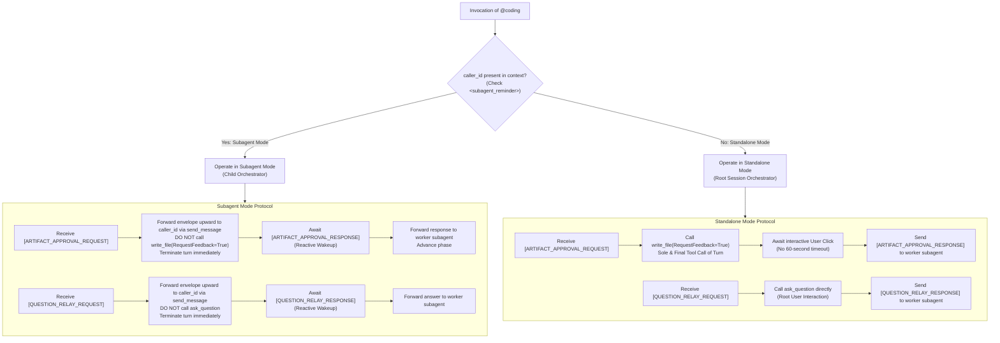
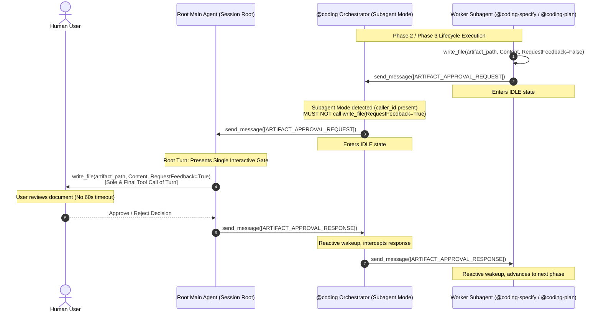

# Dual-Mode Coding Orchestrator with Multi-Hop Relay and Anti-Direct-Coding Guardrails Architecture & Implementation Plan

> [!NOTE] Implementation Milestone: Phase 7 (Merge & Release Complete)
> - **Specification ID**: `SPEC-2026-DUAL-MODE-001`
> - **Architecture Decision Record**: [[architecture/adr-008-dual-mode-coding-orchestrator|ADR-008: Dual-Mode Coding Orchestrator with Multi-Hop Relay and Anti-Direct-Coding Guardrails]]
> - **Feature Specification Note**: [[features/dual-mode-coding-orchestrator|Feature: Dual-Mode Coding Orchestrator with Multi-Hop Relay and Anti-Direct-Coding Guardrails]]
> - **Target Branch**: `master` (Merged and synchronized across all repositories)
> - **Current Phase**: Phase 7: Merge & Release Complete
> - **Merge Commits**:
>   - `agentic`: PR #2 merged into `master` ([`fa5164a`](file:///Users/gpfister/Development/Projects/gpfister/agentic/))
>   - `agentic-coding-plugin`: PR #2 merged into `master` ([`3e04ac1`](file:///Users/gpfister/Development/Projects/gpfister/agentic/agentic-coding-plugin/)), **21/21 tests passed (100%)**
>   - `agentic-issue-investigation-plugin`: PR #1 merged into `master` ([`34629b3`](file:///Users/gpfister/Development/Projects/gpfister/agentic/agentic-issue-investigation-plugin/)), **14/14 tests passed (100%)**
> - **Verification Verdict**: **PASS (35/35 tests passing across feature repos, 100% pass rate)**

---

## 1. Problem Formulation & Root Causes

Operational production traces revealed two severe vulnerabilities when [`@coding`](file:///Users/gpfister/Development/Projects/gpfister/agentic/agentic-coding-plugin/agents/coding/agent.md) is executed:

### 1.1 Root Cause A: 60-Second Subagent Timeout & Duplicate Gate Presentation
During multi-agent handoffs (e.g., when the session root agent spawns `@coding` to resolve an issue diagnosed by `@coding-investigate`), `@coding` was classified as a top-level orchestrator. Consequently:
- Upon receiving `[ARTIFACT_APPROVAL_REQUEST]` from `@coding-specify` or `@coding-plan`, `@coding` called `write_file(RequestFeedback=True)` in its background turn.
- Meanwhile, the session root agent also intercepted the subagent idle status and rendered `write_file(RequestFeedback=True)` at the root.
- This produced duplicate interactive modals in Antigravity's UI.
- Furthermore, `@coding` called `ask_question` directly during clarification, triggering the host runtime's rigid 60-second execution timeout when user review exceeded one minute.

### 1.2 Root Cause B: Workflow Bypass & Direct Code Mutation
When `@coding` received an imperative prompt with technical guidance (such as an approved remediation plan), the LLM took the path of least resistance:
- Bypassed all 7 lifecycle phases (`coding-clarify`, `coding-specify`, `coding-plan`, `coding-develop`, `coding-deploy`, `coding-review`, `coding-merge`).
- Used its declared `write_file` and `run_command` tools to directly edit application code files and run tests.
- Omitted clean code reviews, test gates, PR creation, git branch management, and documentation updates.

---

## 2. Architectural Design: Dual-Mode & Multi-Hop Relay

### 2.1 Multi-Hop Relay Sequence Diagram

---

## 3. Subagent Classification Matrix

| Tier | Agents | Operating Protocol | Tooling & Action Permissions |
| :--- | :--- | :--- | :--- |
| **Pure Subagents** | `@coding-clarify` `@coding-specify` `@coding-plan` `@coding-develop` `@coding-deploy` `@coding-review` `@coding-merge` | Strictly run under `@coding`. **NEVER** call `ask_question` or `write_file(RequestFeedback=True)`. Always dispatch `[QUESTION_RELAY_REQUEST]` and `[ARTIFACT_APPROVAL_REQUEST]` to `caller_id`. | `send_message`, `write_file` (without `RequestFeedback=True`), specialized domain tools. |
| **Dual-Mode Orchestrators & Agents** | **`@coding`** `@coding-investigate` `/project-grooming` (`@coding-groom`) `@coding-monitor` `@coding-research` | **Subagent Mode (`caller_id` present)**: • Relay `[ARTIFACT_APPROVAL_REQUEST]` up to `caller_id` via `send_message`. • Relay `[QUESTION_RELAY_REQUEST]` up to `caller_id` via `send_message`. • Forward responses down to requesting worker subagent. **Standalone Mode (no `caller_id`)**: • Call `write_file(RequestFeedback=True)` directly as sole and final tool call of turn. • Call `ask_question` directly. | `send_message`, `invoke_subagent`, `ask_question`, `write_file` (strictly for gates in standalone mode), inspection tools (`git status`). |

---

## 4. Work Breakdown by Repository

### Repository 1: `agentic-coding-plugin` (Sub-Repository)
- **Branch**: `feat/dual-mode-coding-orchestrator`
- **Affected Files**:
  1. [`agents/coding/agent.md`](file:///Users/gpfister/Development/Projects/gpfister/agentic/agentic-coding-plugin/agents/coding/agent.md): Add Dual-Mode mode detection, multi-hop relay rules, anti-direct-coding negative constraints, tool boundary rules, and pre-clarified fast-path instructions.
  2. [`skills/coding-orchestrator/SKILL.md`](file:///Users/gpfister/Development/Projects/gpfister/agentic/agentic-coding-plugin/skills/coding-orchestrator/SKILL.md): Update skill instructions with multi-hop relay execution, tool constraints, and fast-path runbooks.
  3. [`rules/AGENTS.md`](file:///Users/gpfister/Development/Projects/gpfister/agentic/agentic-coding-plugin/rules/AGENTS.md): Update Section 6 and Section 7 protocols to categorize `@coding` under Dual-Mode.
  4. [`agents/agent.md`](file:///Users/gpfister/Development/Projects/gpfister/agentic/agentic-coding-plugin/agents/agent.md): Synchronize catalog tables and subagent privilege matrices.
  5. [`tests/test_plugin.py`](file:///Users/gpfister/Development/Projects/gpfister/agentic/agentic-coding-plugin/tests/test_plugin.py): Add unit tests verifying Dual-Mode classification, multi-hop relay contracts, anti-direct-coding constraints, and pre-clarified fast-path.

### Repository 2: `agentic` (Workspace Root Repository)
- **Branch**: `feat/dual-mode-coding-orchestrator`
- **Affected Files**:
  1. [`AGENTS.md`](file:///Users/gpfister/Development/Projects/gpfister/agentic/AGENTS.md): Update Section 2.3, Section 3.1, Section 3.2.4, Section 3.3.4, subagent categorization tables, and standardized upstream invocation template.

### Repository 3: `agentic-issue-investigation-plugin` (Sub-Repository)
- **Branch**: `feat/dual-mode-coding-orchestrator`
- **Affected Files**:
  1. [`rules/AGENTS.md`](file:///Users/gpfister/Development/Projects/gpfister/agentic/agentic-issue-investigation-plugin/rules/AGENTS.md): Update Section 2 Remediation Confirmation Gate to format upstream handoffs using the standardized orchestration template.

---

## 5. Verification Strategy & Outcomes

1. **Automated Test Suite**:
   - `agentic-coding-plugin`: Executed `pytest agentic-coding-plugin/tests/test_plugin.py` -> **21/21 passed (100%)** (all 17 baseline tests + 4 new tests asserting dual-mode classification, multi-hop relay message handling, anti-direct-coding constraints, and pre-clarified fast-path).
   - `agentic-issue-investigation-plugin`: Executed `pytest agentic-issue-investigation-plugin/tests/test_plugin.py` -> **14/14 passed (100%)** (all 13 baseline tests + 1 new test asserting standardized orchestration prompt template).
2. **Quality Audit & Review (Phase 5)**:
   - Clean Code Reviewer audit performed and approved with zero architectural regressions.
   - Dual-Mode orchestrator protocol validated across all caller-subagent topologies.
3. **Pre-Merge Documentation Tidy-Up (Phase 6)**:
   - Synchronized all READMEs, feature notes, architecture plans, ADR-008, plugin specs, and git status tracking records across the workspace.
4. **Merge & Release Execution (Phase 7)**:
   - PR #2 in `agentic` merged into `master` (commit `fa5164a`).
   - PR #2 in `agentic-coding-plugin` merged into `master` (commit `3e04ac1`).
   - PR #1 in `agentic-issue-investigation-plugin` merged into `master` (commit `34629b3`).
   - Upstream changes pulled into local master branches; feature branches deleted; working trees clean. Workspace status, release changelog, and feature specs updated to Released / Completed.
