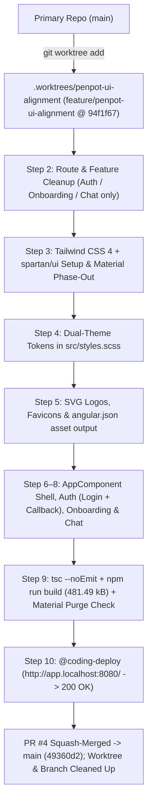

# Architecture Plan — Minigma AI Web App UI Alignment & Screen Cleanup

> [!NOTE]
> - **Status**: **Merged / Completed** — [PR #4](https://github.com/gpfister/minigma-ai-web-app/pull/4) squash-merged into `main` (`49360d2`); `.worktrees/penpot-ui-alignment` removed & pruned; `feature/penpot-ui-alignment` deleted locally & remotely.
> - **Feature Specification**: [[features/minigma-ai-web-app-ui-alignment|Feature Spec — Minigma AI Web App UI Alignment & Screen Cleanup]]
> - **Design Specification**: [[designs/minigma-ai-web-app-ui-alignment|Design Spec — Minigma AI Web App UI Alignment & Screen Cleanup]]
> - **Project Note**: [[projects/minigma-ai-web-app|Minigma AI Web App]]
> - **Formal Decision**: [[architecture/adr-015-minigma-ai-web-app-spartan-ui-and-screen-cleanup|ADR-015]]
> - **Target Repository**: [`minigma-ai-web-app`](file:///Users/gpfister/Development/Projects/gpfister/minigma-ai/minigma-ai-web-app)
> - **Source Artifacts**: [`specification.md`](file:///Users/gpfister/.gemini/antigravity/brain/b334efa9-f904-44c2-a445-bbfd30f309da/specification.md) · [`plan.md`](file:///Users/gpfister/.gemini/antigravity/brain/b334efa9-f904-44c2-a445-bbfd30f309da/plan.md) · [`design-spec.md`](file:///Users/gpfister/.gemini/antigravity/brain/eff05b10-f717-4f08-806d-bd059eb10d54/design-spec.md) · [`review-penpot-ui-alignment.md`](file:///Users/gpfister/.gemini/antigravity/brain/b334efa9-f904-44c2-a445-bbfd30f309da/review-penpot-ui-alignment.md)

---

## 1. Architectural Shift Overview

[`minigma-ai-web-app`](file:///Users/gpfister/Development/Projects/gpfister/minigma-ai/minigma-ai-web-app) (Angular `^19.0.0`, TypeScript `~5.6.0`, standalone components) transitions from an Angular Material 3 (`@angular/material`) prototype with 9+ routes to a focused **spartan/ui + Tailwind CSS 4** application aligned 1:1 with PenPot (`42288968-6e5e-808d-8008-fab5dcc739f5`):

- **UI Primitive & Styling Layer**: Phasing out `@angular/material`, `--mat-sys-*`, and Google Material Icons in favor of Tailwind CSS 4 (`@tailwindcss/postcss` via `.postcssrc.json`) and `@spartan-ng/brain` + Hlm primitives (`HlmButton`, `HlmCard`, `HlmInput`, `HlmLabel`, `HlmScrollArea` in `src/app/shared/ui/`).
- **Dual-Theme Token System**: `src/styles.scss` defines **Late Sun Engineering (Light)** on `:root, html, html[data-theme='light']` and **Twilight Engineering (Dark)** on `html[data-theme='dark']` via `@custom-variant dark`, paired with `JetBrains Mono` (`--font-mono`) and `Plus Jakarta Sans` (`--font-sans`), spacing, and radii tokens.
- **Route Surface Reduction**: Retains only `'' -> 'chat'`, `'auth/login'`, `'auth/callback'`, `'onboarding'` (`authGuard`), `'chat'` (`authGuard`, `orgGuard`), and `'**' -> 'chat'`. Removes `spec`, `code`, `ops`, `sandbox`, `user/account`, `admin/users`, and `adminGuard`.
- **Worktree & Local Deployment Pipeline**: All development, build/test verification, and local Kubernetes deployment (`./scripts/deployment_local.sh` -> Minikube `minigma-ai`) executed inside `.worktrees/penpot-ui-alignment` on `feature/penpot-ui-alignment` (`94f1f67`), then squash-merged into `main` via [PR #4](https://github.com/gpfister/minigma-ai-web-app/pull/4) (`49360d2`) with worktree and branch cleanup completed.

---

## 2. Work Breakdown (`minigma-ai-web-app`)

| Step | Scope | Key Files / Targets | Verification |
| :--- | :--- | :--- | :--- |
| **Step 1** | Worktree & Branch Isolation | `.worktrees/penpot-ui-alignment` on `feature/penpot-ui-alignment` (`94f1f67`), `.git/info/exclude` | Squash-merged into `main` (`49360d2`); worktree removed & pruned; branch deleted |
| **Step 2** | Route & Feature Cleanup | `src/app/app.routes.ts`; removed `features/{spec,code,ops,sandbox,user,admin}` & `admin.guard.ts` | `rg -n "spec\|code\|ops\|sandbox\|user/account\|admin/users\|adminGuard" src/app` returns 0 matches |
| **Step 3** | Tailwind CSS 4 & `spartan/ui` Setup | `package.json`, `.postcssrc.json`, `src/app/shared/ui/` Hlm primitives | `npm run build` compiles cleanly |
| **Step 4** | Dual-Theme Design Tokens | `src/styles.scss` (Late Sun Light + Twilight Dark, fonts, spacing, radii) | Zero `@angular/material` imports; 100% hex parity with `design-spec.md` |
| **Step 5** | Brand Assets & Favicons | `src/assets/logo-light.svg`, `logo-dark.svg`, favicons, `src/index.html`, `angular.json` (`"output": "assets"`) | Assets emitted to `dist/minigma-ai-web-app/browser/assets/` |
| **Step 6** | App Shell & `spartan-navbar` | `src/app/app.component.{ts,html,scss,spec.ts}`, `OrgService.selectOrganisation(id)` | `64px` navbar, org switcher on `/chat`, floating toggle on `/auth/*` |
| **Step 7** | Auth & Onboarding Alignment | `src/app/features/auth/{login,callback}/*`, `src/app/features/onboarding/*` | `460px` `HlmCard`, Login/Sign-Up modes, `CallbackComponent` aligned |
| **Step 8** | Chat Screen Alignment | `src/app/features/chat/chat.component.{ts,html,scss,spec.ts}` | `900px` container, `HlmScrollArea`, collapsible `AgentActivity`, `A2UI / ask_question`, `Composer` |
| **Step 9** | Build & Static Verification | `npx tsc -p tsconfig.app.json --noEmit`, `npm run build`, `rg` Material check | `0` TS errors, `Initial total: 481.49 kB`, `0` Material matches (`npm test` not configured in `angular.json`) |
| **Step 10** | Local Deployment (`@coding-deploy`) | `./scripts/deployment_local.sh`, `Dockerfile`, `nginx.conf`, `terraform/main.tf` | Pod `1/1 Running`; `http://app.localhost:8080/` (`minigma-ai-web-app:94f1f67-1795625897` in namespace `minigma-ai-web-app`) `200 OK` |

---

## 3. Approved Unplanned Implementation Adjustments (`94f1f67`)

1. **`angular.json` Asset Output (`"output": "assets"`)**: Configured `src/assets` asset output so SVG logos and favicons are emitted to `dist/minigma-ai-web-app/browser/assets/` and served at `/assets/*`.
2. **`OrgService.selectOrganisation(id: string)`**: Added client-side signal setter in `src/app/core/services/org.service.ts` so `AppComponent`'s Organisation Switcher updates `activeOrganisationSignal`.
3. **`CallbackComponent` Migration**: Migrated `src/app/features/auth/callback/callback.component.{ts,html}` off `@angular/material` to `HlmCardDirective` / `HlmButtonDirective` and updated post-callback navigation from `/user/account` to `/chat`.

---

## 4. Local Deployment Architecture

`minigma-ai-web-app` ships with local Kubernetes deployment infrastructure:
- [`scripts/deployment_local.sh`](file:///Users/gpfister/Development/Projects/gpfister/minigma-ai/minigma-ai-web-app/scripts/deployment_local.sh) (worktree-aware via `GIT_COMMON_DIR` for shared `terraform/terraform.tfstate`).
- [`Dockerfile`](file:///Users/gpfister/Development/Projects/gpfister/minigma-ai/minigma-ai-web-app/Dockerfile) (Node 22 build + `nginx:alpine` on port 80) and [`nginx.conf`](file:///Users/gpfister/Development/Projects/gpfister/minigma-ai/minigma-ai-web-app/nginx.conf).
- [`terraform/main.tf`](file:///Users/gpfister/Development/Projects/gpfister/minigma-ai/minigma-ai-web-app/terraform/main.tf) (Deployment, Service, and Traefik `IngressRoute` for `Host('app.localhost')` in namespace `minigma-ai`).

Local deployment is active on `http://app.localhost:8080/` (`minigma-ai-web-app:94f1f67-1795625897` in namespace `minigma-ai-web-app`).
