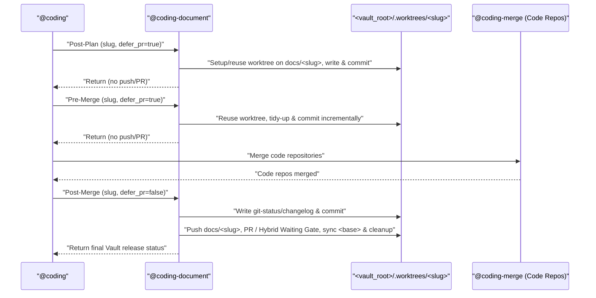

# Obsidian Vault Git Worktree & PR Lifecycle Architecture Plan

> [!NOTE] Lifecycle Status: Phase 6 Complete — Ready to Merge (Pre-Merge Tidy-Up)
> - **Architecture Decision Record**: [[architecture/adr-016-obsidian-vault-worktree-and-pr-lifecycle|ADR-016: Obsidian Vault Git Worktree & PR Lifecycle for @coding-document]]
> - **Feature Specification Note**: [[features/obsidian-worktree-pr-lifecycle|Feature: Obsidian Vault Git Worktree & PR Lifecycle (@coding-document)]]
> - **Target Repositories (2)**:
>   - `agentic-project-documenting-plugin` (`feature/obsidian-worktree-pr-lifecycle` @ `9c3c5b4`, `15/15` pytest passed)
>   - `agentic-coding-plugin` (`feature/obsidian-worktree-pr-lifecycle` @ `fc35a54`, `28/28` pytest passed)
> - **Isolation Worktree / Branch**: `<repo_root>/.worktrees/obsidian-worktree-pr-lifecycle` on `feature/obsidian-worktree-pr-lifecycle`
> - **Local Deployment (`@coding-deploy`)**: Not Required across both repositories
> - **Approved Spec**: [`specification.md`](file:///Users/gpfister/.gemini/antigravity/brain/80702574-ccc2-4666-8292-74b14ad1fcb5/specification.md)
> - **Approved Plan**: [`plan.md`](file:///Users/gpfister/.gemini/antigravity/brain/7c7af799-883f-444a-a23e-3c109736f1cf/plan.md)
> - **Review & QA Audit**: [`review-obsidian-worktree-pr-lifecycle.md`](file:///Users/gpfister/.gemini/antigravity/brain/e6771348-445c-4880-88aa-179e69836f9d/review-obsidian-worktree-pr-lifecycle.md) (**PASS**, zero unplanned changes)

---

## 1. Overview & Execution Order

This plan introduces self-managed Git worktree isolation (`<vault_root>/.worktrees/<slug>` on `docs/<slug>`), incremental commits, `defer_pr` multi-phase accumulation, Remote/Local/Non-Git release & cleanup strategies, Hybrid PR Waiting Gate, and Dual-Mode Question Relay (`[QUESTION_RELAY_REQUEST]` / `[QUESTION_RELAY_RESPONSE]`) for `@coding-document` across `*-obsidian/` repositories, alongside multi-phase orchestration updates in `@coding`.

### Execution Order
1. **`agentic-project-documenting-plugin`**: Defines `@coding-document` worktree isolation, `defer_pr`, release/cleanup strategies, Question Relay behavior, and unit tests.
2. **`agentic-coding-plugin`**: Updates `@coding` to pass `slug` and `defer_pr` across Post-Plan, Pre-Merge, and Post-Merge hooks, forward `[QUESTION_RELAY_REQUEST]` for `@coding-document`, and keep `@coding-merge` scoped to code repositories + unit tests.



---

## 2. Per-Repository Work Breakdown & Verification

### Repository 1: [`agentic-project-documenting-plugin`](file:///Users/gpfister/Development/Projects/gpfister/agentic/agentic-project-documenting-plugin)
- **Branch / Commit**: `feature/obsidian-worktree-pr-lifecycle` (`9c3c5b4`)
- **Worktree**: `agentic-project-documenting-plugin/.worktrees/obsidian-worktree-pr-lifecycle` (Primary repo clean on `main...origin/main`)
- **Modified Planned Files (6, 0 unplanned)**:
  1. [`agents/coding-document/agent.md`](file:///Users/gpfister/Development/Projects/gpfister/agentic/agentic-project-documenting-plugin/agents/coding-document/agent.md):
     - Restrict `write_file` to `<vault_root>/.worktrees/<slug>/**` (or `<vault_root>/**` under Non-Git Fallback) and session artifacts under `<appDataDir>/brain/<conversation-id>/*.md`.
     - Scope `run_command` to read-only code-repo git inspection, `scripts/sync_sessions.py`, and `*-obsidian/` git worktree/commit/push/`gh`/sync/cleanup commands. Keep `edit_file` strictly prohibited.
     - Add Worktree Isolation (`<vault_root>` on `<base>`, `.worktrees/<slug>` on `docs/<slug>`, `.worktrees/` ignore check, `worktree list`/`prune`/`add`), Multi-Phase `defer_pr` & Single-Shot Modes, Remote/Local/Non-Git Release & Cleanup Strategies, Hybrid PR Waiting Gate, and Dual-Mode Question Relay Protocol.
  2. [`skills/coding-document/SKILL.md`](file:///Users/gpfister/Development/Projects/gpfister/agentic/agentic-project-documenting-plugin/skills/coding-document/SKILL.md): Document worktree lifecycle, `defer_pr` contract, Release & Cleanup strategies, Hybrid PR Waiting Gate, and Dual-Mode Question Relay.
  3. [`rules/AGENTS.md`](file:///Users/gpfister/Development/Projects/gpfister/agentic/agentic-project-documenting-plugin/rules/AGENTS.md): Update Section 2 (Safety Boundary) and Section 3 (`@coding` `slug` + `defer_pr` handoff and Dual-Mode Question Relay).
  4. [`agents/agent.md`](file:///Users/gpfister/Development/Projects/gpfister/agentic/agentic-project-documenting-plugin/agents/agent.md) & [`README.md`](file:///Users/gpfister/Development/Projects/gpfister/agentic/agentic-project-documenting-plugin/README.md): Summarize self-managed `*-obsidian/` worktree isolation, `docs/<slug>` branching, `defer_pr` accumulation, PR/merge cleanup, and Question Relay.
  5. [`tests/test_plugin.py`](file:///Users/gpfister/Development/Projects/gpfister/agentic/agentic-project-documenting-plugin/tests/test_plugin.py): Preserve all 11 existing tests and add 4 new tests covering `.worktrees/<slug>`, `docs/<slug>`, `defer_pr`, release strategies, Hybrid PR Waiting Gate, Question Relay, and `edit_file` prohibition.
- **Verification (`PASS`)**:
  ```bash
  uv --directory /Users/gpfister/Development/Projects/gpfister/agentic/agentic-project-documenting-plugin/.worktrees/obsidian-worktree-pr-lifecycle run pytest -v
  # Result: 15 passed, 0 failed (0.02s)
  ```

### Repository 2: [`agentic-coding-plugin`](file:///Users/gpfister/Development/Projects/gpfister/agentic/agentic-coding-plugin)
- **Branch / Commit**: `feature/obsidian-worktree-pr-lifecycle` (`fc35a54`)
- **Worktree**: `agentic-coding-plugin/.worktrees/obsidian-worktree-pr-lifecycle` (Primary repo clean on `main...origin/main`)
- **Modified Planned Files (4, 0 unplanned)**:
  1. [`agents/coding/agent.md`](file:///Users/gpfister/Development/Projects/gpfister/agentic/agentic-coding-plugin/agents/coding/agent.md): Include `@coding-document` in Question Relay handling; pass consistent `slug` and `defer_pr=true` (Post-Plan, Pre-Merge) and `defer_pr=false` (Post-Merge); clarify `@coding-merge` remains scoped to code repositories only.
  2. [`skills/coding-orchestrator/SKILL.md`](file:///Users/gpfister/Development/Projects/gpfister/agentic/agentic-coding-plugin/skills/coding-orchestrator/SKILL.md): Align Post-Plan, Pre-Merge, and Post-Merge `@coding-document` hooks, Mermaid diagram, and Question Relay routing.
  3. [`rules/AGENTS.md`](file:///Users/gpfister/Development/Projects/gpfister/agentic/agentic-coding-plugin/rules/AGENTS.md): Update Sections 4, 6, and 8 for `slug`/`defer_pr` coordination, `@coding-document` Question Relay routing, and `*-obsidian/` vs. code-repo worktree ownership.
  4. [`tests/test_plugin.py`](file:///Users/gpfister/Development/Projects/gpfister/agentic/agentic-coding-plugin/tests/test_plugin.py): Preserve all 27 existing tests and add 1 new test for `defer_pr` coordination, `@coding-document` Question Relay routing, and `@coding-merge` code-repo scoping.
- **Verification (`PASS`)**:
  ```bash
  uv --directory /Users/gpfister/Development/Projects/gpfister/agentic/agentic-coding-plugin/.worktrees/obsidian-worktree-pr-lifecycle run pytest -v
  # Result: 28 passed, 0 failed (0.03s)
  ```
