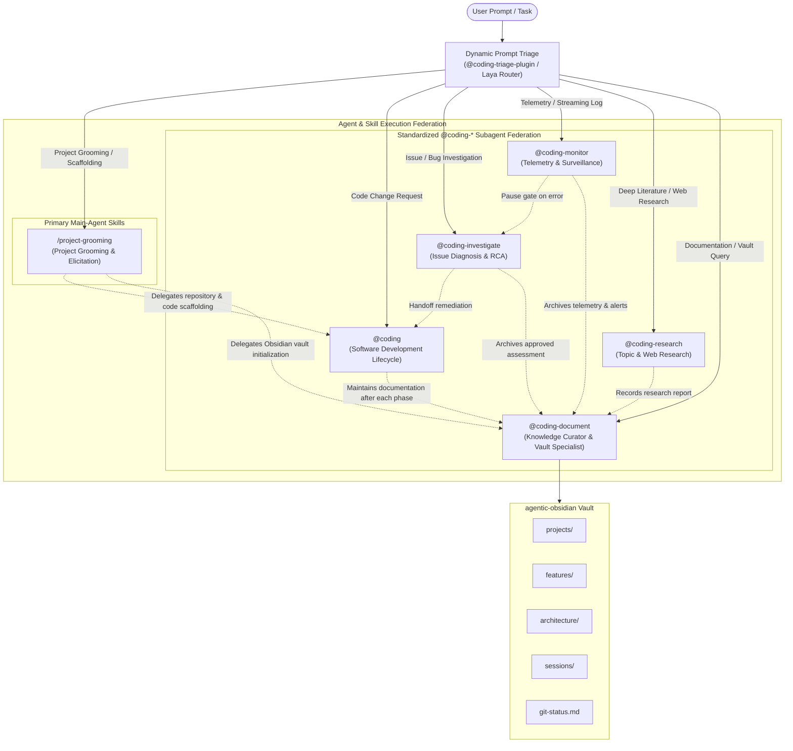

# Agentic Workspace Architecture Overview

## Motivation & Principles
The **Agentic** workspace is designed to author, test, and maintain a federation of **Google Antigravity** plugins while maintaining an indexed Obsidian knowledge base.

### Key Tenets
1. **Multi-Repo Federation**: Each plugin is self-contained with its own Git history, `uv`-managed virtual environment, tests, and configuration. The parent directory acts as an orchestrator.
2. **Declarative Multi-Agent Orchestration**: Plugins define specialized subagents as markdown files (`agents/*.md`) registered at `SessionStart` and routed at `PreInvocation` via the **Laya Router** System 1 classifier.
3. **Interactive Artifact Gates**: Key lifecycle milestones (`specification.md`, `plan.md`, `issue-assessment.md`) use Antigravity's interactive `RequestFeedback=True` approval modals before advancing execution.
4. **Knowledge Continuity**: Agent interactions, reasoning steps, tool usage, and generated artifacts from both `~/.gemini/antigravity/brain` and `~/.gemini/antigravity-cli/brain` are exported to `agentic-obsidian/sessions/` using structured callouts and frontmatter metadata.
5. **Progressive Disclosure**: Skills and rules adhere strictly to Antigravity guidelines, minimizing context overhead while providing targeted guidance.
6. **Standard Antigravity Packaging**: All plugins comply with native manifest and lifecycle specs (`plugin.json`, `agents/`, `rules/AGENTS.md`, `skills/`, `hooks.json`, `mcp_config.json`).

---

## System Topology & Subagent Federation

---

## Repository Map

| Repository / Path | Purpose |
| :--- | :--- |
| [`AGENTS.md`](file:///Users/gpfister/Development/Projects/gpfister/agentic/AGENTS.md) | Root workspace coordination instructions, cross-plugin interoperability guidelines, and 6-stage flowchart. |
| [`scripts/sync_sessions.py`](file:///Users/gpfister/Development/Projects/gpfister/agentic/scripts/sync_sessions.py) | Exports Antigravity session transcripts and artifacts into `agentic-obsidian/sessions/`. |
| [`scripts/worktree.py`](file:///Users/gpfister/Development/Projects/gpfister/agentic/scripts/worktree.py) | Manages isolated Git worktrees across root and sub-repositories for parallel sessions. |
| [`agentic-coding-plugin/`](file:///Users/gpfister/Development/Projects/gpfister/agentic/agentic-coding-plugin/) | 6-stage software development companion (`@coding`) with after-each-phase documentation maintenance. |
| [`agentic-investigate-plugin/`](file:///Users/gpfister/Development/Projects/gpfister/agentic/agentic-investigate-plugin/) | Autonomous multi-repo issue investigation plugin (`@coding-investigate`). |
| [`agentic-monitor-plugin/`](file:///Users/gpfister/Development/Projects/gpfister/agentic/agentic-monitor-plugin/) | Telemetry and stream surveillance companion (`@coding-monitor`, formerly `agentic-monitoring-plugin`). |
| [`agentic-document-plugin/`](file:///Users/gpfister/Development/Projects/gpfister/agentic/agentic-document-plugin/) | Centralized Obsidian documentation companion (`@coding-document`, formerly `agentic-obsidian-plugin`). |
| [`agentic-project-grooming-plugin/`](file:///Users/gpfister/Development/Projects/gpfister/agentic/agentic-project-grooming-plugin/) | Interactive project grooming, Matt Pocock style interrogation across 7 categories, and scaffolding coordinator (`/project-grooming`). |
| [`agentic-research-plugin/`](file:///Users/gpfister/Development/Projects/gpfister/agentic/agentic-research-plugin/) | Deep web and literature research companion (`@coding-research`). |
| [`agentic-triage-plugin/`](file:///Users/gpfister/Development/Projects/gpfister/agentic/agentic-triage-plugin/) | Dynamic Laya Router System 1 prompt triage hook adapting to installed plugins. |
| [`agentic-obsidian/`](file:///Users/gpfister/Development/Projects/gpfister/agentic/agentic-obsidian/) | Centralized Obsidian vault for plugin specs, architecture docs, and session logs. |

---

## Architectural Decision Records (ADRs)

| ADR ID | Title | Status |
| :--- | :--- | :--- |
| [[architecture/adr-001-standardize-agent-handles\|ADR-001]] | Standardize Subagent Handles, Aliases, and Skill Identifiers to Coding Namespace | Accepted |
| [[architecture/adr-002-agent-display-names-and-plugin-renames\|ADR-002]] | Agent Display Names Standardization & Dual Plugin Repository Rename | Accepted |
| [[architecture/adr-003-project-grooming-plugin\|ADR-003]] | Project Grooming Architecture, Skill-Only Execution, Grilling Protocol, Interactive Approval Gate, and Cross-Plugin Delegation | Accepted |
