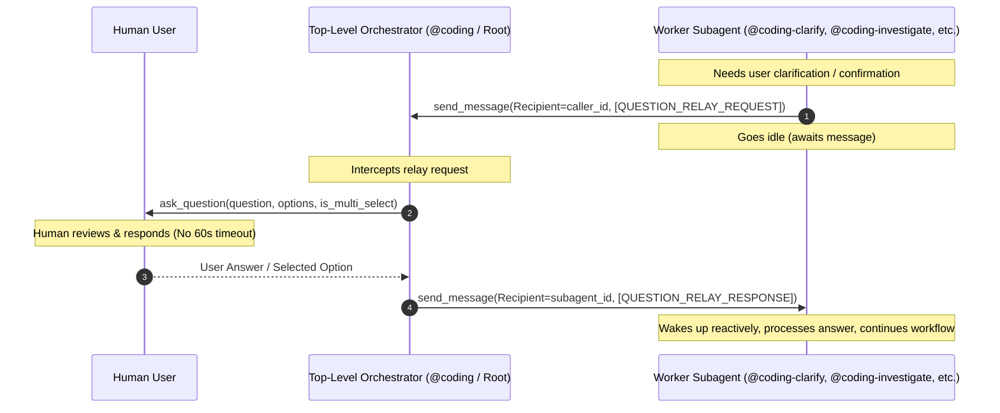
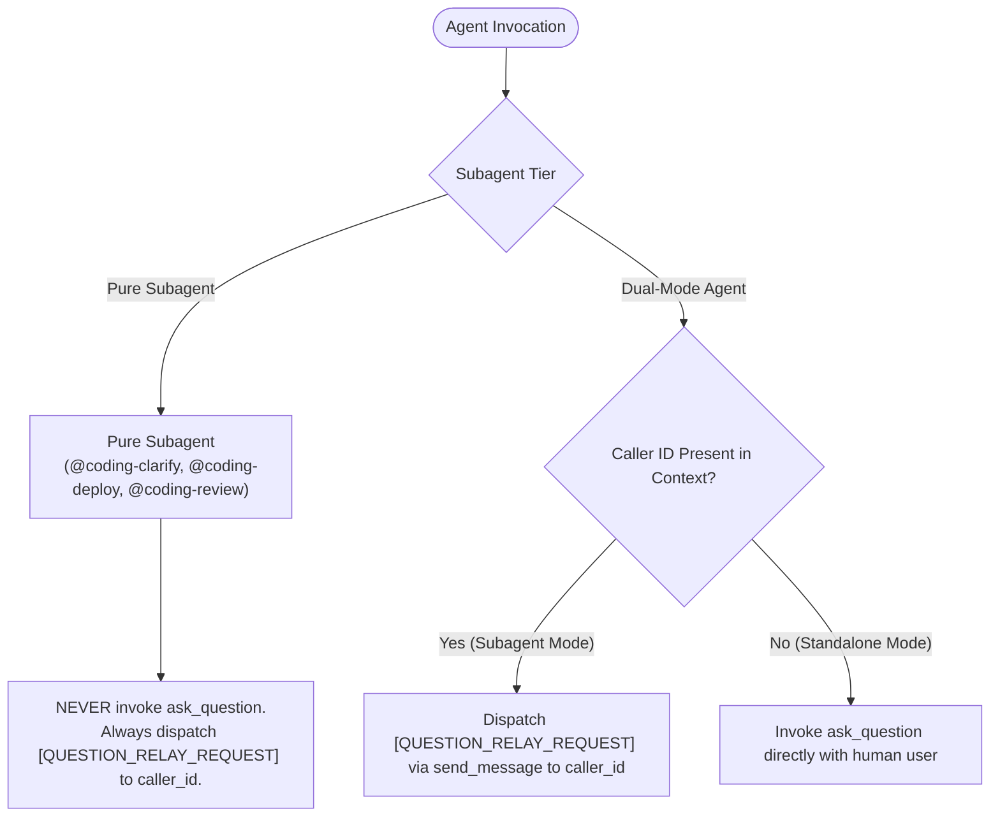

# Question Relay Protocol Architecture & Implementation Plan

## 1. Executive Summary & Problem Formulation

### 1.1 Problem Statement
In Google Antigravity, worker subagents spawned via `invoke_subagent` run in background processes managed by the host runtime. When a subagent calls `ask_question` directly, the host agent runtime enforces a strict **60-second execution timeout** on the turn. If human users require more than 60 seconds to review, deliberate, or answer multi-choice inquiries, the subagent tool invocation fails with a timeout exception, terminating the turn and aborting active workflows:
- Phase 1 clarification grilling (`@coding-clarify`).
- Phase 5 deployment strategy selection (`@coding-deploy`).
- Phase 6 merge confirmation gate (`@coding-review`).
- Stream anomaly pause gates (`@coding-monitor`).
- Issue investigation remediation gates (`@coding-investigate`).
- Research scope clarification (`@coding-research`).
- Project grooming 7-category Matt Pocock interviews (`/project-grooming`).

Conversely, top-level orchestrators (`@coding` and root sessions) run without background execution timeouts and can await user input indefinitely.

### 1.2 Proposed Architecture: Option 3 (Question Relay Protocol)
To eliminate subagent timeouts while preserving interactive human-in-the-loop grilling and confirmation gates, the system relays questions through the top-level orchestrator:



---

## 2. Standardized Message Protocol

### 2.1 Request Envelope: `[QUESTION_RELAY_REQUEST]`
Dispatched by the worker subagent to the parent orchestrator (`caller_id`):

```text
[QUESTION_RELAY_REQUEST]
```
```json
{
  "type": "QUESTION_RELAY_REQUEST",
  "questions": [
    {
      "question": "Which architecture pattern should we follow for the relay handler?",
      "options": [
        "(Recommended) Event-driven message listener hook in orchestrator loop",
        "Synchronous subagent blocking loop with sleep",
        "Direct callback via shared memory"
      ],
      "is_multi_select": false
    }
  ],
  "context": "Clarification needed for orchestrator-subagent interaction design."
}
```

#### Field Schema
| Field | Type | Required | Description |
| :--- | :--- | :--- | :--- |
| `type` | string | Yes | Fixed value `"QUESTION_RELAY_REQUEST"`. |
| `questions` | array | Yes | Non-empty list containing **strictly 1 question** object to maintain the single-question rule. |
| `questions[i].question` | string | Yes | Prompt text displayed to the human user. |
| `questions[i].options` | array[string] | Yes | Selectable choices, with `(Recommended)` prefixing the recommended option. |
| `questions[i].is_multi_select` | boolean | No | Defaults to `false`. If `true`, permits multiple choices. |
| `context` | string | No | Optional contextual rationale for the prompt. |

### 2.2 Response Envelope: `[QUESTION_RELAY_RESPONSE]`
Dispatched by the orchestrator back to the worker subagent (`subagent_id`):

```text
[QUESTION_RELAY_RESPONSE]
```
```json
{
  "type": "QUESTION_RELAY_RESPONSE",
  "answers": [
    "(Recommended) Event-driven message listener hook in orchestrator loop"
  ],
  "status": "COMPLETED"
}
```

#### Field Schema
| Field | Type | Required | Description |
| :--- | :--- | :--- | :--- |
| `type` | string | Yes | Fixed value `"QUESTION_RELAY_RESPONSE"`. |
| `answers` | array[string] | Yes | Selected option string(s) or custom user input text. |
| `status` | string | Yes | `"COMPLETED"`, `"REJECTED"`, or `"CANCELLED"`. |

---

## 3. Subagent Execution Tiers



1. **Pure Subagents** (`@coding-clarify`, `@coding-deploy`, `@coding-review`):
   - Only run under `@coding`.
   - Never call `ask_question`. Tool declarations omit `ask_question` and declare `send_message`.
2. **Dual-Mode Subagents & Orchestrators** (`@coding-investigate`, `/project-grooming`, `@coding-monitor`, `@coding-research`, and `@coding` via [[architecture/adr-008-dual-mode-coding-orchestrator|ADR-008]]):
   - When invoked by a parent/caller: dispatch/forward `[QUESTION_RELAY_REQUEST]` upward via `send_message` (Multi-Hop Relay).
   - When invoked directly by human as root agent: invoke `ask_question` directly.

---

## 4. Multi-Repository Work Breakdown

### Repository Matrix

| Repository | Git Branch | Local Deployment | Primary Deliverables |
| :--- | :--- | :--- | :--- |
| [`agentic-coding-plugin/`](file:///Users/gpfister/Development/Projects/gpfister/agentic/agentic-coding-plugin) | `feature/question-relay-protocol` | Not Required | Add `send_message` to `coding-clarify`, update `@coding` orchestrator relay handler, update `coding-deploy` & `coding-review`, update tests. |
| [`agentic-issue-investigation-plugin/`](file:///Users/gpfister/Development/Projects/gpfister/agentic/agentic-issue-investigation-plugin) | `feature/question-relay-protocol` | Not Required | Dual-mode support in `@coding-investigate` for user interrogation and remediation confirmation gate. |
| [`agentic-project-grooming-plugin/`](file:///Users/gpfister/Development/Projects/gpfister/agentic/agentic-project-grooming-plugin) | `feature/question-relay-protocol` | Not Required | Dual-mode support in `@coding-groom` for Matt Pocock 7-category grilling interviews. |
| [`agentic-task-monitoring-plugin/`](file:///Users/gpfister/Development/Projects/gpfister/agentic/agentic-task-monitoring-plugin) | `feature/question-relay-protocol` | Not Required | Dual-mode support in `@coding-monitor` for anomaly detection pause gates. |
| [`agentic-topic-researching-plugin/`](file:///Users/gpfister/Development/Projects/gpfister/agentic/agentic-topic-researching-plugin) | `feature/question-relay-protocol` | Not Required | Dual-mode support in `@coding-research` for research scope formulation and clarification. |
| [`agentic` (Root Orchestrator)](file:///Users/gpfister/Development/Projects/gpfister/agentic) | `feature/question-relay-protocol` | Not Required | Update [`AGENTS.md`](file:///Users/gpfister/Development/Projects/gpfister/agentic/AGENTS.md) Cross-Plugin Section and 6-stage lifecycle flowchart; update [`README.md`](file:///Users/gpfister/Development/Projects/gpfister/agentic/README.md). |

---

## 5. Acceptance Criteria & Verification Summary

- [x] **AC 1: Standardized Envelopes**: `[QUESTION_RELAY_REQUEST]` and `[QUESTION_RELAY_RESPONSE]` schemas documented across rules and manifests.
- [x] **AC 2: Pure Subagent Compliance**: `@coding-clarify`, `@coding-deploy`, and `@coding-review` omit direct `ask_question`; all inquiries use `send_message`.
- [x] **AC 3: Dual-Mode Subagent Support**: `@coding-investigate`, `@coding-groom`, `@coding-monitor`, and `@coding-research` dynamically branch between relay request and direct `ask_question`.
- [x] **AC 4: Orchestrator Relay Loop**: `@coding` intercepts relay requests, runs `ask_question` at the top level without timeouts, and returns response envelopes.
- [x] **AC 5: Ecosystem Test Suite**: 100% test pass rate across all 5 plugin repositories (60/60 unit tests passing):
  - `agentic-coding-plugin`: **15/15 passed**
  - `agentic-issue-investigation-plugin`: **10/10 passed**
  - `agentic-project-grooming-plugin`: **12/12 passed**
  - `agentic-task-monitoring-plugin`: **11/11 passed**
  - `agentic-topic-researching-plugin`: **12/12 passed**
- [x] **AC 6: Workspace Documentation Consistency**: Root `AGENTS.md`, `README.md`, Obsidian architecture, ADR-005, and feature specifications fully synchronized.

> [!NOTE] Phase 7 Release Merge Verdict: Merged into master & Released
> All 6 participating repositories have successfully executed fast-forward release merge into `master` (`695e1b1`, `d2c822c`, `df03d3c`, `a2e7932`, `23a101e`, `efb067d`). All 147/147 unit tests pass cleanly workspace-wide. Feature `SPEC-2026-RELAY-001` is released.
