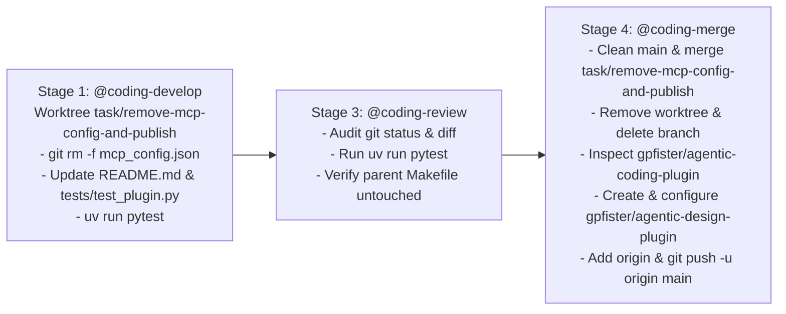

# Architecture & Implementation Plan: `agentic-design-plugin` Cleanup & GitHub Publication

> [!NOTE]
> - **Feature Note**: [[features/remove-mcp-config-and-publish|agentic-design-plugin GitHub Remote Setup & Working Tree Finalization]]
> - **Approved Specification**: [specification.md](file:///Users/gpfister/.gemini/antigravity/brain/f9451afa-521e-429c-9a1e-11830bd1ce85/specification.md)
> - **Approved Plan**: [plan.md](file:///Users/gpfister/.gemini/antigravity/brain/33bab1a3-fa8f-4437-85a7-49f372d0dffc/plan.md)
> - **Related Decision Record**: [[architecture/adr-013-coding-design-plugin-and-penpot-mcp|ADR-013]]

---

## 1. Architectural Impact

### Externalized PenPot MCP Configuration
Originally, [[architecture/adr-013-coding-design-plugin-and-penpot-mcp|ADR-013]] bundled a portable `mcp_config.json` inside `agentic-design-plugin/`. Removing `mcp_config.json` shifts PenPot MCP server registration to the user's host Antigravity MCP configuration while retaining `PENPOT_MCP_URL` (defaulting to `http://localhost:4401/mcp`) as the documented endpoint contract in [`README.md`](file:///Users/gpfister/Development/Projects/gpfister/agentic/agentic-design-plugin/README.md).

### Worktree Isolation & Scope
- **Target Repository**: [`agentic-design-plugin`](file:///Users/gpfister/Development/Projects/gpfister/agentic/agentic-design-plugin)
- **Worktree**: `.worktrees/remove-mcp-config-and-publish` on branch `task/remove-mcp-config-and-publish`
- **Primary Branch Invariant**: `main` remains checked out in the primary repository working tree during development and review.
- **Local Deployment**: **Not Required** (no `Dockerfile`, `compose.yaml`, local deployment scripts, Terraform/K8s manifests, or `Makefile` in `agentic-design-plugin`). `coding-deploy` is skipped.

---

## 2. Execution Workflow

### Stage Breakdown
1. **Stage 1 (`@coding-develop`)**:
   - Create/reuse `.worktrees/remove-mcp-config-and-publish` on `task/remove-mcp-config-and-publish`.
   - Remove `mcp_config.json` (`git rm -f mcp_config.json`).
   - Update `README.md` (`## PenPot MCP Configuration`) to document external Antigravity MCP setup and `PENPOT_MCP_URL`.
   - Update `tests/test_plugin.py` (`test_mcp_config_valid_and_portable`) to align with the removal of `mcp_config.json`.
   - Run `uv run pytest` and commit on `task/remove-mcp-config-and-publish`.
2. **Stage 2 (`@coding-deploy`)**:
   - Skipped (`Local Deployment: Not Required`).
3. **Stage 3 (`@coding-review`)**:
   - Inspect `git status` and `git diff main..task/remove-mcp-config-and-publish`.
   - Run `uv run pytest` and verify no unintended or parent workspace changes.
4. **Stage 4 (`@coding-merge`)**:
   - Restore any unstaged deletion of `mcp_config.json` on `main` (`git restore mcp_config.json`) if present, merge `task/remove-mcp-config-and-publish` into `main`, remove `.worktrees/remove-mcp-config-and-publish`, prune worktrees, and delete `task/remove-mcp-config-and-publish`.
   - Inspect `gpfister/agentic-coding-plugin` via `gh repo view` / `gh api`.
   - Create `gpfister/agentic-design-plugin` on GitHub (idempotently) with `plugin.json` description and mirrored visibility/merge settings.
   - Configure `origin` (`git@github.com:gpfister/agentic-design-plugin.git`), run `git push -u origin main`, and verify `git remote -v`, `git branch -vv`, and `git status`.

---

## 3. Verification Matrix

| Phase | Command | Expected Outcome |
| :--- | :--- | :--- |
| Development / Review | `uv run pytest` | All tests in `tests/test_plugin.py` pass |
| Merge / Publish | `gh repo view gpfister/agentic-design-plugin` | Repository exists with mirrored settings & `plugin.json` description |
| Merge / Publish | `git remote -v && git branch -vv && git status` | `origin` is `git@github.com:gpfister/agentic-design-plugin.git`, `main` tracks `origin/main`, clean tree |
