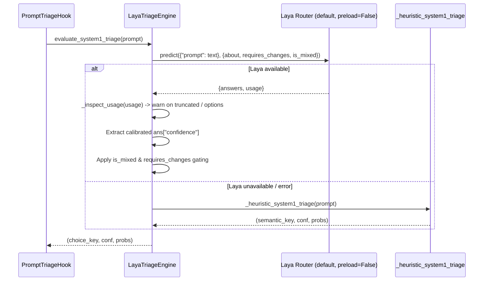

# Semantic Laya Triage & Parallel `choice` + `noul` Decomposition Architecture Plan

> [!NOTE] Lifecycle Status: Merged / Completed (`PHASE 7 COMPLETE`)
> - **Architecture Decision Record**: [[architecture/adr-017-semantic-laya-triage-and-parallel-choice-noul-decomposition|ADR-017: Semantic Laya Triage & Parallel choice + noul Decomposition]]
> - **Feature Specification Note**: [[features/semantic-laya-triage|Feature: Semantic Laya Triage & Parallel choice + noul Decomposition]]
> - **Target Repository (1)**: [`agentic-prompt-triage-plugin`](file:///Users/gpfister/Development/Projects/gpfister/agentic/agentic-prompt-triage-plugin)
> - **Release / Merge**: [PR #2](https://github.com/gpfister/agentic-prompt-triage-plugin/pull/2) merged into `main` at `ff5a3ae`; `.worktrees/semantic-laya-triage` removed & pruned; `feature/semantic-laya-triage` deleted locally & remotely
> - **Local Deployment (`@coding-deploy`)**: Not Required (Python lifecycle hook package managed via `uv` and `pytest`)
> - **Verification**: `101/101` tests passing (`uv run pytest -v`), CLI smoke test passed, empirical Laya evaluation selected `default` (`Router(preload=False)`) over `typed-decisions`, QA review **PASS** with zero unplanned changes
> - **Approved Spec**: [`specification.md`](file:///Users/gpfister/.gemini/antigravity/brain/d960a873-bd14-41ff-926f-3b099ca59e43/specification.md)
> - **Approved Plan**: [`plan.md`](file:///Users/gpfister/.gemini/antigravity/brain/d960a873-bd14-41ff-926f-3b099ca59e43/plan.md)
> - **QA Review Report**: [`review-semantic-laya-triage.md`](file:///Users/gpfister/.gemini/antigravity/brain/d960a873-bd14-41ff-926f-3b099ca59e43/review-semantic-laya-triage.md)

---

## 1. Overview & Architecture

Refactored [`hooks/prompt_triage.py`](file:///Users/gpfister/Development/Projects/gpfister/agentic/agentic-prompt-triage-plugin/hooks/prompt_triage.py), [`tests/test_prompt_triage.py`](file:///Users/gpfister/Development/Projects/gpfister/agentic/agentic-prompt-triage-plugin/tests/test_prompt_triage.py), [`scripts/eval_laya_triage.py`](file:///Users/gpfister/Development/Projects/gpfister/agentic/agentic-prompt-triage-plugin/scripts/eval_laya_triage.py), [`README.md`](file:///Users/gpfister/Development/Projects/gpfister/agentic/agentic-prompt-triage-plugin/README.md), and [`rules/AGENTS.md`](file:///Users/gpfister/Development/Projects/gpfister/agentic/agentic-prompt-triage-plugin/rules/AGENTS.md) inside `agentic-prompt-triage-plugin` (merged into `main` at `ff5a3ae`).

### Component Flow

---

## 2. Implemented Work Breakdown (`agentic-prompt-triage-plugin`)

### Step 1: Semantic Criteria Keys & Anchored `TRIAGE_QUESTION` (FR-1, FR-3) — Completed & Merged
- **File**: [`hooks/prompt_triage.py`](file:///Users/gpfister/Development/Projects/gpfister/agentic/agentic-prompt-triage-plugin/hooks/prompt_triage.py)
- Set `TRIAGE_QUESTION = "Which single agent or action should handle `prompt`?"`.
- Refactored `build_dynamic_triage_spec(installed_plugins)` to emit semantic keys (`inquiry`, `coding`, `monitoring`, `investigation`, `research`, `documentation`, `grooming`, `design`) with concise, mutually-exclusive, action-oriented descriptions.
- Removed `mixed` from `triage_responses` (`spec.responses`) while keeping `response_to_intent["mixed"] = "mixed"` and `response_to_directive["mixed"]`.

### Step 2: Parallel `choice` + `noul` Triage, `usage` Inspection & Calibrated Confidence (FR-2, FR-4) — Completed & Merged
- **File**: [`hooks/prompt_triage.py`](file:///Users/gpfister/Development/Projects/gpfister/agentic/agentic-prompt-triage-plugin/hooks/prompt_triage.py)
- Submitted `"about"` (`choice`), `"requires_changes"` (`noul`), and `"is_mixed"` (`noul`) in a single `self._predict_with_laya(prompt, questions)` call (omitting `is_mixed` when `len(self.triage_responses) <= 1`).
- Added `_inspect_usage` to inspect `res.get("usage", {})` for `truncated` / `truncated_questions` and `options` collisions/mismatches, logging structured `logger.warning(...)` messages.
- Preferred `ans.get("confidence")` over `probs.get(choice, ans.get("answer_confidence", 0.0))`.
- Applied Python post-processing:
  - `is_mixed == "yes"` with high confidence (`>= CONFIDENCE_THRESHOLD`) -> `("mixed", mixed_conf, probs)`.
  - `MUTATING_AGENTS = frozenset({"coding", "documentation", "grooming", "design"})` + `requires_changes == "no"` -> cap confidence `< CONFIDENCE_THRESHOLD` (`0.80`) to trigger `ask_question` disambiguation.
  - `inquiry` + `requires_changes == "yes"` -> cap confidence `< CONFIDENCE_THRESHOLD`.
  - `NON_MUTATING_AGENTS = frozenset({"monitoring", "investigation", "research"})` -> exempt from `requires_changes == "no"` penalty.
  - Missing `requires_changes` / `is_mixed` -> neutral.
- Updated `_heuristic_system1_triage` and `triage()` default fallback key to semantic keys (fallback `"inquiry"`).

### Step 3: Unit Test Suite Updates (FR-5.1) — Completed & Merged
- **File**: [`tests/test_prompt_triage.py`](file:///Users/gpfister/Development/Projects/gpfister/agentic/agentic-prompt-triage-plugin/tests/test_prompt_triage.py)
- Migrated `response 1`..`response 9` assertions to semantic keys, verified `mixed` is absent from `triage_responses`, verified updated `TRIAGE_QUESTION`, and added mocked `self._router.predict` tests for parallel `choice` + `noul`, gating, exemptions, calibrated confidence, `usage` warnings, and `inquiry`-only edge case (`89/89` passed; `101/101` total with `tests/test_plugin.py`).

### Step 4: Empirical Laya Evaluation & Router Model Selection (FR-4.3, FR-5.2) — Completed & Merged
- **File**: [`scripts/eval_laya_triage.py`](file:///Users/gpfister/Development/Projects/gpfister/agentic/agentic-prompt-triage-plugin/scripts/eval_laya_triage.py)
- Benchmarked `Router(preload=False)` (`default`) vs `Router(model="typed-decisions", preload=False)` across all 10 categories (`inquiry`, `coding`, `monitoring`, `investigation`, `research`, `documentation`, `grooming`, `design`, `mixed`, ambiguous).
- **Outcome**: `default` (`Router(preload=False)`) outperformed `typed-decisions` and was retained as the default configuration in `LayaTriageEngine.__init__`.

### Step 5: Documentation Consistency (FR-6) — Completed & Merged
- **Files**: [`README.md`](file:///Users/gpfister/Development/Projects/gpfister/agentic/agentic-prompt-triage-plugin/README.md), [`rules/AGENTS.md`](file:///Users/gpfister/Development/Projects/gpfister/agentic/agentic-prompt-triage-plugin/rules/AGENTS.md)
- Documented all supported plugins (including `agentic-design-plugin` / `@coding-design`), `Router(preload=False)` default, semantic criteria keys, parallel `choice` + `noul` decomposition, `usage` diagnostics, and calibrated confidence.

---

## 3. Verification Results

Executed inside `.worktrees/semantic-laya-triage` prior to merge ([PR #2](https://github.com/gpfister/agentic-prompt-triage-plugin/pull/2) -> `main` at `ff5a3ae`):

1. `uv run pytest -v` -> **`101 passed in 3.96s`** (`tests/test_plugin.py`: 12 passed; `tests/test_prompt_triage.py`: 89 passed).
2. `echo '{"prompt": "Explain how prompt_triage.py works", "invocationNum": 0}' | uv run python hooks/prompt_triage.py` -> **Exited `0`**, output `{"injectSteps": []}`.
3. QA Audit ([`review-semantic-laya-triage.md`](file:///Users/gpfister/.gemini/antigravity/brain/d960a873-bd14-41ff-926f-3b099ca59e43/review-semantic-laya-triage.md)) -> **PASS** (zero unplanned changes).
4. Post-merge cleanup: `.worktrees/semantic-laya-triage` removed & pruned; `feature/semantic-laya-triage` deleted locally & remotely; `main` synchronized at `ff5a3ae`.
