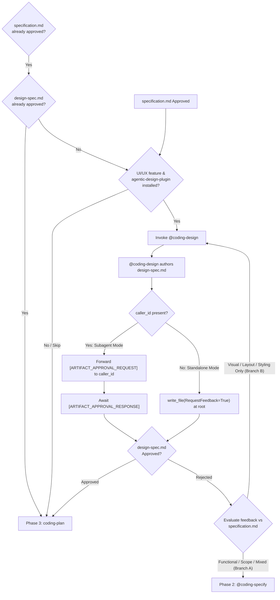

# UI Design Stage & Change-Request Loop Architecture & Implementation Plan

> [!NOTE] Implementation Milestone: Phase 7 (Merged & Released — [PR #7](https://github.com/gpfister/agentic-coding-plugin/pull/7))
> - **Approved Specification**: [specification.md](file:///Users/gpfister/.gemini/antigravity/brain/7c2e6aa5-d2ae-44bb-94f4-a5354ea85b6a/specification.md)
> - **Approved Plan**: [plan.md](file:///Users/gpfister/.gemini/antigravity/brain/7c2e6aa5-d2ae-44bb-94f4-a5354ea85b6a/plan.md)
> - **Review & QA Audit**: [review-ui-design-stage-loop.md](file:///Users/gpfister/.gemini/antigravity/brain/7c2e6aa5-d2ae-44bb-94f4-a5354ea85b6a/review-ui-design-stage-loop.md) (**PASS**, `27/27` tests passing)
> - **Architecture Decision Record**: [[architecture/adr-014-ui-design-stage-and-change-request-loop|ADR-014]]
> - **Feature Specification Note**: [[features/ui-design-stage-and-change-request-loop|Feature: UI Design Stage & Change-Request Loop]]
> - **Merged State**: [PR #7](https://github.com/gpfister/agentic-coding-plugin/pull/7) merged `feature/ui-design-stage-loop` -> `main` at `634f62b` (implementation commit `314ce39`); `.worktrees/ui-design-stage-loop` removed and branches pruned (`agentic-coding-plugin`).

---

## 1. Architecture Summary

This change establishes a deterministic **UI Design Stage (`@coding-design`)** strictly between **Phase 2 (`coding-specify`)** and **Phase 3 (`coding-plan`)** within `@coding` ([SKILL.md](file:///Users/gpfister/Development/Projects/gpfister/agentic/agentic-coding-plugin/skills/coding-orchestrator/SKILL.md) and [AGENTS.md](file:///Users/gpfister/Development/Projects/gpfister/agentic/agentic-coding-plugin/rules/AGENTS.md)):

1. **Strict Stage Placement**: Removes ambiguous *"or alongside `@coding-plan` and `@coding-develop`"* wording so UI/UX design always resolves before planning.
2. **Dual-Condition `DesignCheck`**: Triggers `@coding-design` only when **both** `agentic-design-plugin` is installed **and** the task involves UI/UX changes; non-UI tasks skip directly to Phase 3 (`coding-plan`).
3. **Pre-Clarified Fast-Path Consistency**: Checks whether `design-spec.md` is already approved (e.g., handoff from standalone `@coding-design`) before advancing to `P3`, otherwise routing through `DesignCheck`.
4. **Dual-Mode Validation Gate (`design-spec.md`)**: Relays `[QUESTION_RELAY_REQUEST]` and `[ARTIFACT_APPROVAL_REQUEST]` from `@coding-design` using the Dual-Mode Orchestrator protocol (Subagent Mode forwards to `caller_id`; Standalone Mode renders `write_file(RequestFeedback=True)` as sole final tool call).
5. **Design Change-Request Loop**: On `DesignGate` rejection, evaluates feedback against `specification.md`:
   - **Branch A (Functional / Scope / Mixed Feedback)**: Routes to `P2` (`@coding-specify`) with rejection feedback -> `specification.md` approval gate -> re-invokes `@coding-design`.
   - **Branch B (Visual / Layout / Styling Only)**: Re-invokes `@coding-design` directly with rejection feedback.
6. **Downstream Handoffs**: Passes approved `design-spec.md` path and PenPot references to both `@coding-plan` (Phase 3) and `@coding-develop` (Phase 4).

---

## 2. Repository & Work Breakdown

### Repository 1: `agentic-coding-plugin` (`/Users/gpfister/Development/Projects/gpfister/agentic/agentic-coding-plugin`)
- **Merged State**: `main` at `634f62b` ([PR #7](https://github.com/gpfister/agentic-coding-plugin/pull/7); `3 files changed, 71 insertions(+), 11 deletions(-)`; worktree `.worktrees/ui-design-stage-loop` removed and `feature/ui-design-stage-loop` deleted & pruned).
- **Local Deployment**: Not Required (markdown/prompt plugin with Python `pytest` suite)

| File | Implemented Modifications |
| :--- | :--- |
| [skills/coding-orchestrator/SKILL.md](file:///Users/gpfister/Development/Projects/gpfister/agentic/agentic-coding-plugin/skills/coding-orchestrator/SKILL.md) | `+30 / -7` lines across **Section 3** (`design-spec.md` already-approved check / `DesignCheck` routing in Pre-Clarified Fast-Path), **Section 4** (Mermaid flowchart `FastPathDesignCheck`, `SpecApproved --> DesignCheck`, Dual-Mode `DesignGate`, and `DesignFeedbackEval` Branch A -> `P2`, Branch B -> `InvokeDesign`), and **Section 5** (removed *"or alongside `@coding-plan` and `@coding-develop`"*, added UI/UX Design `@coding-design` handoff block, updated `coding-plan` and `coding-develop`). |
| [rules/AGENTS.md](file:///Users/gpfister/Development/Projects/gpfister/agentic/agentic-coding-plugin/rules/AGENTS.md) | `+4 / -4` lines adding `@coding-design` to **Sections 6 & 7** worker subagent lists for `[QUESTION_RELAY_REQUEST]` and `[ARTIFACT_APPROVAL_REQUEST]` interception and delegation. |
| [tests/test_plugin.py](file:///Users/gpfister/Development/Projects/gpfister/agentic/agentic-coding-plugin/tests/test_plugin.py) | `+37` lines adding `test_coding_orchestrator_ui_design_stage_and_change_request_loop` verifying removal of `"alongside @coding-plan and @coding-develop"`, flowchart nodes, Section 3/5 rules, and `rules/AGENTS.md` Sections 6 & 7 `@coding-design` references. |

### Repository 2: `agentic-design-plugin` (`/Users/gpfister/Development/Projects/gpfister/agentic/agentic-design-plugin`)
- **Changes**: None required (verified `skills/coding-design/SKILL.md`, `rules/AGENTS.md`, `agents/coding-design/agent.md`, and `README.md` have no conflicting stage-placement references).
- **Local Deployment**: Not Required.

---

## 3. Execution & Verification Sequence

1. **`coding-develop`** (Completed): Implemented edits in `.worktrees/ui-design-stage-loop` (`feature/ui-design-stage-loop`, commit `314ce39`) and verified `uv run pytest -v` (`27/27 passed` in `0.03s`).
2. **`coding-deploy`**: Skipped (`Local Deployment: Not Required`).
3. **`coding-review`** (Completed): Audited `git diff main..HEAD` against `plan.md` and `specification.md`; zero unplanned changes; `uv run pytest -v` passed (`27/27`).
4. **`coding-document`** (Pre-Merge Tidy-Up): Updated Obsidian vault architecture records, feature specs, plugin specs, and index notes.
5. **`coding-merge`** (Completed): Merged `feature/ui-design-stage-loop` into `main` via [PR #7](https://github.com/gpfister/agentic-coding-plugin/pull/7) (`634f62b`), removed `.worktrees/ui-design-stage-loop`, deleted local and remote `feature/ui-design-stage-loop` branches, and pruned tracking references.
6. **`coding-document`** (Post-Merge Sync): Updated `agentic-obsidian/git-status.md`, `agentic-obsidian/changelog.md`, and feature/architecture statuses to `Completed / Merged`.
