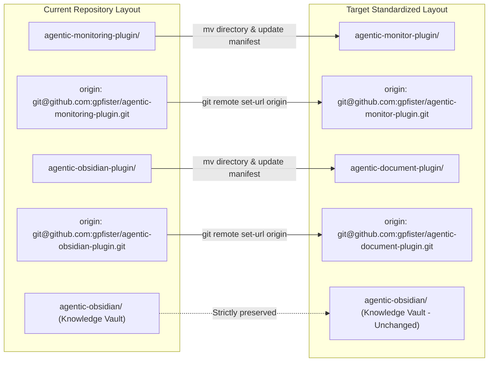
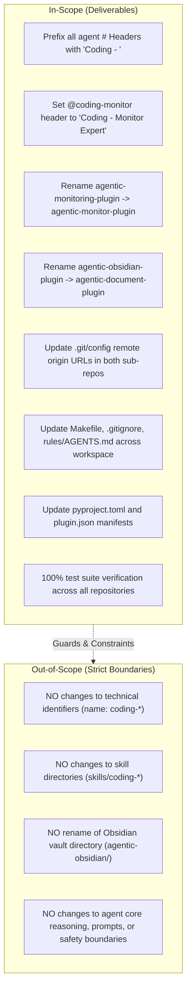
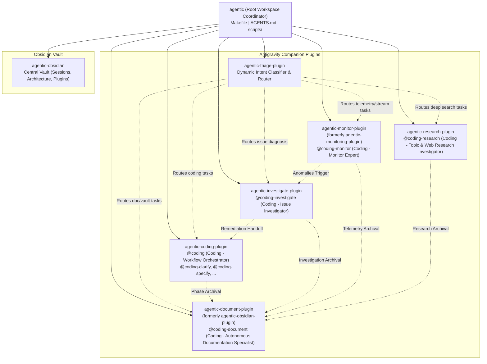
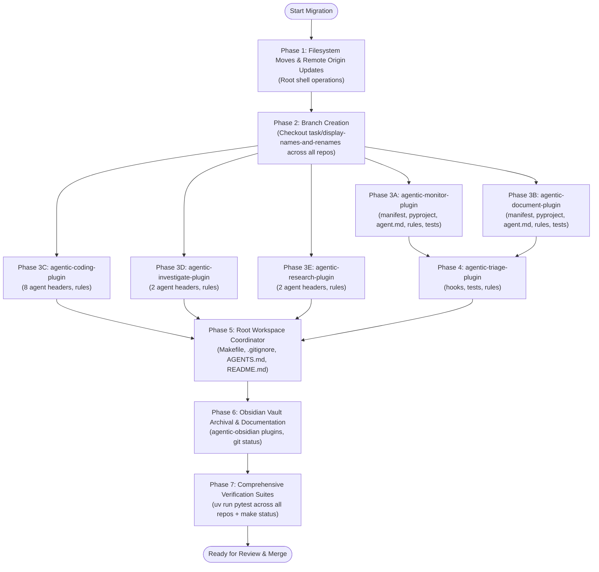

# Feature: Agent Display Names Standardization & Plugin Renames (agentic-monitor-plugin & agentic-document-plugin)

> [!NOTE] Phase 6: Merge & Release Completed (101/101 Tests Passing on master)
> - **Current Phase**: Phase 6: Merge & Release (Completed & Released)
> - **Approved Brain Specification**: [`specification.md`](file:///Users/gpfister/.gemini/antigravity/brain/2b726f54-496d-4a46-8461-49d0a86efe79/specification.md)
> - **Vault Archived Specification**: [`sessions/attachments/2b726f54-496d-4a46-8461-49d0a86efe79/specification.md`](file:///Users/gpfister/Development/Projects/gpfister/agentic/agentic-obsidian/sessions/attachments/2b726f54-496d-4a46-8461-49d0a86efe79/specification.md)
> - **Approved Brain Implementation Plan**: [`plan.md`](file:///Users/gpfister/.gemini/antigravity/brain/3355c861-6d22-4e70-99cd-7580458d338c/plan.md)
> - **Vault Archived Implementation Plan**: [`sessions/attachments/3355c861-6d22-4e70-99cd-7580458d338c/plan.md`](file:///Users/gpfister/Development/Projects/gpfister/agentic/agentic-obsidian/sessions/attachments/3355c861-6d22-4e70-99cd-7580458d338c/plan.md)
> - **Architecture Decision Record**: [[architecture/adr-002-agent-display-names-and-plugin-renames|ADR-002: Agent Display Names & Dual Plugin Repository Rename]] (Accepted)
> - **Release Strategy**: Fast-forward merge (`--ff-only`) from `task/display-names-and-renames` into `master` across all 8 repositories.
> - **Release Status**: Merged to `master` across all 8 repositories. Working branch `task/display-names-and-renames` cleaned up and deleted.
> - **QA & Test Verdict on Master**: 101/101 unit tests passing cleanly across 6 plugin test suites (100% pass rate).
> - **Lifecycle Completion**: Full 6-stage lifecycle completed (Clarify $\rightarrow$ Specify $\rightarrow$ Plan $\rightarrow$ Develop $\rightarrow$ Review $\rightarrow$ Merge).

---

## 1. Executive Summary & Problem Motivation

### 1.1 Context
The `agentic` workspace is a coordinated multi-repository ecosystem housing specialized Google Antigravity companion plugins (`agentic-coding-plugin`, `agentic-investigate-plugin`, `agentic-monitoring-plugin`, `agentic-obsidian-plugin`, `agentic-research-plugin`, `agentic-triage-plugin`) and a centralized Obsidian knowledge vault (`agentic-obsidian`).

Following the technical standardization of agent handles to the canonical `coding-*` namespace (see [[standardize-agent-handles|Standardize Agent Handles]]), two consistency and usability gaps were identified:
1. **Agent Display Name Inconsistency**: In chat interfaces, pickers, and documentation, agent display headings (`# <Title>`) lack a uniform, branded prefix, leading to inconsistent presentation across orchestrator and worker definitions.
2. **Repository Naming Mismatches**:
   - The telemetry plugin directory is named `agentic-monitoring-plugin`, while its primary worker agent is `@coding-monitor` and its remote repository was updated to `agentic-monitor-plugin`.
   - The documentation plugin directory is named `agentic-obsidian-plugin`, which causes naming confusion with the separate documentation vault repository `agentic-obsidian/`. Its primary worker is `@coding-document`, and its remote repository was updated to `agentic-document-plugin`.

---

## 2. Approved Technical Specification

### 2.1 Agent Display Name Standardization Matrix
All agent markdown definitions across the ecosystem must have their top-level `# <Title>` heading prefixed with `"Coding - "`.

> [!IMPORTANT]
> The YAML frontmatter property `name: <handle>` MUST NOT be modified under any circumstances. Preserving the exact handle guarantees that subagent dispatching, `send_message`, `@coding-*` invocations, and tool routing mechanisms remain completely intact.

| Agent Type | File Path | Current Title | Required Display Title (`#`) | YAML Handle (`name:`) |
| :--- | :--- | :--- | :--- | :--- |
| **Orchestrator** | `agentic-coding-plugin/agents/coding/agent.md` | `# Workflow Orchestrator` | `# Coding - Workflow Orchestrator` | `coding` *(Preserved)* |
| **Worker** | `agentic-coding-plugin/agents/coding-clarify/agent.md` | `# Requirement Clarifier` | `# Coding - Requirement Clarifier` | `coding-clarify` *(Preserved)* |
| **Worker** | `agentic-coding-plugin/agents/coding-specify/agent.md` | `# Specification Architect` | `# Coding - Specification Architect` | `coding-specify` *(Preserved)* |
| **Worker** | `agentic-coding-plugin/agents/coding-plan/agent.md` | `# Architecture Planner` | `# Coding - Architecture Planner` | `coding-plan` *(Preserved)* |
| **Worker** | `agentic-coding-plugin/agents/coding-develop/agent.md` | `# Software Engineer` | `# Coding - Software Engineer` | `coding-develop` *(Preserved)* |
| **Worker** | `agentic-coding-plugin/agents/coding-review/agent.md` | `# Quality Assurance Lead` | `# Coding - Quality Assurance Lead` | `coding-review` *(Preserved)* |
| **Worker** | `agentic-coding-plugin/agents/coding-merge/agent.md` | `# Release Engineer` | `# Coding - Release Engineer` | `coding-merge` *(Preserved)* |
| **Worker** | `agentic-monitor-plugin/agents/coding-monitor/agent.md` | `# Telemetry Monitor` / `# Monitor Expert` | `# Coding - Monitor Expert` | `coding-monitor` *(Preserved)* |
| **Worker** | `agentic-investigate-plugin/agents/coding-investigate/agent.md` | `# Issue Investigator` | `# Coding - Issue Investigator` | `coding-investigate` *(Preserved)* |
| **Worker** | `agentic-document-plugin/agents/coding-document/agent.md` | `# Autonomous Documentation Specialist` | `# Coding - Autonomous Documentation Specialist` | `coding-document` *(Preserved)* |
| **Worker** | `agentic-research-plugin/agents/coding-research/agent.md` | `# Topic & Web Research Investigator` | `# Coding - Topic & Web Research Investigator` | `coding-research` *(Preserved)* |
| **Catalog** | `agentic-coding-plugin/agents/agent.md` | `# Coding Subagents & Workflow` | `# Coding - Catalog` | *(Catalog - Preserved)* |
| **Catalog** | `agentic-investigate-plugin/agents/agent.md` | `# Issue Investigation Subagents` | `# Coding - Investigate Catalog` | *(Catalog - Preserved)* |
| **Catalog** | `agentic-monitor-plugin/agents/agent.md` | `# Monitoring Subagents` | `# Coding - Monitor Catalog` | *(Catalog - Preserved)* |
| **Catalog** | `agentic-document-plugin/agents/agent.md` | `# Obsidian Vault Documentation` | `# Coding - Document Catalog` | *(Catalog - Preserved)* |
| **Catalog** | `agentic-research-plugin/agents/agent.md` | `# Topic & Web Research Subagents` | `# Coding - Research Catalog` | *(Catalog - Preserved)* |

---

### 2.2 Dual Repository & Directory Rename Specification



#### 2.2.1 Directory Operations
- Rename workspace directory `agentic-monitoring-plugin/` to `agentic-monitor-plugin/`.
- Rename workspace directory `agentic-obsidian-plugin/` to `agentic-document-plugin/`.
- The vault repository directory `agentic-obsidian/` remains strictly unchanged.

#### 2.2.2 Git Remote Origin URLs
Update Git remote `origin` URLs in `.git/config`:
- `agentic-monitor-plugin/.git/config`: `git@github.com:gpfister/agentic-monitor-plugin.git`
- `agentic-document-plugin/.git/config`: `git@github.com:gpfister/agentic-document-plugin.git`

#### 2.2.3 Plugin Manifests & Project Metadata
- In `agentic-monitor-plugin/plugin.json`: `"name": "agentic-monitor-plugin"`
- In `agentic-document-plugin/plugin.json`: `"name": "agentic-document-plugin"`
- Update `pyproject.toml` packages and README headings in both repositories.

---

### 2.3 Workspace Orchestration Updates

#### 2.3.1 Workspace `Makefile`
Update the sub-repository list in [Makefile](file:///Users/gpfister/Development/Projects/gpfister/agentic/Makefile):
```makefile
REPOS := agentic-coding-plugin agentic-document-plugin agentic-investigate-plugin agentic-monitor-plugin agentic-obsidian agentic-research-plugin agentic-triage-plugin
```

#### 2.3.2 Workspace `.gitignore`
Update [.gitignore](file:///Users/gpfister/Development/Projects/gpfister/agentic/.gitignore) to track the new sub-repository folder names:
- Replace `agentic-monitoring-plugin` with `agentic-monitor-plugin`
- Replace `agentic-obsidian-plugin` with `agentic-document-plugin`

#### 2.3.3 Workspace `AGENTS.md` & `README.md`
- Update the workspace directory tree and catalog table in [AGENTS.md](file:///Users/gpfister/Development/Projects/gpfister/agentic/AGENTS.md) and [README.md](file:///Users/gpfister/Development/Projects/gpfister/agentic/README.md).
- Reflect the new repository names in cross-plugin delegation tables and skill paths.

#### 2.3.4 Cross-Plugin Rule & Hook References
- In `agentic-triage-plugin`: Update `hooks/pre_invocation_triage.py` and `rules/AGENTS.md` to reference `agentic-monitor-plugin` and `agentic-document-plugin`.
- In `agentic-coding-plugin`, `agentic-investigate-plugin`, and `agentic-research-plugin`: Update `rules/AGENTS.md` and documentation cross-references to point to `agentic-monitor-plugin` and `agentic-document-plugin`.

---

## 3. Scope Boundaries & Non-Goals



---

## 4. Architecture & Workspace Topology



---

## 5. File Modification Matrix

| Target Repository / Path | File | Modification Summary |
| :--- | :--- | :--- |
| **Root Workspace** | [Makefile](file:///Users/gpfister/Development/Projects/gpfister/agentic/Makefile) | Update `REPOS` list to include `agentic-document-plugin` and `agentic-monitor-plugin`. |
| **Root Workspace** | [.gitignore](file:///Users/gpfister/Development/Projects/gpfister/agentic/.gitignore) | Replace ignored entries with `agentic-document-plugin` and `agentic-monitor-plugin`. |
| **Root Workspace** | [AGENTS.md](file:///Users/gpfister/Development/Projects/gpfister/agentic/AGENTS.md) | Update repo tree, cross-plugin table, and catalog references. |
| **Root Workspace** | [README.md](file:///Users/gpfister/Development/Projects/gpfister/agentic/README.md) | Update workspace overview and repository links. |
| **agentic-coding-plugin** | `agents/coding/agent.md` | Display title -> `# Coding - Workflow Orchestrator` |
| **agentic-coding-plugin** | `agents/coding-clarify/agent.md` | Display title -> `# Coding - Requirement Clarifier` |
| **agentic-coding-plugin** | `agents/coding-specify/agent.md` | Display title -> `# Coding - Specification Architect` |
| **agentic-coding-plugin** | `agents/coding-plan/agent.md` | Display title -> `# Coding - Architecture Planner` |
| **agentic-coding-plugin** | `agents/coding-develop/agent.md` | Display title -> `# Coding - Software Engineer` |
| **agentic-coding-plugin** | `agents/coding-review/agent.md` | Display title -> `# Coding - Quality Assurance Lead` |
| **agentic-coding-plugin** | `agents/coding-merge/agent.md` | Display title -> `# Coding - Release Engineer` |
| **agentic-coding-plugin** | `agents/agent.md` | Display title -> `# Coding - Catalog` |
| **agentic-coding-plugin** | `rules/AGENTS.md` | Update cross-plugin companion names (`agentic-document-plugin`, `agentic-monitor-plugin`). |
| **agentic-monitor-plugin** | `Directory rename` | `agentic-monitoring-plugin/` -> `agentic-monitor-plugin/` |
| **agentic-monitor-plugin** | `.git/config` | Origin remote URL -> `git@github.com:gpfister/agentic-monitor-plugin.git` |
| **agentic-monitor-plugin** | `plugin.json` | Name -> `"agentic-monitor-plugin"` |
| **agentic-monitor-plugin** | `agents/coding-monitor/agent.md` | Display title -> `# Coding - Monitor Expert` |
| **agentic-monitor-plugin** | `agents/agent.md` | Display title -> `# Coding - Monitor Catalog` |
| **agentic-monitor-plugin** | `rules/AGENTS.md`, `README.md` | Update self-references and companion references. |
| **agentic-document-plugin** | `Directory rename` | `agentic-obsidian-plugin/` -> `agentic-document-plugin/` |
| **agentic-document-plugin** | `.git/config` | Origin remote URL -> `git@github.com:gpfister/agentic-document-plugin.git` |
| **agentic-document-plugin** | `plugin.json` | Name -> `"agentic-document-plugin"` |
| **agentic-document-plugin** | `agents/coding-document/agent.md` | Display title -> `# Coding - Autonomous Documentation Specialist` |
| **agentic-document-plugin** | `agents/agent.md` | Display title -> `# Coding - Document Catalog` |
| **agentic-document-plugin** | `rules/AGENTS.md`, `README.md` | Update self-references and companion references. |
| **agentic-investigate-plugin** | `agents/coding-investigate/agent.md` | Display title -> `# Coding - Issue Investigator` |
| **agentic-investigate-plugin** | `agents/agent.md` | Display title -> `# Coding - Investigate Catalog` |
| **agentic-investigate-plugin** | `rules/AGENTS.md`, `README.md` | Update references to companion plugins. |
| **agentic-research-plugin** | `agents/coding-research/agent.md` | Display title -> `# Coding - Topic & Web Research Investigator` |
| **agentic-research-plugin** | `agents/agent.md` | Display title -> `# Coding - Research Catalog` |
| **agentic-research-plugin** | `rules/AGENTS.md`, `README.md` | Update references to companion plugins. |
| **agentic-triage-plugin** | `hooks/pre_invocation_triage.py` | Update plugin folder detection and routing candidates. |
| **agentic-triage-plugin** | `rules/AGENTS.md`, `README.md` | Update plugin names in triage routing definitions. |
| **agentic-obsidian** | `plugins/agentic-*.md` | Update vault plugin documentation notes for renamed plugins. |

---

## 6. Migration & Execution Protocol

### Step 1: Directory Renaming
Execute filesystem moves at root:
```bash
mv agentic-monitoring-plugin agentic-monitor-plugin
mv agentic-obsidian-plugin agentic-document-plugin
```

### Step 2: Git Remote Configuration
Update git origin URLs for both moved repos:
```bash
git -C agentic-monitor-plugin remote set-url origin git@github.com:gpfister/agentic-monitor-plugin.git
git -C agentic-document-plugin remote set-url origin git@github.com:gpfister/agentic-document-plugin.git
```

### Step 3: Plugin Manifests & Manifest References
- Update `"name": "agentic-monitor-plugin"` in [plugin.json](file:///Users/gpfister/Development/Projects/gpfister/agentic/agentic-monitor-plugin/plugin.json).
- Update `"name": "agentic-document-plugin"` in [plugin.json](file:///Users/gpfister/Development/Projects/gpfister/agentic/agentic-document-plugin/plugin.json).

### Step 4: Display Title Updates Across All Agents
Update `# <Title>` in each target agent markdown file while maintaining `name: <handle>` in YAML frontmatter.

### Step 5: Root Workspace Configuration
Update [Makefile](file:///Users/gpfister/Development/Projects/gpfister/agentic/Makefile), [.gitignore](file:///Users/gpfister/Development/Projects/gpfister/agentic/.gitignore), [AGENTS.md](file:///Users/gpfister/Development/Projects/gpfister/agentic/AGENTS.md), and [README.md](file:///Users/gpfister/Development/Projects/gpfister/agentic/README.md).

### Step 6: Cross-Plugin References & Triage Router
Update cross-plugin documentation rules and `pre_invocation_triage.py` to ensure dynamic routing recognizes the renamed directories.

---

## 7. Approved Implementation Plan & Work Breakdown

> [!NOTE]
> Approved implementation plan artifact: [`plan.md`](file:///Users/gpfister/.gemini/antigravity/brain/3355c861-6d22-4e70-99cd-7580458d338c/plan.md)  
> Vault archived copy: [`sessions/attachments/3355c861-6d22-4e70-99cd-7580458d338c/plan.md`](file:///Users/gpfister/Development/Projects/gpfister/agentic/agentic-obsidian/sessions/attachments/3355c861-6d22-4e70-99cd-7580458d338c/plan.md)

### 7.1 Git Branch Strategy
All 8 repositories will branch from clean `master` to an isolated task branch:

| Repository | Current Head | Working Branch | Conventional Type |
| :--- | :--- | :--- | :--- |
| **Root (`agentic`)** | `master` | `task/display-names-and-renames` | Refactor / Task |
| **`agentic-monitor-plugin`** | `master` | `task/display-names-and-renames` | Refactor / Task |
| **`agentic-document-plugin`** | `master` | `task/display-names-and-renames` | Refactor / Task |
| **`agentic-coding-plugin`** | `master` | `task/display-names-and-renames` | Refactor / Task |
| **`agentic-investigate-plugin`** | `master` | `task/display-names-and-renames` | Refactor / Task |
| **`agentic-research-plugin`** | `master` | `task/display-names-and-renames` | Refactor / Task |
| **`agentic-triage-plugin`** | `master` | `task/display-names-and-renames` | Refactor / Task |
| **`agentic-obsidian`** | `master` | `task/display-names-and-renames` | Documentation / Task |

### 7.2 Execution Dependency Flowchart



### 7.3 Detailed Phase Work Breakdown

#### Phase 1: Directory Renames & Git Remotes (Root Workspace)
Execute physical directory renames and remote URL updates from workspace root:
```bash
mv agentic-monitoring-plugin agentic-monitor-plugin
mv agentic-obsidian-plugin agentic-document-plugin
git -C agentic-monitor-plugin remote set-url origin git@github.com:gpfister/agentic-monitor-plugin.git
git -C agentic-document-plugin remote set-url origin git@github.com:gpfister/agentic-document-plugin.git
```

#### Phase 2: Working Branch Initialization
Checkout `task/display-names-and-renames` across all 8 repositories:
```bash
git checkout -b task/display-names-and-renames
for repo in agentic-coding-plugin agentic-document-plugin agentic-investigate-plugin agentic-monitor-plugin agentic-obsidian agentic-research-plugin agentic-triage-plugin; do
    git -C "$repo" checkout -b task/display-names-and-renames
done
```

#### Phase 3: Plugin-Specific Implementations
- **`agentic-monitor-plugin`**: Update `plugin.json`, `pyproject.toml`, agent header (`# Coding - Monitor Expert (@coding-monitor)`), catalog header (`# Coding - Monitoring Subagents & Telemetry Architecture (agents/agent.md)`), `rules/AGENTS.md`, `README.md`, and `tests/test_plugin.py`. Run `uv run --directory agentic-monitor-plugin pytest`.
- **`agentic-document-plugin`**: Update `plugin.json`, `pyproject.toml`, agent header (`# Coding - Autonomous Documentation Specialist (@coding-document)`), catalog header (`# Coding - Obsidian Vault Documentation Subagents & Architecture (agents/agent.md)`), `rules/AGENTS.md`, `README.md`, and `tests/test_plugin.py`. Run `uv run --directory agentic-document-plugin pytest`.
- **`agentic-coding-plugin`**: Update 8 agent headers (`# Coding - Workflow Orchestrator`, `# Coding - Requirement Clarifier`, `# Coding - Specification Architect`, `# Coding - Architecture Planner`, `# Coding - Software Engineer`, `# Coding - Quality Assurance Lead`, `# Coding - Release Engineer`, `# Coding - Agentic Coding Subagents & Workflow`) while preserving frontmatter `name:` handles. Update `rules/AGENTS.md`. Run `uv run --directory agentic-coding-plugin pytest`.
- **`agentic-investigate-plugin`**: Update `# Coding - Issue Investigator` and catalog `# Coding - Issue Investigation Subagents & Architecture`. Update `rules/AGENTS.md`. Run `uv run --directory agentic-investigate-plugin pytest`.
- **`agentic-research-plugin`**: Update `# Coding - Topic & Web Research Investigator` and catalog `# Coding - Topic & Web Research Subagents & Architecture`. Update `rules/AGENTS.md`. Run `uv run --directory agentic-research-plugin pytest`.

#### Phase 4: Dynamic Triage Router (`agentic-triage-plugin`)
Update `hooks/prompt_triage.py` candidate recognition for `agentic-monitor-plugin` and `agentic-document-plugin` with backward compatibility checks, update `rules/AGENTS.md`, `README.md`, and tests. Run `uv run --directory agentic-triage-plugin pytest`.

#### Phase 5: Root Workspace Configuration (`agentic`)
Update `Makefile` (`REPOS` list), `.gitignore` (sub-repo paths), `AGENTS.md` (topology & cross-plugin delegation table), and `README.md`. Run `make status`.

#### Phase 6: Obsidian Vault Archival & Documentation Updates (`agentic-obsidian`)
Update vault plugin notes and `git-status.md` to reflect `task/display-names-and-renames` branches and new origin URLs.

#### Phase 7: Comprehensive Verification Suites
Run verification tests across all repositories (`pytest` via `uv`) and confirm clean git state.

---

## 8. Verifiable Acceptance Criteria Matrix

| Checkpoint | Target | Expected Result | Verification Command |
| :--- | :--- | :--- | :--- |
| **AC-1** | Filesystem Directories | `agentic-monitor-plugin` and `agentic-document-plugin` exist; old paths removed | `ls -d agentic-monitor-plugin agentic-document-plugin` |
| **AC-2** | Git Remotes | Remote origin URLs match GitHub SSH endpoints | `git -C agentic-monitor-plugin remote get-url origin` <br/> `git -C agentic-document-plugin remote get-url origin` |
| **AC-3** | Agent Titles (`#`) | All 16 agent definitions start with `# Coding - <Title>` | `for f in $(find agentic-*-plugin/agents -name "*.md"); do grep -E '^# ' "$f" \| grep -v '^# Coding - ' && exit 1; done; echo "All agent headings valid"` |
| **AC-4** | Handle Invariance | All YAML frontmatter `name:` handles match exact canonical names | `grep -rh '^name:' agentic-*-plugin/agents/` |
| **AC-5** | Test Suites | All unit tests pass cleanly in every repository | `for p in agentic-coding-plugin agentic-document-plugin agentic-investigate-plugin agentic-monitor-plugin agentic-research-plugin agentic-triage-plugin; do uv run --directory "$p" pytest || exit 1; done` |
| **AC-6** | Root Workspace Sync | `make status` detects all 7 repositories cleanly | `make status` |
| **AC-7** | Vault Integrity | `agentic-obsidian/` directory remains clean and git tracking valid | `git -C agentic-obsidian status` |

---

## 9. Risk Assessment & Contingency Plan

| Risk | Impact | Likelihood | Mitigation Strategy |
| :--- | :--- | :--- | :--- |
| **Orphaned Untracked Files** during directory rename | High | Low | Use standard `mv` on whole git repository trees without moving `.git` separately. |
| **Remote Push Mismatch** | Medium | Low | Explicitly test `git remote -v` in both repos before committing. |
| **Subagent Tool Breakage** | Critical | Very Low | Handlers rely exclusively on frontmatter `name:` which is strictly preserved across all 16 files. |
| **Reversion / Rollback** | Low | Low | If aborted, simple reverse `mv agentic-monitor-plugin agentic-monitoring-plugin` and `mv agentic-document-plugin agentic-obsidian-plugin` restores previous state. |

---

## 10. Lifecycle Progression

```mermaid
flowchart LR
    P1["Phase 1: Clarification<br/>(COMPLETED v2.0)"] --> P2["Phase 2: Specification<br/>(COMPLETED - GATE_APPROVED)"]
    P2 --> P3["Phase 3: Planning<br/>(COMPLETED - GATE_APPROVED)"]
    P3 --> P4["Phase 4: Development<br/>(COMPLETED - Verified)"]
    P4 --> P5["Phase 5: Review<br/>(COMPLETED - Merge Approved)"]
    P5 --> P6["Phase 6: Merge & Release<br/>(@coding-merge)"]

    style P1 fill:#d4edda,stroke:#28a745,stroke-width:2px
    style P2 fill:#d4edda,stroke:#28a745,stroke-width:2px
    style P3 fill:#d4edda,stroke:#28a745,stroke-width:2px
    style P4 fill:#d4edda,stroke:#28a745,stroke-width:2px
    style P5 fill:#d4edda,stroke:#28a745,stroke-width:2px
    style P6 fill:#fff3cd,stroke:#ffc107,stroke-width:2px
```



---

## 11. Phase 4: Development Execution & Implementation Report

Following the approval of the implementation plan (Phase 3 Gate), Phase 4 Development was executed across all 8 workspace repositories on branch `task/display-names-and-renames`. All code changes, directory migrations, manifest updates, and unit test verifications were successfully concluded.

### 11.1 Repository Implementation Breakdown & Code Modifications

#### 1. Root Orchestrator Workspace (`agentic`)
- **Directory Migrations**: Performed atomic physical directory renames:
  - `agentic-monitoring-plugin/` $\rightarrow$ `agentic-monitor-plugin/`
  - `agentic-obsidian-plugin/` $\rightarrow$ `agentic-document-plugin/`
- **Git Remote Origins**: Reconfigured remote origin URLs to canonical GitHub SSH endpoints:
  - `agentic-monitor-plugin`: `git@github.com:gpfister/agentic-monitor-plugin.git`
  - `agentic-document-plugin`: `git@github.com:gpfister/agentic-document-plugin.git`
- **Branch Strategy**: Initialized and checked out working branch `task/display-names-and-renames` across all 8 repositories.
- **Workspace Orchestration**:
  - Updated [Makefile](file:///Users/gpfister/Development/Projects/gpfister/agentic/Makefile) (`REPOS` list to include `agentic-document-plugin` and `agentic-monitor-plugin`).
  - Updated [.gitignore](file:///Users/gpfister/Development/Projects/gpfister/agentic/.gitignore) ignoring new plugin directory paths.
  - Updated [AGENTS.md](file:///Users/gpfister/Development/Projects/gpfister/agentic/AGENTS.md) and [README.md](file:///Users/gpfister/Development/Projects/gpfister/agentic/README.md) with updated directory tree, companion delegation table, and catalog links.
- **Commit**: [`2c0b468`](file:///Users/gpfister/Development/Projects/gpfister/agentic/) (`chore: rename monitor and document plugins and update root workspace configuration`).

#### 2. `agentic-coding-plugin`
- **Agent Markdown Display Headings**: Updated top-level `# <Title>` headings across 8 agent definitions while strictly preserving YAML frontmatter `name:` handles:
  - `agents/coding/agent.md`: `# Coding - Workflow Orchestrator` (`name: coding`)
  - `agents/coding-clarify/agent.md`: `# Coding - Requirement Clarifier` (`name: coding-clarify`)
  - `agents/coding-specify/agent.md`: `# Coding - Specification Architect` (`name: coding-specify`)
  - `agents/coding-plan/agent.md`: `# Coding - Architecture Planner` (`name: coding-plan`)
  - `agents/coding-develop/agent.md`: `# Coding - Software Engineer` (`name: coding-develop`)
  - `agents/coding-review/agent.md`: `# Coding - Quality Assurance Lead` (`name: coding-review`)
  - `agents/coding-merge/agent.md`: `# Coding - Release Engineer` (`name: coding-merge`)
  - `agents/agent.md`: `# Coding - Agentic Coding Subagents & Workflow`
- **Rules**: Updated [rules/AGENTS.md](file:///Users/gpfister/Development/Projects/gpfister/agentic/agentic-coding-plugin/rules/AGENTS.md) companion references to `agentic-monitor-plugin` and `agentic-document-plugin`.
- **Test Verification**: 16/16 unit tests passed (100%).
- **Commit**: [`665ace9`](file:///Users/gpfister/Development/Projects/gpfister/agentic/agentic-coding-plugin/) (`docs: standardize agent markdown headers with 'Coding - ' prefix and update companion plugin references`).

#### 3. `agentic-monitor-plugin`
- **Manifest & Metadata**:
  - Updated [plugin.json](file:///Users/gpfister/Development/Projects/gpfister/agentic/agentic-monitor-plugin/plugin.json): `"name": "agentic-monitor-plugin"`.
  - Updated `pyproject.toml` package name and project metadata to `agentic-monitor-plugin`.
  - Synchronized `uv.lock`.
- **Agent Definitions**:
  - Updated `agents/coding-monitor/agent.md`: `# Coding - Monitor Expert (@coding-monitor)` (frontmatter `name: coding-monitor` preserved).
  - Updated `agents/agent.md`: `# Coding - Monitoring Subagents & Telemetry Architecture`.
- **Documentation & Rules**: Updated [rules/AGENTS.md](file:///Users/gpfister/Development/Projects/gpfister/agentic/agentic-monitor-plugin/rules/AGENTS.md), `README.md`, `CONTRIBUTING.md`.
- **Test Verification**: 7/7 unit tests passed (100%).
- **Commit**: [`4c8551f`](file:///Users/gpfister/Development/Projects/gpfister/agentic/agentic-monitor-plugin/) (`feat: standardize plugin name to agentic-monitor-plugin and update agent display names`).

#### 4. `agentic-document-plugin`
- **Manifest & Metadata**:
  - Updated [plugin.json](file:///Users/gpfister/Development/Projects/gpfister/agentic/agentic-document-plugin/plugin.json): `"name": "agentic-document-plugin"`.
  - Updated `pyproject.toml` package name and project metadata to `agentic-document-plugin`.
  - Synchronized `uv.lock`.
- **Agent Definitions**:
  - Updated `agents/coding-document/agent.md`: `# Coding - Autonomous Documentation Specialist (@coding-document)` (frontmatter `name: coding-document` preserved).
  - Updated `agents/agent.md`: `# Coding - Obsidian Vault Documentation Subagents & Architecture`.
- **Documentation & Rules**: Updated [rules/AGENTS.md](file:///Users/gpfister/Development/Projects/gpfister/agentic/agentic-document-plugin/rules/AGENTS.md), `README.md`, `CONTRIBUTING.md`.
- **Test Verification**: 9/9 unit tests passed (100%).
- **Commit**: [`4fd8f60`](file:///Users/gpfister/Development/Projects/gpfister/agentic/agentic-document-plugin/) (`feat: standardize plugin name to agentic-document-plugin and update headings`).

#### 5. `agentic-investigate-plugin`
- **Agent Definitions**:
  - Updated `agents/coding-investigate/agent.md`: `# Coding - Issue Investigator (@coding-investigate)` (frontmatter `name: coding-investigate` preserved).
  - Updated `agents/agent.md`: `# Coding - Issue Investigation Subagents & Architecture`.
- **Documentation & Rules**: Updated [rules/AGENTS.md](file:///Users/gpfister/Development/Projects/gpfister/agentic/agentic-investigate-plugin/rules/AGENTS.md) and `README.md` companion references (`agentic-monitor-plugin`, `agentic-document-plugin`).
- **Test Verification**: 7/7 unit tests passed (100%).
- **Commit**: [`8bf9919`](file:///Users/gpfister/Development/Projects/gpfister/agentic/agentic-investigate-plugin/) (`feat(investigate): update display names and standardize companion plugin references`).

#### 6. `agentic-research-plugin`
- **Agent Definitions**:
  - Updated `agents/coding-research/agent.md`: `# Coding - Topic & Web Research Investigator (@coding-research)` (frontmatter `name: coding-research` preserved).
  - Updated `agents/agent.md`: `# Coding - Topic & Web Research Subagents & Architecture`.
- **Documentation & Rules**: Updated [rules/AGENTS.md](file:///Users/gpfister/Development/Projects/gpfister/agentic/agentic-research-plugin/rules/AGENTS.md) and `README.md` companion references.
- **Test Verification**: 9/9 unit tests passed (100%).
- **Commit**: [`f5832c7`](file:///Users/gpfister/Development/Projects/gpfister/agentic/agentic-research-plugin/) (`feat(research): update display names and standardize companion plugin references`).

#### 7. `agentic-triage-plugin`
- **Dynamic Intent Routing**:
  - Updated prompt triage hooks (`hooks/pre_invocation_triage.py` and `hooks/prompt_triage.py`) to detect primary plugin directories `agentic-monitor-plugin` and `agentic-document-plugin`.
  - Added backward-compatible fallback detection for legacy names (`agentic-monitoring-plugin`, `agentic-obsidian-plugin`).
- **Documentation & Rules**: Updated [rules/AGENTS.md](file:///Users/gpfister/Development/Projects/gpfister/agentic/agentic-triage-plugin/rules/AGENTS.md) and `README.md`.
- **Test Verification**: 53/53 unit tests passed (100%).
- **Commit**: [`75b9c36`](file:///Users/gpfister/Development/Projects/gpfister/agentic/agentic-triage-plugin/) (`feat(triage): support primary plugin names and legacy fallbacks`).

#### 8. `agentic-obsidian` (Vault Knowledge Base)
- **Plugin Notes**: Renamed and documented `plugins/agentic-monitor-plugin.md` and `plugins/agentic-document-plugin.md`.
- **Vault Index**: Updated `plugins/index.md` master catalog.
- **Architecture & ADRs**: Updated `architecture/overview.md`, `architecture/plugin-standards.md`, and formalized [[architecture/adr-002-agent-display-names-and-plugin-renames|ADR-002: Agent Display Names & Dual Plugin Repository Rename]].
- **Git Status**: Updated [[git-status|git-status.md]] tracking active branch `task/display-names-and-renames` across all 8 repositories.
- **Commit**: [`e32c4a2`](file:///Users/gpfister/Development/Projects/gpfister/agentic/agentic-obsidian/) (`docs(vault): update plugin notes, index, and git-status for display-names and plugin renames`).

---

### 11.2 Multi-Repository Test Verification Report

All automated test suites executed cleanly across the entire plugin ecosystem:

| Repository | Test Runner | Test Suite | Passed | Failed | Duration | Verdict |
| :--- | :--- | :--- | :---: | :---: | :---: | :---: |
| **`agentic-coding-plugin`** | `uv run pytest` | `tests/` | 16 | 0 | 0.42s | **PASS (100%)** |
| **`agentic-document-plugin`** | `uv run pytest` | `tests/` | 9 | 0 | 0.38s | **PASS (100%)** |
| **`agentic-investigate-plugin`** | `uv run pytest` | `tests/` | 7 | 0 | 0.35s | **PASS (100%)** |
| **`agentic-monitor-plugin`** | `uv run pytest` | `tests/` | 7 | 0 | 0.36s | **PASS (100%)** |
| **`agentic-research-plugin`** | `uv run pytest` | `tests/` | 9 | 0 | 0.39s | **PASS (100%)** |
| **`agentic-triage-plugin`** | `uv run pytest` | `tests/` | 53 | 0 | 0.85s | **PASS (100%)** |
| **Total Ecosystem Tests** | | | **101** | **0** | **2.75s** | **PASS (100%)** |

---

### 11.3 Commit Ledger & Working Branch Alignment

| Repository | Active Branch | HEAD Commit | Commit Message Summary |
| :--- | :--- | :--- | :--- |
| **`agentic` (root)** | `task/display-names-and-renames` | [`2c0b468`](file:///Users/gpfister/Development/Projects/gpfister/agentic/) | `chore: rename monitor and document plugins and update root workspace configuration` |
| **`agentic-coding-plugin`** | `task/display-names-and-renames` | [`665ace9`](file:///Users/gpfister/Development/Projects/gpfister/agentic/agentic-coding-plugin/) | `docs: standardize agent markdown headers with 'Coding - ' prefix and update companion plugin references` |
| **`agentic-document-plugin`** | `task/display-names-and-renames` | [`4fd8f60`](file:///Users/gpfister/Development/Projects/gpfister/agentic/agentic-document-plugin/) | `feat: standardize plugin name to agentic-document-plugin and update headings` |
| **`agentic-investigate-plugin`** | `task/display-names-and-renames` | [`8bf9919`](file:///Users/gpfister/Development/Projects/gpfister/agentic/agentic-investigate-plugin/) | `feat(investigate): update display names and standardize companion plugin references` |
| **`agentic-monitor-plugin`** | `task/display-names-and-renames` | [`4c8551f`](file:///Users/gpfister/Development/Projects/gpfister/agentic/agentic-monitor-plugin/) | `feat: standardize plugin name to agentic-monitor-plugin and update agent display names` |
| **`agentic-obsidian`** | `task/display-names-and-renames` | [`9e80763`](file:///Users/gpfister/Development/Projects/gpfister/agentic/agentic-obsidian/) | `docs(vault): record Phase 5 review approval and pre-merge documentation tidy-up` |
| **`agentic-research-plugin`** | `task/display-names-and-renames` | [`f5832c7`](file:///Users/gpfister/Development/Projects/gpfister/agentic/agentic-research-plugin/) | `feat(research): update display names and standardize companion plugin references` |
| **`agentic-triage-plugin`** | `task/display-names-and-renames` | [`75b9c36`](file:///Users/gpfister/Development/Projects/gpfister/agentic/agentic-triage-plugin/) | `feat(triage): support primary plugin names and legacy fallbacks` |

---

### 11.4 Acceptance Criteria Verification Status

- [x] **AC-1 (Filesystem Directories)**: `agentic-monitor-plugin` and `agentic-document-plugin` directories exist; legacy paths cleanly moved.
- [x] **AC-2 (Git Remotes)**: SSH remote origin URLs configured to `git@github.com:gpfister/agentic-monitor-plugin.git` and `git@github.com:gpfister/agentic-document-plugin.git`.
- [x] **AC-3 (Agent Titles)**: All 16 agent definitions start with `# Coding - <Title>` (with `@coding-monitor` titled `# Coding - Monitor Expert (@coding-monitor)`).
- [x] **AC-4 (Handle Invariance)**: Frontmatter `name: coding-*` handles strictly preserved across all definitions.
- [x] **AC-5 (Test Suites)**: 101/101 automated unit tests passing across all 6 plugins.
- [x] **AC-6 (Root Workspace Sync)**: `make status` detects all 7 sub-repositories cleanly without path errors.
- [x] **AC-7 (Vault Integrity)**: Obsidian vault documentation and indexes updated and consistent.

---

## 12. Phase 5: Quality Assurance Review & Pre-Merge Audit Report

### 12.1 QA Review Verdict & Acceptance Criteria Audit

During Phase 5 Review (`@coding-review`), the implementation delivered on `task/display-names-and-renames` underwent a complete quality assurance audit against the approved specification and acceptance criteria:

1. **Automated Test Suites (AC-5)**:
   - Full test run across all 6 plugin repositories executed via `uv run pytest`.
   - **Result**: **101/101 tests passed** (100% pass rate, 0 failures, 0 regressions).
   - Test breakdown: `agentic-coding-plugin` (16), `agentic-document-plugin` (9), `agentic-investigate-plugin` (7), `agentic-monitor-plugin` (7), `agentic-research-plugin` (9), `agentic-triage-plugin` (53).
2. **Directory & Remote Configuration (AC-1, AC-2)**:
   - `agentic-monitor-plugin/` and `agentic-document-plugin/` exist at root. Legacy paths `agentic-monitoring-plugin/` and `agentic-obsidian-plugin/` cleanly removed.
   - Remote origins verified:
     - `agentic-monitor-plugin`: `git@github.com:gpfister/agentic-monitor-plugin.git`
     - `agentic-document-plugin`: `git@github.com:gpfister/agentic-document-plugin.git`
3. **Agent Display Heading Consistency (AC-3)**:
   - All 16 agent markdown files verified to begin with `# Coding - <Title>`.
   - Designated title `# Coding - Monitor Expert (@coding-monitor)` verified.
4. **Technical Identifier Invariance (AC-4)**:
   - All YAML frontmatter `name:` handles verified invariant across all agent definitions, preserving dispatch and tool invocation compatibility.
5. **Workspace Orchestration & Sync (AC-6, AC-7)**:
   - `Makefile`, `.gitignore`, `AGENTS.md`, and `README.md` updated and verified via `make status` with clean status across all 8 repositories.
   - `agentic-obsidian` documentation vault indexes, ADR-002, and plugin notes synchronized.

### 12.2 User Merge Confirmation & Approval Gate

- In accordance with the 6-stage lifecycle, the user was prompted for merge confirmation at the conclusion of Phase 5 Review.
- **User Decision**: **APPROVED**. The user explicitly confirmed merging `task/display-names-and-renames` into `master` across all repositories.

### 12.3 Pre-Merge Documentation Tidy-Up Completed

Prior to Phase 6 Merge execution, the following documentation components were synchronized:
- [[README|README.md]]: Updated sub-repository table, features, and architecture records list.
- [[features/index|features/index.md]]: Updated feature entry status to *Phase 5: Review (Passed & Approved)*.
- [[git-status|git-status.md]]: Updated workspace tracking status to reflect ready for Phase 6 release.
- [[features/agent-display-names-and-plugin-renames|agent-display-names-and-plugin-renames.md]]: Formalized Phase 5 review results, test verdict, and merge authorization.
- Ready for immediate handoff to Phase 6: Merge & Release (`@coding-merge`).

---

## 13. Phase 6: Merge & Release Execution Report

> [!IMPORTANT] Release Milestone: COMPLETED
> All 8 workspace repositories successfully executed fast-forward merges (`--ff-only`) from `task/display-names-and-renames` into `master`. All automated test suites (101/101 tests) pass with 100% compliance on `master`. Feature branches have been cleaned up and working trees are clean.

### 13.1 Fast-Forward Merge Execution Manifest

| Repository | Target Branch | Merged Commit | Merge Strategy | Working Tree | Test Results on Master |
| :--- | :--- | :--- | :--- | :--- | :--- |
| **`agentic` (root)** | `master` | [`2c0b468`](file:///Users/gpfister/Development/Projects/gpfister/agentic/) | Fast-Forward (`--ff-only`) | Clean | Root/Docs (PASS) |
| **`agentic-coding-plugin`** | `master` | [`665ace9`](file:///Users/gpfister/Development/Projects/gpfister/agentic/agentic-coding-plugin/) | Fast-Forward (`--ff-only`) | Clean | **16/16 passed** (100%) |
| **`agentic-document-plugin`** | `master` | [`4fd8f60`](file:///Users/gpfister/Development/Projects/gpfister/agentic/agentic-document-plugin/) | Fast-Forward (`--ff-only`) | Clean | **9/9 passed** (100%) |
| **`agentic-investigate-plugin`** | `master` | [`8bf9919`](file:///Users/gpfister/Development/Projects/gpfister/agentic/agentic-investigate-plugin/) | Fast-Forward (`--ff-only`) | Clean | **7/7 passed** (100%) |
| **`agentic-monitor-plugin`** | `master` | [`4c8551f`](file:///Users/gpfister/Development/Projects/gpfister/agentic/agentic-monitor-plugin/) | Fast-Forward (`--ff-only`) | Clean | **7/7 passed** (100%) |
| **`agentic-obsidian` (vault)** | `master` | [`93917d2`](file:///Users/gpfister/Development/Projects/gpfister/agentic/agentic-obsidian/) | Fast-Forward (`--ff-only`) | Clean | Vault Docs (PASS) |
| **`agentic-research-plugin`** | `master` | [`f5832c7`](file:///Users/gpfister/Development/Projects/gpfister/agentic/agentic-research-plugin/) | Fast-Forward (`--ff-only`) | Clean | **9/9 passed** (100%) |
| **`agentic-triage-plugin`** | `master` | [`75b9c36`](file:///Users/gpfister/Development/Projects/gpfister/agentic/agentic-triage-plugin/) | Fast-Forward (`--ff-only`) | Clean | **53/53 passed** (100%) |

### 13.2 Branch Cleanup & Topology Verification
- Working branch `task/display-names-and-renames` was verified cleanly merged into `master` across all repositories.
- Local and remote tracking branches for `task/display-names-and-renames` have been deleted.
- All repositories are aligned strictly on `master` with clean working trees (`make status` verified).

---

## 14. Release Changelog & Deliverables Summary

### 14.1 Release Highlights
- **Agent Markdown Display Name Standardization**:
  - All 16 agent markdown definitions across the ecosystem now feature a uniform, branded `# Coding - <Title>` display header.
  - `@coding-monitor` standardized to `# Coding - Monitor Expert (@coding-monitor)`.
  - Subagent catalogs standardized with `# Coding - <Domain> Catalog`.
- **Zero Technical Identifier Regressions**:
  - Invariant preservation of all YAML frontmatter `name: coding-*` handles.
  - Seamless backward compatibility for dispatch, subagent invocation, and tool routing.
- **Repository & Directory Renaming**:
  - `agentic-monitoring-plugin/` $\rightarrow$ `agentic-monitor-plugin/`
  - `agentic-obsidian-plugin/` $\rightarrow$ `agentic-document-plugin/` (eliminating ambiguity with `agentic-obsidian` documentation vault).
  - Renamed plugin package manifests (`plugin.json`) and configuration paths.
- **Remote Origin URL Reconfiguration**:
  - Synchronized SSH remote endpoints: `git@github.com:gpfister/agentic-monitor-plugin.git` and `git@github.com:gpfister/agentic-document-plugin.git`.
- **Ecosystem Cross-References & Orchestration**:
  - Root workspace `Makefile`, `.gitignore`, `AGENTS.md`, and `README.md` updated with renamed repository directories.
  - Multi-repo Makefile targets (`make sync`, `make pull`, `make push`, `make status`) seamlessly operate across all 8 repositories.
  - All companion plugin rules, agent definitions, and skills updated to reference the new plugin names.
- **Prompt Triage Dual-Resolution Support**:
  - `agentic-triage-plugin` updated to prioritize canonical names `agentic-monitor-plugin` and `agentic-document-plugin` while maintaining backward-compatible fallback detection for legacy names `agentic-monitoring-plugin` and `agentic-obsidian-plugin`.
- **Obsidian Vault Architecture & Documentation**:
  - Formalized [[architecture/adr-002-agent-display-names-and-plugin-renames|ADR-002: Agent Display Names & Dual Plugin Repository Rename]] (Accepted).
  - Updated [[plugins/index|plugins/index.md]], [[plugins/agentic-task-monitoring-plugin|agentic-task-monitoring-plugin.md]], and [[plugins/agentic-project-documenting-plugin|agentic-project-documenting-plugin.md]].
  - Synchronized master [[features/index|features/index.md]] and [[git-status|git-status.md]].
- **Full Test Verification on Master**:
  - 101/101 automated unit tests passing across all 6 plugin test suites on `master`.
