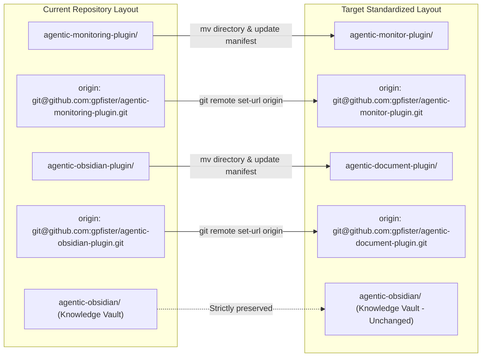
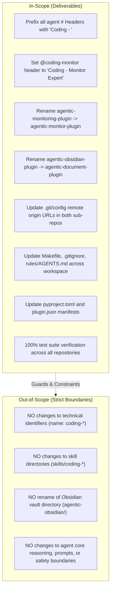
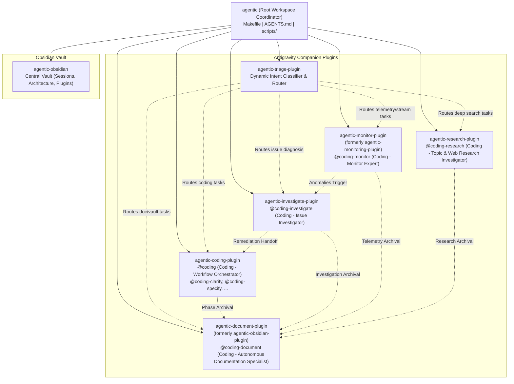
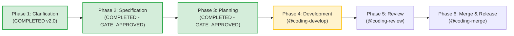

# Feature: Agent Display Names Standardization & Plugin Renames (agentic-monitor-plugin & agentic-document-plugin)

> [!NOTE] Phase 3 Implementation Plan Approved (GATE_APPROVED)
> - **Current Phase**: Phase 3: Planning (Approved by User Gate)
> - **Approved Brain Specification**: [`specification.md`](file:///Users/gpfister/.gemini/antigravity/brain/2b726f54-496d-4a46-8461-49d0a86efe79/specification.md)
> - **Vault Archived Specification**: [`sessions/attachments/2b726f54-496d-4a46-8461-49d0a86efe79/specification.md`](file:///Users/gpfister/Development/Projects/gpfister/agentic/agentic-obsidian/sessions/attachments/2b726f54-496d-4a46-8461-49d0a86efe79/specification.md)
> - **Approved Brain Implementation Plan**: [`plan.md`](file:///Users/gpfister/.gemini/antigravity/brain/3355c861-6d22-4e70-99cd-7580458d338c/plan.md)
> - **Vault Archived Implementation Plan**: [`sessions/attachments/3355c861-6d22-4e70-99cd-7580458d338c/plan.md`](file:///Users/gpfister/Development/Projects/gpfister/agentic/agentic-obsidian/sessions/attachments/3355c861-6d22-4e70-99cd-7580458d338c/plan.md)
> - **Architecture Decision Record**: [[architecture/adr-002-agent-display-names-and-plugin-renames|ADR-002: Agent Display Names & Dual Plugin Repository Rename]] (Accepted)
> - **Branch Strategy**: Branch `task/display-names-and-renames` across all 8 repositories.
> - **Execution Strategy**: Ordered 7-phase multi-repo execution:
>   1. Filesystem directory renames & Git remote updates.
>   2. Working branch initialization.
>   3. Plugin-specific updates (`agentic-monitor-plugin`, `agentic-document-plugin`, `agentic-coding-plugin`, `agentic-investigate-plugin`, `agentic-research-plugin`).
>   4. Dynamic triage router updates (`agentic-triage-plugin`).
>   5. Root workspace coordinator configuration (`Makefile`, `.gitignore`, `AGENTS.md`, `README.md`).
>   6. Obsidian vault archival & documentation (`agentic-obsidian`).
>   7. Comprehensive verification test suites across all repos.
> - **Next Stage**: Phase 4: Development (`@coding-develop`).

---

## 1. Executive Summary & Problem Motivation

### 1.1 Context
The `agentic` workspace is a coordinated multi-repository ecosystem housing specialized Google Antigravity companion plugins (`agentic-coding-plugin`, `agentic-investigate-plugin`, `agentic-monitoring-plugin`, `agentic-obsidian-plugin`, `agentic-research-plugin`, `agentic-triage-plugin`) and a centralized Obsidian knowledge vault (`agentic-obsidian`).

Following the technical standardization of agent handles to the canonical `coding-*` namespace (see [[standardize-agent-handles|Standardize Agent Handles]]), two consistency and usability gaps were identified:
1. **Agent Display Name Inconsistency**: In chat interfaces, pickers, and documentation, agent display headings (`# <Title>`) lack a uniform, branded prefix, leading to inconsistent presentation across orchestrator and worker definitions.
2. **Repository Naming Mismatches**:
   - The telemetry plugin directory is named `agentic-monitoring-plugin`, while its primary worker agent is `@coding-monitor` and its remote repository was updated to `agentic-monitor-plugin`.
   - The documentation plugin directory is named `agentic-obsidian-plugin`, which causes naming confusion with the separate documentation vault repository `agentic-obsidian/`. Its primary worker is `@coding-document`, and its remote repository was updated to `agentic-document-plugin`.

---

## 2. Approved Technical Specification

### 2.1 Agent Display Name Standardization Matrix
All agent markdown definitions across the ecosystem must have their top-level `# <Title>` heading prefixed with `"Coding - "`.

> [!IMPORTANT]
> The YAML frontmatter property `name: <handle>` MUST NOT be modified under any circumstances. Preserving the exact handle guarantees that subagent dispatching, `send_message`, `@coding-*` invocations, and tool routing mechanisms remain completely intact.

| Agent Type | File Path | Current Title | Required Display Title (`#`) | YAML Handle (`name:`) |
| :--- | :--- | :--- | :--- | :--- |
| **Orchestrator** | `agentic-coding-plugin/agents/coding/agent.md` | `# Workflow Orchestrator` | `# Coding - Workflow Orchestrator` | `coding` *(Preserved)* |
| **Worker** | `agentic-coding-plugin/agents/coding-clarify/agent.md` | `# Requirement Clarifier` | `# Coding - Requirement Clarifier` | `coding-clarify` *(Preserved)* |
| **Worker** | `agentic-coding-plugin/agents/coding-specify/agent.md` | `# Specification Architect` | `# Coding - Specification Architect` | `coding-specify` *(Preserved)* |
| **Worker** | `agentic-coding-plugin/agents/coding-plan/agent.md` | `# Architecture Planner` | `# Coding - Architecture Planner` | `coding-plan` *(Preserved)* |
| **Worker** | `agentic-coding-plugin/agents/coding-develop/agent.md` | `# Software Engineer` | `# Coding - Software Engineer` | `coding-develop` *(Preserved)* |
| **Worker** | `agentic-coding-plugin/agents/coding-review/agent.md` | `# Quality Assurance Lead` | `# Coding - Quality Assurance Lead` | `coding-review` *(Preserved)* |
| **Worker** | `agentic-coding-plugin/agents/coding-merge/agent.md` | `# Release Engineer` | `# Coding - Release Engineer` | `coding-merge` *(Preserved)* |
| **Worker** | `agentic-monitor-plugin/agents/coding-monitor/agent.md` | `# Telemetry Monitor` / `# Monitor Expert` | `# Coding - Monitor Expert` | `coding-monitor` *(Preserved)* |
| **Worker** | `agentic-investigate-plugin/agents/coding-investigate/agent.md` | `# Issue Investigator` | `# Coding - Issue Investigator` | `coding-investigate` *(Preserved)* |
| **Worker** | `agentic-document-plugin/agents/coding-document/agent.md` | `# Autonomous Documentation Specialist` | `# Coding - Autonomous Documentation Specialist` | `coding-document` *(Preserved)* |
| **Worker** | `agentic-research-plugin/agents/coding-research/agent.md` | `# Topic & Web Research Investigator` | `# Coding - Topic & Web Research Investigator` | `coding-research` *(Preserved)* |
| **Catalog** | `agentic-coding-plugin/agents/agent.md` | `# Coding Subagents & Workflow` | `# Coding - Catalog` | *(Catalog - Preserved)* |
| **Catalog** | `agentic-investigate-plugin/agents/agent.md` | `# Issue Investigation Subagents` | `# Coding - Investigate Catalog` | *(Catalog - Preserved)* |
| **Catalog** | `agentic-monitor-plugin/agents/agent.md` | `# Monitoring Subagents` | `# Coding - Monitor Catalog` | *(Catalog - Preserved)* |
| **Catalog** | `agentic-document-plugin/agents/agent.md` | `# Obsidian Vault Documentation` | `# Coding - Document Catalog` | *(Catalog - Preserved)* |
| **Catalog** | `agentic-research-plugin/agents/agent.md` | `# Topic & Web Research Subagents` | `# Coding - Research Catalog` | *(Catalog - Preserved)* |

---

### 2.2 Dual Repository & Directory Rename Specification



#### 2.2.1 Directory Operations
- Rename workspace directory `agentic-monitoring-plugin/` to `agentic-monitor-plugin/`.
- Rename workspace directory `agentic-obsidian-plugin/` to `agentic-document-plugin/`.
- The vault repository directory `agentic-obsidian/` remains strictly unchanged.

#### 2.2.2 Git Remote Origin URLs
Update Git remote `origin` URLs in `.git/config`:
- `agentic-monitor-plugin/.git/config`: `git@github.com:gpfister/agentic-monitor-plugin.git`
- `agentic-document-plugin/.git/config`: `git@github.com:gpfister/agentic-document-plugin.git`

#### 2.2.3 Plugin Manifests & Project Metadata
- In `agentic-monitor-plugin/plugin.json`: `"name": "agentic-monitor-plugin"`
- In `agentic-document-plugin/plugin.json`: `"name": "agentic-document-plugin"`
- Update `pyproject.toml` packages and README headings in both repositories.

---

### 2.3 Workspace Orchestration Updates

#### 2.3.1 Workspace `Makefile`
Update the sub-repository list in [Makefile](file:///Users/gpfister/Development/Projects/gpfister/agentic/Makefile):
```makefile
REPOS := agentic-coding-plugin agentic-document-plugin agentic-investigate-plugin agentic-monitor-plugin agentic-obsidian agentic-research-plugin agentic-triage-plugin
```

#### 2.3.2 Workspace `.gitignore`
Update [.gitignore](file:///Users/gpfister/Development/Projects/gpfister/agentic/.gitignore) to track the new sub-repository folder names:
- Replace `agentic-monitoring-plugin` with `agentic-monitor-plugin`
- Replace `agentic-obsidian-plugin` with `agentic-document-plugin`

#### 2.3.3 Workspace `AGENTS.md` & `README.md`
- Update the workspace directory tree and catalog table in [AGENTS.md](file:///Users/gpfister/Development/Projects/gpfister/agentic/AGENTS.md) and [README.md](file:///Users/gpfister/Development/Projects/gpfister/agentic/README.md).
- Reflect the new repository names in cross-plugin delegation tables and skill paths.

#### 2.3.4 Cross-Plugin Rule & Hook References
- In `agentic-triage-plugin`: Update `hooks/pre_invocation_triage.py` and `rules/AGENTS.md` to reference `agentic-monitor-plugin` and `agentic-document-plugin`.
- In `agentic-coding-plugin`, `agentic-investigate-plugin`, and `agentic-research-plugin`: Update `rules/AGENTS.md` and documentation cross-references to point to `agentic-monitor-plugin` and `agentic-document-plugin`.

---

## 3. Scope Boundaries & Non-Goals



---

## 4. Architecture & Workspace Topology



---

## 5. File Modification Matrix

| Target Repository / Path | File | Modification Summary |
| :--- | :--- | :--- |
| **Root Workspace** | [Makefile](file:///Users/gpfister/Development/Projects/gpfister/agentic/Makefile) | Update `REPOS` list to include `agentic-document-plugin` and `agentic-monitor-plugin`. |
| **Root Workspace** | [.gitignore](file:///Users/gpfister/Development/Projects/gpfister/agentic/.gitignore) | Replace ignored entries with `agentic-document-plugin` and `agentic-monitor-plugin`. |
| **Root Workspace** | [AGENTS.md](file:///Users/gpfister/Development/Projects/gpfister/agentic/AGENTS.md) | Update repo tree, cross-plugin table, and catalog references. |
| **Root Workspace** | [README.md](file:///Users/gpfister/Development/Projects/gpfister/agentic/README.md) | Update workspace overview and repository links. |
| **agentic-coding-plugin** | `agents/coding/agent.md` | Display title -> `# Coding - Workflow Orchestrator` |
| **agentic-coding-plugin** | `agents/coding-clarify/agent.md` | Display title -> `# Coding - Requirement Clarifier` |
| **agentic-coding-plugin** | `agents/coding-specify/agent.md` | Display title -> `# Coding - Specification Architect` |
| **agentic-coding-plugin** | `agents/coding-plan/agent.md` | Display title -> `# Coding - Architecture Planner` |
| **agentic-coding-plugin** | `agents/coding-develop/agent.md` | Display title -> `# Coding - Software Engineer` |
| **agentic-coding-plugin** | `agents/coding-review/agent.md` | Display title -> `# Coding - Quality Assurance Lead` |
| **agentic-coding-plugin** | `agents/coding-merge/agent.md` | Display title -> `# Coding - Release Engineer` |
| **agentic-coding-plugin** | `agents/agent.md` | Display title -> `# Coding - Catalog` |
| **agentic-coding-plugin** | `rules/AGENTS.md` | Update cross-plugin companion names (`agentic-document-plugin`, `agentic-monitor-plugin`). |
| **agentic-monitor-plugin** | `Directory rename` | `agentic-monitoring-plugin/` -> `agentic-monitor-plugin/` |
| **agentic-monitor-plugin** | `.git/config` | Origin remote URL -> `git@github.com:gpfister/agentic-monitor-plugin.git` |
| **agentic-monitor-plugin** | `plugin.json` | Name -> `"agentic-monitor-plugin"` |
| **agentic-monitor-plugin** | `agents/coding-monitor/agent.md` | Display title -> `# Coding - Monitor Expert` |
| **agentic-monitor-plugin** | `agents/agent.md` | Display title -> `# Coding - Monitor Catalog` |
| **agentic-monitor-plugin** | `rules/AGENTS.md`, `README.md` | Update self-references and companion references. |
| **agentic-document-plugin** | `Directory rename` | `agentic-obsidian-plugin/` -> `agentic-document-plugin/` |
| **agentic-document-plugin** | `.git/config` | Origin remote URL -> `git@github.com:gpfister/agentic-document-plugin.git` |
| **agentic-document-plugin** | `plugin.json` | Name -> `"agentic-document-plugin"` |
| **agentic-document-plugin** | `agents/coding-document/agent.md` | Display title -> `# Coding - Autonomous Documentation Specialist` |
| **agentic-document-plugin** | `agents/agent.md` | Display title -> `# Coding - Document Catalog` |
| **agentic-document-plugin** | `rules/AGENTS.md`, `README.md` | Update self-references and companion references. |
| **agentic-investigate-plugin** | `agents/coding-investigate/agent.md` | Display title -> `# Coding - Issue Investigator` |
| **agentic-investigate-plugin** | `agents/agent.md` | Display title -> `# Coding - Investigate Catalog` |
| **agentic-investigate-plugin** | `rules/AGENTS.md`, `README.md` | Update references to companion plugins. |
| **agentic-research-plugin** | `agents/coding-research/agent.md` | Display title -> `# Coding - Topic & Web Research Investigator` |
| **agentic-research-plugin** | `agents/agent.md` | Display title -> `# Coding - Research Catalog` |
| **agentic-research-plugin** | `rules/AGENTS.md`, `README.md` | Update references to companion plugins. |
| **agentic-triage-plugin** | `hooks/pre_invocation_triage.py` | Update plugin folder detection and routing candidates. |
| **agentic-triage-plugin** | `rules/AGENTS.md`, `README.md` | Update plugin names in triage routing definitions. |
| **agentic-obsidian** | `plugins/agentic-*.md` | Update vault plugin documentation notes for renamed plugins. |

---

## 6. Migration & Execution Protocol

### Step 1: Directory Renaming
Execute filesystem moves at root:
```bash
mv agentic-monitoring-plugin agentic-monitor-plugin
mv agentic-obsidian-plugin agentic-document-plugin
```

### Step 2: Git Remote Configuration
Update git origin URLs for both moved repos:
```bash
git -C agentic-monitor-plugin remote set-url origin git@github.com:gpfister/agentic-monitor-plugin.git
git -C agentic-document-plugin remote set-url origin git@github.com:gpfister/agentic-document-plugin.git
```

### Step 3: Plugin Manifests & Manifest References
- Update `"name": "agentic-monitor-plugin"` in [plugin.json](file:///Users/gpfister/Development/Projects/gpfister/agentic/agentic-monitor-plugin/plugin.json).
- Update `"name": "agentic-document-plugin"` in [plugin.json](file:///Users/gpfister/Development/Projects/gpfister/agentic/agentic-document-plugin/plugin.json).

### Step 4: Display Title Updates Across All Agents
Update `# <Title>` in each target agent markdown file while maintaining `name: <handle>` in YAML frontmatter.

### Step 5: Root Workspace Configuration
Update [Makefile](file:///Users/gpfister/Development/Projects/gpfister/agentic/Makefile), [.gitignore](file:///Users/gpfister/Development/Projects/gpfister/agentic/.gitignore), [AGENTS.md](file:///Users/gpfister/Development/Projects/gpfister/agentic/AGENTS.md), and [README.md](file:///Users/gpfister/Development/Projects/gpfister/agentic/README.md).

### Step 6: Cross-Plugin References & Triage Router
Update cross-plugin documentation rules and `pre_invocation_triage.py` to ensure dynamic routing recognizes the renamed directories.

---

## 7. Approved Implementation Plan & Work Breakdown

> [!NOTE]
> Approved implementation plan artifact: [`plan.md`](file:///Users/gpfister/.gemini/antigravity/brain/3355c861-6d22-4e70-99cd-7580458d338c/plan.md)  
> Vault archived copy: [`sessions/attachments/3355c861-6d22-4e70-99cd-7580458d338c/plan.md`](file:///Users/gpfister/Development/Projects/gpfister/agentic/agentic-obsidian/sessions/attachments/3355c861-6d22-4e70-99cd-7580458d338c/plan.md)

### 7.1 Git Branch Strategy
All 8 repositories will branch from clean `master` to an isolated task branch:

| Repository | Current Head | Working Branch | Conventional Type |
| :--- | :--- | :--- | :--- |
| **Root (`agentic`)** | `master` | `task/display-names-and-renames` | Refactor / Task |
| **`agentic-monitor-plugin`** | `master` | `task/display-names-and-renames` | Refactor / Task |
| **`agentic-document-plugin`** | `master` | `task/display-names-and-renames` | Refactor / Task |
| **`agentic-coding-plugin`** | `master` | `task/display-names-and-renames` | Refactor / Task |
| **`agentic-investigate-plugin`** | `master` | `task/display-names-and-renames` | Refactor / Task |
| **`agentic-research-plugin`** | `master` | `task/display-names-and-renames` | Refactor / Task |
| **`agentic-triage-plugin`** | `master` | `task/display-names-and-renames` | Refactor / Task |
| **`agentic-obsidian`** | `master` | `task/display-names-and-renames` | Documentation / Task |

### 7.2 Execution Dependency Flowchart


### 7.3 Detailed Phase Work Breakdown

#### Phase 1: Directory Renames & Git Remotes (Root Workspace)
Execute physical directory renames and remote URL updates from workspace root:
```bash
mv agentic-monitoring-plugin agentic-monitor-plugin
mv agentic-obsidian-plugin agentic-document-plugin
git -C agentic-monitor-plugin remote set-url origin git@github.com:gpfister/agentic-monitor-plugin.git
git -C agentic-document-plugin remote set-url origin git@github.com:gpfister/agentic-document-plugin.git
```

#### Phase 2: Working Branch Initialization
Checkout `task/display-names-and-renames` across all 8 repositories:
```bash
git checkout -b task/display-names-and-renames
for repo in agentic-coding-plugin agentic-document-plugin agentic-investigate-plugin agentic-monitor-plugin agentic-obsidian agentic-research-plugin agentic-triage-plugin; do
    git -C "$repo" checkout -b task/display-names-and-renames
done
```

#### Phase 3: Plugin-Specific Implementations
- **`agentic-monitor-plugin`**: Update `plugin.json`, `pyproject.toml`, agent header (`# Coding - Monitor Expert (@coding-monitor)`), catalog header (`# Coding - Monitoring Subagents & Telemetry Architecture (agents/agent.md)`), `rules/AGENTS.md`, `README.md`, and `tests/test_plugin.py`. Run `uv run --directory agentic-monitor-plugin pytest`.
- **`agentic-document-plugin`**: Update `plugin.json`, `pyproject.toml`, agent header (`# Coding - Autonomous Documentation Specialist (@coding-document)`), catalog header (`# Coding - Obsidian Vault Documentation Subagents & Architecture (agents/agent.md)`), `rules/AGENTS.md`, `README.md`, and `tests/test_plugin.py`. Run `uv run --directory agentic-document-plugin pytest`.
- **`agentic-coding-plugin`**: Update 8 agent headers (`# Coding - Workflow Orchestrator`, `# Coding - Requirement Clarifier`, `# Coding - Specification Architect`, `# Coding - Architecture Planner`, `# Coding - Software Engineer`, `# Coding - Quality Assurance Lead`, `# Coding - Release Engineer`, `# Coding - Agentic Coding Subagents & Workflow`) while preserving frontmatter `name:` handles. Update `rules/AGENTS.md`. Run `uv run --directory agentic-coding-plugin pytest`.
- **`agentic-investigate-plugin`**: Update `# Coding - Issue Investigator` and catalog `# Coding - Issue Investigation Subagents & Architecture`. Update `rules/AGENTS.md`. Run `uv run --directory agentic-investigate-plugin pytest`.
- **`agentic-research-plugin`**: Update `# Coding - Topic & Web Research Investigator` and catalog `# Coding - Topic & Web Research Subagents & Architecture`. Update `rules/AGENTS.md`. Run `uv run --directory agentic-research-plugin pytest`.

#### Phase 4: Dynamic Triage Router (`agentic-triage-plugin`)
Update `hooks/prompt_triage.py` candidate recognition for `agentic-monitor-plugin` and `agentic-document-plugin` with backward compatibility checks, update `rules/AGENTS.md`, `README.md`, and tests. Run `uv run --directory agentic-triage-plugin pytest`.

#### Phase 5: Root Workspace Configuration (`agentic`)
Update `Makefile` (`REPOS` list), `.gitignore` (sub-repo paths), `AGENTS.md` (topology & cross-plugin delegation table), and `README.md`. Run `make status`.

#### Phase 6: Obsidian Vault Archival & Documentation Updates (`agentic-obsidian`)
Update vault plugin notes and `git-status.md` to reflect `task/display-names-and-renames` branches and new origin URLs.

#### Phase 7: Comprehensive Verification Suites
Run verification tests across all repositories (`pytest` via `uv`) and confirm clean git state.

---

## 8. Verifiable Acceptance Criteria Matrix

| Checkpoint | Target | Expected Result | Verification Command |
| :--- | :--- | :--- | :--- |
| **AC-1** | Filesystem Directories | `agentic-monitor-plugin` and `agentic-document-plugin` exist; old paths removed | `ls -d agentic-monitor-plugin agentic-document-plugin` |
| **AC-2** | Git Remotes | Remote origin URLs match GitHub SSH endpoints | `git -C agentic-monitor-plugin remote get-url origin` <br/> `git -C agentic-document-plugin remote get-url origin` |
| **AC-3** | Agent Titles (`#`) | All 16 agent definitions start with `# Coding - <Title>` | `for f in $(find agentic-*-plugin/agents -name "*.md"); do grep -E '^# ' "$f" \| grep -v '^# Coding - ' && exit 1; done; echo "All agent headings valid"` |
| **AC-4** | Handle Invariance | All YAML frontmatter `name:` handles match exact canonical names | `grep -rh '^name:' agentic-*-plugin/agents/` |
| **AC-5** | Test Suites | All unit tests pass cleanly in every repository | `for p in agentic-coding-plugin agentic-document-plugin agentic-investigate-plugin agentic-monitor-plugin agentic-research-plugin agentic-triage-plugin; do uv run --directory "$p" pytest || exit 1; done` |
| **AC-6** | Root Workspace Sync | `make status` detects all 7 repositories cleanly | `make status` |
| **AC-7** | Vault Integrity | `agentic-obsidian/` directory remains clean and git tracking valid | `git -C agentic-obsidian status` |

---

## 9. Risk Assessment & Contingency Plan

| Risk | Impact | Likelihood | Mitigation Strategy |
| :--- | :--- | :--- | :--- |
| **Orphaned Untracked Files** during directory rename | High | Low | Use standard `mv` on whole git repository trees without moving `.git` separately. |
| **Remote Push Mismatch** | Medium | Low | Explicitly test `git remote -v` in both repos before committing. |
| **Subagent Tool Breakage** | Critical | Very Low | Handlers rely exclusively on frontmatter `name:` which is strictly preserved across all 16 files. |
| **Reversion / Rollback** | Low | Low | If aborted, simple reverse `mv agentic-monitor-plugin agentic-monitoring-plugin` and `mv agentic-document-plugin agentic-obsidian-plugin` restores previous state. |

---

## 10. Lifecycle Progression


