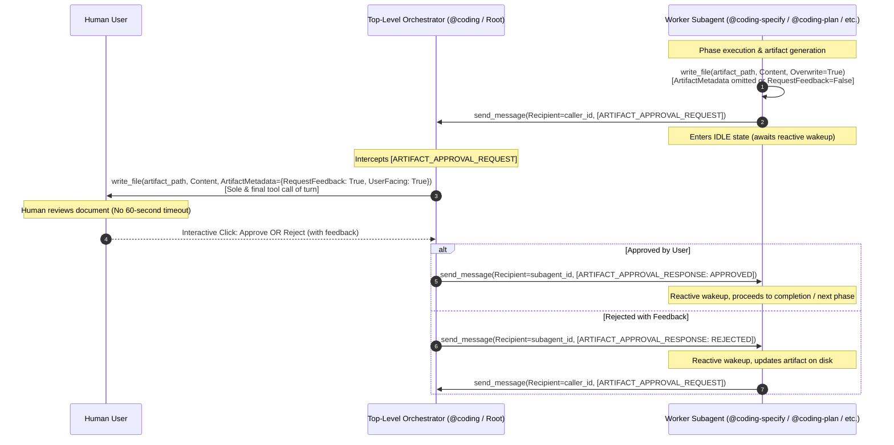
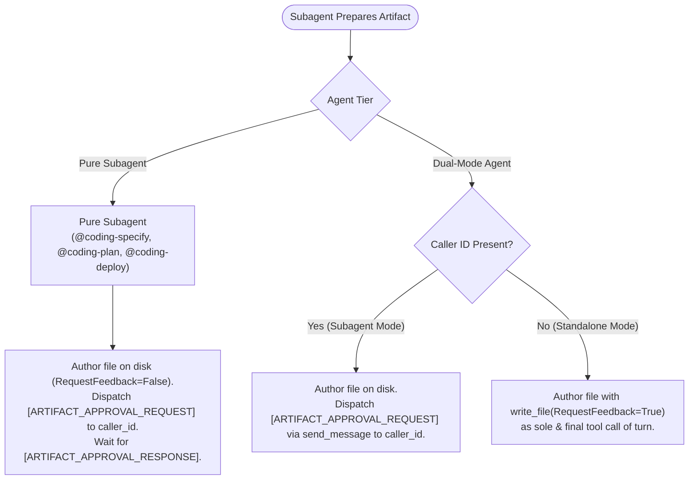

# Feature: Artifact Approval Relay Protocol for Subagent Gates

> [!NOTE] Milestone: Phase 5 Review Completed & Pre-Merge Approved (Proceeding to Phase 6: Merge & Release)
> - **Current Phase**: Phase 5: Code Review & Pre-Merge Documentation — Completed & Verified
> - **Status**: **Verified / Ready for Merge into `master`**
> - **Specification ID**: `SPEC-2026-RELAY-002`
> - **Architecture Decision Record**: [[architecture/adr-006-artifact-approval-relay-protocol|ADR-006: Artifact Approval Relay Protocol for Subagent Approval Gates]]
> - **Architecture Plan Note**: [[architecture/artifact-approval-relay-protocol|Artifact Approval Relay Protocol Architecture & Implementation Plan]]
> - **Approved Technical Specification**: [`specification.md`](file:///Users/gpfister/.gemini/antigravity/brain/96edaecb-d1d2-4ef1-aa7d-618ce6f4fdad/specification.md) ([Vault Archive](file:///Users/gpfister/Development/Projects/gpfister/agentic/agentic-obsidian/sessions/attachments/96edaecb-d1d2-4ef1-aa7d-618ce6f4fdad/specification.md))
> - **Approved Implementation Plan**: [`plan.md`](file:///Users/gpfister/.gemini/antigravity/brain/c671d2e2-89ff-4d43-a7f8-49a66ac9e957/plan.md) ([Vault Archive](file:///Users/gpfister/Development/Projects/gpfister/agentic/agentic-obsidian/sessions/attachments/c671d2e2-89ff-4d43-a7f8-49a66ac9e957/plan.md))
> - **Unit Test Verdict**: **PASS (60/60 tests passed across feature plugins, 158/158 tests workspace-wide)**
> - **Commits Ledger**:
>   - Root `agentic`: [`419cd50`](file:///Users/gpfister/Development/Projects/gpfister/agentic/) on `feature/artifact-approval-relay`
>   - `agentic-coding-plugin`: [`8302109`](file:///Users/gpfister/Development/Projects/gpfister/agentic/agentic-coding-plugin/) on `feature/artifact-approval-relay`
>   - `agentic-issue-investigation-plugin`: [`0939f82`](file:///Users/gpfister/Development/Projects/gpfister/agentic/agentic-issue-investigation-plugin/) on `feature/artifact-approval-relay`
>   - `agentic-project-grooming-plugin`: [`2729c34`](file:///Users/gpfister/Development/Projects/gpfister/agentic/agentic-project-grooming-plugin/) on `feature/artifact-approval-relay`
>   - `agentic-topic-researching-plugin`: [`5c0931f`](file:///Users/gpfister/Development/Projects/gpfister/agentic/agentic-topic-researching-plugin/) on `feature/artifact-approval-relay`
> - **Local Deployment Requirement**: **Not Required** across all 5 participating repositories

---

## 1. Executive Summary & Problem Formulation

### 1.1 Root Cause & Host Timeout Constraint
In Google Antigravity, worker subagents spawned via `invoke_subagent` run inside background processes managed by the runtime. If a worker subagent executes a tool call that blocks awaiting human interaction, the host runtime enforces a rigid **60-second execution timeout** on the turn.

The workspace previously addressed user interrogation timeouts via the **Question Relay Protocol** ([[features/question-relay-protocol|SPEC-2026-RELAY-001]] / [[architecture/adr-005-question-relay-protocol|ADR-005]]), routing `ask_question` inquiries through the root orchestrator turn.

However, an identical failure mode occurs with interactive approval gates:
When worker subagents (`@coding-specify`, `@coding-plan`, `@coding-deploy`, `@coding-investigate`, `@coding-groom`, `@coding-research`) author milestone deliverables requiring human sign-off (`specification.md`, `plan.md`, `deployment-issue.md`, `issue-assessment.md`, `Project_Request_Grooming.md`, `research-report.md`) using `write_file` with `ArtifactMetadata={"RequestFeedback": True, "UserFacing": True}`, the interactive Approve/Reject buttons and feedback input box are rendered within the subagent turn.

If human users review complex architectural specifications, plans, or research reports for longer than 60 seconds before clicking **Approve** or providing revision feedback, the runtime throws a timeout exception, prematurely terminating the workflow and losing intermediate progress. Furthermore, nested approval gates can suffer from UI visibility degradation in complex agent hierarchies.

Top-level orchestrators (`@coding` and root conversational turns) run without background tool execution timeouts and can await human responses indefinitely.

### 1.2 Architectural Solution: Artifact Approval Relay Protocol
Standardize the **Artifact Approval Relay Protocol** across all agentic plugins and workspace guidelines:
1. Subagents author the deliverable directly into the session artifact directory (`<appDataDir>/brain/<conversation-id>/<artifact_name>`) **without** `RequestFeedback=True` (or omitting `ArtifactMetadata`).
2. Subagents dispatch an `[ARTIFACT_APPROVAL_REQUEST]` envelope to their parent orchestrator (`caller_id`) via `send_message` and enter an idle state.
3. The parent orchestrator presents the artifact to the human user using `write_file` with `ArtifactMetadata={"RequestFeedback": True, "UserFacing": True}` as the sole and final tool call of its root turn. At the root level, Antigravity waits indefinitely for user interaction without background tool timeouts.
4. When the user approves or rejects the artifact, the parent orchestrator intercepts the decision and returns an `[ARTIFACT_APPROVAL_RESPONSE]` envelope to the subagent via `send_message`.
5. The subagent wakes up reactively:
   - On approval (`status: "APPROVED"`), the subagent finalizes its phase and signals completion.
   - On rejection/revisions (`status: "REJECTED"`), the subagent parses `feedback`, updates the file on disk, and re-dispatches `[ARTIFACT_APPROVAL_REQUEST]`.

---

## 2. Sequence Flow Architecture



---

## 3. Standardized Message Protocol Envelopes

### 3.1 Request Envelope: `[ARTIFACT_APPROVAL_REQUEST]`
Dispatched by the worker subagent to the parent orchestrator (`caller_id`):

```text
[ARTIFACT_APPROVAL_REQUEST]
```
```json
{
  "type": "ARTIFACT_APPROVAL_REQUEST",
  "artifact_name": "specification.md",
  "artifact_path": "/Users/user/.gemini/antigravity/brain/<session-id>/specification.md",
  "stage": "SPECIFICATION",
  "summary": "Detailed technical specification for feature XYZ",
  "user_facing": true
}
```

#### Field Specifications:
- `type` (*string*, required): Fixed value `"ARTIFACT_APPROVAL_REQUEST"`.
- `artifact_name` (*string*, required): Base file name (e.g. `specification.md`, `plan.md`, `deployment-issue.md`, `issue-assessment.md`, `Project_Request_Grooming.md`, `research-report.md`).
- `artifact_path` (*string*, required): Absolute path on filesystem located in `<appDataDir>/brain/<conversation-id>/`.
- `stage` (*string*, required): Identification of the originating workflow stage (`"SPECIFICATION"`, `"PLANNING"`, `"DEPLOYMENT_ISSUE"`, `"INVESTIGATION"`, `"GROOMING"`, `"RESEARCH"`).
- `summary` (*string*, required): Multi-line descriptive summary passed into `ArtifactMetadata.Summary`.
- `user_facing` (*boolean*, required): Defaults to `true`.

---

### 3.2 Response Envelope: `[ARTIFACT_APPROVAL_RESPONSE]`
Dispatched by the orchestrator back to the worker subagent (`subagent_id`):

```text
[ARTIFACT_APPROVAL_RESPONSE]
```
```json
{
  "type": "ARTIFACT_APPROVAL_RESPONSE",
  "artifact_name": "specification.md",
  "status": "APPROVED",
  "feedback": ""
}
```

#### Field Specifications:
- `type` (*string*, required): Fixed value `"ARTIFACT_APPROVAL_RESPONSE"`.
- `artifact_name` (*string*, required): The file name matching the corresponding request.
- `status` (*string*, required): Outcome status: strictly `"APPROVED"` or `"REJECTED"`.
- `feedback` (*string*, optional): User-provided revision comments or adjustment instructions when `status == "REJECTED"`. Empty string if `APPROVED`.

---

## 4. Agent Classification & Operational Matrix



| Agent Handle / Capability | Classification | Parent Caller Present (`caller_id` exists) | Standalone Mode (Root Turn) |
| :--- | :--- | :--- | :--- |
| `@coding-specify` | Pure Subagent | Writes file on disk; relays via `[ARTIFACT_APPROVAL_REQUEST]`. Never calls `RequestFeedback=True`. | N/A (Always invoked by `@coding`). |
| `@coding-plan` | Pure Subagent | Writes file on disk; relays via `[ARTIFACT_APPROVAL_REQUEST]`. Never calls `RequestFeedback=True`. | N/A (Always invoked by `@coding`). |
| `@coding-deploy` | Pure Subagent | Writes deployment issue artifact on disk; relays via `[ARTIFACT_APPROVAL_REQUEST]`. | N/A (Always invoked by `@coding`). |
| `@coding-investigate` | Dual-Mode Agent | Relays via `[ARTIFACT_APPROVAL_REQUEST]` to orchestrator. | Directly authors `issue-assessment.md` with `RequestFeedback=True` as sole & final call. |
| `/project-grooming` (`@coding-groom`) | Dual-Mode Agent | Relays via `[ARTIFACT_APPROVAL_REQUEST]` to caller orchestrator. | Directly authors `Project_Request_Grooming.md` with `RequestFeedback=True` as sole & final call. |
| `@coding-research` | Dual-Mode Agent | Relays via `[ARTIFACT_APPROVAL_REQUEST]` to caller orchestrator. | Directly authors `research-report.md` with `RequestFeedback=True` as sole & final call. |
| `@coding` (Orchestrator) | Root Orchestrator | Intercepts `[ARTIFACT_APPROVAL_REQUEST]`, renders `write_file` with `ArtifactMetadata={"RequestFeedback": True}`, awaits user gate, replies `[ARTIFACT_APPROVAL_RESPONSE]`. | Top-level lifecycle management. |

---

## 5. Multi-Repository Work Breakdown

### 5.1 Repository Matrix

| Repository | Git Branch | Local Deployment | Primary Deliverables |
| :--- | :--- | :--- | :--- |
| [`agentic` (Root Orchestrator)](file:///Users/gpfister/Development/Projects/gpfister/agentic) | `feature/artifact-approval-relay` | Not Required | Update [`AGENTS.md`](file:///Users/gpfister/Development/Projects/gpfister/agentic/AGENTS.md) with Section 3.3 (Artifact Approval Relay Protocol) and Section 4 flowchart updates. |
| [`agentic-coding-plugin/`](file:///Users/gpfister/Development/Projects/gpfister/agentic/agentic-coding-plugin) | `feature/artifact-approval-relay` | Not Required | Pure subagents (`@coding-specify`, `@coding-plan`, `@coding-deploy`), `@coding` relay handler loop, rules, skills, and unit tests in `tests/test_plugin.py`. |
| [`agentic-issue-investigation-plugin/`](file:///Users/gpfister/Development/Projects/gpfister/agentic/agentic-issue-investigation-plugin) | `feature/artifact-approval-relay` | Not Required | Dual-mode support in `@coding-investigate` for `issue-assessment.md`, rules, skill, and unit tests in `tests/test_plugin.py`. |
| [`agentic-project-grooming-plugin/`](file:///Users/gpfister/Development/Projects/gpfister/agentic/agentic-project-grooming-plugin) | `feature/artifact-approval-relay` | Not Required | Dual-mode support in `@coding-groom` for `Project_Request_Grooming.md`, rules, skill, and unit tests in `tests/test_plugin.py`. |
| [`agentic-topic-researching-plugin/`](file:///Users/gpfister/Development/Projects/gpfister/agentic/agentic-topic-researching-plugin) | `feature/artifact-approval-relay` | Not Required | Dual-mode support in `@coding-research` for `research-report.md`, rules, skill, and unit tests in `tests/test_plugin.py`. |

---

## 6. Edge Cases & Mitigations

| Edge Case | Potential Impact | Mitigation Strategy |
| :--- | :--- | :--- |
| **Missing Orchestrator Relay Handler** | If a caller does not implement `[ARTIFACT_APPROVAL_REQUEST]`, subagent remains idle. | Pure subagents run strictly under `@coding`. Dual-mode subagents verify caller ID; if absent, they fall back to standalone direct gate presentation. |
| **User Submits Rejection with Empty Feedback** | Subagent cannot determine what revisions are requested. | The subagent detects empty feedback upon `status: "REJECTED"` and dispatches a single clarification question via `[QUESTION_RELAY_REQUEST]` asking the user for specific revision instructions. |
| **Concurrent Artifact Approvals** | Multiple background subagents submit approval requests simultaneously. | The orchestrator queues artifact approvals sequentially, presenting one gate turn at a time. |
| **File Read Failure at Root** | Orchestrator fails to locate subagent deliverable. | Subagents write to standardized path `<appDataDir>/brain/<conversation-id>/<artifact_name>` and include the verified absolute path in the request envelope. Orchestrator confirms file presence before presenting. |

---

## 7. Verifiable Acceptance Criteria

- [x] **AC 1: Standardized Envelopes**: `[ARTIFACT_APPROVAL_REQUEST]` and `[ARTIFACT_APPROVAL_RESPONSE]` schemas documented across rules, manifests, and coordination guides.
- [x] **AC 2: Pure Subagent Compliance**: `@coding-specify`, `@coding-plan`, and `@coding-deploy` write files to disk without `RequestFeedback=True`; gates relayed via `send_message`.
- [x] **AC 3: Dual-Mode Subagent Support**: `@coding-investigate`, `@coding-groom`, and `@coding-research` dynamically branch between relaying in subagent mode and direct gate authoring in standalone mode.
- [x] **AC 4: Orchestrator Relay Loop**: `@coding` orchestrator intercepts `[ARTIFACT_APPROVAL_REQUEST]`, verifies file on disk, presents interactive gate at the root turn (`RequestFeedback=True` as sole & final call), and returns `[ARTIFACT_APPROVAL_RESPONSE]`.
- [x] **AC 5: Ecosystem Test Suite**: 100% test pass rate across all 5 participating plugin repositories with assertions verifying new relay envelopes (60/60 tests passing across feature plugins, 158/158 tests workspace-wide).
- [x] **AC 6: Workspace Documentation Consistency**: Root `AGENTS.md`, Obsidian architecture, ADR-006, and feature specifications fully synchronized.

---

## 8. Pre-Merge Verification & Audit Ledger

| Repository | Branch | Commit | Unit Tests | Status |
| :--- | :--- | :--- | :--- | :--- |
| [`agentic` (Root Workspace)](file:///Users/gpfister/Development/Projects/gpfister/agentic/) | `feature/artifact-approval-relay` | [`419cd50`](file:///Users/gpfister/Development/Projects/gpfister/agentic/) | Documentation & rule audit | **Verified** |
| [`agentic-coding-plugin/`](file:///Users/gpfister/Development/Projects/gpfister/agentic/agentic-coding-plugin/) | `feature/artifact-approval-relay` | [`8302109`](file:///Users/gpfister/Development/Projects/gpfister/agentic/agentic-coding-plugin/) | **16/16 passed** (100%) | **Verified** |
| [`agentic-issue-investigation-plugin/`](file:///Users/gpfister/Development/Projects/gpfister/agentic/agentic-issue-investigation-plugin/) | `feature/artifact-approval-relay` | [`0939f82`](file:///Users/gpfister/Development/Projects/gpfister/agentic/agentic-issue-investigation-plugin/) | **13/13 passed** (100%) | **Verified** |
| [`agentic-project-grooming-plugin/`](file:///Users/gpfister/Development/Projects/gpfister/agentic/agentic-project-grooming-plugin/) | `feature/artifact-approval-relay` | [`2729c34`](file:///Users/gpfister/Development/Projects/gpfister/agentic/agentic-project-grooming-plugin/) | **16/16 passed** (100%) | **Verified** |
| [`agentic-topic-researching-plugin/`](file:///Users/gpfister/Development/Projects/gpfister/agentic/agentic-topic-researching-plugin/) | `feature/artifact-approval-relay` | [`5c0931f`](file:///Users/gpfister/Development/Projects/gpfister/agentic/agentic-topic-researching-plugin/) | **15/15 passed** (100%) | **Verified** |

> [!NOTE] Pre-Merge Status
> Clean code reviews completed and approved. All deliverables verified and ready for Phase 6 (Merge & Release into `master`).
