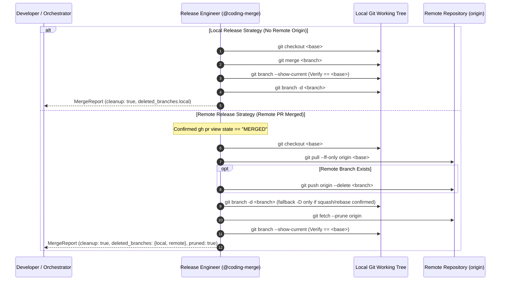

# Feature: Complete Branch Cleanup, Base Branch Checkout, and Remote Tracking Prune for `@coding-merge`

> [!NOTE] Implementation Milestone: Phase 3 (Plan Approved & Formalized)
> - **Specification ID**: `SPEC-2026-MERGE-002`
> - **Architecture Decision Record**: [[architecture/adr-009-coding-merge-complete-branch-cleanup-and-remote-sync|ADR-009: Complete Branch Cleanup, Base Branch Checkout, and Remote Tracking Prune for @coding-merge]]
> - **Architecture Plan Note**: [[architecture/coding-merge-complete-branch-cleanup-and-remote-sync|Complete Branch Cleanup & Remote Synchronization Architecture Plan]]
> - **Target Repository**: [`agentic-coding-plugin`](file:///Users/gpfister/Development/Projects/gpfister/agentic/agentic-coding-plugin)
> - **Current Phase**: Phase 3: Plan Approved / Handed off to Development
> - **Approved Spec**: [`specification.md`](file:///Users/gpfister/.gemini/antigravity/brain/c00e61a0-f612-484f-a3b5-8aba9aa3366a/specification.md) ([Vault Archive](file:///Users/gpfister/Development/Projects/gpfister/agentic/agentic-obsidian/sessions/attachments/c00e61a0-f612-484f-a3b5-8aba9aa3366a/specification.md))
> - **Approved Plan**: [`plan.md`](file:///Users/gpfister/.gemini/antigravity/brain/c00e61a0-f612-484f-a3b5-8aba9aa3366a/plan.md) ([Vault Archive](file:///Users/gpfister/Development/Projects/gpfister/agentic/agentic-obsidian/sessions/attachments/c00e61a0-f612-484f-a3b5-8aba9aa3366a/plan.md))

---

## 1. Feature Summary & Motivation

In the current `agentic-coding-plugin` workflow, Stage 7 ([`@coding-merge`](file:///Users/gpfister/Development/Projects/gpfister/agentic/agentic-coding-plugin/agents/coding-merge/agent.md)) coordinates the final release phase by integrating feature branches into base branches (`main` or `master`).

However, two distinct gaps were identified in branch cleanup and workspace synchronization:

1. **Local Release Strategy**:
   - For repositories without a remote origin, `@coding-merge` checks out `<base>` and merges the feature branch, but leaves the local feature branch intact (`cleanup: false` in `MergeReport`), causing local branch proliferation.
2. **Remote Release Strategy**:
   - For repositories with a remote origin, after the PR is confirmed merged (`gh pr view` reports `state == "MERGED"`), `@coding-merge` checks out `<base>`, fast-forwards remote commits (`git pull --ff-only origin <base>`), and deletes the local feature branch (`git branch -d <branch>`).
   - However, it does **not** delete the remote feature branch on `origin` (`git push origin --delete <branch>`), nor does it prune obsolete remote tracking branches (`git fetch --prune origin`).
3. **Workspace State Consistency**:
   - Without `git fetch --prune origin`, local tracking references (`origin/<branch>`) remain dangling in `.git/refs/remotes/origin/`, causing downstream tools (e.g. [`@coding-document`](file:///Users/gpfister/Development/Projects/gpfister/agentic/agentic-project-documenting-plugin/agents/coding-document/agent.md), `git branch -a`, `git status`) to report outdated topologies.
   - Furthermore, the repository must guarantee that the working tree returns to and remains on the primary base branch (`main` or `master`) across all execution paths.

---

## 2. Functional Requirements

### FR-1: Local Release Strategy Branch Cleanup & Base Switch
When a repository has no remote configured:
1. **Switch to Base Branch**: `git checkout <base>`.
2. **Merge Feature Branch**: `git merge <branch>`.
3. **Verify Working Tree**: Confirm checkout succeeded on `<base>` (`git branch --show-current`).
4. **Delete Local Feature Branch**: Safely delete the merged local feature branch (`git branch -d <branch>`).
5. **Output Structured Report**: Emit `MergeReport` with `cleanup: true` and local deletion recorded:
   ```json
   {
     "status": "merged",
     "strategy": "local",
     "base_branch": "<base>",
     "merged_branch": "<branch>",
     "cleanup": true,
     "deleted_branches": {
       "local": "<branch>"
     }
   }
   ```

### FR-2: Remote Release Strategy Branch Cleanup & Base Switch
When a repository has a remote configured (`origin`) and PR is confirmed merged (`gh pr view` reports `state == "MERGED"`):
1. **Switch to Base Branch**: `git checkout <base>`.
2. **Synchronize Base with Remote**: `git pull --ff-only origin <base>`.
3. **Delete Remote Feature Branch**:
   - Check if remote branch exists: `git ls-remote --heads origin <branch>`.
   - If present, delete remote branch: `git push origin --delete <branch>`.
   - If already deleted (e.g. by GitHub auto-delete head branches option), handle idempotently without error.
4. **Delete Local Feature Branch**:
   - Safely delete local feature branch: `git branch -d <branch>`.
   - In squash-merge or rebase-merge PR scenarios where git cannot detect direct ancestry, fallback to `git branch -D <branch>` strictly after verifying that PR `state == "MERGED"` and the base branch has pulled the merged commit.
5. **Prune Remote-Tracking References**:
   - Execute `git fetch --prune origin` to remove stale `origin/<branch>` references from `.git/refs/remotes/origin/`.
6. **Verify Working Tree**: Confirm active branch is `<base>` (`git branch --show-current`).
7. **Output Structured Report**: Emit `MergeReport` with `cleanup: true`, remote/local deletion status, and prune confirmation:
   ```json
   {
     "status": "merged",
     "strategy": "remote_pr",
     "pr_number": "<pr_number>",
     "pr_url": "<pr_url>",
     "base_branch": "<base>",
     "merged_branch": "<branch>",
     "cleanup": true,
     "deleted_branches": {
       "local": "<branch>",
       "remote": "<branch>"
     },
     "pruned": true
   }
   ```

### FR-3: Update Agent Definitions & Catalogs
1. **`agents/coding-merge/agent.md`**:
   - Update Section 2 ("Local Release Strategy") to include local branch deletion (`git branch -d <branch>`) and updated `MergeReport` schema (`cleanup: true`).
   - Update Section 5 to *"Post-Merge Base Synchronization & Complete Cleanup"* to include remote branch deletion (`git push origin --delete <branch>`), local branch deletion (`git branch -d <branch>`), and remote prune (`git fetch --prune origin`).
2. **`agents/coding/agent.md`**:
   - Update Stage 7 flow and phase descriptions to document post-merge base branch switch, local/remote branch deletion, and `git fetch --prune`.
3. **`agents/agent.md`**:
   - Update Stage 7 (`coding-merge`) summary in the multi-agent catalog to document full cleanup across local and remote release strategies.
4. **`skills/coding-orchestrator/SKILL.md`**:
   - Update Phase 7 (`coding-merge`) description in Section 5 to document switching to base branch, deleting local feature branch (local merge), and deleting remote branch + local branch + running `git fetch --prune` (remote PR merge).

### FR-4: Automated Verification in Test Suite
Update `tests/test_plugin.py`:
1. Enhance `test_coding_merge_pr_waiting_and_sync` to assert:
   - `git push origin --delete`
   - `git fetch --prune`
   - Local merge strategy specifies `git branch -d` and `cleanup: true`
   - Post-merge working directory returns to base branch (`git checkout <base>`)
2. Add dedicated test `test_coding_merge_complete_branch_cleanup_and_prune` verifying all 4 documentation files.
3. Ensure 100% test pass with `pytest`.

---

## 3. Workflow Architecture



---

## 4. Affected Repositories & Files

| Repository | File Path | Modification Summary |
| :--- | :--- | :--- |
| `agentic-coding-plugin` | `agents/coding-merge/agent.md` | Add local branch deletion to Local Release Strategy; add remote branch deletion and `git fetch --prune` to Remote Release Strategy; update `MergeReport` schema. |
| `agentic-coding-plugin` | `agents/coding/agent.md` | Update Stage 7 description and Mermaid diagrams for post-merge cleanup. |
| `agentic-coding-plugin` | `agents/agent.md` | Update Stage 7 summary in agent catalog for local/remote cleanup and prune. |
| `agentic-coding-plugin` | `skills/coding-orchestrator/SKILL.md` | Update Section 5 (Phase 7) cleanup and synchronization instructions. |
| `agentic-coding-plugin` | `tests/test_plugin.py` | Add assertions for `git push origin --delete`, `git fetch --prune`, local merge cleanup, and base checkout. |

---

## 5. Verifiable Acceptance Criteria

- [ ] `agents/coding-merge/agent.md` explicitly specifies checking out base branch, deleting local feature branch (`git branch -d <branch>`), and returning `cleanup: true` for the Local Release Strategy.
- [ ] `agents/coding-merge/agent.md` explicitly specifies checking out base branch, pulling with `--ff-only`, deleting remote feature branch (`git push origin --delete <branch>`), deleting local feature branch (`git branch -d <branch>`), running `git fetch --prune origin`, and returning `cleanup: true` with `pruned: true` for the Remote Release Strategy.
- [ ] `agents/coding/agent.md`, `agents/agent.md`, and `skills/coding-orchestrator/SKILL.md` are aligned with the new cleanup and prune procedures.
- [ ] `tests/test_plugin.py` contains explicit assertions verifying remote branch deletion, local branch deletion, remote pruning (`git fetch --prune`), and base branch switching across the updated documentation.
- [ ] All automated unit tests in `agentic-coding-plugin` pass cleanly (`pytest tests/test_plugin.py`).
