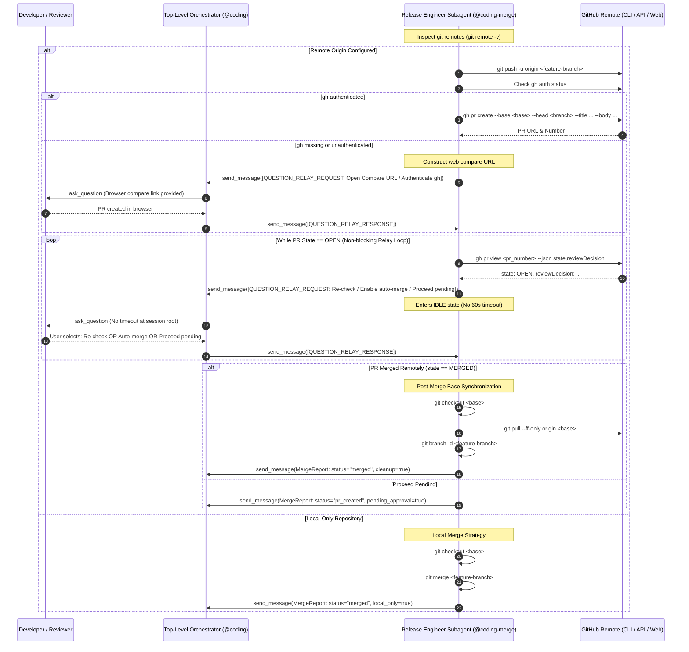

# Feature: Remote PR Creation, Question Relay Waiting Gate, and Post-Merge Synchronization for `@coding-merge`

> [!NOTE] Milestone: Phase 5 Pre-Merge Documentation Gate (Ready for Merge)
> - **Current Phase**: Phase 5: Review / Pre-Merge Documentation Gate (Call 2/3)
> - **Status**: **Pre-Merge Review Approved (Ready for Merge)**
> - **Specification ID**: `SPEC-2026-MERGE-001`
> - **Architecture Decision Record**: [[architecture/adr-007-coding-merge-remote-pr-and-sync|ADR-007: Remote PR Creation, Question Relay Waiting Gate, and Post-Merge Synchronization for @coding-merge]]
> - **Architecture Plan Note**: [[architecture/coding-merge-remote-pr-and-sync|Remote PR Creation, Question Relay Waiting Gate, and Post-Merge Synchronization Architecture & Implementation Plan]]
> - **Approved Technical Specification**: [`specification.md`](file:///Users/gpfister/.gemini/antigravity/brain/7408dcce-9644-4ba0-af51-bd171ed61a54/specification.md) ([Vault Archive](file:///Users/gpfister/Development/Projects/gpfister/agentic/agentic-obsidian/sessions/attachments/7408dcce-9644-4ba0-af51-bd171ed61a54/specification.md))
> - **Approved Implementation Plan**: [`plan.md`](file:///Users/gpfister/.gemini/antigravity/brain/7408dcce-9644-4ba0-af51-bd171ed61a54/plan.md) ([Vault Archive](file:///Users/gpfister/Development/Projects/gpfister/agentic/agentic-obsidian/sessions/attachments/7408dcce-9644-4ba0-af51-bd171ed61a54/plan.md))
> - **Target Branch**: `feature/coding-merge-pr-waiting-gate`
> - **Delivered Commits**:
>   - `agentic-coding-plugin`: [`486131c`](file:///Users/gpfister/Development/Projects/gpfister/agentic/agentic-coding-plugin/) — `feat(coding-merge): add PR creation, Question Relay waiting gate, and post-merge branch synchronization`
>   - `agentic` (root): [`1aa5e88`](file:///Users/gpfister/Development/Projects/gpfister/agentic/) — `docs(agents): update AGENTS.md for coding-merge remote PR waiting gate and sync`
> - **Verification Verdict**: **PASS (17/17 tests passing in agentic-coding-plugin, 100% pass rate)**
> - **Acceptance Criteria**: AC-1 through AC-5 **100% satisfied**
> - **Local Deployment Status**: **Not Required** across participating repositories

---

## 1. Summary & Problem Motivation

### 1.1 Problem Statement
In the existing implementation of `agentic-coding-plugin`, the release engineer subagent (`@coding-merge`) handles code integration in Stage 7 of the software development lifecycle. However:
1. When a remote repository is configured, `@coding-merge` executes `git push origin <branch>` and `gh pr create`, but lacks an interactive, non-blocking mechanism to wait for human review, approval, CI checks, and merge completion.
2. In the Google Antigravity runtime, background worker subagents face a strict **60-second execution timeout** when executing interactive prompting tools (`ask_question`) directly or blocking synchronously in polling loops.
3. If the GitHub CLI (`gh`) is not installed or unauthenticated (`gh auth status` failure), `@coding-merge` lacks a robust fallback workflow to generate a web-based compare URL (`https://github.com/<owner>/<repo>/compare/<base>...<branch>`) and guide the user through manual PR creation.
4. Once a Pull Request is merged remotely, local workspaces are left unsynchronized: the base branch is not fast-forward updated with remote commits, and the local feature branch remains unpruned.
5. `coding-merge` is missing `send_message` in its frontmatter tools list and is not fully integrated into the Question Relay Protocol matrix as a Pure Subagent.

### 1.2 Proposed Solution
Upgrade `@coding-merge` to:
- Detect remote repository configuration and validate GitHub CLI authentication status.
- Push the feature branch and create a Pull Request with structured metadata; provide a resilient fallback using web compare URLs when `gh` is unavailable.
- Introduce a **Hybrid Check & Question Relay Gate** that polls status via `gh pr view --json state,reviewDecision` and uses the Question Relay Protocol (`[QUESTION_RELAY_REQUEST]`) to delegate status checks, auto-merge configuration, or pending continuations to the parent orchestrator (`@coding`), completely avoiding subagent timeouts.
- Execute post-merge base branch synchronization (`git checkout <base>`, `git pull --ff-only origin <base>`) and delete the local feature branch (`git branch -d <branch>`).
- Update tooling declarations (`send_message`), agent instructions, orchestrator documentation, rules, and comprehensive unit tests.

---

## 2. Sequence Architecture

---

## 3. Functional Requirements

### FR-1: Remote Repository Detection & Validation
- **FR-1.1**: `@coding-merge` MUST inspect git remote configuration using `git remote -v` or `git remote get-url origin`.
- **FR-1.2**: If no remote is configured (local-only repository), `@coding-merge` MUST proceed with the local merge strategy: checkout the base branch (`main` or `master`), execute `git merge <branch>`, and conclude with `MergeReport` (`status: "merged"`).
- **FR-1.3**: If a remote named `origin` is configured, `@coding-merge` MUST determine the remote repository URL and extract the repository slug (`<owner>/<repo>`).

### FR-2: Feature Branch Push & PR Creation
- **FR-2.1**: `@coding-merge` MUST push the active feature branch to the remote origin using `git push -u origin <branch>`.
- **FR-2.2**: `@coding-merge` MUST check GitHub CLI authentication status via `run_command("gh auth status")`.
- **FR-2.3**: If `gh auth status` succeeds:
  - Create a Pull Request via `gh pr create --base <base> --head <branch> --title "<title>" --body "<body>"`.
  - Capture the generated PR URL and PR number from stdout.
  - Present the PR link in the execution log.

### FR-3: Fallback Flow for Missing or Unauthenticated GitHub CLI
- **FR-3.1**: If `gh` is missing, not installed, or `gh auth status` reports an unauthenticated state:
  - Construct the GitHub web compare URL:
    `https://github.com/<owner>/<repo>/compare/<base>...<branch>?expand=1`
  - Relay a prompt to `@coding` using Question Relay Protocol (`[QUESTION_RELAY_REQUEST]`):
    - **Question**: "GitHub CLI (`gh`) is unauthenticated or not installed. Please create the Pull Request via the browser compare URL or authenticate `gh`."
    - **Options**:
      1. `(Recommended) PR created in browser; check if merged`
      2. `Re-check gh auth status`
      3. `Proceed without waiting (mark pending)`
    - **Context**: Explains that the branch was pushed to remote origin and provides the clickable web link.

### FR-4: Non-Blocking PR Waiting & Review Decision Gate
- **FR-4.1**: After PR creation, `@coding-merge` MUST query the current PR status using:
  `gh pr view <pr_number> --json state,reviewDecision,mergedAt,url`
- **FR-4.2**: If `state == "MERGED"`, `@coding-merge` advances immediately to post-merge synchronization (FR-5).
- **FR-4.3**: If `state == "OPEN"`, `@coding-merge` MUST NOT execute a blocking sleep loop that risks Antigravity subagent timeouts. Instead, it MUST dispatch a `[QUESTION_RELAY_REQUEST]` to `@coding` with structured choices:
  - **Question**: `Pull Request #<number> is currently OPEN (reviewDecision: <decision>). How would you like to proceed?`
  - **Options**:
    1. `(Recommended) Re-check PR status`
    2. `Enable GitHub auto-merge (gh pr merge --auto --merge) and re-check`
    3. `Proceed without waiting (mark PR pending)`
  - **Context**: Summarizes PR title, URL, current approval state, and continuous integration status.
- **FR-4.4**: Upon receiving `[QUESTION_RELAY_RESPONSE]`:
  - If `Re-check PR status`: Re-run `gh pr view` and evaluate state. If still open, present the gate again.
  - If `Enable GitHub auto-merge`: Run `gh pr merge <pr_number> --auto --merge` (or `--squash`), then re-check status.
  - If `Proceed without waiting`: Complete the turn with `MergeReport` (`status: "pr_created"`, `pr_status: "open"`, `pending_approval: true`).

### FR-5: Post-Merge Base Synchronization & Local Cleanup
- **FR-5.1**: Once PR merge is confirmed (`state == "MERGED"`), `@coding-merge` MUST switch to the base branch:
  `git checkout <base>`
- **FR-5.2**: Fast-forward pull remote changes to ensure local base is identical to remote:
  `git pull --ff-only origin <base>`
- **FR-5.3**: Safely prune the merged local feature branch:
  `git branch -d <branch>`
- **FR-5.4**: Conclude by producing a structured `MergeReport` containing:
  - `status`: `"merged"`
  - `pr_number`: PR number
  - `pr_url`: PR URL
  - `base_branch`: base branch name
  - `merged_branch`: feature branch name
  - `cleanup`: boolean indicating local branch deletion success.

### FR-6: Subagent Tooling & Permission Configuration
- **FR-6.1**: Update `agentic-coding-plugin/agents/coding-merge/agent.md`:
  - Add `send_message` to `tools` list in YAML frontmatter.
  - Maintain `run_command`, `read_file`, `list_dir`, `ask_question`.
- **FR-6.2**: Add explicit Pure Subagent instructions to `coding-merge/agent.md` detailing:
  - When running under `@coding` (caller ID present), use `send_message` with `[QUESTION_RELAY_REQUEST]` for user prompts.
  - Standalone fallback to `ask_question` only when executed without a caller ID.

### FR-7: Ecosystem Coordination & Documentation Consistency
- **FR-7.1**: Update `agentic-coding-plugin/skills/coding-orchestrator/SKILL.md`:
  - Document the PR creation, waiting gate, and post-merge sync in Stage 7 (`coding-merge`).
  - Document `@coding-merge` participation in Question Relay Protocol.
- **FR-7.2**: Update `agentic-coding-plugin/rules/AGENTS.md`:
  - Add `@coding-merge` to Section 6 Question Relay Protocol Pure Subagents.
- **FR-7.3**: Update `agentic-coding-plugin/agents/agent.md`:
  - Update Stage 7 summary to reflect PR creation, waiting gate, and cleanup.
- **FR-7.4**: Update workspace root `AGENTS.md`:
  - Reflect `@coding-merge` PR creation, waiting gate, and inclusion in Section 3.2.4 Question Relay Protocol pure subagents table.

---

## 4. Non-Functional Requirements

### 4.1 Concurrency & Subagent Timeout Safety
- **NFR-1.1**: Under no circumstances shall `@coding-merge` invoke `sleep` in a tight loop or call `ask_question` directly while operating as a subagent under `@coding`.
- **NFR-1.2**: All interactive waiting intervals MUST be offloaded to the root session via `[QUESTION_RELAY_REQUEST]`, ensuring indefinite human deliberation capability without triggering Antigravity's 60-second subagent execution timeout.

### 4.2 Safety & Non-Destructive Operations
- **NFR-2.1**: Feature branch deletion MUST use `git branch -d` (safe delete), never `-D` (force delete), to prevent accidental data loss if upstream commits are not fully integrated.
- **NFR-2.2**: Upstream pulling MUST use `git pull --ff-only` to prevent unintended local merge commits or conflicts on the base branch.

### 4.3 Clarity & Observability
- **NFR-3.1**: Every git and GitHub CLI command executed MUST log its exact command line and return code in the subagent output.
- **NFR-3.2**: Markdown URLs and clickable symbols (`file://`) MUST be used when referencing branches, commits, PR links, and configuration files.

---

## 5. Affected Repositories & Files

| Repository / Sub-repo | File Path | Key Changes |
| :--- | :--- | :--- |
| `agentic-coding-plugin` | `agents/coding-merge/agent.md` | Add `send_message` to frontmatter tools. Add PR creation, fallback compare URL, waiting gate via `[QUESTION_RELAY_REQUEST]`, and post-merge cleanup instructions. |
| `agentic-coding-plugin` | `agents/agent.md` | Update Stage 7 description to include PR creation, waiting gate, and post-merge synchronization. |
| `agentic-coding-plugin` | `skills/coding-orchestrator/SKILL.md` | Update Stage 7 lifecycle in skill documentation to describe the PR waiting loop and Question Relay Protocol integration. |
| `agentic-coding-plugin` | `rules/AGENTS.md` | Add `@coding-merge` to Section 6 Question Relay Protocol Pure Subagents. |
| `agentic-coding-plugin` | `tests/test_plugin.py` | Add unit tests verifying `send_message` tool presence in `coding-merge`, PR waiting gate documentation, and Question Relay Protocol assertions for `coding-merge`. |
| Root `agentic` | `AGENTS.md` | Update Section 3.2.4 subagent matrix to include `@coding-merge` under Pure Subagents with PR waiting gate protocol. |

---

## 6. Verifiable Acceptance Criteria

- [x] **AC-1 (Frontmatter Tools)**: `agentic-coding-plugin/agents/coding-merge/agent.md` declares `send_message` in its `tools` list alongside `run_command`, `read_file`, `list_dir`, and `ask_question`.
- [x] **AC-2 (Agent Instructions)**: `coding-merge/agent.md` explicitly details:
  - Remote repository detection (`git remote -v`).
  - Feature branch push (`git push -u origin <branch>`).
  - GitHub CLI verification (`gh auth status`) and PR creation (`gh pr create`).
  - Fallback compare URL generation when `gh` is unauthenticated/missing.
  - Hybrid PR waiting gate via `gh pr view --json state,reviewDecision` and `[QUESTION_RELAY_REQUEST]`.
  - Post-merge base checkout (`git checkout <base>`), fast-forward pull (`git pull --ff-only origin <base>`), and safe local branch deletion (`git branch -d <branch>`).
- [x] **AC-3 (Question Relay Compliance)**: `rules/AGENTS.md`, `agents/agent.md`, and workspace `AGENTS.md` classify `@coding-merge` as a Pure Subagent utilizing `[QUESTION_RELAY_REQUEST]` and `[QUESTION_RELAY_RESPONSE]` to avoid 60-second timeouts.
- [x] **AC-4 (Orchestrator Skill)**: `skills/coding-orchestrator/SKILL.md` documents Stage 7's PR creation, waiting gate handling, and post-merge cleanup.
- [x] **AC-5 (Automated Tests)**: `tests/test_plugin.py` includes tests asserting:
  - `send_message` is present in `coding-merge` tools.
  - `coding-merge/agent.md` contains PR waiting gate and Question Relay contracts.
  - `test_question_relay_protocol_contracts` includes `coding-merge/agent.md`.
  - All existing and new tests pass cleanly with `pytest` (17/17 passing).

---

## 7. Implementation Deliverables & Pre-Merge Audit

### 7.1 Commit Ledger

| Repository | Branch | Commit | Commit Message | Files Modified | Test Results |
| :--- | :--- | :--- | :--- | :--- | :--- |
| **`agentic-coding-plugin`** | `feature/coding-merge-pr-waiting-gate` | [`486131c`](file:///Users/gpfister/Development/Projects/gpfister/agentic/agentic-coding-plugin/) | `feat(coding-merge): add PR creation, Question Relay waiting gate, and post-merge branch synchronization` | `agents/coding-merge/agent.md` `agents/agent.md` `skills/coding-orchestrator/SKILL.md` `rules/AGENTS.md` `tests/test_plugin.py` | **17/17 passed** |
| **`agentic` (root)** | `feature/coding-merge-pr-waiting-gate` | [`1aa5e88`](file:///Users/gpfister/Development/Projects/gpfister/agentic/) | `docs(agents): update AGENTS.md for coding-merge remote PR waiting gate and sync` | `AGENTS.md` | Verified markdown & consistency |

### 7.2 Pre-Merge Code Review Verdict
- **Verdict**: **APPROVED (0 Blockers)**
- **Audit Findings**:
  - `coding-merge/agent.md`: Declares `send_message` in YAML frontmatter; enforces Pure Subagent relay protocol with `[QUESTION_RELAY_REQUEST]` and `[QUESTION_RELAY_RESPONSE]`; implements remote detection, `gh auth status`, `gh pr create`, compare URL fallback, `gh pr view` polling with non-blocking relay gate, `git checkout <base>`, `git pull --ff-only origin <base>`, and `git branch -d <branch>`.
  - `rules/AGENTS.md` & `AGENTS.md`: Properly includes `@coding-merge` in Section 6 and Section 3.2.4 Pure Subagents list.
  - `skills/coding-orchestrator/SKILL.md`: Stage 7 lifecycle instructions and Question Relay Protocol updated.
  - `tests/test_plugin.py`: Added `test_coding_merge_pr_waiting_and_sync` and updated `test_question_relay_protocol_contracts` and `test_subagent_tool_configurations`. All 17 tests passed in 0.02s.
- **Local Deployment**: Confirmed Not Required across both repositories.
