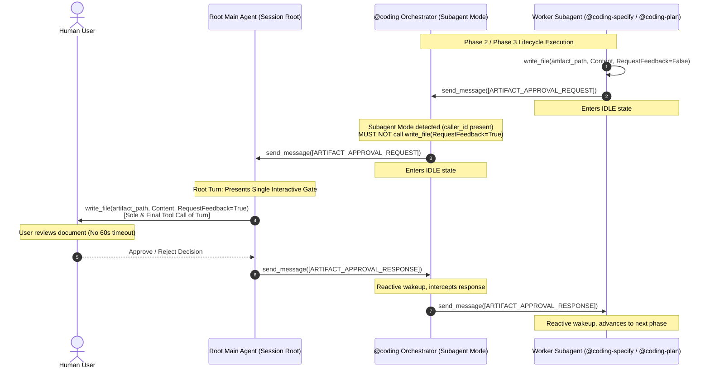

# Feature: Dual-Mode Coding Orchestrator with Multi-Hop Relay and Anti-Direct-Coding Guardrails

> [!NOTE] Milestone: Phase 7 Merge & Release Complete (Released / Completed)
> - **Current Phase**: Phase 7: Merge & Release Complete
> - **Status**: **Released / Completed**
> - **Specification ID**: `SPEC-2026-DUAL-MODE-001`
> - **Architecture Decision Record**: [[architecture/adr-008-dual-mode-coding-orchestrator|ADR-008: Dual-Mode Coding Orchestrator with Multi-Hop Relay and Anti-Direct-Coding Guardrails]]
> - **Architecture Plan Note**: [[architecture/dual-mode-coding-orchestrator|Dual-Mode Coding Orchestrator Architecture & Implementation Plan]]
> - **Target Branch**: `master` (Merged via GitHub PRs and fast-forward synchronized across all repositories)
> - **Release Commits**:
>   - `agentic`: PR #2 merged into `master` ([`fa5164a`](file:///Users/gpfister/Development/Projects/gpfister/agentic/))
>   - `agentic-coding-plugin`: PR #2 merged into `master` ([`3e04ac1`](file:///Users/gpfister/Development/Projects/gpfister/agentic/agentic-coding-plugin/)), **21/21 tests passed (100%)**
>   - `agentic-issue-investigation-plugin`: PR #1 merged into `master` ([`34629b3`](file:///Users/gpfister/Development/Projects/gpfister/agentic/agentic-issue-investigation-plugin/)), **14/14 tests passed (100%)**
> - **Verification Verdict**: **PASS (35/35 unit tests passing across feature repos, 100% pass rate)**

---

## 1. Feature Overview

This feature upgrades [`@coding`](file:///Users/gpfister/Development/Projects/gpfister/agentic/agentic-coding-plugin/agents/coding/agent.md), the central software development orchestrator, to solve two core reliability and architectural integrity issues discovered in operational environments:

1. **Dual-Mode Orchestration & Multi-Hop Relay Protocol**:
   Eliminates duplicate interactive UI approval gates and 60-second runtime timeout failures when `@coding` is executed as a child subagent under an upstream caller.
   - When running in **Subagent Mode** (`caller_id` present), `@coding` relays approval requests (`[ARTIFACT_APPROVAL_REQUEST]`) and user questions (`[QUESTION_RELAY_REQUEST]`) upward to its caller via `send_message` without calling `write_file(RequestFeedback=True)` or `ask_question`.
   - When running in **Standalone Mode** (no `caller_id`), `@coding` renders the interactive approval modal directly via `write_file(RequestFeedback=True)` and prompts the user directly via `ask_question`.
2. **Hard Anti-Direct-Coding Guardrails**:
   Prevents the orchestrator from bypassing the 7-stage development lifecycle when receiving imperative remediation prompts.
   - Strictly restricts `write_file` to interactive approval gate rendering in standalone mode; prohibits editing repository files.
   - Strictly restricts `run_command` to workspace inspection (`git status`); prohibits executing build tools and test suites.
   - Mandates delegation of all code changes to `@coding-develop`, health checks to `@coding-deploy`, code review to `@coding-review`, and git merges to `@coding-merge`.
3. **Pre-Clarified Fast-Path**:
   Deterministic fast-path for automated handoffs (from `@coding-investigate` or `/project-grooming`): skips Phase 1 (`coding-clarify`) while strictly maintaining Phase 2 (`coding-specify`) and Phase 3 (`coding-plan`) gates before implementation.
4. **Standardized Upstream Invocation Template**:
   Standardized caller prompt format across workspace documentation and companion plugins.

---

## 2. Architecture & Data Flow

---

## 3. Verifiable Acceptance Criteria

- [x] **Specification Authored & Approved**: Formatted in `SPEC-2026-DUAL-MODE-001` and archived in Obsidian.
- [x] **Implementation Plan Authored & Approved**: Multi-repository breakdown documented and archived.
- [x] **ADR-008 Formalized**: Recorded in `architecture/adr-008-dual-mode-coding-orchestrator.md`.
- [x] **Dual-Mode Matrix Consistency**: Synchronized across `rules/AGENTS.md`, `agents/coding/agent.md`, `skills/coding-orchestrator/SKILL.md`, and root `AGENTS.md`.
- [x] **Multi-Hop Relay Rules**: Multi-hop instructions and envelope handling documented in all target files.
- [x] **Anti-Direct-Coding Guardrails**: Explicit negative constraints prohibiting direct source code/test editing present in `@coding` agent and skill definitions.
- [x] **Pre-Clarified Fast-Path**: Instructions in place to skip Phase 1 and fast-path to Phase 2/3 for pre-clarified requirements.
- [x] **Standardized Upstream Invocation**: Template updated in root `AGENTS.md` and `agentic-issue-investigation-plugin/rules/AGENTS.md`.
- [x] **Automated Test Suite**: All unit tests passing with 100% success (21/21 in `agentic-coding-plugin`, 14/14 in `agentic-issue-investigation-plugin`).

---

## 4. Phase 4–6 Implementation, Review & Verification Summary

### 4.1 Phase 4: Implementation Delivery
- **`agentic-coding-plugin`**:
  - `agents/coding/agent.md`: Configured dual-mode operation (`caller_id` detection), multi-hop relay message handling, hard anti-direct-coding negative constraints, and pre-clarified fast-path.
  - `skills/coding-orchestrator/SKILL.md`: Added multi-hop relay protocol runbooks, anti-direct-coding execution rules, and pre-clarified fast-path workflows.
  - `rules/AGENTS.md`: Categorized `@coding` under Dual-Mode Orchestrator tier across Question Relay and Artifact Approval Relay matrices.
  - `agents/agent.md`: Updated catalog definitions and capability tables.
  - `tests/test_plugin.py`: Added 4 new test functions (21 total tests) asserting dual-mode orchestration, multi-hop relay, anti-direct-coding constraints, and fast-path execution.
- **`agentic` (Workspace Root)**:
  - `AGENTS.md`: Updated Section 2.3, Section 3.1, Section 3.2.4, Section 3.3.4, subagent categorization tables, and the standardized upstream invocation prompt template.
  - `README.md`: Added Dual-Mode Coding Orchestrator and Artifact Approval Relay ecosystem standards.
- **`agentic-issue-investigation-plugin`**:
  - `rules/AGENTS.md`: Updated Section 2 to invoke `@coding` using the standardized prompt template.
  - `agents/coding-investigate/agent.md`: Updated handoff instructions.
  - `skills/coding-investigate/SKILL.md`: Synchronized standardized invocation format.
  - `tests/test_plugin.py`: Added test assertion for standardized handoff prompt format (14 total tests).

### 4.2 Phase 5: Clean Code Review
- Verified by QA Lead against `SPEC-2026-DUAL-MODE-001`.
- Clean Code Reviewer verdict: **APPROVED**.
- All unit tests verified:
  - `agentic-coding-plugin`: **21/21 passed** (100%).
  - `agentic-issue-investigation-plugin`: **14/14 passed** (100%).

### 4.3 Phase 6: Pre-Merge Documentation Tidy-Up
- Synchronized all feature notes, architecture records, ADRs, plugin READMEs, and git tracking states across the 3 affected repositories. Ready for Phase 7 Merge & Release.

### 4.4 Phase 7: Remote PR Merge & Release Execution
- **Pull Request Creation & Review**:
  - `agentic`: [PR #2](https://github.com/gpfister/gp-agentic/pull/2) created and approved.
  - `agentic-coding-plugin`: [PR #2](https://github.com/gpfister/agentic-coding-plugin/pull/2) created and approved with 21/21 tests passing.
  - `agentic-issue-investigation-plugin`: [PR #1](https://github.com/gpfister/agentic-issue-investigation-plugin/pull/1) created and approved with 14/14 tests passing.
- **Merge Execution**:
  - `agentic`: PR #2 merged into `master` (commit [`fa5164a`](file:///Users/gpfister/Development/Projects/gpfister/agentic/)).
  - `agentic-coding-plugin`: PR #2 merged into `master` (commit [`3e04ac1`](file:///Users/gpfister/Development/Projects/gpfister/agentic/agentic-coding-plugin/)).
  - `agentic-issue-investigation-plugin`: PR #1 merged into `master` (commit [`34629b3`](file:///Users/gpfister/Development/Projects/gpfister/agentic/agentic-issue-investigation-plugin/)).
- **Post-Merge Synchronization & Cleanup**:
  - Upstream changes fast-forward pulled into local `master` branches across all repositories.
  - Feature branches `feat/dual-mode-coding-orchestrator` safely pruned/deleted.
  - Workspace git status, release changelog, and feature registry updated to **Released / Completed**.
