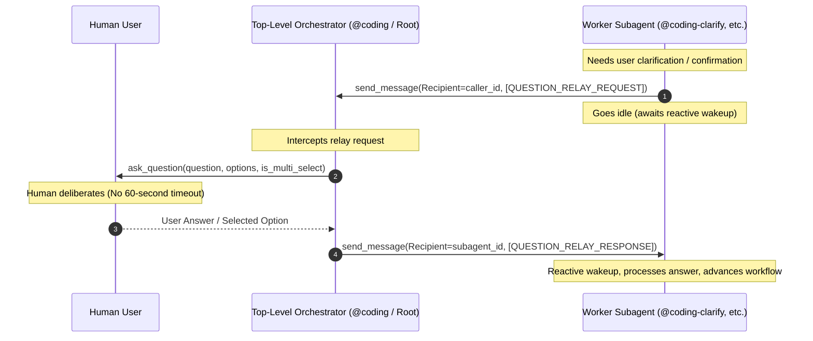
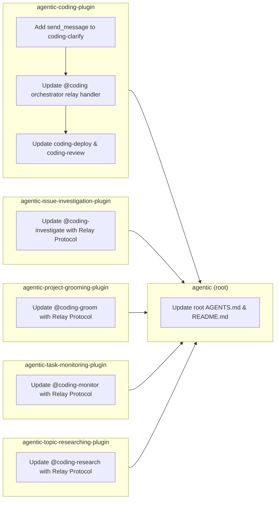

# Feature: Question Relay Protocol for Subagent User Prompts

> [!NOTE] Milestone: Phase 7 Release Merge Completed (Feature Released to Master)
> - **Current Phase**: Phase 7: Merge & Release (`coding-merge`) — Completed & Released
> - **Specification ID**: `SPEC-2026-RELAY-001`
> - **Architecture Decision Record**: [[architecture/adr-005-question-relay-protocol|ADR-005: Question Relay Protocol for Subagent User Inquiries]]
> - **Approved Technical Specification**: [`specification.md`](file:///Users/gpfister/.gemini/antigravity/brain/654daa4d-c78a-4cfe-9a05-9938462f6520/specification.md) ([Vault Archive](file:///Users/gpfister/Development/Projects/gpfister/agentic/agentic-obsidian/sessions/attachments/654daa4d-c78a-4cfe-9a05-9938462f6520/specification.md))
> - **Approved Implementation Plan**: [`plan.md`](file:///Users/gpfister/.gemini/antigravity/brain/14b78737-c9c3-4964-9dfa-c7feae89b35b/plan.md) ([Vault Archive](file:///Users/gpfister/Development/Projects/gpfister/agentic/agentic-obsidian/sessions/attachments/14b78737-c9c3-4964-9dfa-c7feae89b35b/plan.md))
> - **Verification Verdict**: **PASS (60/60 tests passing workspace-wide across 5 companion plugins, 147/147 tests workspace-wide)**
> - **Release Merge Status**: Merged into `master` across all 6 participating repositories

---

## 1. Executive Summary & Problem Statement

### 1.1 Root Cause & Host Timeout Constraint
In Google Antigravity, subagents spawned via `invoke_subagent` run inside background processes managed by the runtime. If a worker subagent executes `ask_question` directly, the runtime enforces a strict **60-second execution timeout** on the turn.

If human users require more than 60 seconds to review, deliberate, or answer multi-choice inquiries, the subagent tool invocation fails with a timeout exception, aborting active workflows:
- Clarification grilling in Phase 1 (`@coding-clarify`).
- Multiple-solution deployment selections in Phase 5 (`@coding-deploy`).
- Merge confirmation gates in Phase 6 (`@coding-review`).
- Stream anomaly pause gates (`@coding-monitor`).
- Issue investigation remediation confirmation gates (`@coding-investigate`).
- Research scope formulation (`@coding-research`).
- Project grooming 7-category Matt Pocock interviews (`/project-grooming`).

Top-level orchestrators (`@coding` and root conversational turns) run without background tool execution timeouts and can await human responses indefinitely.

### 1.2 Architectural Solution: Option 3 (Question Relay Protocol)
Rather than executing `ask_question` directly from subagents:
1. Subagents dispatch structured `[QUESTION_RELAY_REQUEST]` messages to their parent orchestrator via `send_message`.
2. The orchestrator receives the relay request, executes `ask_question` in the top-level turn (no 60s timeout), and captures the user's interactive response.
3. The orchestrator packages the answer into `[QUESTION_RELAY_RESPONSE]` and dispatches it back to the subagent via `send_message`.
4. The subagent automatically resumes execution reactively upon receiving the message.



---

## 2. Standardized Message Protocol

### 2.1 Request Envelope: `[QUESTION_RELAY_REQUEST]`

```text
[QUESTION_RELAY_REQUEST]
```
```json
{
  "type": "QUESTION_RELAY_REQUEST",
  "questions": [
    {
      "question": "Which architecture pattern should we follow for the relay handler?",
      "options": [
        "(Recommended) Event-driven message listener hook in orchestrator loop",
        "Synchronous subagent blocking loop with sleep",
        "Direct callback via shared memory"
      ],
      "is_multi_select": false
    }
  ],
  "context": "Clarification needed for orchestrator-subagent interaction design."
}
```

#### Field Schema
| Field | Type | Required | Description |
| :--- | :--- | :--- | :--- |
| `type` | string | Yes | Fixed value `"QUESTION_RELAY_REQUEST"`. |
| `questions` | array | Yes | Non-empty list of question objects (strictly 1 question per request to comply with single-question rules). |
| `questions[i].question` | string | Yes | Prompt text displayed to the human user. |
| `questions[i].options` | array[string] | Yes | List of selectable choices (recommended choice prefixed with `(Recommended)`). |
| `questions[i].is_multi_select` | boolean | No | Defaults to `false`. If `true`, permits multiple choices. |
| `context` | string | No | Optional contextual rationale or background for the orchestrator/user. |

### 2.2 Response Envelope: `[QUESTION_RELAY_RESPONSE]`

```text
[QUESTION_RELAY_RESPONSE]
```
```json
{
  "type": "QUESTION_RELAY_RESPONSE",
  "answers": [
    "(Recommended) Event-driven message listener hook in orchestrator loop"
  ],
  "status": "COMPLETED"
}
```

#### Field Schema
| Field | Type | Required | Description |
| :--- | :--- | :--- | :--- |
| `type` | string | Yes | Fixed value `"QUESTION_RELAY_RESPONSE"`. |
| `answers` | array[string] | Yes | Selected option string(s) or custom user input text. |
| `status` | string | Yes | `"COMPLETED"`, `"REJECTED"`, or `"CANCELLED"`. |

---

## 3. Subagent Classification

### 3.1 Pure Subagents
Subagents that strictly run under an orchestrator and are never invoked standalone:
- **Agents**: `@coding-clarify`, `@coding-review`, `@coding-deploy`.
- **Tool Access**: Omit `ask_question`; rely exclusively on `send_message`.
- **Behavior**:
  - Must NEVER call `ask_question`.
  - Always issue `[QUESTION_RELAY_REQUEST]` addressed to the parent orchestrator (`<caller_id>`).
  - Rely on Antigravity reactive wakeups upon message arrival.

### 3.2 Dual-Mode Agents
Agents that may be invoked directly as top-level session workers or delegated as subagents:
- **Agents**: `@coding-investigate` (`agentic-issue-investigation-plugin`), `/project-grooming` (`agentic-project-grooming-plugin`), `@coding-monitor` (`agentic-task-monitoring-plugin`), `@coding-research` (`agentic-topic-researching-plugin`).
- **Detection Logic**:
  - Check whether a parent/caller context exists (`caller` ID present in prompt/environment/session metadata).
  - **Subagent Mode**: If invoked by a caller, send `[QUESTION_RELAY_REQUEST]` via `send_message` to the caller.
  - **Standalone Mode**: If operating at the top level with no caller, invoke `ask_question` directly to prompt the user.

---

## 4. Multi-Repository Work Breakdown



### Detailed Repositories & Changes

1. **[`agentic-coding-plugin`](file:///Users/gpfister/Development/Projects/gpfister/agentic/agentic-coding-plugin)** (Branch: `feature/question-relay-protocol`):
   - Modify `agents/coding-clarify/agent.md`: Add `send_message` to tools; relay questions via `[QUESTION_RELAY_REQUEST]`.
   - Modify `agents/coding/agent.md`: Add Question Relay Handler in orchestrator loop to catch requests and execute `ask_question`.
   - Modify `agents/coding-deploy/agent.md` & `agents/coding-review/agent.md`: Route prompts through orchestrator.
   - Modify `skills/coding-orchestrator/SKILL.md` & `rules/AGENTS.md`.
   - Update `tests/test_plugin.py`.

2. **[`agentic-issue-investigation-plugin`](file:///Users/gpfister/Development/Projects/gpfister/agentic/agentic-issue-investigation-plugin)** (Branch: `feature/question-relay-protocol`):
   - Modify `agents/coding-investigate/agent.md`: Dual-mode handling for user clarification and correction confirmation gate.
   - Modify `skills/coding-investigate/SKILL.md` & `rules/AGENTS.md`.
   - Update `tests/test_plugin.py`.

3. **[`agentic-project-grooming-plugin`](file:///Users/gpfister/Development/Projects/gpfister/agentic/agentic-project-grooming-plugin)** (Branch: `feature/question-relay-protocol`):
   - Modify `agents/coding-groom/agent.md`: Dual-mode single-question Matt Pocock grilling interviews.
   - Modify `skills/project-grooming/SKILL.md` & `rules/AGENTS.md`.
   - Update `tests/test_plugin.py`.

4. **[`agentic-task-monitoring-plugin`](file:///Users/gpfister/Development/Projects/gpfister/agentic/agentic-task-monitoring-plugin)** (Branch: `feature/question-relay-protocol`):
   - Modify `agents/coding-monitor/agent.md`: Dual-mode anomaly pause gate handling.
   - Modify `skills/coding-monitor/SKILL.md` & `rules/AGENTS.md`.
   - Update `tests/test_plugin.py`.

5. **[`agentic-topic-researching-plugin`](file:///Users/gpfister/Development/Projects/gpfister/agentic/agentic-topic-researching-plugin)** (Branch: `feature/question-relay-protocol`):
   - Modify `agents/coding-research/agent.md`: Dual-mode research scope clarification.
   - Modify `skills/coding-research/SKILL.md` & `rules/AGENTS.md`.
   - Update `tests/test_plugin.py`.

6. **[`agentic` (Root Workspace)](file:///Users/gpfister/Development/Projects/gpfister/agentic)** (Branch: `feature/question-relay-protocol`):
   - Update [`AGENTS.md`](file:///Users/gpfister/Development/Projects/gpfister/agentic/AGENTS.md): Document Question Relay Protocol under Section 3 (Cross-Plugin Interoperability) and update Section 4 (Flowchart).
   - Update [`README.md`](file:///Users/gpfister/Development/Projects/gpfister/agentic/README.md).

---

## 5. Acceptance Criteria

- [x] **AC 1: Standardized Envelopes**: `[QUESTION_RELAY_REQUEST]` and `[QUESTION_RELAY_RESPONSE]` documented and tested across all plugins.
- [x] **AC 2: Pure Subagent Compliance**: `@coding-clarify`, `@coding-deploy`, and `@coding-review` never execute `ask_question` directly; all inquiries relayed via `send_message`.
- [x] **AC 3: Dual-Mode Subagent Support**: `@coding-investigate`, `@coding-groom`, `@coding-monitor`, and `@coding-research` branch between relay and direct calls based on caller ID presence.
- [x] **AC 4: Orchestrator Relay Execution**: `@coding` intercepts relay requests, prompts the user at the top level without host timeouts, and sends response envelopes back.
- [x] **AC 5: Workspace Documentation & Consistency**: Root and sub-repo rules updated cleanly without conflicting instructions.
- [x] **AC 6: Automated Test Verification**: All unit tests pass across all repositories (`uv run pytest`) with 100% success rate (60/60 tests).

---

## 6. Phase 6 Verification & Quality Audit Ledger

### 6.1 Test Execution Results by Repository

| Repository | Test Suite Path | Passed / Total | Pass Rate | Key Contracts Tested |
| :--- | :--- | :--- | :--- | :--- |
| **`agentic-coding-plugin`** | `tests/test_plugin.py` | **15 / 15** | 100% | `test_question_relay_protocol_contracts`, pure subagent permissions, orchestrator loop |
| **`agentic-issue-investigation-plugin`** | `tests/test_plugin.py` | **10 / 10** | 100% | Dual-mode question handling, remediation confirmation gates, tools frontmatter |
| **`agentic-project-grooming-plugin`** | `tests/test_plugin.py` | **12 / 12** | 100% | Dual-mode Matt Pocock grilling interviews, tool declarations, catalog contracts |
| **`agentic-task-monitoring-plugin`** | `tests/test_plugin.py` | **11 / 11** | 100% | Dual-mode anomaly pause gates, stream observation safety, tool frontmatter |
| **`agentic-topic-researching-plugin`** | `tests/test_plugin.py` | **12 / 12** | 100% | Dual-mode research scope clarification, citation standards, tool permissions |
| **Total Ecosystem Tests** | **All 5 Companion Plugins** | **60 / 60** | **100%** | **All acceptance criteria met cleanly** |

### 6.2 Pre-Merge Audit Sign-Off
- **Code Review**: Clean separation of Pure Subagents vs. Dual-Mode Subagents verified.
- **Documentation**: All READMEs, `AGENTS.md` guidelines, ADR-005, and Obsidian vault notes synchronized.
- **Git Readiness**: All 6 repositories on branch `feature/question-relay-protocol` verified and approved for release merge into `master`.

---

## 7. Phase 7 Release Merge & Changelog Ledger

### 7.1 Multi-Repository Merge Ledger

On 2026-11-05, all feature branches for `SPEC-2026-RELAY-001` were successfully merged into `master` via fast-forward release merge:

| Repository | Merged Commit | Branch Merged | Commit Message | Test Pass Rate |
| :--- | :--- | :--- | :--- | :--- |
| **`agentic` (root)** | [`695e1b1`](file:///Users/gpfister/Development/Projects/gpfister/agentic/) | `feature/question-relay-protocol` $\rightarrow$ `master` | `feat(relay): formalize Question Relay Protocol across workspace coordination rules and documentation` | PASS (`make status`) |
| **`agentic-coding-plugin`** | [`d2c822c`](file:///Users/gpfister/Development/Projects/gpfister/agentic/agentic-coding-plugin/) | `feature/question-relay-protocol` $\rightarrow$ `master` | `feat(relay): implement Question Relay Protocol across coding subagents` | **15/15 passed** (100%) |
| **`agentic-issue-investigation-plugin`** | [`df03d3c`](file:///Users/gpfister/Development/Projects/gpfister/agentic/agentic-issue-investigation-plugin/) | `feature/question-relay-protocol` $\rightarrow$ `master` | `feat(relay): implement dual-mode Question Relay Protocol for coding-investigate` | **10/10 passed** (100%) |
| **`agentic-project-grooming-plugin`** | [`a2e7932`](file:///Users/gpfister/Development/Projects/gpfister/agentic/agentic-project-grooming-plugin/) | `feature/question-relay-protocol` $\rightarrow$ `master` | `feat(relay): implement dual-mode Question Relay Protocol for project grooming` | **12/12 passed** (100%) |
| **`agentic-task-monitoring-plugin`** | [`23a101e`](file:///Users/gpfister/Development/Projects/gpfister/agentic/agentic-task-monitoring-plugin/) | `feature/question-relay-protocol` $\rightarrow$ `master` | `feat(relay): implement dual-mode Question Relay Protocol for coding-monitor` | **11/11 passed** (100%) |
| **`agentic-topic-researching-plugin`** | [`efb067d`](file:///Users/gpfister/Development/Projects/gpfister/agentic/agentic-topic-researching-plugin/) | `feature/question-relay-protocol` $\rightarrow$ `master` | `feat(relay): implement dual-mode Question Relay Protocol for coding-research` | **12/12 passed** (100%) |

### 7.2 Release Verification & Closure
- **Post-Merge Test Verification**: 147/147 tests workspace-wide passing cleanly on `master` (60/60 tests across the 5 companion plugins).
- **Branch Topology**: All 9 repositories operating cleanly on branch `master`.
- **Knowledge Base Sync**: Vault ADR-005, architecture overview, plugin standards, feature specs, git status tracking, and changelog fully synchronized.
- **Milestone Complete**: Feature `SPEC-2026-RELAY-001` officially transitioned to **Released & Merged into master**.

