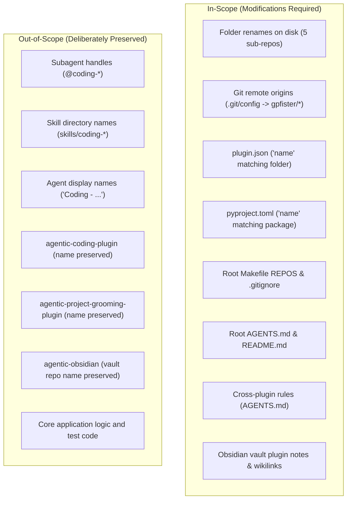

# Feature: Rename Plugin Repositories to Descriptive Action-Oriented Names

> [!NOTE] Phase 1: Clarification Completed
> - **Current Phase**: Phase 1: Clarification (Completed) $\rightarrow$ Ready for Phase 2: Specification (`@coding-specify`)
> - **Status**: Clarified / In-Progress
> - **Scope**: Rename 5 Antigravity companion plugin repositories to descriptive, action-oriented names (`agentic-<action>-plugin`), update remote git origins, update manifests, and align cross-plugin references while strictly preserving subagent handles (`@coding-*`).
> - **Branch Strategy**: Direct commits on `master` across root and sub-repositories (as clarified by user).

---

## 1. Executive Summary & Problem Motivation

### 1.1 Context & Background
The `agentic` workspace hosts modular Google Antigravity companion plugins alongside a centralized Obsidian knowledge vault (`agentic-obsidian/`). Previously, two plugins followed expanded descriptive naming:
- [`agentic-coding-plugin`](file:///Users/gpfister/Development/Projects/gpfister/agentic/agentic-coding-plugin)
- [`agentic-project-grooming-plugin`](file:///Users/gpfister/Development/Projects/gpfister/agentic/agentic-project-grooming-plugin)

However, the remaining companion plugins used condensed or inconsistent naming:
- `agentic-triage-plugin`
- `agentic-investigate-plugin`
- `agentic-monitor-plugin`
- `agentic-research-plugin`
- `agentic-document-plugin`

### 1.2 Objective
Align all 5 companion plugin repositories with a uniform naming grammar reflecting the functional action performed by each plugin:
1. `agentic-triage-plugin` $\rightarrow$ `agentic-prompt-triage-plugin`
2. `agentic-investigate-plugin` $\rightarrow$ `agentic-issue-investigation-plugin`
3. `agentic-monitor-plugin` $\rightarrow$ `agentic-task-monitoring-plugin`
4. `agentic-research-plugin` $\rightarrow$ `agentic-topic-researching-plugin`
5. `agentic-document-plugin` $\rightarrow$ `agentic-project-documenting-plugin`

---

## 2. Clarified Scope & Interview Outcomes

### 2.1 Repository Renames & Remote URLs

| Current Sub-Repo Directory | New Sub-Repo Directory | New Remote Git URL | Primary Role |
| :--- | :--- | :--- | :--- |
| `agentic-triage-plugin` | `agentic-prompt-triage-plugin` | `git@github.com:gpfister/agentic-prompt-triage-plugin.git` | Fast prompt intent classification & routing |
| `agentic-investigate-plugin` | `agentic-issue-investigation-plugin` | `git@github.com:gpfister/agentic-issue-investigation-plugin.git` | Autonomous issue root cause diagnosis |
| `agentic-monitor-plugin` | `agentic-task-monitoring-plugin` | `git@github.com:gpfister/agentic-task-monitoring-plugin.git` | Real-time telemetry, logs, and container monitoring |
| `agentic-research-plugin` | `agentic-topic-researching-plugin` | `git@github.com:gpfister/agentic-topic-researching-plugin.git` | Deep web and literature research synthesis |
| `agentic-document-plugin` | `agentic-project-documenting-plugin` | `git@github.com:gpfister/agentic-project-documenting-plugin.git` | Obsidian vault documentation & knowledge curation |

### 2.2 Clarified Architectural & Design Decisions

> [!IMPORTANT] Subagent Technical Handles Preserved
> Subagent invocation handles (`@coding-document`, `@coding-investigate`, `@coding-monitor`, `@coding-research`), agent metadata identifiers (`name: coding-*`), and skill directory names (`skills/coding-*`) **must be preserved without changes**. 
> - **Rationale**: Altering subagent handles breaks established prompt contracts, system prompt routing, and existing test suites across the ecosystem. The renaming is purely at the plugin package/repository and manifest layer.

#### Summary of Key Decisions:
1. **Subagent Handles & Skills**:
   - Retain `@coding-document`, `@coding-investigate`, `@coding-monitor`, and `@coding-research`.
   - Keep skill directory names (`skills/coding-document/`, `skills/coding-investigate/`, etc.) identical.
2. **Git Remotes**:
   - Update `origin` remote URLs in `.git/config` for each renamed repository to point to `git@github.com:gpfister/<new-name>.git`.
3. **Plugin Manifests & Packaging**:
   - Update `plugin.json` `"name"` to match the new directory name in all 5 plugins.
   - Update `pyproject.toml` package `name` field in all renamed plugins.
4. **Workspace Root Coordination**:
   - Update `Makefile` `REPOS` list to reflect the new directory names.
   - Update `.gitignore` root entries to ignore the new directory names.
   - Update root [`AGENTS.md`](file:///Users/gpfister/Development/Projects/gpfister/agentic/AGENTS.md) and [`README.md`](file:///Users/gpfister/Development/Projects/gpfister/agentic/README.md) workspace maps.
5. **Cross-Plugin Rules & Standards**:
   - Update rules, references, and skills across companion plugins (`agentic-coding-plugin`, `agentic-project-grooming-plugin`, etc.) that reference former plugin directory names.
6. **Obsidian Vault Updates**:
   - Rename plugin documentation files in `agentic-obsidian/plugins/` (e.g. `plugins/agentic-prompt-triage-plugin.md`).
   - Update wikilinks, plugin catalog index (`plugins/index.md`), git status tracking (`git-status.md`), and vault `README.md`.
7. **Branch & Release Strategy**:
   - Commit changes directly on `master` across the root orchestrator and each sub-repository (no temporary feature branches).

---

## 3. Scope Boundaries: In-Scope vs. Out-of-Scope

| Area | Component | Action / Treatment |
| :--- | :--- | :--- |
| **Sub-repo Folders** | 5 companion plugin directories | Renamed on disk to descriptive action names |
| **Git Remotes** | Sub-repo `.git/config` origins | Pointed to new GitHub remote URLs |
| **Plugin Manifests** | `plugin.json` in each renamed repo | Updated `"name"` field to match new folder name |
| **Package Manifests** | `pyproject.toml` in renamed repos | Updated `name = "..."` field |
| **Root Workspace** | `Makefile`, `.gitignore`, `README.md`, `AGENTS.md` | Updated repository lists and structural diagrams |
| **Cross-Plugin Rules** | `rules/AGENTS.md` in companion repos | Updated references to plugin names (fallback detection, etc.) |
| **Obsidian Vault** | `agentic-obsidian/plugins/*.md`, `index.md`, `git-status.md` | Renamed plugin notes and updated links |
| **Subagent Handles** | `@coding-document`, `@coding-investigate`, `@coding-monitor`, `@coding-research` | **Retained strictly unchanged** |
| **Skill Directories** | `skills/<skill_name>/` | **Retained strictly unchanged** |
| **Root & Other Repos** | `agentic`, `agentic-coding-plugin`, `agentic-project-grooming-plugin`, `agentic-obsidian` | Base repo names preserved |

---

## 4. Acceptance Criteria

- [ ] **Folder Structure**: All 5 repository directories renamed accurately on disk:
  - `agentic-prompt-triage-plugin/`
  - `agentic-issue-investigation-plugin/`
  - `agentic-task-monitoring-plugin/`
  - `agentic-topic-researching-plugin/`
  - `agentic-project-documenting-plugin/`
- [ ] **Plugin Manifests**: Each renamed repository has an updated `plugin.json` whose `"name"` strictly matches its folder name.
- [ ] **Package Manifests**: Each renamed repository has an updated `pyproject.toml` with the corresponding package name.
- [ ] **Git Remote Origins**: `git remote get-url origin` reflects the updated GitHub repository URL for all 5 sub-repos.
- [ ] **Workspace Automation**: `Makefile` `REPOS` list and `.gitignore` updated; `make status` and `make sync` operate seamlessly.
- [ ] **Root & Cross-Plugin References**: Root [`AGENTS.md`](file:///Users/gpfister/Development/Projects/gpfister/agentic/AGENTS.md), [`README.md`](file:///Users/gpfister/Development/Projects/gpfister/agentic/README.md), and companion plugin rules reflect the new names with zero dead links or outdated folder paths.
- [ ] **Obsidian Vault Integrity**: Vault documentation notes in `plugins/` renamed and cross-linked; wikilinks and clickable `file://` links resolved.
- [ ] **Subagent Contract Preservation**: Subagent handles (`@coding-*`) and skills remain identical without regression.
- [ ] **Test Suites**: Existing unit test suites run and pass cleanly without broken path assumptions.

---

## 5. Next Steps

- **Handoff Target**: Phase 2: Specification (`@coding-specify`) to synthesize formal technical specification artifact `specification.md`.
- **Documentation Reference**: Internal wikilink [[features/rename-plugin-repositories|Rename Plugin Repositories]].
