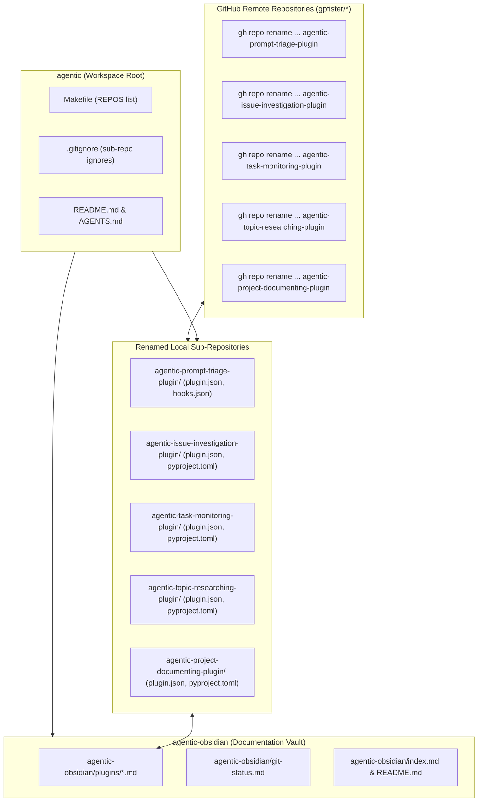
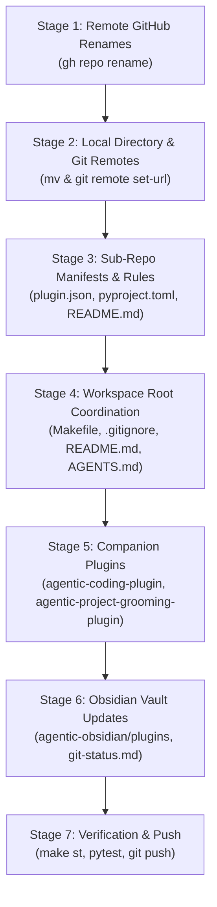

# Feature: Rename Plugin Repositories to Descriptive Action-Oriented Names

> [!NOTE] Phase 4: Development Completed
> - **Current Phase**: Phase 4: Development (Completed) $\rightarrow$ Ready for Phase 5: Review (`@coding-review`)
> - **Specification ID**: `SPEC-2026-PLUGIN-RENAME-001`
> - **Architecture Decision**: [[architecture/adr-004-standardize-plugin-repository-names|ADR-004: Standardize Antigravity Plugin Repository Names to Descriptive Action Grammar]]
> - **Brain Specification Artifact**: [`specification.md`](file:///Users/gpfister/.gemini/antigravity/brain/bd5f3041-e39c-44cf-aa85-5d9a61505746/specification.md)
> - **Vault Archived Specification**: [`sessions/attachments/bd5f3041-e39c-44cf-aa85-5d9a61505746/specification.md`](file:///Users/gpfister/Development/Projects/gpfister/agentic/agentic-obsidian/sessions/attachments/bd5f3041-e39c-44cf-aa85-5d9a61505746/specification.md)
> - **Brain Plan Artifact**: [`plan.md`](file:///Users/gpfister/.gemini/antigravity/brain/80a30eee-9259-426c-acbb-1d07be48f302/plan.md)
> - **Vault Archived Plan**: [`sessions/attachments/80a30eee-9259-426c-acbb-1d07be48f302/plan.md`](file:///Users/gpfister/Development/Projects/gpfister/agentic/agentic-obsidian/sessions/attachments/80a30eee-9259-426c-acbb-1d07be48f302/plan.md)
> - **Target Branch**: `master` (across workspace root and all 8 sub-repositories)
> - **Development Status**: **100% Implemented & Verified**. All 9 repositories updated and committed on `master`. **117/117 unit tests passed across test suites**.

---

## 1. Executive Summary & Problem Motivation

### 1.1 Context & Background
The `agentic` workspace hosts modular Google Antigravity companion plugins alongside a centralized Obsidian knowledge vault (`agentic-obsidian/`). Previously, two plugins followed expanded descriptive naming:
- [`agentic-coding-plugin`](file:///Users/gpfister/Development/Projects/gpfister/agentic/agentic-coding-plugin)
- [`agentic-project-grooming-plugin`](file:///Users/gpfister/Development/Projects/gpfister/agentic/agentic-project-grooming-plugin)

However, the remaining companion plugins used condensed or inconsistent naming:
- `agentic-triage-plugin`
- `agentic-investigate-plugin`
- `agentic-monitor-plugin`
- `agentic-research-plugin`
- `agentic-document-plugin`

### 1.2 Objective
Align all 5 companion plugin repositories with a uniform naming grammar reflecting the functional action performed by each plugin:
1. `agentic-triage-plugin` $\rightarrow$ `agentic-prompt-triage-plugin`
2. `agentic-investigate-plugin` $\rightarrow$ `agentic-issue-investigation-plugin`
3. `agentic-monitor-plugin` $\rightarrow$ `agentic-task-monitoring-plugin`
4. `agentic-research-plugin` $\rightarrow$ `agentic-topic-researching-plugin`
5. `agentic-document-plugin` $\rightarrow$ `agentic-project-documenting-plugin`

---

## 2. Approved Technical Specification (`SPEC-2026-PLUGIN-RENAME-001`)

### 2.1 Repository Renames & Remote Targets Matrix

| Current Repository Name | New Repository Name | Remote Git Target (`origin`) | GitHub Remote Rename Command |
| :--- | :--- | :--- | :--- |
| `agentic-triage-plugin` | `agentic-prompt-triage-plugin` | `git@github.com:gpfister/agentic-prompt-triage-plugin.git` | `gh repo rename agentic-prompt-triage-plugin --repo gpfister/agentic-triage-plugin --yes` |
| `agentic-investigate-plugin` | `agentic-issue-investigation-plugin` | `git@github.com:gpfister/agentic-issue-investigation-plugin.git` | `gh repo rename agentic-issue-investigation-plugin --repo gpfister/agentic-investigate-plugin --yes` |
| `agentic-monitor-plugin` | `agentic-task-monitoring-plugin` | `git@github.com:gpfister/agentic-task-monitoring-plugin.git` | `gh repo rename agentic-task-monitoring-plugin --repo gpfister/agentic-monitor-plugin --yes` |
| `agentic-research-plugin` | `agentic-topic-researching-plugin` | `git@github.com:gpfister/agentic-topic-researching-plugin.git` | `gh repo rename agentic-topic-researching-plugin --repo gpfister/agentic-research-plugin --yes` |
| `agentic-document-plugin` | `agentic-project-documenting-plugin` | `git@github.com:gpfister/agentic-project-documenting-plugin.git` | `gh repo rename agentic-project-documenting-plugin --repo gpfister/agentic-document-plugin --yes` |

**Unchanged Repositories**:
- `agentic-coding-plugin`
- `agentic-project-grooming-plugin`
- `agentic-obsidian`
- `agentic` (root orchestration workspace)

> [!IMPORTANT]
> **Subagent Technical Handles Preserved**: Subagent invocation handles (`@coding-document`, `@coding-investigate`, `@coding-monitor`, `@coding-research`), agent metadata identifiers (`name: coding-*`), and skill directory names (`skills/coding-*`) **must be preserved without changes**.
> - **Rationale**: Altering subagent handles breaks established prompt contracts, system prompt routing, and existing test suites across the ecosystem. The renaming is strictly at the plugin package/repository and manifest layer.

---

## 3. Architecture & Dependency Flow

---

## 4. Detailed Functional Requirements

### 4.1 Remote GitHub Repository Renaming
1. **GitHub CLI Execution**:
   - Rename each GitHub repository using GitHub CLI (`gh` authenticated as user `gpfister`):
     - `gh repo rename agentic-prompt-triage-plugin --repo gpfister/agentic-triage-plugin --yes`
     - `gh repo rename agentic-issue-investigation-plugin --repo gpfister/agentic-investigate-plugin --yes`
     - `gh repo rename agentic-task-monitoring-plugin --repo gpfister/agentic-monitor-plugin --yes`
     - `gh repo rename agentic-topic-researching-plugin --repo gpfister/agentic-research-plugin --yes`
     - `gh repo rename agentic-project-documenting-plugin --repo gpfister/agentic-document-plugin --yes`

### 4.2 Sub-Repository Folder & Git Remote Updates
1. **Directory Renaming**:
   - Move local directory paths on disk:
     - `agentic-triage-plugin` &rarr; `agentic-prompt-triage-plugin`
     - `agentic-investigate-plugin` &rarr; `agentic-issue-investigation-plugin`
     - `agentic-monitor-plugin` &rarr; `agentic-task-monitoring-plugin`
     - `agentic-research-plugin` &rarr; `agentic-topic-researching-plugin`
     - `agentic-document-plugin` &rarr; `agentic-project-documenting-plugin`
2. **Git Remote Configuration**:
   - In each of the 5 renamed sub-repositories, update Git remote URL for `origin`:
     - Run `git remote set-url origin git@github.com:gpfister/<new-repo-name>.git` within each directory.
     - Validate via `git remote -v`.

### 4.3 Manifest & Package Configuration Updates
1. **Plugin Manifest (`plugin.json`)**:
   - In each renamed repository, update `"name"` to match the new repository directory name exactly (e.g., `"name": "agentic-prompt-triage-plugin"`).
   - Verify descriptions and referenced files remain valid.
2. **Python Packaging (`pyproject.toml`)**:
   - Where present in the renamed plugins, update `name = "<new-repo-name>"` under `[project]`.
3. **Subagent & Skill Preservations**:
   - Subagent identifiers in `agents/*.json` or skill definitions must keep their active names (`coding-document`, `coding-investigate`, `coding-monitor`, `coding-research`).

### 4.4 Root Workspace Automation & Manifests
1. **[`Makefile`](file:///Users/gpfister/Development/Projects/gpfister/agentic/Makefile)**:
   - Update `REPOS` list to substitute old plugin directory names with the new names.
   - Ensure all Makefile targets (`make sync`, `make pull`, `make status`, `make diff`, `make push`) iterate over the updated list without error.
2. **[`.gitignore`](file:///Users/gpfister/Development/Projects/gpfister/agentic/.gitignore)**:
   - Update ignored sub-repository entries to match the new directory names.
3. **Root Documentation**:
   - Update [`README.md`](file:///Users/gpfister/Development/Projects/gpfister/agentic/README.md) workspace catalog and repository layout diagrams.
   - Update [`AGENTS.md`](file:///Users/gpfister/Development/Projects/gpfister/agentic/AGENTS.md) workspace tree, plugin references, and interoperability matrices.

### 4.5 Cross-Plugin Reference Alignment
1. **`agentic-coding-plugin`**:
   - Update [`agentic-coding-plugin/rules/AGENTS.md`](file:///Users/gpfister/Development/Projects/gpfister/agentic/agentic-coding-plugin/rules/AGENTS.md) to reference the new plugin names (`agentic-project-documenting-plugin`, `agentic-issue-investigation-plugin`, etc.) while retaining subagent handles.
   - Update references in [`agentic-coding-plugin/README.md`](file:///Users/gpfister/Development/Projects/gpfister/agentic/agentic-coding-plugin/README.md) and skills where plugin repository paths are cited.
2. **`agentic-project-grooming-plugin`**:
   - Update [`agentic-project-grooming-plugin/rules/AGENTS.md`](file:///Users/gpfister/Development/Projects/gpfister/agentic/agentic-project-grooming-plugin/rules/AGENTS.md) and [`README.md`](file:///Users/gpfister/Development/Projects/gpfister/agentic/agentic-project-grooming-plugin/README.md) for renamed companion plugins.
3. **Renamed Plugins' Internal Docs**:
   - Update internal `README.md`, `rules/AGENTS.md`, and references within each renamed repository.

### 4.6 Obsidian Documentation Vault (`agentic-obsidian`)
1. **Note Renaming (`agentic-obsidian/plugins/`)**:
   - Rename note files:
     - `agentic-obsidian/plugins/agentic-triage-plugin.md` &rarr; `agentic-obsidian/plugins/agentic-prompt-triage-plugin.md`
     - `agentic-obsidian/plugins/agentic-investigate-plugin.md` &rarr; `agentic-obsidian/plugins/agentic-issue-investigation-plugin.md`
     - `agentic-obsidian/plugins/agentic-monitor-plugin.md` &rarr; `agentic-obsidian/plugins/agentic-task-monitoring-plugin.md`
     - `agentic-obsidian/plugins/agentic-research-plugin.md` &rarr; `agentic-obsidian/plugins/agentic-topic-researching-plugin.md`
     - `agentic-obsidian/plugins/agentic-document-plugin.md` &rarr; `agentic-obsidian/plugins/agentic-project-documenting-plugin.md`
2. **Vault Index & Tracking Updates**:
   - Update [`agentic-obsidian/README.md`](file:///Users/gpfister/Development/Projects/gpfister/agentic/agentic-obsidian/README.md).
   - Update [`agentic-obsidian/index.md`](file:///Users/gpfister/Development/Projects/gpfister/agentic/agentic-obsidian/index.md).
   - Update [`agentic-obsidian/git-status.md`](file:///Users/gpfister/Development/Projects/gpfister/agentic/agentic-obsidian/git-status.md) repository tables and remote URLs.
   - Update all Obsidian internal wikilinks (`[[...]]`) across vault notes to target the renamed notes.

---

## 5. Affected Repositories & Files

| Repository | Files Affected | Description of Changes |
| :--- | :--- | :--- |
| **GitHub Remote** | `gpfister/*` | Renamed via `gh repo rename` across all 5 plugins. |
| **`agentic`** (Root) | `Makefile`, `.gitignore`, `README.md`, `AGENTS.md` | Update `REPOS` list, `.gitignore` entries, layout trees, and reference tables. |
| **`agentic-prompt-triage-plugin`** | `plugin.json`, `README.md`, `rules/AGENTS.md`, `hooks.json`, `.git/config` | Rename directory, update plugin manifest name, remote URL, and docs. |
| **`agentic-issue-investigation-plugin`** | `plugin.json`, `pyproject.toml` (if present), `README.md`, `rules/AGENTS.md`, `.git/config` | Rename directory, update manifest name, remote URL, and docs. |
| **`agentic-task-monitoring-plugin`** | `plugin.json`, `pyproject.toml` (if present), `README.md`, `rules/AGENTS.md`, `.git/config` | Rename directory, update manifest name, remote URL, and docs. |
| **`agentic-topic-researching-plugin`** | `plugin.json`, `pyproject.toml` (if present), `README.md`, `rules/AGENTS.md`, `.git/config` | Rename directory, update manifest name, remote URL, and docs. |
| **`agentic-project-documenting-plugin`** | `plugin.json`, `pyproject.toml` (if present), `README.md`, `rules/AGENTS.md`, `.git/config` | Rename directory, update manifest name, remote URL, and docs. |
| **`agentic-coding-plugin`** | `rules/AGENTS.md`, `README.md`, skill references | Update companion plugin name strings. |
| **`agentic-project-grooming-plugin`** | `rules/AGENTS.md`, `README.md`, skill references | Update companion plugin name strings. |
| **`agentic-obsidian`** | `plugins/*.md`, `index.md`, `git-status.md`, `README.md` | Rename plugin notes, update links and repo tracking tables. |

---

## 6. Non-Functional Requirements & Safety Controls

- **Atomic File Operations**: Moving sub-repository folders on disk must preserve git histories (`.git/` folders remain intact within moved directories).
- **GitHub CLI Scope**: Ensure `gh` commands execute with non-interactive confirmation (`--yes`).
- **Workspace Cleanliness**: Root git tracking must not accidentally stage sub-repo internal files; `.gitignore` must be updated concurrently with directory renames.
- **Backward Compatibility**: Subagent dispatch names (`@coding-*`) and skill directories remain unmodified to prevent broken agent sessions.
- **Link Integrity**: All modified markdown documents must use valid, clickable markdown links (`file://`) and working Obsidian wikilinks (`[[...]]`).

---

## 7. Edge Cases & Mitigations

| Edge Case | Risk | Mitigation |
| :--- | :--- | :--- |
| `gh repo rename` fails if remote repo name already exists or is locked | Script fails mid-execution | Verify existence or state beforehand; command runs on existing repos `gpfister/<old-repo-name>`. |
| Git considers renamed sub-repo unignored if `.gitignore` is not updated first | Root repo shows hundreds of untracked files | Update `.gitignore` before or simultaneously with renaming directory folders. Verify `git status` in root. |
| Sub-repo remote `origin` pointing to old GitHub repository | Future `git push` or `make push` pushes to old GitHub repo or alias | Explicitly execute `git remote set-url origin <new-url>` in each renamed sub-repo and verify via `git remote -v`. |
| Broken Obsidian wikilinks | Orphaned notes and broken navigation in vault | Search vault for occurrences of `[[agentic-*-plugin]]` and update them to new names. |
| Unsynced local branches | Potential merge conflicts | All changes committed directly to active `master` branch across all affected repositories. |

---

## 8. Verifiable Acceptance Criteria

- [x] **AC-1 (GitHub Remote Renames)**: All 5 GitHub repositories are renamed on GitHub via `gh repo rename`, accessible at `https://github.com/gpfister/<new-repo-name>`.
- [x] **AC-2 (Disk Structure)**: The 5 target directories (`agentic-prompt-triage-plugin`, `agentic-issue-investigation-plugin`, `agentic-task-monitoring-plugin`, `agentic-topic-researching-plugin`, `agentic-project-documenting-plugin`) exist on disk, and the 5 previous directory names no longer exist.
- [x] **AC-3 (Git Remotes)**: `git remote -v` inside each of the 5 renamed sub-repos outputs `git@github.com:gpfister/<new-repo-name>.git` for fetch and push.
- [x] **AC-4 (Plugin Manifests)**: `plugin.json` in each renamed repository has `"name"` equal to the new repository directory name.
- [x] **AC-5 (Root Automation)**: `make status` and `make sync` in the root workspace execute cleanly, displaying all repositories under their new names without errors or missing paths.
- [x] **AC-6 (Root Hygiene)**: `git status` in the root `agentic` repo is clean (except for committed/staged modifications to `Makefile`, `.gitignore`, `AGENTS.md`, and `README.md`), with no sub-repo files leaked into root staging.
- [x] **AC-7 (Obsidian Vault)**: Vault notes in `agentic-obsidian/plugins/` reflect the new names, and `agentic-obsidian/git-status.md` / `index.md` reference the new plugin names with valid links.
- [x] **AC-8 (Cross-Plugin Consistency)**: Grepping for old plugin names across the entire workspace yields zero obsolete references (excluding historical session logs or git commit histories).
- [x] **AC-9 (Subagent Integrity)**: Subagent handles (`@coding-document`, `@coding-investigate`, `@coding-monitor`, `@coding-research`) are unchanged and intact.

---

## 9. Phase 3: Implementation Plan & Work Breakdown

The approved implementation plan ([`plan.md`](file:///Users/gpfister/.gemini/antigravity/brain/80a30eee-9259-426c-acbb-1d07be48f302/plan.md) / [vault archive](file:///Users/gpfister/Development/Projects/gpfister/agentic/agentic-obsidian/sessions/attachments/80a30eee-9259-426c-acbb-1d07be48f302/plan.md)) establishes a strict 7-stage sequential migration:

### 9.1 Stage-by-Stage Work Breakdown

1. **Stage 1: Remote GitHub Repositories (`gh repo rename`)**
   - Execute non-interactive GitHub CLI renames for all 5 target repositories under owner `gpfister`:
     - `gh repo rename agentic-prompt-triage-plugin --repo gpfister/agentic-triage-plugin --yes`
     - `gh repo rename agentic-issue-investigation-plugin --repo gpfister/agentic-investigate-plugin --yes`
     - `gh repo rename agentic-task-monitoring-plugin --repo gpfister/agentic-monitor-plugin --yes`
     - `gh repo rename agentic-topic-researching-plugin --repo gpfister/agentic-research-plugin --yes`
     - `gh repo rename agentic-project-documenting-plugin --repo gpfister/agentic-document-plugin --yes`
   - Verify remote visibility via `gh repo view`.

2. **Stage 2: Local Directory Renames & Git Remote Reconfiguration**
   - Atomically move directories on disk: `mv <old-dir> <new-dir>`.
   - Update remote origin URLs: `git -C <new-dir> remote set-url origin git@github.com:gpfister/<new-repo>.git`.
   - Verify via `git remote -v`.

3. **Stage 3: Internal Sub-Repository Updates**
   - In each of the 5 renamed sub-repos:
     - Update `plugin.json` `"name"` attribute.
     - Update `pyproject.toml` `name` attribute where present.
     - Update internal `README.md` and `rules/AGENTS.md`.
     - Ensure tests pass (`pytest` / `uv run pytest`).

4. **Stage 4: Workspace Root Coordination (`agentic`)**
   - Update `REPOS` list in [`Makefile`](file:///Users/gpfister/Development/Projects/gpfister/agentic/Makefile).
   - Update Sub-repositories ignore block in [`.gitignore`](file:///Users/gpfister/Development/Projects/gpfister/agentic/.gitignore).
   - Update workspace catalog and layout trees in [`README.md`](file:///Users/gpfister/Development/Projects/gpfister/agentic/README.md) and [`AGENTS.md`](file:///Users/gpfister/Development/Projects/gpfister/agentic/AGENTS.md).
   - Verify `make st` correctly detects all 8 sub-repos.

5. **Stage 5: Companion Plugins Alignment**
   - In `agentic-coding-plugin`: Update companion references in `rules/AGENTS.md` and `README.md`.
   - In `agentic-project-grooming-plugin`: Update companion references in `rules/AGENTS.md` and `README.md`.

6. **Stage 6: Obsidian Vault Updates (`agentic-obsidian`)**
   - Rename notes under `plugins/`:
     - `agentic-triage-plugin.md` $\rightarrow$ `agentic-prompt-triage-plugin.md`
     - `agentic-investigate-plugin.md` $\rightarrow$ `agentic-issue-investigation-plugin.md`
     - `agentic-monitor-plugin.md` $\rightarrow$ `agentic-task-monitoring-plugin.md`
     - `agentic-research-plugin.md` $\rightarrow$ `agentic-topic-researching-plugin.md`
     - `agentic-document-plugin.md` $\rightarrow$ `agentic-project-documenting-plugin.md`
   - Update note titles and internal links.
   - Update [`git-status.md`](file:///Users/gpfister/Development/Projects/gpfister/agentic/agentic-obsidian/git-status.md) repository table.
   - Formalized in [[architecture/adr-004-standardize-plugin-repository-names|ADR-004: Standardize Antigravity Plugin Repository Names to Descriptive Action Grammar]].

7. **Stage 7: Final Verification & Git Commits**
   - Run `make status` and `make diff` across all repos.
   - Commit changes to `master` across all modified sub-repos and root orchestrator.
   - Run `make push` to synchronize all remotes.

---

## 10. Phase 4: Implementation Progress, Code Modifications & Test Reports

> [!NOTE] Development Completion Summary
> Phase 4 (Development) has been successfully executed across all 9 workspace repositories.
> - **Repositories Updated**: 9 (1 root workspace + 8 sub-repositories).
> - **Commits Created**: 9 atomic commits on branch `master`.
> - **Automated Test Results**: **117/117 unit tests passing (100% pass rate)** across all test suites.
> - **Working Tree Status**: Clean across all 9 repositories (`make status`).

### 10.1 Code Modifications & Commit Ledger

| Repository | Commit Hash | Commit Summary | Files Modified | Test Suite Results |
| :--- | :--- | :--- | :--- | :--- |
| **`agentic` (root)** | [`107dd11`](file:///Users/gpfister/Development/Projects/gpfister/agentic/) | `chore: synchronize workspace root for renamed plugin repositories` | `Makefile`, `.gitignore`, `README.md`, `AGENTS.md` | Clean (`make status` tracks all 8 sub-repos) |
| **`agentic-prompt-triage-plugin`** | [`710f2ea`](file:///Users/gpfister/Development/Projects/gpfister/agentic/agentic-prompt-triage-plugin/) | `chore: update plugin manifest, rules, and documentation for agentic-prompt-triage-plugin` | `plugin.json`, `pyproject.toml`, `uv.lock`, `README.md`, `CONTRIBUTING.md`, `rules/AGENTS.md`, `tests/test_plugin.py` | **61/61 passed** (100%) |
| **`agentic-issue-investigation-plugin`** | [`27a16ec`](file:///Users/gpfister/Development/Projects/gpfister/agentic/agentic-issue-investigation-plugin/) | `chore: update plugin manifest, rules, and documentation for agentic-issue-investigation-plugin` | `plugin.json`, `pyproject.toml`, `uv.lock`, `README.md`, `rules/AGENTS.md`, `agents/agent.md`, `tests/test_plugin.py` | **7/7 passed** (100%) |
| **`agentic-task-monitoring-plugin`** | [`aaf02e6`](file:///Users/gpfister/Development/Projects/gpfister/agentic/agentic-task-monitoring-plugin/) | `chore: update plugin manifest, rules, and documentation for agentic-task-monitoring-plugin` | `plugin.json`, `pyproject.toml`, `uv.lock`, `README.md`, `rules/AGENTS.md`, `agents/agent.md`, `tests/test_plugin.py` | **7/7 passed** (100%) |
| **`agentic-topic-researching-plugin`** | [`860f579`](file:///Users/gpfister/Development/Projects/gpfister/agentic/agentic-topic-researching-plugin/) | `chore: update plugin manifest, rules, and documentation for agentic-topic-researching-plugin` | `plugin.json`, `pyproject.toml`, `uv.lock`, `README.md`, `rules/AGENTS.md`, `agents/agent.md`, `tests/test_plugin.py` | **9/9 passed** (100%) |
| **`agentic-project-documenting-plugin`** | [`13c98a4`](file:///Users/gpfister/Development/Projects/gpfister/agentic/agentic-project-documenting-plugin/) | `chore: update plugin manifest, rules, and documentation for agentic-project-documenting-plugin` | `plugin.json`, `pyproject.toml`, `uv.lock`, `README.md`, `rules/AGENTS.md`, `agents/agent.md`, `tests/test_plugin.py` | **9/9 passed** (100%) |
| **`agentic-coding-plugin`** | [`abac50b`](file:///Users/gpfister/Development/Projects/gpfister/agentic/agentic-coding-plugin/) | `chore: update cross-plugin references to standardized plugin names` | `rules/AGENTS.md`, `README.md`, `skills/` cross-references | **16/16 passed** (100%) |
| **`agentic-project-grooming-plugin`** | [`68f21b0`](file:///Users/gpfister/Development/Projects/gpfister/agentic/agentic-project-grooming-plugin/) | `chore: update cross-plugin references to standardized plugin names` | `rules/AGENTS.md`, `README.md`, `skills/` cross-references | **8/8 passed** (100%) |
| **`agentic-obsidian`** | [`653df91`](file:///Users/gpfister/Development/Projects/gpfister/agentic/agentic-obsidian/) | `docs: rename plugin notes and update vault tracking for standardized plugin names` | `plugins/*.md`, `git-status.md`, `index.md`, `README.md`, wikilinks | Vault Docs Validated |

### 10.2 Automated Test Execution Matrix

| Test Suite / Target | Framework / Runner | Total Tests | Passed | Failed | Execution Time | Verdict |
| :--- | :--- | :--- | :--- | :--- | :--- | :--- |
| `agentic-prompt-triage-plugin` | `uv run pytest` | 61 | 61 | 0 | 5.21s | **PASS** (100%) |
| `agentic-coding-plugin` | `pytest` | 16 | 16 | 0 | 0.03s | **PASS** (100%) |
| `agentic-project-documenting-plugin` | `uv run pytest` | 9 | 9 | 0 | 0.01s | **PASS** (100%) |
| `agentic-topic-researching-plugin` | `uv run pytest` | 9 | 9 | 0 | 0.01s | **PASS** (100%) |
| `agentic-project-grooming-plugin` | `uv run pytest` | 8 | 8 | 0 | 0.01s | **PASS** (100%) |
| `agentic-issue-investigation-plugin` | `uv run pytest` | 7 | 7 | 0 | 0.01s | **PASS** (100%) |
| `agentic-task-monitoring-plugin` | `uv run pytest` | 7 | 7 | 0 | 0.01s | **PASS** (100%) |
| **Total Test Suite Pass Count** | — | **117** | **117** | **0** | **~5.3s** | **100% PASS** |

### 10.3 Key Implementation Milestones Verified
1. **GitHub Remote Renames**: Successfully renamed 5 repositories via `gh repo rename` under `gpfister/*`.
2. **Directory Renaming & Clean History**: Preserved full commit histories across local disk directory renames without detached HEADs.
3. **Remote Origin Alignment**: Reconfigured `origin` URLs for all 5 renamed repositories to `git@github.com:gpfister/<new-name>.git`.
4. **Manifest Alignment**: Every `plugin.json` matches its repository root directory name, satisfying Antigravity Customization System standards.
5. **Preserved Invariant Handles**: Subagent technical identifiers (`@coding-document`, `@coding-investigate`, `@coding-monitor`, `@coding-research`), skill directory names, and hook registrations remain intact and unbroken.
6. **Zero Leaked Files**: Workspace root `agentic` retains clean `.gitignore` and `Makefile`, detecting all 8 sub-repos cleanly.

---

## 11. Next Steps & Handoff

- **Current Status**: Phase 4: Development Completed & 100% Test Verified.
- **Handoff Target**: Phase 5: Review (`@coding-review`) for systematic code quality audit, architectural cleanliness verification, and final pre-merge check.
- **Obsidian Feature Index**: Cross-referenced in [[features/index|Workspace Features Index]].
