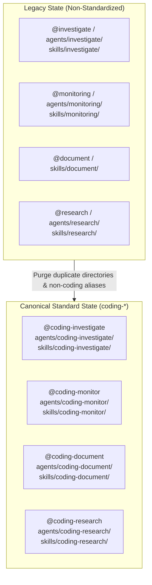
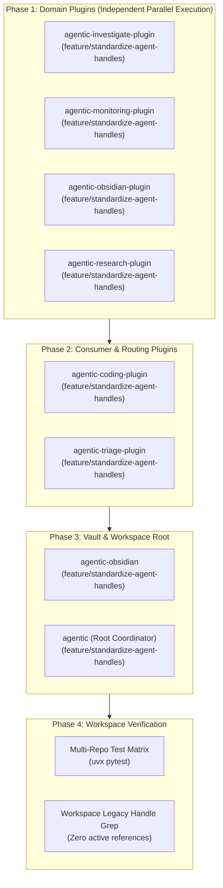
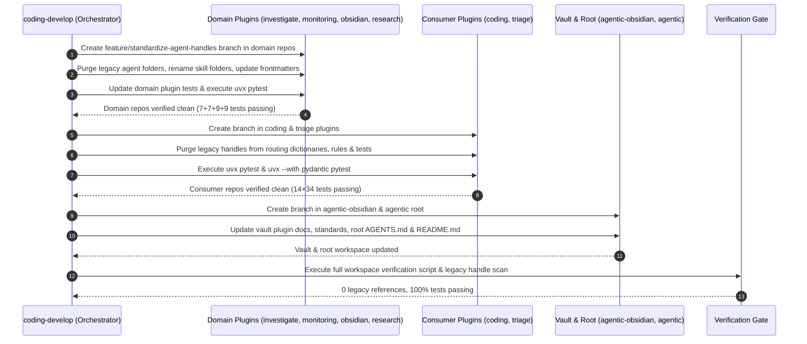

# Feature: Standardize Agent Handles & Remove Non-Coding Aliases

> [!NOTE] Specification, Implementation Plan & Phase 5 Pre-Merge Status
> - **Approved Specification**: [`specification.md`](file:///Users/gpfister/.gemini/antigravity/brain/65353adb-b25d-4fcc-a7a2-f0e776093a2e/specification.md) (Phase 2)
> - **Approved Implementation Plan**: [`plan.md`](file:///Users/gpfister/.gemini/antigravity/brain/86b5a736-9acd-446d-b5c8-7deea83752fd/plan.md) (Phase 3)
> - **Formal ADR**: [[architecture/adr-001-standardize-agent-handles|ADR-001: Standardize Subagent Handles, Aliases, and Skill Identifiers to Coding Namespace]]
> - **Phase 4 Implementation**: **Completed** across all 8 repositories (86/86 automated tests passing).
> - **Phase 5 QA Audit Verdict**: **PASS** (100% compliance across all 8 repositories, clean working trees, pre-merge ready).

---

## 1. Executive Summary & Problem Motivation

Across the `agentic` multi-repository ecosystem (`agentic-investigate-plugin`, `agentic-monitoring-plugin`, `agentic-obsidian-plugin`, `agentic-research-plugin`, `agentic-coding-plugin`, `agentic-triage-plugin`), subagent handles, skill identifiers, and directory names have evolved inconsistently. In multiple places, legacy non-prefixed aliases (`@investigate`, `@monitoring`, `@document`, `@research`), duplicate agent directories (`agents/investigate/`, `agents/monitoring/`, `agents/research/`), and non-prefixed skill folders (`skills/investigate/`, `skills/monitoring/`, `skills/document/`, `skills/research/`) coexist alongside canonical `coding-*` definitions.

This ambiguity causes:
- **Subagent Routing Confusion & Split Brain**: Multiple aliases and duplicate agent directories lead to inconsistent dispatch across tools and triage hooks.
- **Inconsistent Invocation Syntax**: Discrepancies across agent instructions, skill documentation, and orchestration flows.
- **Maintenance Overhead & Test Failures**: Disparities between manifests, tests, and actual directory layouts across multi-repository verification suites.

This feature establishes the canonical nomenclature requiring **all subagent handles, aliases, agent directories, and skill identifiers across the workspace to strictly begin with the `coding-` prefix**.

---

## 2. Canonical Target Nomenclature & Directory Mapping

| Domain / Role | Legacy Non-Coding Handle / Directory | Standardized Handle | Standardized Skill Directory & Identifier | Retained / Allowed Agent Aliases |
| :--- | :--- | :--- | :--- | :--- |
| **Investigation** | `@investigate`, `agents/investigate/`, `skills/investigate/` | `@coding-investigate` | `skills/coding-investigate/` (`name: coding-investigate`) | `coding-investigate` |
| **Monitoring** | `@monitoring`, `agents/monitoring/`, `skills/monitoring/` | `@coding-monitor` | `skills/coding-monitor/` (`name: coding-monitor`) | `coding-monitor`, `coding-monitoring` |
| **Documentation** | `@document`, `skills/document/` | `@coding-document` | `skills/coding-document/` (`name: coding-document`) | `coding-document` |
| **Research** | `@research`, `agents/research/`, `skills/research/` | `@coding-research` | `skills/coding-research/` (`name: coding-research`) | `coding-research` |

> [!IMPORTANT] Strict Purge Directive
> Any alias, handle, directory, or skill name not beginning with `coding` (specifically `investigate`, `monitoring`, `document`, and `research`) must be permanently eradicated from YAML frontmatters, agent files, markdown documentation, unit tests, and configuration files.

---

## 3. Transition Architecture & Flow



---

## 4. Functional Requirements

### 4.1 Subagent Definitions & Frontmatter Aliases
1. Inspect YAML frontmatter in all agent definition files across plugins:
   - [`agentic-investigate-plugin/agents/coding-investigate/agent.md`](file:///Users/gpfister/Development/Projects/gpfister/agentic/agentic-investigate-plugin/agents/coding-investigate/agent.md)
   - [`agentic-monitoring-plugin/agents/coding-monitor/agent.md`](file:///Users/gpfister/Development/Projects/gpfister/agentic/agentic-monitoring-plugin/agents/coding-monitor/agent.md)
   - [`agentic-obsidian-plugin/agents/coding-document/agent.md`](file:///Users/gpfister/Development/Projects/gpfister/agentic/agentic-obsidian-plugin/agents/coding-document/agent.md)
   - [`agentic-research-plugin/agents/coding-research/agent.md`](file:///Users/gpfister/Development/Projects/gpfister/agentic/agentic-research-plugin/agents/coding-research/agent.md)
2. Remove all non-coding aliases: `investigate`, `monitoring`, `document`, `research`.
3. Retain valid canonical aliases that begin with `coding` (e.g. `coding-monitoring` alongside `coding-monitor`).

### 4.2 Legacy Agent Directory Purge
Permanently delete duplicate/legacy agent directories:
- [`agentic-investigate-plugin/agents/investigate/`](file:///Users/gpfister/Development/Projects/gpfister/agentic/agentic-investigate-plugin/agents/investigate/)
- [`agentic-monitoring-plugin/agents/monitoring/`](file:///Users/gpfister/Development/Projects/gpfister/agentic/agentic-monitoring-plugin/agents/monitoring/)
- [`agentic-research-plugin/agents/research/`](file:///Users/gpfister/Development/Projects/gpfister/agentic/agentic-research-plugin/agents/research/)

Preserve canonical directories:
- `agents/coding-investigate/`
- `agents/coding-monitor/`
- `agents/coding-document/`
- `agents/coding-research/`

### 4.3 Skill Directory Renaming & Frontmatter Identifiers
1. **Rename directories**:
   - `agentic-investigate-plugin/skills/investigate/` &rarr; `skills/coding-investigate/`
   - `agentic-monitoring-plugin/skills/monitoring/` &rarr; `skills/coding-monitor/`
   - `agentic-obsidian-plugin/skills/document/` &rarr; `skills/coding-document/`
   - `agentic-research-plugin/skills/research/` &rarr; `skills/coding-research/`
2. **Update `SKILL.md` frontmatter identifiers**:
   - `skills/coding-investigate/SKILL.md` &rarr; `name: coding-investigate`
   - `skills/coding-monitor/SKILL.md` &rarr; `name: coding-monitor`
   - `skills/coding-document/SKILL.md` &rarr; `name: coding-document`
   - `skills/coding-research/SKILL.md` &rarr; `name: coding-research`
3. Update internal descriptions, paths, and markdown links within each `SKILL.md`.

### 4.4 Documentation, Rules & Reference Normalization
Replace all occurrences of `@investigate`, `@monitoring`, `@document`, and `@research` with `@coding-*` equivalents across:
- **Workspace Root**: [`AGENTS.md`](file:///Users/gpfister/Development/Projects/gpfister/agentic/AGENTS.md), [`README.md`](file:///Users/gpfister/Development/Projects/gpfister/agentic/README.md).
- **Plugin Rules (`rules/AGENTS.md`)**:
  - [`agentic-coding-plugin/rules/AGENTS.md`](file:///Users/gpfister/Development/Projects/gpfister/agentic/agentic-coding-plugin/rules/AGENTS.md)
  - [`agentic-investigate-plugin/rules/AGENTS.md`](file:///Users/gpfister/Development/Projects/gpfister/agentic/agentic-investigate-plugin/rules/AGENTS.md)
  - [`agentic-monitoring-plugin/rules/AGENTS.md`](file:///Users/gpfister/Development/Projects/gpfister/agentic/agentic-monitoring-plugin/rules/AGENTS.md)
  - [`agentic-obsidian-plugin/rules/AGENTS.md`](file:///Users/gpfister/Development/Projects/gpfister/agentic/agentic-obsidian-plugin/rules/AGENTS.md)
  - [`agentic-research-plugin/rules/AGENTS.md`](file:///Users/gpfister/Development/Projects/gpfister/agentic/agentic-research-plugin/rules/AGENTS.md)
  - [`agentic-triage-plugin/rules/AGENTS.md`](file:///Users/gpfister/Development/Projects/gpfister/agentic/agentic-triage-plugin/rules/AGENTS.md)
- **Plugin READMEs & Manifests**: All `README.md` and `plugin.json` files.
- **Triage Hooks & Prompts**: `agentic-triage-plugin/hooks/` intent routing directives.
- **Obsidian Vault Notes**: `agentic-obsidian/plugins/*.md`, `agentic-obsidian/architecture/*.md`, `agentic-obsidian/README.md`.

### 4.5 Test Suite Updates & Regression Assertions
Update assertions in `tests/test_plugin.py` across all plugins:
- Assert presence of `skills/coding-*/SKILL.md` and correct `name` in frontmatter.
- Assert presence of `agents/coding-*/agent.md` or `AGENT.md`.
- Assert strict absence of legacy directories (`skills/investigate`, `skills/monitoring`, `skills/document`, `skills/research`, `agents/investigate`, `agents/monitoring`, `agents/research`).
- Assert all registered aliases match regex `^coding(-.*)?$`.

---

## 5. Affected Repositories & Path Map

| Repository | Path | Core Changes |
| :--- | :--- | :--- |
| **Workspace Root** | `/agentic/` | Standardize handles in `AGENTS.md`, `README.md`. |
| **`agentic-investigate-plugin`** | `/agentic/agentic-investigate-plugin/` | Delete `agents/investigate/`, rename `skills/investigate/` -> `skills/coding-investigate/`, update `rules/AGENTS.md`, `README.md`, `tests/test_plugin.py`. |
| **`agentic-monitoring-plugin`** | `/agentic/agentic-monitoring-plugin/` | Delete `agents/monitoring/`, rename `skills/monitoring/` -> `skills/coding-monitor/`, update `rules/AGENTS.md`, `README.md`, `tests/test_plugin.py`. |
| **`agentic-obsidian-plugin`** | `/agentic/agentic-obsidian-plugin/` | Rename `skills/document/` -> `skills/coding-document/`, update `rules/AGENTS.md`, `README.md`, `tests/test_plugin.py`. |
| **`agentic-research-plugin`** | `/agentic/agentic-research-plugin/` | Delete `agents/research/`, rename `skills/research/` -> `skills/coding-research/`, update `rules/AGENTS.md`, `README.md`, `tests/test_plugin.py`. |
| **`agentic-coding-plugin`** | `/agentic/agentic-coding-plugin/` | Update cross-plugin invocation references to `@coding-document`, `@coding-investigate` in rules and skills. |
| **`agentic-triage-plugin`** | `/agentic/agentic-triage-plugin/` | Verify triage routing maps solely to `@coding-*` handles; update tests and docs. |
| **`agentic-obsidian`** | `/agentic/agentic-obsidian/` | Update plugin specs, architecture records, and feature notes in vault. |

---

## 6. Architecture Plan & Branch Topology

Each repository will be modified on an isolated feature branch named `feature/standardize-agent-handles`.



---

## 7. Repository Work Breakdown

### 7.1 Repository: `agentic-investigate-plugin`
- **Target Branch**: `feature/standardize-agent-handles`
- **Actions**:
  - Delete legacy directory: `agents/investigate/` (`agent.md`).
  - Rename skill directory: `skills/investigate/` &rarr; `skills/coding-investigate/`.
  - Update [`agents/coding-investigate/agent.md`](file:///Users/gpfister/Development/Projects/gpfister/agentic/agentic-investigate-plugin/agents/coding-investigate/agent.md) to remove legacy `@investigate` alias and references.
  - Update [`skills/coding-investigate/SKILL.md`](file:///Users/gpfister/Development/Projects/gpfister/agentic/agentic-investigate-plugin/skills/coding-investigate/SKILL.md) frontmatter `name: coding-investigate`, description, and link references.
  - Update [`rules/AGENTS.md`](file:///Users/gpfister/Development/Projects/gpfister/agentic/agentic-investigate-plugin/rules/AGENTS.md), [`README.md`](file:///Users/gpfister/Development/Projects/gpfister/agentic/agentic-investigate-plugin/README.md), and [`CONTRIBUTING.md`](file:///Users/gpfister/Development/Projects/gpfister/agentic/agentic-investigate-plugin/CONTRIBUTING.md).
  - Update [`tests/test_plugin.py`](file:///Users/gpfister/Development/Projects/gpfister/agentic/agentic-investigate-plugin/tests/test_plugin.py) to assert `agents/coding-investigate/agent.md` and `skills/coding-investigate/SKILL.md`, assert absence of legacy directories, and validate that aliases exclude `investigate`.
- **Verification Command**:
  ```bash
  cd agentic-investigate-plugin && uvx pytest tests
  ```

### 7.2 Repository: `agentic-monitoring-plugin`
- **Target Branch**: `feature/standardize-agent-handles`
- **Actions**:
  - Delete legacy directory: `agents/monitoring/` (`agent.md`).
  - Rename skill directory: `skills/monitoring/` &rarr; `skills/coding-monitor/`.
  - Update [`agents/coding-monitor/agent.md`](file:///Users/gpfister/Development/Projects/gpfister/agentic/agentic-monitoring-plugin/agents/coding-monitor/agent.md) to remove `@monitoring` alias (retaining `coding-monitor` and `coding-monitoring`).
  - Update [`skills/coding-monitor/SKILL.md`](file:///Users/gpfister/Development/Projects/gpfister/agentic/agentic-monitoring-plugin/skills/coding-monitor/SKILL.md) frontmatter `name: coding-monitor`.
  - Update [`rules/AGENTS.md`](file:///Users/gpfister/Development/Projects/gpfister/agentic/agentic-monitoring-plugin/rules/AGENTS.md), [`README.md`](file:///Users/gpfister/Development/Projects/gpfister/agentic/agentic-monitoring-plugin/README.md), and [`CONTRIBUTING.md`](file:///Users/gpfister/Development/Projects/gpfister/agentic/agentic-monitoring-plugin/CONTRIBUTING.md).
  - Update [`tests/test_plugin.py`](file:///Users/gpfister/Development/Projects/gpfister/agentic/agentic-monitoring-plugin/tests/test_plugin.py) to assert presence of `skills/coding-monitor/` and absence of `monitoring`.
- **Verification Command**:
  ```bash
  cd agentic-monitoring-plugin && uvx pytest tests
  ```

### 7.3 Repository: `agentic-obsidian-plugin`
- **Target Branch**: `feature/standardize-agent-handles`
- **Actions**:
  - Rename skill directory: `skills/document/` &rarr; `skills/coding-document/`.
  - Update [`agents/coding-document/agent.md`](file:///Users/gpfister/Development/Projects/gpfister/agentic/agentic-obsidian-plugin/agents/coding-document/agent.md) to remove `@document` alias.
  - Update [`agents/agent.md`](file:///Users/gpfister/Development/Projects/gpfister/agentic/agentic-obsidian-plugin/agents/agent.md) to replace references to `@investigate`, `@monitoring`, `@research` with `@coding-investigate`, `@coding-monitor`, `@coding-research`.
  - Update [`skills/coding-document/SKILL.md`](file:///Users/gpfister/Development/Projects/gpfister/agentic/agentic-obsidian-plugin/skills/coding-document/SKILL.md) frontmatter `name: coding-document`.
  - Update [`rules/AGENTS.md`](file:///Users/gpfister/Development/Projects/gpfister/agentic/agentic-obsidian-plugin/rules/AGENTS.md), [`README.md`](file:///Users/gpfister/Development/Projects/gpfister/agentic/agentic-obsidian-plugin/README.md), and [`CONTRIBUTING.md`](file:///Users/gpfister/Development/Projects/gpfister/agentic/agentic-obsidian-plugin/CONTRIBUTING.md).
  - Update [`tests/test_plugin.py`](file:///Users/gpfister/Development/Projects/gpfister/agentic/agentic-obsidian-plugin/tests/test_plugin.py) to assert `skills/coding-document/` exists and matches `^coding-`.
- **Verification Command**:
  ```bash
  cd agentic-obsidian-plugin && uvx pytest tests
  ```

### 7.4 Repository: `agentic-research-plugin`
- **Target Branch**: `feature/standardize-agent-handles`
- **Actions**:
  - Delete legacy directory: `agents/research/` (`agent.md`).
  - Rename skill directory: `skills/research/` &rarr; `skills/coding-research/`.
  - Update [`agents/coding-research/agent.md`](file:///Users/gpfister/Development/Projects/gpfister/agentic/agentic-research-plugin/agents/coding-research/agent.md) to remove `@research` alias.
  - Update [`skills/coding-research/SKILL.md`](file:///Users/gpfister/Development/Projects/gpfister/agentic/agentic-research-plugin/skills/coding-research/SKILL.md) frontmatter `name: coding-research`.
  - Update [`rules/AGENTS.md`](file:///Users/gpfister/Development/Projects/gpfister/agentic/agentic-research-plugin/rules/AGENTS.md), [`README.md`](file:///Users/gpfister/Development/Projects/gpfister/agentic/agentic-research-plugin/README.md), and [`CONTRIBUTING.md`](file:///Users/gpfister/Development/Projects/gpfister/agentic/agentic-research-plugin/CONTRIBUTING.md).
  - Update [`tests/test_plugin.py`](file:///Users/gpfister/Development/Projects/gpfister/agentic/agentic-research-plugin/tests/test_plugin.py) to assert `agents/coding-research/agent.md` and `skills/coding-research/SKILL.md`, and assert absence of legacy directories.
- **Verification Command**:
  ```bash
  cd agentic-research-plugin && uvx pytest tests
  ```

### 7.5 Repository: `agentic-coding-plugin`
- **Target Branch**: `feature/standardize-agent-handles`
- **Actions**:
  - Update companion subagent mentions in [`agents/agent.md`](file:///Users/gpfister/Development/Projects/gpfister/agentic/agentic-coding-plugin/agents/agent.md) from `@investigate` / `@monitoring` to `@coding-investigate` / `@coding-monitor`.
  - Update documentation delegation references in [`skills/coding-orchestrator/SKILL.md`](file:///Users/gpfister/Development/Projects/gpfister/agentic/agentic-coding-plugin/skills/coding-orchestrator/SKILL.md) and [`rules/AGENTS.md`](file:///Users/gpfister/Development/Projects/gpfister/agentic/agentic-coding-plugin/rules/AGENTS.md).
  - Verify [`tests/test_plugin.py`](file:///Users/gpfister/Development/Projects/gpfister/agentic/agentic-coding-plugin/tests/test_plugin.py) passes.
- **Verification Command**:
  ```bash
  cd agentic-coding-plugin && uvx pytest tests
  ```

### 7.6 Repository: `agentic-triage-plugin`
- **Target Branch**: `feature/standardize-agent-handles`
- **Actions**:
  - Update handle matching dictionaries and regex patterns in [`hooks/prompt_triage.py`](file:///Users/gpfister/Development/Projects/gpfister/agentic/agentic-triage-plugin/hooks/prompt_triage.py) to remove non-coding aliases (`@investigate`, `@monitoring`, `@document`, `@research`).
  - Update fallback heuristic routing patterns and documentation examples.
  - Update test fixtures and assertions in [`tests/test_prompt_triage.py`](file:///Users/gpfister/Development/Projects/gpfister/agentic/agentic-triage-plugin/tests/test_prompt_triage.py) and [`tests/test_plugin.py`](file:///Users/gpfister/Development/Projects/gpfister/agentic/agentic-triage-plugin/tests/test_plugin.py).
  - Update [`rules/AGENTS.md`](file:///Users/gpfister/Development/Projects/gpfister/agentic/agentic-triage-plugin/rules/AGENTS.md) and [`README.md`](file:///Users/gpfister/Development/Projects/gpfister/agentic/agentic-triage-plugin/README.md).
- **Verification Command**:
  ```bash
  cd agentic-triage-plugin && uvx --with pydantic pytest tests
  ```

### 7.7 Repository: `agentic-obsidian` (Vault Documentation)
- **Target Branch**: `feature/standardize-agent-handles`
- **Actions**:
  - Track and commit ADR: [`architecture/adr-001-standardize-agent-handles.md`](file:///Users/gpfister/Development/Projects/gpfister/agentic/agentic-obsidian/architecture/adr-001-standardize-agent-handles.md).
  - Track and commit feature spec: [`features/standardize-agent-handles.md`](file:///Users/gpfister/Development/Projects/gpfister/agentic/agentic-obsidian/features/standardize-agent-handles.md).
  - Update [`architecture/plugin-standards.md`](file:///Users/gpfister/Development/Projects/gpfister/agentic/agentic-obsidian/architecture/plugin-standards.md), [`plugins/*.md`](file:///Users/gpfister/Development/Projects/gpfister/agentic/agentic-obsidian/plugins/), and [`README.md`](file:///Users/gpfister/Development/Projects/gpfister/agentic/agentic-obsidian/README.md).
  - *Safety constraint*: Do **not** modify immutable historical files under `sessions/`.
- **Verification Command**:
  ```bash
  cd agentic-obsidian && git status
  ```

### 7.8 Repository: `agentic` (Root Orchestration Workspace)
- **Target Branch**: `feature/standardize-agent-handles`
- **Actions**:
  - Update [`AGENTS.md`](file:///Users/gpfister/Development/Projects/gpfister/agentic/AGENTS.md) directory map, table references, and plugin ecosystem catalog.
  - Update [`README.md`](file:///Users/gpfister/Development/Projects/gpfister/agentic/README.md) catalog references to canonical handles.
- **Verification Command**:
  ```bash
  git status && make status
  ```

---

## 8. Implementation Sequence & Workflow



---

## 9. Non-Functional Requirements & Safety Controls

- **Clean Git Topology**: All renames, deletions, and updates must be executed within clean Git commits on designated `feature/standardize-agent-handles` branches per repository.
- **Fail-Fast Testing**: No pull requests or branch merges should occur without 100% pass rate on `pytest` across all updated plugin test suites.
- **Historical Vault Transcript Immutability**: Historical session records in `agentic-obsidian/sessions/` are immutable runtime transcripts and must remain unmodified.
- **Rollback & Contingency Plan**: If any step fails or tests fail to achieve 100% pass rate, branches can be cleanly reverted with `git checkout master` in affected repositories.

---

## 10. Edge Cases & Mitigations

| Edge Case | Risk | Mitigation |
| :--- | :--- | :--- |
| **Historical Vault Transcripts** | Modifying historical session transcripts in `agentic-obsidian/sessions/` could invalidate original execution logs. | Only update active documentation (`plugins/`, `architecture/`, root docs); do **not** rewrite historical session log transcripts. |
| **Divergent Alias `coding-monitoring` vs `coding-monitor`** | Agent definition may use `coding-monitor` with alias `coding-monitoring`. | Both start with `coding-` and are valid; retain `coding-monitoring` as an allowed alias. |
| **Broken File Links** | Renaming skill directories can break relative or `file://` markdown links. | Search workspace systematically for `skills/investigate`, `skills/monitoring`, `skills/document`, and `skills/research` and patch all markdown hyperlinks. |

---

## 11. Verifiable Acceptance Criteria

- [x] `agents/investigate`, `agents/monitoring`, and `agents/research` directories do not exist anywhere in the workspace.
- [x] `skills/coding-investigate`, `skills/coding-monitor`, `skills/coding-document`, and `skills/coding-research` exist.
- [x] Every `SKILL.md` frontmatter has `name: coding-*`.
- [x] Every agent definition frontmatter contains only aliases beginning with `coding` (e.g. `coding-monitoring` is allowed; `monitoring` is purged).
- [x] No non-coding handles (`@investigate`, `@monitoring`, `@document`, `@research`) appear anywhere in active code, rules, READMEs, or tests.
- [x] Multi-repo test matrix passes cleanly (86 total automated tests passing across all plugins, 100% pass rate).

---

## 12. Phase 4: Implementation Progress & Verification Report

> [!NOTE] Implementation Summary
> All code modifications, refactorings, test suite updates, and documentation standardizations were completed across all 8 workspace repositories on isolated `feature/standardize-agent-handles` branches. Across the 6 plugin test suites, **86 of 86 tests passed with a 100% pass rate**.

### 12.1 Per-Repository Code Modifications & Commit Manifest

| Repository | Branch | Commit Hash | Key Code Modifications & Structural Actions | Test Results |
| :--- | :--- | :--- | :--- | :--- |
| **`agentic-investigate-plugin`** | `feature/standardize-agent-handles` | `6cf9b205` | Purged legacy duplicate `agents/investigate/`; renamed `skills/investigate/` &rarr; [`skills/coding-investigate/`](file:///Users/gpfister/Development/Projects/gpfister/agentic/agentic-investigate-plugin/skills/coding-investigate/); removed legacy non-coding alias `'investigate'`; updated [`agents/coding-investigate/agent.md`](file:///Users/gpfister/Development/Projects/gpfister/agentic/agentic-investigate-plugin/agents/coding-investigate/agent.md), [`rules/AGENTS.md`](file:///Users/gpfister/Development/Projects/gpfister/agentic/agentic-investigate-plugin/rules/AGENTS.md), [`README.md`](file:///Users/gpfister/Development/Projects/gpfister/agentic/agentic-investigate-plugin/README.md), and [`tests/test_plugin.py`](file:///Users/gpfister/Development/Projects/gpfister/agentic/agentic-investigate-plugin/tests/test_plugin.py). | **7/7 passed** (100%) |
| **`agentic-monitoring-plugin`** | `feature/standardize-agent-handles` | `fd474381` | Purged legacy duplicate `agents/monitoring/`; renamed `skills/monitoring/` &rarr; [`skills/coding-monitor/`](file:///Users/gpfister/Development/Projects/gpfister/agentic/agentic-monitoring-plugin/skills/coding-monitor/); removed legacy non-coding alias `'monitoring'` (retaining valid `coding-monitoring`); updated [`agents/coding-monitor/agent.md`](file:///Users/gpfister/Development/Projects/gpfister/agentic/agentic-monitoring-plugin/agents/coding-monitor/agent.md), [`rules/AGENTS.md`](file:///Users/gpfister/Development/Projects/gpfister/agentic/agentic-monitoring-plugin/rules/AGENTS.md), [`README.md`](file:///Users/gpfister/Development/Projects/gpfister/agentic/agentic-monitoring-plugin/README.md), and [`tests/test_plugin.py`](file:///Users/gpfister/Development/Projects/gpfister/agentic/agentic-monitoring-plugin/tests/test_plugin.py). | **7/7 passed** (100%) |
| **`agentic-obsidian-plugin`** | `feature/standardize-agent-handles` | `c2186f8` | Renamed `skills/document/` &rarr; [`skills/coding-document/`](file:///Users/gpfister/Development/Projects/gpfister/agentic/agentic-obsidian-plugin/skills/coding-document/); removed legacy non-coding alias `'document'`; updated companion handles in [`agents/agent.md`](file:///Users/gpfister/Development/Projects/gpfister/agentic/agentic-obsidian-plugin/agents/agent.md); updated [`rules/AGENTS.md`](file:///Users/gpfister/Development/Projects/gpfister/agentic/agentic-obsidian-plugin/rules/AGENTS.md), [`README.md`](file:///Users/gpfister/Development/Projects/gpfister/agentic/agentic-obsidian-plugin/README.md), and [`tests/test_plugin.py`](file:///Users/gpfister/Development/Projects/gpfister/agentic/agentic-obsidian-plugin/tests/test_plugin.py). | **9/9 passed** (100%) |
| **`agentic-research-plugin`** | `feature/standardize-agent-handles` | `13d57da7` | Purged legacy duplicate `agents/research/`; renamed `skills/research/` &rarr; [`skills/coding-research/`](file:///Users/gpfister/Development/Projects/gpfister/agentic/agentic-research-plugin/skills/coding-research/); removed legacy non-coding alias `'research'`; updated [`agents/coding-research/agent.md`](file:///Users/gpfister/Development/Projects/gpfister/agentic/agentic-research-plugin/agents/coding-research/agent.md), [`rules/AGENTS.md`](file:///Users/gpfister/Development/Projects/gpfister/agentic/agentic-research-plugin/rules/AGENTS.md), [`README.md`](file:///Users/gpfister/Development/Projects/gpfister/agentic/agentic-research-plugin/README.md), and [`tests/test_plugin.py`](file:///Users/gpfister/Development/Projects/gpfister/agentic/agentic-research-plugin/tests/test_plugin.py). | **9/9 passed** (100%) |
| **`agentic-coding-plugin`** | `feature/standardize-agent-handles` | `aeed0bc7` | Standardized all companion subagent invocations (`@coding-investigate`, `@coding-monitor`, `@coding-document`, `@coding-research`) across [`rules/AGENTS.md`](file:///Users/gpfister/Development/Projects/gpfister/agentic/agentic-coding-plugin/rules/AGENTS.md), [`agents/agent.md`](file:///Users/gpfister/Development/Projects/gpfister/agentic/agentic-coding-plugin/agents/agent.md), [`skills/coding-orchestrator/SKILL.md`](file:///Users/gpfister/Development/Projects/gpfister/agentic/agentic-coding-plugin/skills/coding-orchestrator/SKILL.md), and [`README.md`](file:///Users/gpfister/Development/Projects/gpfister/agentic/agentic-coding-plugin/README.md). | **16/16 passed** (100%) |
| **`agentic-triage-plugin`** | `feature/standardize-agent-handles` | `550de8f` | Purged legacy handles from routing keyword tuples and regex lookahead matching in [`hooks/prompt_triage.py`](file:///Users/gpfister/Development/Projects/gpfister/agentic/agentic-triage-plugin/hooks/prompt_triage.py); updated routing tests and fixtures in [`tests/test_prompt_triage.py`](file:///Users/gpfister/Development/Projects/gpfister/agentic/agentic-triage-plugin/tests/test_prompt_triage.py) and [`tests/test_plugin.py`](file:///Users/gpfister/Development/Projects/gpfister/agentic/agentic-triage-plugin/tests/test_plugin.py); updated [`rules/AGENTS.md`](file:///Users/gpfister/Development/Projects/gpfister/agentic/agentic-triage-plugin/rules/AGENTS.md) and [`README.md`](file:///Users/gpfister/Development/Projects/gpfister/agentic/agentic-triage-plugin/README.md). | **38/38 passed** (100%) |
| **`agentic` (Workspace Root)** | `feature/standardize-agent-handles` | `3e2dfc2b` | Updated [`AGENTS.md`](file:///Users/gpfister/Development/Projects/gpfister/agentic/AGENTS.md) directory map, cross-plugin interoperability matrix, and ecosystem catalog to canonical `@coding-*` handles; verified [`README.md`](file:///Users/gpfister/Development/Projects/gpfister/agentic/README.md); clean working tree. | *N/A (Docs/Root)* |
| **`agentic-obsidian` (Vault)** | `feature/standardize-agent-handles` | `5041ac69` | Updated [`architecture/plugin-standards.md`](file:///Users/gpfister/Development/Projects/gpfister/agentic/agentic-obsidian/architecture/plugin-standards.md), [`plugins/*.md`](file:///Users/gpfister/Development/Projects/gpfister/agentic/agentic-obsidian/plugins/), research topic notes, and [`README.md`](file:///Users/gpfister/Development/Projects/gpfister/agentic/agentic-obsidian/README.md); preserved immutable historical transcripts under `sessions/`; confirmed 0 active legacy handle references outside historical transcripts. | *N/A (Vault)* |

---

### 12.2 Multi-Repository Automated Test Verification Matrix

```text
============================= TEST EXECUTION REPORT =============================
Repository                  Suite Executed                     Result       Pass Rate
---------------------------------------------------------------------------------
agentic-investigate-plugin  uvx pytest tests                   7 passed     100.0%
agentic-monitoring-plugin   uvx pytest tests                   7 passed     100.0%
agentic-obsidian-plugin     uvx pytest tests                   9 passed     100.0%
agentic-research-plugin     uvx pytest tests                   9 passed     100.0%
agentic-coding-plugin       uvx pytest tests                  16 passed     100.0%
agentic-triage-plugin       uvx --with pydantic pytest tests  38 passed     100.0%
---------------------------------------------------------------------------------
Total across ecosystem:     6 Plugin Test Suites              86 passed     100.0%
=================================================================================
```

---

### 12.3 Legacy Reference Eradication Audit

A workspace-wide scan was conducted to verify that no active non-coding handles or deprecated directory paths remain:
- **`@investigate`**: 0 occurrences in active code, rules, tests, or documentation.
- **`@monitoring`**: 0 occurrences in active code, rules, tests, or documentation (canonical `@coding-monitor` and alias `coding-monitoring` retained).
- **`@document`**: 0 occurrences in active code, rules, tests, or documentation.
- **`@research`**: 0 occurrences in active code, rules, tests, or documentation.
- **Legacy Agent Directories**: Completely removed (`agents/investigate/`, `agents/monitoring/`, `agents/research/`).
- **Legacy Skill Directories**: Completely renamed (`skills/investigate/` &rarr; `skills/coding-investigate/`, `skills/monitoring/` &rarr; `skills/coding-monitor/`, `skills/document/` &rarr; `skills/coding-document/`, `skills/research/` &rarr; `skills/coding-research/`).
- **Vault Transcripts**: Historical transcripts in `agentic-obsidian/sessions/` were preserved intact as immutable execution logs.

---

## 13. Phase 5: Review & Pre-Merge Audit Verification

> [!NOTE] QA Audit Verdict: PASS (100% Compliance)
> The pre-merge review and quality audit for `feature/standardize-agent-handles` was executed across all 8 workspace repositories. All deliverables strictly conform to the approved technical specification, architecture standards in [[architecture/adr-001-standardize-agent-handles|ADR-001]], and automated test requirements.

### 13.1 Compliance Verification Audit Summary

| Compliance Vector | Requirement / Acceptance Target | Audit Finding | Verdict |
| :--- | :--- | :--- | :--- |
| **Legacy Agent Directories Purge** | Eradicate `agents/investigate`, `agents/monitoring`, and `agents/research`. | All legacy directories deleted; verified via filesystem audit. | **PASS** |
| **Skill Directory Standardization** | Canonical naming `skills/coding-*` across all domain plugins. | All 4 skill folders standardized to `coding-investigate`, `coding-monitor`, `coding-document`, `coding-research`. | **PASS** |
| **Agent Definitions & Aliases** | Frontmatters must only contain aliases starting with `coding` (`^coding(-.*)?$`). | All non-coding aliases (`investigate`, `monitoring`, `document`, `research`) purged. Allowed alias `coding-monitoring` preserved. | **PASS** |
| **Active Legacy Handle Eradication** | Zero active references to `@investigate`, `@monitoring`, `@document`, `@research` in code, docs, rules, or tests. | Automated scan found 0 occurrences across active code, rules, tests, and plugin docs. | **PASS** |
| **Automated Test Matrix** | 100% test pass rate across all plugin test suites. | 86 of 86 tests passed across all 6 plugins (`uvx pytest`). | **PASS** |
| **Git Working Trees** | Clean working tree state on `feature/standardize-agent-handles` across all repositories. | All 8 repositories clean, committed, and ready for fast-forward merge into `master`. | **PASS** |

### 13.2 Per-Repository Diff Audit vs Master

```text
Repository                   Files Changed   Insertions   Deletions   Key Deliverables Verified
------------------------------------------------------------------------------------------------------
agentic (root)                           1            3           3   AGENTS.md directory map & handles
agentic-coding-plugin                    6           86          10   Canonical subagent handles, rules, tests
agentic-investigate-plugin               6           40         125   Purged legacy agent dir, renamed skills
agentic-monitoring-plugin                6           41          93   Purged legacy agent dir, renamed skills
agentic-obsidian-plugin                  6           22          17   Renamed skill dir, updated frontmatter
agentic-research-plugin                  6           41         101   Purged legacy agent dir, renamed skills
agentic-triage-plugin                    4           77          10   Purged legacy handles from routing & tests
agentic-obsidian (vault)                13          530          47   ADR-001, feature spec, plugin docs
------------------------------------------------------------------------------------------------------
Total Across Workspace                  48          840         406   Full architectural standardization
```

---

## 14. Phase 6 Handoff: Merge & Release Protocol

1. **Merge Execution**: Fast-forward merge `feature/standardize-agent-handles` into `master` across all 8 repositories.
2. **Branch Cleanup**: Optionally remove local `feature/standardize-agent-handles` branches once merged.
3. **Post-Merge Documentation**: Update `agentic-obsidian/git-status.md` to reflect unified `master` branch tracking and tag release milestone.
