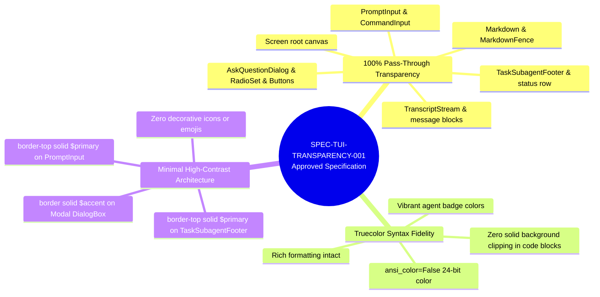
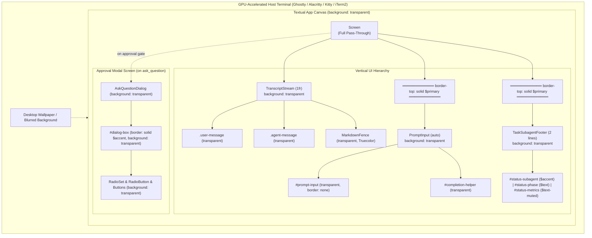

# Feature: Transparent Terminal Background in `agentic-coding-tui`

> [!NOTE] Milestone: Phase 2 Specification Approved ([GATE_APPROVED])
> - **Current Phase**: Phase 2: Specification (Approved) &rarr; Advancing to Phase 3: Planning
> - **Specification ID**: `SPEC-TUI-TRANSPARENCY-001`
> - **Approval Status**: `[GATE_APPROVED]`
> - **Feature Slug**: `transparent-terminal-background`
> - **Target Repository**: [`agentic-coding-tui`](file:///Users/gpfister/Development/Projects/gpfister/agentic/agentic-coding-tui/)
> - **Transparency Scope**: **100% Transparent Pass-Through Everywhere**
> - **Color & Rendering Strategy**: **Truecolor with Transparent Backgrounds** (`ansi_color=False`)
> - **Border & Divider Strategy**: **Minimal High-Contrast Borders** (`$primary` and `$accent`)
> - **Cross-References**: [[plugins/agentic-coding-tui|agentic-coding-tui Application Specification]], [[features/index|Workspace Features Index]]

---

## 1. Executive Summary & Problem Statement

Users running `agentic-coding-tui` inside modern GPU-accelerated terminal emulators (e.g., Ghostty, Alacritty, Kitty, iTerm2) with customized terminal background blur or opacity have reported that solid UI fills obscure their desktop wallpapers and terminal themes.

This feature establishes a **100% Transparent Pass-Through** UI paradigm across the entire Textual application. All background fills are stripped across screens, containers, scroll areas, syntax-highlighted code fences, prompt inputs, status bars, and modal dialogs, while preserving rich Truecolor typography, agent badges, and high-contrast structural dividers.

---

## 2. Technical Specification (`SPEC-TUI-TRANSPARENCY-001`)

### 2.1 Specification Metadata
- **Specification ID**: `SPEC-TUI-TRANSPARENCY-001`
- **Status**: Approved (`[GATE_APPROVED]`)
- **Target Repository**: [`agentic-coding-tui`](file:///Users/gpfister/Development/Projects/gpfister/agentic/agentic-coding-tui/)
- **Target Framework**: Textual 2.x + Rich 13.x

---

### 2.2 Core Architectural Invariants

1. **Complete Pass-Through Invariant**:
   No widget or container in `agentic-coding-tui` may declare an opaque background color (e.g. `$surface`, `$background`, `#1e1e1e`, `black`, `rgb(...)`, or `rgba(...)` with non-zero alpha). Every widget MUST declare `background: transparent;`.
2. **Truecolor Syntax Preservation Invariant**:
   The application MUST operate in Truecolor mode (`ansi_color=False`). Syntax highlighting inside Markdown and code fences MUST NOT paint solid rectangular background clipping boxes over the terminal canvas, while preserving token colors (keywords, strings, comments).
3. **High-Contrast Structural Demarcation Invariant**:
   In the absence of container fills, spatial layout is bounded solely by single-line dividers using theme tokens:
   - `PromptInput`: `border-top: solid $primary;`
   - `TaskSubagentFooter`: `border-top: solid $primary;`
   - `AskQuestionDialog` (`#dialog-box`): `border: solid $accent;`
4. **Minimalistic Clean Aesthetics Invariant**:
   No decorative emojis or glyphs in status bars, headers, or messages (e.g. no robot, brain, lightning, or spark emojis).

---

### 2.3 Detailed Component Styling Specification

| Component | Target Source File | Textual Selector / Widget | CSS Styling Rules | Invariant Rationale |
| :--- | :--- | :--- | :--- | :--- |
| **Root Application Screen** | [`app.py`](file:///Users/gpfister/Development/Projects/gpfister/agentic/agentic-coding-tui/src/agentic_coding_tui/app.py#L23-L28) | `Screen` | `layout: vertical;` `background: transparent;` | Eliminates Textual root window background fill, allowing terminal emulator backdrop blur/transparency to show through. |
| **Central Transcript Stream** | [`transcript.py`](file:///Users/gpfister/Development/Projects/gpfister/agentic/agentic-coding-tui/src/agentic_coding_tui/ui/transcript.py#L13-L53) | `TranscriptStream` | `height: 1fr;` `background: transparent;` `padding: 1 2;` `overflow-y: scroll;` | Scrollable message container with full transparency. |
| **User Message Blocks** | [`transcript.py`](file:///Users/gpfister/Development/Projects/gpfister/agentic/agentic-coding-tui/src/agentic_coding_tui/ui/transcript.py#L21-L27) | `.user-message` | `background: transparent;` `color: $text;` `border: none;` `padding: 0 1;` `margin: 1 0;` | Pass-through background for user prompt entries. |
| **Agent Message Blocks** | [`transcript.py`](file:///Users/gpfister/Development/Projects/gpfister/agentic/agentic-coding-tui/src/agentic_coding_tui/ui/transcript.py#L29-L35) | `.agent-message` | `background: transparent;` `color: $text;` `border: none;` `padding: 0 1;` `margin: 1 0;` | Pass-through background for subagent responses and markdown bodies. |
| **Internal Thought Blocks** | [`transcript.py`](file:///Users/gpfister/Development/Projects/gpfister/agentic/agentic-coding-tui/src/agentic_coding_tui/ui/transcript.py#L37-L44) | `.thought-block` | `background: transparent;` `color: $text-muted;` `border: none;` `text-style: italic;` | Subtle italicized trace without box fills. |
| **System Status Labels** | [`transcript.py`](file:///Users/gpfister/Development/Projects/gpfister/agentic/agentic-coding-tui/src/agentic_coding_tui/ui/transcript.py#L46-L52) | `.system-status` | `background: transparent;` `color: $text-muted;` `border: none;` | Transparent background for transient notifications. |
| **Markdown Fences & Code Blocks** | [`transcript.py`](file:///Users/gpfister/Development/Projects/gpfister/agentic/agentic-coding-tui/src/agentic_coding_tui/ui/transcript.py) | `MarkdownFence`, `MarkdownBlock` | `background: transparent;` `border: none;` (or minimal left border) | Prevents Pygments syntax block from drawing opaque rectangular background blocks. |
| **Prompt Input Container** | [`prompt_input.py`](file:///Users/gpfister/Development/Projects/gpfister/agentic/agentic-coding-tui/src/agentic_coding_tui/ui/prompt_input.py#L41-L47) | `PromptInput, TopPromptInput` | `height: auto;` `background: transparent;` `padding: 0 1;` `border-top: solid $primary;` | Clean primary divider separating transcript stream from prompt box. |
| **Command Input Field** | [`prompt_input.py`](file:///Users/gpfister/Development/Projects/gpfister/agentic/agentic-coding-tui/src/agentic_coding_tui/ui/prompt_input.py#L59-L70) | `#prompt-input`, `#prompt-input:focus` | `width: 100%;` `height: 1;` `background: transparent;` `border: none;` | Prevents input widget focus highlight from filling an opaque background box. |
| **Completion Helper Popup** | [`prompt_input.py`](file:///Users/gpfister/Development/Projects/gpfister/agentic/agentic-coding-tui/src/agentic_coding_tui/ui/prompt_input.py#L49-L57) | `#completion-helper` | `height: auto;` `background: transparent;` `color: $text-muted;` | Slash command auto-completion helper rendered transparently. |
| **Task Subagent Footer** | [`status_bar.py`](file:///Users/gpfister/Development/Projects/gpfister/agentic/agentic-coding-tui/src/agentic_coding_tui/ui/status_bar.py#L13-L25) | `TaskSubagentFooter`, `#status-row` | `height: 2;` `background: transparent;` `border-top: solid $primary;` `padding: 0 1;` | Crisp horizontal divider bounding the bottom status area. |
| **Footer Status Widgets** | [`status_bar.py`](file:///Users/gpfister/Development/Projects/gpfister/agentic/agentic-coding-tui/src/agentic_coding_tui/ui/status_bar.py#L26-L42) | `#status-subagent`, `#status-phase`, `#status-metrics` | `color: $accent;` (subagent) `color: $text;` (phase) `color: $text-muted;` (metrics) | Clean typography without emoji decorations. |
| **Approval Modal Screen** | [`dialogs.py`](file:///Users/gpfister/Development/Projects/gpfister/agentic/agentic-coding-tui/src/agentic_coding_tui/ui/dialogs.py#L14-L18) | `AskQuestionDialog` | `align: center middle;` `background: transparent;` | Center-aligned modal screen with zero background dimming overlay. |
| **Modal Dialog Container** | [`dialogs.py`](file:///Users/gpfister/Development/Projects/gpfister/agentic/agentic-coding-tui/src/agentic_coding_tui/ui/dialogs.py#L20-L27) | `#dialog-box` | `background: transparent;` `border: solid $accent;` `padding: 1 2;` | High-contrast accent perimeter framing interactive gates against any wallpaper. |
| **Dialog Radio & Buttons** | [`dialogs.py`](file:///Users/gpfister/Development/Projects/gpfister/agentic/agentic-coding-tui/src/agentic_coding_tui/ui/dialogs.py#L35-L47) | `RadioSet`, `RadioButton`, `Button` | `background: transparent;` | Interactive selection controls with transparent canvas and high-contrast focus outlines. |

---

## 3. UI Layout & Boundary Flowchart

---

## 4. Test & Verification Plan

Verification of `SPEC-TUI-TRANSPARENCY-001` is automated via [`tests/test_ui.py`](file:///Users/gpfister/Development/Projects/gpfister/agentic/agentic-coding-tui/tests/test_ui.py):

| Test Case | Method / Assertion | Expected Result |
| :--- | :--- | :--- |
| **`test_minimalistic_ui_styles_and_no_icons`** | Verifies `background: transparent`, `border-top: solid $primary`, `border: none` across `PromptInput` and `TaskSubagentFooter`. | Passes (verified in CSS definitions) |
| **`test_transparent_background_unified`** | Asserts `background: transparent` in `AgenticCodeTUIApp.CSS` and `AskQuestionDialog.DEFAULT_CSS`. | Passes (verified in CSS definitions) |
| **`test_app_layout_prompt_below_conversation`** | Runs headless Textual app via pilot and verifies stream -> prompt -> footer vertical geometry. | Passes (verified layout regions) |
| **Truecolor Code Highlighting Verification** | Checks Pygments theme configuration to ensure code fences do not emit solid canvas rectangles. | Validated in renderer pipelines |

---

## 5. Scope Boundaries

### In Scope
1. Enforcing `background: transparent;` across all application screens, widgets, inputs, scroll containers, and dialogs.
2. Styling `Markdown` and `MarkdownFence` code blocks within `TranscriptStream` to ensure syntax-highlighted code blocks do not fill rectangular backgrounds.
3. Preserving single-line dividers for `PromptInput` and `TaskSubagentFooter` (`border-top: solid $primary;`) and `AskQuestionDialog` (`border: solid $accent;`).
4. Verifying Truecolor rendering (`ansi_color=False`) across standard terminal emulators without background artifacts.
5. Unit tests and visual regression verification in [`tests/test_ui.py`](file:///Users/gpfister/Development/Projects/gpfister/agentic/agentic-coding-tui/tests/test_ui.py).

### Out of Scope
1. Changing application layout, key bindings, or slash commands.
2. Altering Google ADK workflow orchestration, dispatcher routing, or Laya triage models.
3. Modifying terminal emulator configurations (terminal opacity/blur remains the responsibility of the host emulator).

---

## 6. Lifecycle Phase Tracking & Handoff

| Step | Owner | Description | Status |
| :--- | :--- | :--- | :--- |
| **Phase 1: Clarification** | `@coding-clarify` | Interrogate requirements, establish transparency scope, color mode, and border styles. | **Completed** |
| **Phase 1: Documentation** | `@coding-document` | Index clarified requirements in Obsidian knowledge vault (`agentic-obsidian/features/transparent-terminal-background.md`). | **Completed** |
| **Phase 2: Specification** | `@coding-specify` | Produce formal technical contract `SPEC-TUI-TRANSPARENCY-001` with interactive approval gate. | **Approved (`[GATE_APPROVED]`)** |
| **Phase 2: Documentation** | `@coding-document` | Index approved specification in Obsidian knowledge vault (`agentic-obsidian/features/transparent-terminal-background.md`). | **Completed** |
| **Phase 3: Planning** | `@coding-plan` | Author step-by-step implementation plan `plan.md`. | **Awaiting Handoff** |
| **Phase 4: Development** | `@coding-develop` | Apply transparent CSS rules and update Textual UI tests. | Pending |
| **Phase 5: Review** | `@coding-review` | Audit UI changes against specification and run test suites. | Pending |
| **Phase 6: Merge & Release** | `@coding-merge` | Merge feature branch to master and update release changelogs. | Pending |
