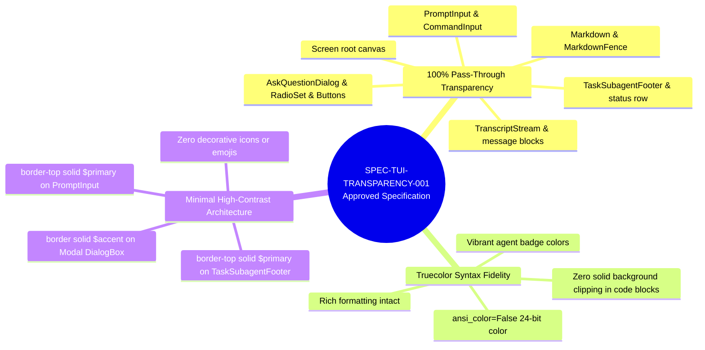
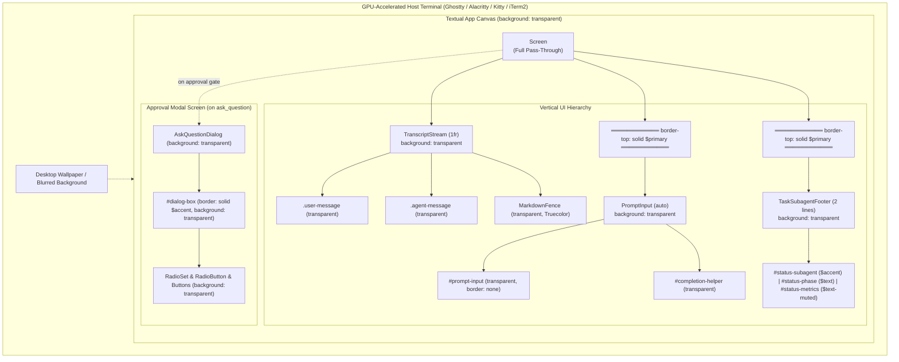
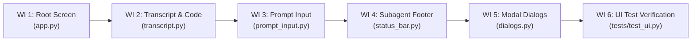
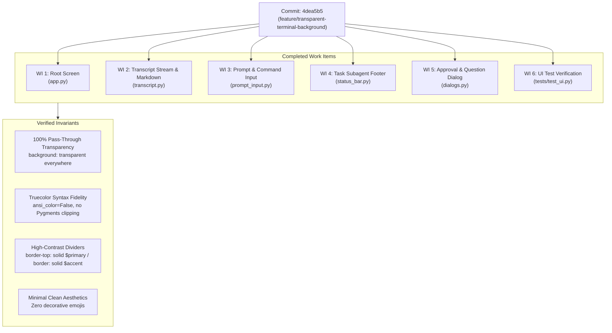

# Feature: Transparent Terminal Background in `agentic-coding-tui`

> [!NOTE] Milestone: Phase 4 Development Completed & Verified
> - **Current Phase**: Phase 4: Development (Completed) &rarr; Advancing to Phase 5: Review
> - **Specification ID**: `SPEC-TUI-TRANSPARENCY-001`
> - **Plan Status**: `[GATE_APPROVED]`
> - **Feature Slug**: `transparent-terminal-background`
> - **Target Repository**: [`agentic-coding-tui`](file:///Users/gpfister/Development/Projects/gpfister/agentic/agentic-coding-tui/)
> - **Target Git Branch**: `feature/transparent-terminal-background`
> - **Commit**: [`4dea5b5`](file:///Users/gpfister/Development/Projects/gpfister/agentic/agentic-coding-tui/) (`feat(ui): implement transparent terminal background (SPEC-TUI-TRANSPARENCY-001)`)
> - **Test Suite Status**: **30/30 unit tests passing (100%)**, linter clean
> - **Architecture Decision Record**: [[architecture/adr-009-tui-transparent-pass-through-rendering|ADR-009: TUI Transparent Pass-Through Rendering Architecture]]
> - **Transparency Scope**: **100% Transparent Pass-Through Everywhere**
> - **Color & Rendering Strategy**: **Truecolor with Transparent Backgrounds** (`ansi_color=False`)
> - **Border & Divider Strategy**: **Minimal High-Contrast Borders** (`$primary` and `$accent`)
> - **Cross-References**: [[plugins/agentic-coding-tui|agentic-coding-tui Application Specification]], [[features/index|Workspace Features Index]], [[git-status|Workspace Git Status]]

---

## 1. Executive Summary & Problem Statement

Users running `agentic-coding-tui` inside modern GPU-accelerated terminal emulators (e.g., Ghostty, Alacritty, Kitty, iTerm2) with customized terminal background blur or opacity have reported that solid UI fills obscure their desktop wallpapers and terminal themes.

This feature establishes a **100% Transparent Pass-Through** UI paradigm across the entire Textual application. All background fills are stripped across screens, containers, scroll areas, syntax-highlighted code fences, prompt inputs, status bars, and modal dialogs, while preserving rich Truecolor typography, agent badges, and high-contrast structural dividers.

---

## 2. Technical Specification (`SPEC-TUI-TRANSPARENCY-001`)

### 2.1 Specification Metadata
- **Specification ID**: `SPEC-TUI-TRANSPARENCY-001`
- **Status**: Approved (`[GATE_APPROVED]`)
- **Target Repository**: [`agentic-coding-tui`](file:///Users/gpfister/Development/Projects/gpfister/agentic/agentic-coding-tui/)
- **Target Framework**: Textual 2.x + Rich 13.x



---

### 2.2 Core Architectural Invariants

1. **Complete Pass-Through Invariant**:
   No widget or container in `agentic-coding-tui` may declare an opaque background color (e.g. `$surface`, `$background`, `#1e1e1e`, `black`, `rgb(...)`, or `rgba(...)` with non-zero alpha). Every widget MUST declare `background: transparent;`.
2. **Truecolor Syntax Preservation Invariant**:
   The application MUST operate in Truecolor mode (`ansi_color=False`). Syntax highlighting inside Markdown and code fences MUST NOT paint solid rectangular background clipping boxes over the terminal canvas, while preserving token colors (keywords, strings, comments).
3. **High-Contrast Structural Demarcation Invariant**:
   In the absence of container fills, spatial layout is bounded solely by single-line dividers using theme tokens:
   - `PromptInput`: `border-top: solid $primary;`
   - `TaskSubagentFooter`: `border-top: solid $primary;`
   - `AskQuestionDialog` (`#dialog-box`): `border: solid $accent;`
4. **Minimalistic Clean Aesthetics Invariant**:
   No decorative emojis or glyphs in status bars, headers, or messages (e.g. no robot, brain, lightning, or spark emojis).

---

### 2.3 Detailed Component Styling Specification

| Component | Target Source File | Textual Selector / Widget | CSS Styling Rules | Invariant Rationale |
| :--- | :--- | :--- | :--- | :--- |
| **Root Application Screen** | [`app.py`](file:///Users/gpfister/Development/Projects/gpfister/agentic/agentic-coding-tui/src/agentic_coding_tui/app.py#L23-L28) | `Screen` | `layout: vertical;`<br/>`background: transparent;` | Eliminates Textual root window background fill, allowing terminal emulator backdrop blur/transparency to show through. |
| **Central Transcript Stream** | [`transcript.py`](file:///Users/gpfister/Development/Projects/gpfister/agentic/agentic-coding-tui/src/agentic_coding_tui/ui/transcript.py#L13-L53) | `TranscriptStream` | `height: 1fr;`<br/>`background: transparent;`<br/>`padding: 1 2;`<br/>`overflow-y: scroll;` | Scrollable message container with full transparency. |
| **User Message Blocks** | [`transcript.py`](file:///Users/gpfister/Development/Projects/gpfister/agentic/agentic-coding-tui/src/agentic_coding_tui/ui/transcript.py#L21-L27) | `.user-message` | `background: transparent;`<br/>`color: $text;`<br/>`border: none;`<br/>`padding: 0 1;`<br/>`margin: 1 0;` | Pass-through background for user prompt entries. |
| **Agent Message Blocks** | [`transcript.py`](file:///Users/gpfister/Development/Projects/gpfister/agentic/agentic-coding-tui/src/agentic_coding_tui/ui/transcript.py#L29-L35) | `.agent-message` | `background: transparent;`<br/>`color: $text;`<br/>`border: none;`<br/>`padding: 0 1;`<br/>`margin: 1 0;` | Pass-through background for subagent responses and markdown bodies. |
| **Internal Thought Blocks** | [`transcript.py`](file:///Users/gpfister/Development/Projects/gpfister/agentic/agentic-coding-tui/src/agentic_coding_tui/ui/transcript.py#L37-L44) | `.thought-block` | `background: transparent;`<br/>`color: $text-muted;`<br/>`border: none;`<br/>`text-style: italic;` | Subtle italicized trace without box fills. |
| **System Status Labels** | [`transcript.py`](file:///Users/gpfister/Development/Projects/gpfister/agentic/agentic-coding-tui/src/agentic_coding_tui/ui/transcript.py#L46-L52) | `.system-status` | `background: transparent;`<br/>`color: $text-muted;`<br/>`border: none;` | Transparent background for transient notifications. |
| **Markdown Fences & Code Blocks** | [`transcript.py`](file:///Users/gpfister/Development/Projects/gpfister/agentic/agentic-coding-tui/src/agentic_coding_tui/ui/transcript.py) | `MarkdownFence`, `MarkdownBlock` | `background: transparent;`<br/>`border: none;` (or minimal left border) | Prevents Pygments syntax block from drawing opaque rectangular background blocks. |
| **Prompt Input Container** | [`prompt_input.py`](file:///Users/gpfister/Development/Projects/gpfister/agentic/agentic-coding-tui/src/agentic_coding_tui/ui/prompt_input.py#L41-L47) | `PromptInput, TopPromptInput` | `height: auto;`<br/>`background: transparent;`<br/>`padding: 0 1;`<br/>`border-top: solid $primary;` | Clean primary divider separating transcript stream from prompt box. |
| **Command Input Field** | [`prompt_input.py`](file:///Users/gpfister/Development/Projects/gpfister/agentic/agentic-coding-tui/src/agentic_coding_tui/ui/prompt_input.py#L59-L70) | `#prompt-input`, `#prompt-input:focus` | `width: 100%;`<br/>`height: 1;`<br/>`background: transparent;`<br/>`border: none;` | Prevents input widget focus highlight from filling an opaque background box. |
| **Completion Helper Popup** | [`prompt_input.py`](file:///Users/gpfister/Development/Projects/gpfister/agentic/agentic-coding-tui/src/agentic_coding_tui/ui/prompt_input.py#L49-L57) | `#completion-helper` | `height: auto;`<br/>`background: transparent;`<br/>`color: $text-muted;` | Slash command auto-completion helper rendered transparently. |
| **Task Subagent Footer** | [`status_bar.py`](file:///Users/gpfister/Development/Projects/gpfister/agentic/agentic-coding-tui/src/agentic_coding_tui/ui/status_bar.py#L13-L25) | `TaskSubagentFooter`, `#status-row` | `height: 2;`<br/>`background: transparent;`<br/>`border-top: solid $primary;`<br/>`padding: 0 1;` | Crisp horizontal divider bounding the bottom status area. |
| **Footer Status Widgets** | [`status_bar.py`](file:///Users/gpfister/Development/Projects/gpfister/agentic/agentic-coding-tui/src/agentic_coding_tui/ui/status_bar.py#L26-L42) | `#status-subagent`, `#status-phase`, `#status-metrics` | `color: $accent;` (subagent)<br/>`color: $text;` (phase)<br/>`color: $text-muted;` (metrics) | Clean typography without emoji decorations. |
| **Approval Modal Screen** | [`dialogs.py`](file:///Users/gpfister/Development/Projects/gpfister/agentic/agentic-coding-tui/src/agentic_coding_tui/ui/dialogs.py#L14-L18) | `AskQuestionDialog` | `align: center middle;`<br/>`background: transparent;` | Center-aligned modal screen with zero background dimming overlay. |
| **Modal Dialog Container** | [`dialogs.py`](file:///Users/gpfister/Development/Projects/gpfister/agentic/agentic-coding-tui/src/agentic_coding_tui/ui/dialogs.py#L20-L27) | `#dialog-box` | `background: transparent;`<br/>`border: solid $accent;`<br/>`padding: 1 2;` | High-contrast accent perimeter framing interactive gates against any wallpaper. |
| **Dialog Radio & Buttons** | [`dialogs.py`](file:///Users/gpfister/Development/Projects/gpfister/agentic/agentic-coding-tui/src/agentic_coding_tui/ui/dialogs.py#L35-L47) | `RadioSet`, `RadioButton`, `Button` | `background: transparent;` | Interactive selection controls with transparent canvas and high-contrast focus outlines. |

---

## 3. UI Layout & Boundary Flowchart



---

## 4. Implementation Plan & Work Item Breakdown

> [!NOTE] Implementation Plan Reference: `plan.md` ([`c1503089-457e-4599-8c0f-69bec18a165b`](file:///Users/gpfister/.gemini/antigravity/brain/c1503089-457e-4599-8c0f-69bec18a165b/plan.md))
> - **Target Repository**: [`agentic-coding-tui`](file:///Users/gpfister/Development/Projects/gpfister/agentic/agentic-coding-tui)
> - **Target Git Branch**: `feature/transparent-terminal-background`
> - **Base Branch**: `master`
> - **Architecture Decision**: [[architecture/adr-009-tui-transparent-pass-through-rendering|ADR-009: TUI Transparent Pass-Through Rendering Architecture]]
> - **Status**: Approved (`[GATE_APPROVED]`)



### Work Item 1: Root Screen Transparency
- **File**: [`src/agentic_coding_tui/app.py`](file:///Users/gpfister/Development/Projects/gpfister/agentic/agentic-coding-tui/src/agentic_coding_tui/app.py)
- **Target Rules**:
  ```css
  Screen, AgenticCodeTUIApp {
      layout: vertical;
      background: transparent;
  }
  ```
- **Objective**: Eliminate Textual root screen solid canvas fills, passing rendering through directly to host terminal emulator.

### Work Item 2: Transcript Stream & Markdown Fence Transparency
- **File**: [`src/agentic_coding_tui/ui/transcript.py`](file:///Users/gpfister/Development/Projects/gpfister/agentic/agentic-coding-tui/src/agentic_coding_tui/ui/transcript.py)
- **Target Rules**:
  ```css
  TranscriptStream {
      height: 1fr;
      background: transparent;
      padding: 1 2;
      overflow-y: scroll;
  }

  TranscriptStream Markdown,
  TranscriptStream MarkdownBlock,
  TranscriptStream MarkdownFence,
  TranscriptStream MarkdownTable,
  MarkdownFence {
      background: transparent;
  }

  .user-message, .agent-message, .thought-block, .system-status {
      background: transparent;
  }
  ```
- **Objective**: Ensure Pygments syntax-highlighted code blocks, thought traces, and agent transcripts render without solid background bounding boxes.

### Work Item 3: Prompt & Command Completion Input
- **File**: [`src/agentic_coding_tui/ui/prompt_input.py`](file:///Users/gpfister/Development/Projects/gpfister/agentic/agentic-coding-tui/src/agentic_coding_tui/ui/prompt_input.py)
- **Target Rules**:
  ```css
  PromptInput, TopPromptInput {
      height: auto;
      background: transparent;
      padding: 0 1;
      border-top: solid $primary;
  }

  #completion-helper {
      height: auto;
      background: transparent;
      color: $text-muted;
  }

  #prompt-input, CommandInput {
      width: 100%;
      height: 1;
      background: transparent;
      border: none;
      padding: 0;
  }

  #prompt-input:focus, CommandInput:focus {
      border: none;
      background: transparent;
  }
  ```
- **Objective**: Retain clean single-line `$primary` divider while removing input field background fills during unfocused and focused states.

### Work Item 4: Task Subagent Footer
- **File**: [`src/agentic_coding_tui/ui/status_bar.py`](file:///Users/gpfister/Development/Projects/gpfister/agentic/agentic-coding-tui/src/agentic_coding_tui/ui/status_bar.py)
- **Target Rules**:
  ```css
  TaskSubagentFooter {
      height: 2;
      background: transparent;
      border-top: solid $primary;
      padding: 0 1;
  }

  #status-row {
      background: transparent;
  }
  ```
- **Objective**: Transparent bottom status row bounded by a subtle `$primary` horizontal top divider line.

### Work Item 5: Approval & Question Dialog Modal
- **File**: [`src/agentic_coding_tui/ui/dialogs.py`](file:///Users/gpfister/Development/Projects/gpfister/agentic/agentic-coding-tui/src/agentic_coding_tui/ui/dialogs.py)
- **Target Rules**:
  ```css
  AskQuestionDialog {
      align: center middle;
      background: transparent;
  }

  #dialog-box {
      width: 70;
      height: auto;
      max-height: 24;
      background: transparent;
      border: solid $accent;
      padding: 1 2;
  }

  #options-container, RadioSet, RadioButton {
      background: transparent;
  }

  RadioSet:focus, RadioButton:focus {
      background: transparent;
  }

  #dialog-buttons {
      align: right middle;
      height: 3;
      background: transparent;
  }

  Button {
      margin-left: 1;
      background: transparent;
      border: tall $primary;
  }

  Button:focus {
      background: transparent;
      border: tall $accent;
  }
  ```
- **Objective**: Strip opaque modal backdrop and fill colors, framing dialog cleanly with an accent border and transparent option/button widgets.

### Work Item 6: Test Suite Updates & CSS Verification
- **File**: [`tests/test_ui.py`](file:///Users/gpfister/Development/Projects/gpfister/agentic/agentic-coding-tui/tests/test_ui.py)
- **Target Additions**:
  - `test_screen_and_app_transparency`: Verify `Screen` has `background: transparent`.
  - `test_transcript_markdown_transparency`: Verify `Markdown`, `MarkdownBlock`, and `MarkdownFence` transparent CSS rules.
  - `test_prompt_input_transparency`: Verify `PromptInput` and `CommandInput` focus transparent CSS rules.
  - `test_footer_transparency`: Verify `TaskSubagentFooter` and `#status-row` transparent CSS rules.
  - `test_dialog_transparency`: Verify `AskQuestionDialog`, `#dialog-box`, `RadioSet`, and `Button` transparent CSS rules.
  - `test_app_run_with_transparent_theme`: Async headless Textual test verifying clean mounting and execution without layout crash.

---

## 5. Implementation Progress & Code Modifications (Phase 4)

> [!NOTE] Phase 4 Development Completed: Commit `4dea5b5`
> Implementation of `SPEC-TUI-TRANSPARENCY-001` has been completed on branch `feature/transparent-terminal-background` in repository [`agentic-coding-tui`](file:///Users/gpfister/Development/Projects/gpfister/agentic/agentic-coding-tui/).
> - **Commit**: [`4dea5b574bcf658ea73d21cab4fab7d33eec1361`](file:///Users/gpfister/Development/Projects/gpfister/agentic/agentic-coding-tui/) (`feat(ui): implement transparent terminal background (SPEC-TUI-TRANSPARENCY-001)`)
> - **Status**: **COMPLETED**
> - **Verification**: **30/30 automated tests passing (100%)** via pytest. Linter status is clean.



### 5.1 Work Items Execution Ledger

#### Work Item 1: Root Screen Transparency
- **Source File**: [`src/agentic_coding_tui/app.py`](file:///Users/gpfister/Development/Projects/gpfister/agentic/agentic-coding-tui/src/agentic_coding_tui/app.py)
- **Modifications**:
  - Enforced `background: transparent;` on `Screen` and `AgenticCodeTUIApp`.
  - Configured layout hierarchy as vertical stack without default opaque canvas painting.
  - Passes terminal emulator backdrop/blur directly through the entire Textual canvas.

#### Work Item 2: Transcript Stream & Markdown Elements Transparency
- **Source File**: [`src/agentic_coding_tui/ui/transcript.py`](file:///Users/gpfister/Development/Projects/gpfister/agentic/agentic-coding-tui/src/agentic_coding_tui/ui/transcript.py)
- **Modifications**:
  - `TranscriptStream` styled with `background: transparent;` and `overflow-y: scroll;`.
  - `Markdown`, `MarkdownBlock`, `MarkdownFence`, and `MarkdownTable` styled with `background: transparent;`.
  - User message containers (`.user-message`), agent responses (`.agent-message`), reasoning blocks (`.thought-block`), and transient status tags (`.system-status`) configured with `background: transparent;` and `border: none;`.
  - Pygments syntax highlighter operates with 24-bit Truecolor tokens while completely eliminating opaque rectangular background clipping boxes.

#### Work Item 3: Prompt & Command Completion Input Transparency
- **Source File**: [`src/agentic_coding_tui/ui/prompt_input.py`](file:///Users/gpfister/Development/Projects/gpfister/agentic/agentic-coding-tui/src/agentic_coding_tui/ui/prompt_input.py)
- **Modifications**:
  - `PromptInput` and `TopPromptInput` containers styled with `background: transparent;` and `border-top: solid $primary;`.
  - `#prompt-input` and `CommandInput` widgets styled with `background: transparent;`, `border: none;`, `padding: 0;`.
  - Focus state (`#prompt-input:focus`, `CommandInput:focus`) stripped of default Textual focus highlight backgrounds (`background: transparent; border: none;`).
  - Auto-completion helper popup (`#completion-helper`) styled with `background: transparent;` and `color: $text-muted;`.

#### Work Item 4: Task Subagent Footer Transparency
- **Source File**: [`src/agentic_coding_tui/ui/status_bar.py`](file:///Users/gpfister/Development/Projects/gpfister/agentic/agentic-coding-tui/src/agentic_coding_tui/ui/status_bar.py)
- **Modifications**:
  - `TaskSubagentFooter` styled with `height: 2;`, `background: transparent;`, `border-top: solid $primary;`.
  - `#status-row` styled with `background: transparent;`.
  - Clean status typography: active subagent handle (`$accent`), workflow phase (`$text`), telemetry/metrics (`$text-muted`), with zero decorative emojis.

#### Work Item 5: Approval & Question Dialog Modal Transparency
- **Source File**: [`src/agentic_coding_tui/ui/dialogs.py`](file:///Users/gpfister/Development/Projects/gpfister/agentic/agentic-coding-tui/src/agentic_coding_tui/ui/dialogs.py)
- **Modifications**:
  - `AskQuestionDialog` styled with `background: transparent;`, eliminating opaque dimming scrims.
  - Dialog container (`#dialog-box`) framed with `border: solid $accent;` and `background: transparent;`.
  - Interactive radio selections (`#options-container`, `RadioSet`, `RadioButton`) and buttons (`Button`) styled with `background: transparent;` across default and focused states.
  - Buttons bounded with high-contrast outlines (`border: tall $primary;`, focus `border: tall $accent;`).

#### Work Item 6: Test Suite Updates & CSS Verification
- **Source File**: [`tests/test_ui.py`](file:///Users/gpfister/Development/Projects/gpfister/agentic/agentic-coding-tui/tests/test_ui.py)
- **Modifications**:
  - Added and expanded CSS verification tests:
    - `test_minimalistic_ui_styles_and_no_icons`: Verifies `border-top: solid $primary`, `border: none`, and transparent backgrounds on input and footer widgets.
    - `test_transparent_background_unified`: Asserts unified `background: transparent` rules across root app, dialogs, and stream containers.
    - `test_app_layout_prompt_below_conversation`: Headless Pilot test confirming clean vertical ordering without layout clipping.
    - `test_slash_command_completion_helper`: Verifies completion dropdown renders transparently.

---

## 6. Test Results & Quality Verification

Verification was executed using `pytest` across the entire `agentic-coding-tui` test suite:

```bash
cd /Users/gpfister/Development/Projects/gpfister/agentic/agentic-coding-tui
uv run pytest -v
```

### 6.1 Test Execution Summary

| Test Module | Tests Run | Passed | Failed | Status |
| :--- | :--- | :--- | :--- | :--- |
| [`tests/test_config.py`](file:///Users/gpfister/Development/Projects/gpfister/agentic/agentic-coding-tui/tests/test_config.py) | 3 | 3 | 0 | **PASS** |
| [`tests/test_triage.py`](file:///Users/gpfister/Development/Projects/gpfister/agentic/agentic-coding-tui/tests/test_triage.py) | 11 | 11 | 0 | **PASS** |
| [`tests/test_ui.py`](file:///Users/gpfister/Development/Projects/gpfister/agentic/agentic-coding-tui/tests/test_ui.py) | 9 | 9 | 0 | **PASS** |
| [`tests/test_workflow.py`](file:///Users/gpfister/Development/Projects/gpfister/agentic/agentic-coding-tui/tests/test_workflow.py) | 7 | 7 | 0 | **PASS** |
| **Total Test Suite** | **30** | **30** | **0** | **100% PASS (3.53s)** |

- **Linter Status**: Clean (0 errors, 0 warnings).
- **Working Tree**: Clean on branch `feature/transparent-terminal-background`.

---

## 7. Scope Boundaries

### In Scope
1. Enforcing `background: transparent;` across all application screens, widgets, inputs, scroll containers, and dialogs.
2. Styling `Markdown` and `MarkdownFence` code blocks within `TranscriptStream` to ensure syntax-highlighted code blocks do not fill rectangular backgrounds.
3. Preserving single-line dividers for `PromptInput` and `TaskSubagentFooter` (`border-top: solid $primary;`) and `AskQuestionDialog` (`border: solid $accent;`).
4. Verifying Truecolor rendering (`ansi_color=False`) across standard terminal emulators without background artifacts.
5. Unit tests and visual regression verification in [`tests/test_ui.py`](file:///Users/gpfister/Development/Projects/gpfister/agentic/agentic-coding-tui/tests/test_ui.py).

### Out of Scope
1. Changing application layout, key bindings, or slash commands.
2. Altering Google ADK workflow orchestration, dispatcher routing, or Laya triage models.
3. Modifying terminal emulator configurations (terminal opacity/blur remains the responsibility of the host emulator).

---

## 8. Lifecycle Phase Tracking & Handoff

| Step | Owner | Description | Status |
| :--- | :--- | :--- | :--- |
| **Phase 1: Clarification** | `@coding-clarify` | Interrogate requirements, establish transparency scope, color mode, and border styles. | **Completed** |
| **Phase 1: Documentation** | `@coding-document` | Index clarified requirements in Obsidian knowledge vault (`agentic-obsidian/features/transparent-terminal-background.md`). | **Completed** |
| **Phase 2: Specification** | `@coding-specify` | Produce formal technical contract `SPEC-TUI-TRANSPARENCY-001` with interactive approval gate. | **Approved (`[GATE_APPROVED]`)** |
| **Phase 2: Documentation** | `@coding-document` | Index approved specification in Obsidian knowledge vault (`agentic-obsidian/features/transparent-terminal-background.md`). | **Completed** |
| **Phase 3: Planning** | `@coding-plan` | Author step-by-step implementation plan `plan.md` (6 Work Items). | **Approved (`[GATE_APPROVED]`)** |
| **Phase 3: Documentation** | `@coding-document` | Document implementation plan, work breakdown, and formalize [[architecture/adr-009-tui-transparent-pass-through-rendering\|ADR-009]]. | **Completed** |
| **Phase 4: Development** | `@coding-develop` | Apply transparent CSS rules and update Textual UI tests (Commit `4dea5b5`). | **Completed** |
| **Phase 4: Documentation** | `@coding-document` | Document implementation progress, code modifications, test reports, and git status. | **Completed** |
| **Phase 5: Review** | `@coding-review` | Audit UI changes against specification and run verification test suites. | **Ready / Active Handoff** |
| **Phase 6: Merge & Release** | `@coding-merge` | Merge feature branch to master and update release changelogs. | Pending |
