# Plugin: agentic-coding-plugin

## Overview
`agentic-coding-plugin` is the primary coding companion plugin within the `agentic` ecosystem. It bundles declarative markdown-defined subagents under [`agentic-coding-plugin/agents/`](file:///Users/gpfister/Development/Projects/gpfister/agentic/agentic-coding-plugin/agents/), progressive-disclosure skills under [`agentic-coding-plugin/skills/`](file:///Users/gpfister/Development/Projects/gpfister/agentic/agentic-coding-plugin/skills/), an instruction-driven 7-stage software development lifecycle executed via `invoke_subagent`, and clean code engineering standards for Google Antigravity.

---

## Components

### 1. Manifest, Environment & Setup (`plugin.json`, `pyproject.toml`, `LICENSE`, `CONTRIBUTING.md`)
- **Manifest**: [`plugin.json`](file:///Users/gpfister/Development/Projects/gpfister/agentic/agentic-coding-plugin/plugin.json) declaring name `agentic-coding-plugin`, version `0.1.0`, license `MIT`, and `post_install` script ([`scripts/post_install.sh`](file:///Users/gpfister/Development/Projects/gpfister/agentic/agentic-coding-plugin/scripts/post_install.sh)).
- **License**: [`LICENSE`](file:///Users/gpfister/Development/Projects/gpfister/agentic/agentic-coding-plugin/LICENSE) specifying MIT License (Copyright (c) 2026 Greg PFISTER).
- **Contributing Guidelines**: [`CONTRIBUTING.md`](file:///Users/gpfister/Development/Projects/gpfister/agentic/agentic-coding-plugin/CONTRIBUTING.md) detailing subagent/skill addition workflows, Conventional Commits, testing requirements, and PR review checklists.
- **Dependencies**: [`pyproject.toml`](file:///Users/gpfister/Development/Projects/gpfister/agentic/agentic-coding-plugin/pyproject.toml) managed via `uv` (`pytest>=8.0.0`).
- **Rules**: [`rules/AGENTS.md`](file:///Users/gpfister/Development/Projects/gpfister/agentic/agentic-coding-plugin/rules/AGENTS.md) enforcing core engineering principles (clarity over cleverness, fail fast, single responsibility, preserving comments/docstrings, and clickable `file://` links).

### 2. Declarative Markdown Subagents (`agents/`)
Subagent instructions are authored as modular markdown specifications within dedicated directories (`agents/<agent>/agent.md`), described and orchestrated by the master [`agents/agent.md`](file:///Users/gpfister/Development/Projects/gpfister/agentic/agentic-coding-plugin/agents/agent.md) specification:

| Agent Directory / File | Handle / Name | Role & Capabilities | Tool Permissions |
| :--- | :--- | :--- | :--- |
| [`agent.md`](file:///Users/gpfister/Development/Projects/gpfister/agentic/agentic-coding-plugin/agents/agent.md) | `coding-catalog` | **Subagents & Workflow Specification**: Architecture, subagent registry, tool privilege model, and coding workflow guide. | `write=False`, `subagent=False`, `mcp=False` |
| [`coding/`](file:///Users/gpfister/Development/Projects/gpfister/agentic/agentic-coding-plugin/agents/coding/) | `@coding` | **Coding Workflow Orchestrator (Dual-Mode)**: Coordinates the 7-stage software development lifecycle across repositories using `invoke_subagent`, `send_message`, and `manage_subagents`. Operates in Dual-Mode (Multi-Hop Relay in Subagent Mode; Direct Gate Rendering & Prompting in Standalone Mode). Bound by Anti-Direct-Coding Guardrails. | `write=True` (Standalone gates only), `subagent=True`, `mcp=True` |
| [`coding-clarify/`](file:///Users/gpfister/Development/Projects/gpfister/agentic/agentic-coding-plugin/agents/coding-clarify/) | `@coding-clarify` | **Requirement Clarifier**: Matt Pocock `/grill-me` style requirement interrogation asking one question at a time via `ask_question`, inspecting code first, and searching docs. | `write=False`, `subagent=False`, `mcp=True` |
| [`coding-specify/`](file:///Users/gpfister/Development/Projects/gpfister/agentic/agentic-coding-plugin/agents/coding-specify/) | `@coding-specify` | **Specification Architect**: Synthesizes clarified requirements into `specification.md` and manages the interactive approval gate. | `write=True`, `subagent=False`, `mcp=True` |
| [`coding-plan/`](file:///Users/gpfister/Development/Projects/gpfister/agentic/agentic-coding-plugin/agents/coding-plan/) | `@coding-plan` | **Architecture Planner**: Deconstructs approved specifications into per-repository tasks, assesses local deployment requirements, and plans branch names in `plan.md`. | `write=True`, `subagent=False`, `mcp=True` |
| [`coding-develop/`](file:///Users/gpfister/Development/Projects/gpfister/agentic/agentic-coding-plugin/agents/coding-develop/) | `@coding-develop` | **Software Engineer**: Isolated single-repository implementation, unit tests, linting, documentation, CI/CD, and fix remediation. | `write=True`, `subagent=False`, `mcp=True` |
| [`coding-deploy/`](file:///Users/gpfister/Development/Projects/gpfister/agentic/agentic-coding-plugin/agents/coding-deploy/) | `@coding-deploy` | **Local Deployment Specialist**: Executes local deployments (Docker, Minikube, Terraform, scripts), monitors health in real time, investigates issues, and orchestrates remediation. | `write=True`, `subagent=True`, `mcp=True` |
| [`coding-review/`](file:///Users/gpfister/Development/Projects/gpfister/agentic/agentic-coding-plugin/agents/coding-review/) | `@coding-review` | **Quality Assurance Lead**: Cross-repository verification against `specification.md`, automated test execution, deployment status auditing, and discrepancy routing. | `write=True`, `subagent=False`, `mcp=True` |
| [`coding-merge/`](file:///Users/gpfister/Development/Projects/gpfister/agentic/agentic-coding-plugin/agents/coding-merge/) | `@coding-merge` | **Release Engineer**: Executes local git merge or remote PR creation (`gh pr create` with compare URL fallback), handles interactive PR review waiting gates via Question Relay Protocol (`[QUESTION_RELAY_REQUEST]`), and performs post-merge base branch synchronization (`git pull --ff-only`) and branch cleanup (`git branch -d`). | `write=True`, `subagent=False`, `mcp=True` |

### 3. Progressive-Disclosure Skills (`skills/`)
| Skill | File | Description |
| :--- | :--- | :--- |
| `coding` | [`skills/coding-orchestrator/SKILL.md`](file:///Users/gpfister/Development/Projects/gpfister/agentic/agentic-coding-plugin/skills/coding-orchestrator/SKILL.md) | Guides full-lifecycle software development tasks through the 7-stage coordinated workflow (`@coding`). |
| `clean-code-reviewer` | [`skills/clean-code-reviewer/SKILL.md`](file:///Users/gpfister/Development/Projects/gpfister/agentic/agentic-coding-plugin/skills/clean-code-reviewer/SKILL.md) | Systematic code quality, readability, error handling, and architectural boundary reviewer. |

---

## Workflows & Protocols

### 1. 7-Stage Coding Lifecycle Pipeline (`@coding`)
Phase transitions are orchestrated via `invoke_subagent`:

```mermaid
flowchart TD
    %% Top Entrypoint
    Start(["User Request / Task"]) --> P1["Phase 1: Clarification<br/>(@coding-clarify)"]
    
    %% Phase 1: Clarification
    P1 --> AmbiguityCheck{"Ambiguities or<br/>Open Questions?"}
    AmbiguityCheck -->|"Yes"| GrillUser["Interrogate User via ask_question<br/>(One question at a time)"]
    GrillUser --> P1
    AmbiguityCheck -->|"No / Clarified"| P2["Phase 2: Specification<br/>(@coding-specify)"]

    %% Phase 2: Specification
    P2 --> SpecArtifact["Write specification.md<br/>(RequestFeedback=True, sole tool call)"]
    SpecArtifact --> IdleSpec["Enter IDLE State<br/>(Wait for User Gate Decision)"]
    IdleSpec --> SpecGate{"User Decision on<br/>specification.md?"}
    SpecGate -->|"[GATE_APPROVED]"| P3["Phase 3: Planning<br/>(@coding-plan)"]

    %% Phase 3: Planning
    P3 --> PlanArtifact["Write plan.md<br/>(RequestFeedback=True, sole tool call)"]
    PlanArtifact --> IdlePlan["Enter IDLE State<br/>(Wait for User Gate Decision)"]
    IdlePlan --> PlanGate{"User Decision on<br/>plan.md?"}
    PlanGate -->|"[GATE_APPROVED]"| DocPlanCheck{"agentic-project-documenting-plugin<br/>installed?"}
    DocPlanCheck -->|"Yes"| InvokeDocPlan["Invoke @coding-document<br/>(Document architecture plan & ADRs)"]
    DocPlanCheck -->|"No"| P4["Phase 4: Development<br/>(@coding-develop)"]
    InvokeDocPlan --> P4

    %% Phase 4: Development & Phase 5: Local Deployment (Per-Repo)
    P4 --> ParallelDev["Fan out parallel workers<br/>per repo on isolated branches"]
    ParallelDev --> DevWork["Implement code, tests, linting<br/>Return DevelopReport"]
    DevWork --> DeployCheck{"Local deployment<br/>instructions exist?"}
    DeployCheck -->|"Yes"| P5Deploy["Phase 5: Local Deployment<br/>(@coding-deploy per repo)"]
    DeployCheck -->|"No"| JoinDevDeploy["Synchronize Deliverables<br/>(All develop & deploy done)"]

    %% Phase 5: Deployment Execution, Monitoring & Error Loop
    P5Deploy --> DeployRun["Execute local deploy & monitor health"]
    DeployRun --> DeploySuccess{"Deployment<br/>Successful?"}
    DeploySuccess -->|"Yes"| JoinDevDeploy
    DeploySuccess -->|"Error"| DeployIssueArtifact["Investigate error & author<br/>Deployment Issue artifact<br/>(RequestFeedback=True)"]
    DeployIssueArtifact --> DeployGate{"User Decision on<br/>Deployment Issue?"}
    DeployGate -->|"Approved"| MultiSolCheck{"Multiple solutions<br/>proposed?"}
    MultiSolCheck -->|"Yes"| AskSol["Ask user solution choice<br/>via ask_question"]
    MultiSolCheck -->|"Single"| InvokeFixDev["Invoke @coding-develop<br/>to implement fix"]
    AskSol --> InvokeFixDev
    InvokeFixDev --> P5Deploy
    DeployGate -->|"Rejected"| AbortWorkflow(["Abort / Terminate"])

    %% Phase 6: Review
    JoinDevDeploy --> P6Review["Phase 6: Review<br/>(@coding-review)"]
    P6Review --> AuditChanges["Audit deliverables & deployment<br/>Run verification test suites"]
    AuditChanges --> ReviewCheck{"Quality Audit<br/>Passed?"}
    ReviewCheck -->|"Passed"| MergeConfirmGate{"Confirm Merge with User<br/>(ask_question)"}
    MergeConfirmGate -->|"User Confirmed"| DocPreMergeCheck{"agentic-project-documenting-plugin<br/>installed?"}
    DocPreMergeCheck -->|"Yes"| InvokeDocPreMerge["Invoke @coding-document<br/>(Pre-merge tidy-up: update READMEs & architecture docs)"]
    DocPreMergeCheck -->|"No"| P7Merge["Phase 7: Merge & Release<br/>(@coding-merge)"]
    InvokeDocPreMerge --> P7Merge

    %% Phase 7: Release & Merge
    P7Merge --> ExecMerge["Execute git merge or remote PR creation<br/>Question Relay waiting gate & post-merge sync"]
    ExecMerge --> DocPostMergeCheck{"agentic-project-documenting-plugin<br/>installed?"}
    DocPostMergeCheck -->|"Yes"| InvokeDocPostMerge["Invoke @coding-document<br/>(Post-merge: update git status, branch tracking & changelogs)"]
    DocPostMergeCheck -->|"No"| Complete(["Workflow Completed"])
    InvokeDocPostMerge --> Complete

    %% Rejection & Rework Loops (routing upward)
    SpecGate -->|"[GATE_REJECTED]"| P1
    PlanGate -->|"[GATE_REJECTED]"| P1
    ReviewCheck -->|"Defects Found"| P3

    %% User Denied Merge routes directly to bottom termination
    MergeConfirmGate -->|"User Denied"| AbortWorkflow
```

### 2. Dual-Mode Orchestration & Multi-Hop Relay Protocol
To prevent duplicate UI modals and 60-second host runtime timeouts in background subagents:
- **Subagent Mode (`caller_id` present)**: When `@coding` runs under an upstream caller, it **MUST NOT** invoke `write_file(RequestFeedback=True)` or `ask_question`. It forwards `[ARTIFACT_APPROVAL_REQUEST]` and `[QUESTION_RELAY_REQUEST]` envelopes upward to `caller_id` via `send_message`, yields immediately, and routes responses downward to the waiting subagent upon reactive wakeup.
- **Standalone Mode (no `caller_id`)**: When running directly at the session root, `@coding` renders interactive milestone artifacts via `write_file(RequestFeedback=True)` as the sole and final tool call of that turn, and prompts the user via `ask_question`.

### 3. Hard Anti-Direct-Coding Guardrails
- `@coding` is strictly a meta-orchestrator. It **MUST NEVER** edit or write application source code, configs, or test suites directly.
- `write_file` is restricted to presenting interactive milestone artifacts in Standalone Mode.
- `run_command` is restricted to workspace inspection (`git status`).
- Implementation is strictly delegated to `@coding-develop`, local deployment checks to `@coding-deploy`, code review to `@coding-review`, and release/merge to `@coding-merge`.

### 4. Pre-Clarified Fast-Path
- Automatically skips Phase 1 (`coding-clarify`) when invoked with pre-clarified requirements or an approved issue assessment.
- Fast-paths directly to Phase 2 (`coding-specify`) or Phase 3 (`coding-plan`), preserving formal approval gates before development begins.

---

## Testing
Automated tests in [`agentic-coding-plugin/tests/`](file:///Users/gpfister/Development/Projects/gpfister/agentic/agentic-coding-plugin/tests/) validate manifest integrity, agent frontmatter & registration, lifecycle rules, dual-mode orchestration, multi-hop relay, and anti-direct-coding constraints:
- [`tests/test_plugin.py`](file:///Users/gpfister/Development/Projects/gpfister/agentic/agentic-coding-plugin/tests/test_plugin.py) (21/21 tests passing, 100% pass rate)
