# Plugin: agentic-coding-plugin

## Overview
`agentic-coding-plugin` is the primary coding companion plugin within the `agentic` ecosystem. It bundles declarative markdown-defined subagents under [`agentic-coding-plugin/agents/`](file:///Users/gpfister/Development/Projects/gpfister/agentic/agentic-coding-plugin/agents/), progressive-disclosure skills under [`agentic-coding-plugin/skills/`](file:///Users/gpfister/Development/Projects/gpfister/agentic/agentic-coding-plugin/skills/), an instruction-driven 6-stage software development lifecycle executed via `invoke_subagent`, and clean code engineering standards for Google Antigravity.

---

## Components

### 1. Manifest, Environment & Setup (`plugin.json`, `pyproject.toml`, `hooks.json`, `LICENSE`, `CONTRIBUTING.md`)
- **Manifest**: [`plugin.json`](file:///Users/gpfister/Development/Projects/gpfister/agentic/agentic-coding-plugin/plugin.json) declaring name `agentic-coding-plugin`, version `0.1.0`, license `MIT`, and `post_install` script ([`scripts/post_install.sh`](file:///Users/gpfister/Development/Projects/gpfister/agentic/agentic-coding-plugin/scripts/post_install.sh)).
- **License**: [`LICENSE`](file:///Users/gpfister/Development/Projects/gpfister/agentic/agentic-coding-plugin/LICENSE) specifying MIT License (Copyright (c) 2026 Greg PFISTER).
- **Contributing Guidelines**: [`CONTRIBUTING.md`](file:///Users/gpfister/Development/Projects/gpfister/agentic/agentic-coding-plugin/CONTRIBUTING.md) detailing subagent/skill addition workflows, Conventional Commits, testing requirements, and PR review checklists.
- **Dependencies**: [`pyproject.toml`](file:///Users/gpfister/Development/Projects/gpfister/agentic/agentic-coding-plugin/pyproject.toml) managed via `uv` (`pytest>=8.0.0`).
- **Rules**: [`rules/AGENTS.md`](file:///Users/gpfister/Development/Projects/gpfister/agentic/agentic-coding-plugin/rules/AGENTS.md) enforcing core engineering principles (clarity over cleverness, fail fast, single responsibility, preserving comments/docstrings, and clickable `file://` links).
- **Lifecycle Hooks**: [`hooks.json`](file:///Users/gpfister/Development/Projects/gpfister/agentic/agentic-coding-plugin/hooks.json):
  - **`SessionStart`**: Deactivated (`enabled: false`) to avoid race conditions with native markdown discovery.

### 2. Declarative Markdown Subagents (`agents/`)
Subagent instructions are authored as modular markdown specifications within dedicated directories (`agents/<agent>/agent.md`), described and orchestrated by the master [`agents/agent.md`](file:///Users/gpfister/Development/Projects/gpfister/agentic/agentic-coding-plugin/agents/agent.md) specification:

| Agent Directory / File | Handle / Name | Role & Capabilities | Tool Permissions |
| :--- | :--- | :--- | :--- |
| [`agent.md`](file:///Users/gpfister/Development/Projects/gpfister/agentic/agentic-coding-plugin/agents/agent.md) | `coding-catalog` | **Subagents & Workflow Specification**: Architecture, subagent registry, tool privilege model, and coding workflow guide. | `write=False`, `subagent=False`, `mcp=False` |
| [`coding/`](file:///Users/gpfister/Development/Projects/gpfister/agentic/agentic-coding-plugin/agents/coding/) | `@coding` | **Coding Workflow Orchestrator**: Coordinates the 6-stage software development lifecycle across repositories using `invoke_subagent`, `send_message`, and `manage_subagents`. | `write=True`, `subagent=True`, `mcp=True` |
| [`coding-clarify/`](file:///Users/gpfister/Development/Projects/gpfister/agentic/agentic-coding-plugin/agents/coding-clarify/) | `@coding-clarify` | **Requirement Clarifier**: Matt Pocock `/grill-me` style requirement interrogation asking one question at a time via `ask_question`, inspecting code first, and searching docs. | `write=False`, `subagent=False`, `mcp=True` |
| [`coding-specify/`](file:///Users/gpfister/Development/Projects/gpfister/agentic/agentic-coding-plugin/agents/coding-specify/) | `@coding-specify` | **Specification Architect**: Synthesizes clarified requirements into `specification.md` and manages the interactive approval gate. | `write=True`, `subagent=False`, `mcp=True` |
| [`coding-plan/`](file:///Users/gpfister/Development/Projects/gpfister/agentic/agentic-coding-plugin/agents/coding-plan/) | `@coding-plan` | **Architecture Planner**: Deconstructs approved specifications into per-repository tasks and branch names (`feature/*`, `task/*`, `bugfix/*`) in `plan.md` with git inspection. | `write=True`, `subagent=False`, `mcp=True` |
| [`coding-develop/`](file:///Users/gpfister/Development/Projects/gpfister/agentic/agentic-coding-plugin/agents/coding-develop/) | `@coding-develop` | **Software Engineer**: Isolated single-repository implementation, unit tests, linting, documentation, CI/CD, and web doc lookups. | `write=True`, `subagent=False`, `mcp=True` |
| [`coding-review/`](file:///Users/gpfister/Development/Projects/gpfister/agentic/agentic-coding-plugin/agents/coding-review/) | `@coding-review` | **Quality Assurance Lead**: Cross-repository verification against `specification.md`, automated test execution, and discrepancy routing. | `write=True`, `subagent=False`, `mcp=True` |
| [`coding-merge/`](file:///Users/gpfister/Development/Projects/gpfister/agentic/agentic-coding-plugin/agents/coding-merge/) | `@coding-merge` | **Release Engineer**: Executes local git merge (when no remote exists) or opens a GitHub Pull Request via `gh pr create` and GitHub MCP. | `write=True`, `subagent=False`, `mcp=True` |

### 3. Progressive-Disclosure Skills (`skills/`)
| Skill | File | Description |
| :--- | :--- | :--- |
| `coding` | [`skills/coding-orchestrator/SKILL.md`](file:///Users/gpfister/Development/Projects/gpfister/agentic/agentic-coding-plugin/skills/coding-orchestrator/SKILL.md) | Guides full-lifecycle software development tasks through the 6-stage coordinated workflow (`@coding`). |
| `clean-code-reviewer` | [`skills/clean-code-reviewer/SKILL.md`](file:///Users/gpfister/Development/Projects/gpfister/agentic/agentic-coding-plugin/skills/clean-code-reviewer/SKILL.md) | Systematic code quality, readability, error handling, and architectural boundary reviewer. |

---

## Workflows & Protocols

### 1. 6-Stage Coding Lifecycle Pipeline (`@coding`)
Phase transitions are orchestrated via `invoke_subagent`:

```mermaid
flowchart TD
    %% Top Entrypoint
    Start(["User Request / Task"]) --> P1["Phase 1: Clarification<br/>(@coding-clarify)"]
    
    %% Phase 1: Clarification
    P1 --> AmbiguityCheck{"Ambiguities or<br/>Open Questions?"}
    AmbiguityCheck -->|"Yes"| GrillUser["Interrogate User via ask_question<br/>(One question at a time)"]
    GrillUser --> P1
    AmbiguityCheck -->|"No / Clarified"| Doc1Check{"agentic-document-plugin<br/>(or agentic-obsidian-plugin)<br/>installed?"}
    Doc1Check -->|"Yes"| InvokeDoc1["Invoke @coding-document<br/>(Document requirements & clarification notes)"]
    Doc1Check -->|"No"| P2["Phase 2: Specification<br/>(@coding-specify)"]
    InvokeDoc1 --> P2

    %% Phase 2: Specification
    P2 --> SpecArtifact["Write specification.md<br/>(RequestFeedback=True, sole tool call)"]
    SpecArtifact --> IdleSpec["Enter IDLE State<br/>(Wait for User Gate Decision)"]
    IdleSpec --> SpecGate{"User Decision on<br/>specification.md?"}
    SpecGate -->|"[GATE_APPROVED]"| Doc2Check{"agentic-document-plugin<br/>installed?"}
    Doc2Check -->|"Yes"| InvokeDoc2["Invoke @coding-document<br/>(Document & index feature specifications)"]
    Doc2Check -->|"No"| P3["Phase 3: Planning<br/>(@coding-plan)"]
    InvokeDoc2 --> P3

    %% Phase 3: Planning
    P3 --> PlanArtifact["Write plan.md<br/>(RequestFeedback=True, sole tool call)"]
    PlanArtifact --> IdlePlan["Enter IDLE State<br/>(Wait for User Gate Decision)"]
    IdlePlan --> PlanGate{"User Decision on<br/>plan.md?"}
    PlanGate -->|"[GATE_APPROVED]"| Doc3Check{"agentic-document-plugin<br/>installed?"}
    Doc3Check -->|"Yes"| InvokeDoc3["Invoke @coding-document<br/>(Document architecture plan & ADRs)"]
    Doc3Check -->|"No"| P4["Phase 4: Development<br/>(@coding-develop)"]
    InvokeDoc3 --> P4

    %% Phase 4: Development
    P4 --> ParallelDev["Fan out parallel workers<br/>per repo on isolated branches"]
    ParallelDev --> DevWork["Implement code, tests, linting<br/>Return DevelopReport"]
    DevWork --> Doc4Check{"agentic-document-plugin<br/>installed?"}
    Doc4Check -->|"Yes"| InvokeDoc4["Invoke @coding-document<br/>(Document code changes & implementation notes)"]
    Doc4Check -->|"No"| P5["Phase 5: Review<br/>(@coding-review)"]
    InvokeDoc4 --> P5

    %% Phase 5: Review
    P5 --> AuditChanges["Audit deliverables against spec<br/>Run verification test suites"]
    AuditChanges --> ReviewCheck{"Quality Audit<br/>Passed?"}
    ReviewCheck -->|"Passed"| MergeConfirmGate{"Confirm Merge with User<br/>(ask_question)"}
    MergeConfirmGate -->|"User Confirmed"| Doc5Check{"agentic-document-plugin<br/>installed?"}
    Doc5Check -->|"Yes"| InvokeDoc5["Invoke @coding-document<br/>(Pre-merge tidy-up: update READMEs & architecture docs)"]
    Doc5Check -->|"No"| P6["Phase 6: Merge & Release<br/>(@coding-merge)"]
    InvokeDoc5 --> P6

    %% Phase 6: Release & Merge
    P6 --> ExecMerge["Execute git merge or open GitHub PR"]
    ExecMerge --> Doc6Check{"agentic-document-plugin<br/>installed?"}
    Doc6Check -->|"Yes"| InvokeDoc6["Invoke @coding-document<br/>(Post-merge: update git status, branch tracking & changelogs)"]
    Doc6Check -->|"No"| Complete(["Workflow Completed"])
    InvokeDoc6 --> Complete

    %% Rejection & Rework Loops (routing upward)
    SpecGate -->|"[GATE_REJECTED]"| P1
    PlanGate -->|"[GATE_REJECTED]"| P1
    ReviewCheck -->|"Defects Found"| P3

    %% User Denied Merge routes directly to bottom termination
    MergeConfirmGate -->|"User Denied"| AbortWorkflow(["Abort / Terminate"])
```


                          └───────────────┴────────────── coding-review
                                                                 │ (approved)
                                                                 ▼
                                                           coding-merge
```

### 2. Antigravity Interactive Artifact Approval Protocol
- **Mandatory Approval Gates**: `specification.md` (Stage 2) and `plan.md` (Stage 3) require interactive user approval before proceeding.
- **Artifact Metadata**: Written to `<appDataDir>/brain/<conversation-id>/<artifact>.md` with `ArtifactMetadata={"RequestFeedback": True, "UserFacing": True}`.
- **Sole & Final Tool Call Rule**: `write_file(..., RequestFeedback=True)` must be the sole and final tool call of that turn so Antigravity presents the interactive **Approve / Reject** UI modal.

---

## Testing
Automated tests in [`agentic-coding-plugin/tests/`](file:///Users/gpfister/Development/Projects/gpfister/agentic/agentic-coding-plugin/tests/) validate manifest integrity, agent frontmatter & registration, and lifecycle rules:
- [`tests/test_plugin.py`](file:///Users/gpfister/Development/Projects/gpfister/agentic/agentic-coding-plugin/tests/test_plugin.py)
- [`tests/test_register_subagents.py`](file:///Users/gpfister/Development/Projects/gpfister/agentic/agentic-coding-plugin/tests/test_register_subagents.py)
