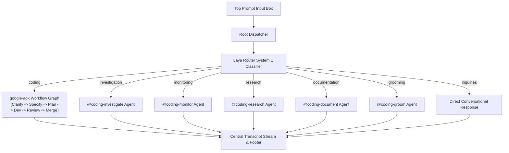

# Application: agentic-coding-tui

## Overview
`agentic-coding-tui` is a standalone, full-screen Terminal User Interface (TUI) application combining the **Google Antigravity SDK** (`google-antigravity`) and **Google ADK** (`google-adk`) workflow graph engine into a unified terminal assistant.

It enables developers to operate the full agentic ecosystem directly in their terminal without requiring a GUI IDE:
- **Top Prompt Input**: Persistent prompt and slash command bar with history and autocomplete.
- **Central Transcript Stream**: Scrollable conversation stream with rich Markdown rendering, syntax-highlighted code blocks, and collapsible thought traces.
- **Bottom Status Footer**: Live display of active subagent, lifecycle phase, tool status, and token metrics.
- **Interactive Approval Dialogs**: Responsive modals for approval gates without timeouts.
- **100% Transparent Terminal Canvas**: Full pass-through styling honoring host terminal emulator blur, opacity, or wallpaper shaders (Ghostty, Kitty, Alacritty, iTerm2) with Truecolor syntax fidelity and minimal single-line dividers.

---

## Architecture & Components



### 1. Orchestration Engine (`google-adk Workflow`)
The coding lifecycle is orchestrated deterministically via `google.adk.workflow.Workflow` with explicit `FunctionNode` steps and transition invariants enforcing approval gates (`[GATE_APPROVED]` on `specification.md` and `plan.md`).

### 2. Domain Worker Agents (`google-antigravity Agent`)
Worker subagents are instantiated using `LocalAgentConfig` and standard Antigravity tools (with `invoke_agent` excluded).

### 3. Intent Triage (`laya Router`)
Fast non-autoregressive prompt classification routes requests to target agents or triggers disambiguation prompts when confidence is below 0.40.

---

## Configuration & Usage

Configuration is loaded from `config/agents.yaml`:

```yaml
default:
  model: "gemini-2.5-flash"
  temperature: 0.2
  seed: 42

agents:
  coding_orchestrator:
    model: "gemini-3.8-pro"
    temperature: 0.2
```

### CLI Commands
```bash
# Launch the TUI
make run
# or
coding --config config/agents.yaml
```

---

## Related Features & Specifications

- [[features/transparent-terminal-background|Transparent Terminal Background (SPEC-TUI-TRANSPARENCY-001)]]: Full 100% transparent pass-through background styling across all screens, streams, input boxes, footers, code fences, and dialogs. Fast-forward merged into `master` (Commits [`4dea5b5`](file:///Users/gpfister/Development/Projects/gpfister/agentic/agentic-coding-tui/) and [`e9e187f`](file:///Users/gpfister/Development/Projects/gpfister/agentic/agentic-coding-tui/)) with feature branch cleanly deleted and 30/30 unit tests passing on `master` (100%). Preserves Truecolor (`ansi_color=False`) syntax highlighting with zero solid background clipping and minimal structural dividers (`$primary`, `$accent`). Formalized in [[architecture/adr-009-tui-transparent-pass-through-rendering|ADR-009]] and tracked in [[changelog|Workspace Release Changelog]]. Status: **Released & Merged**.

