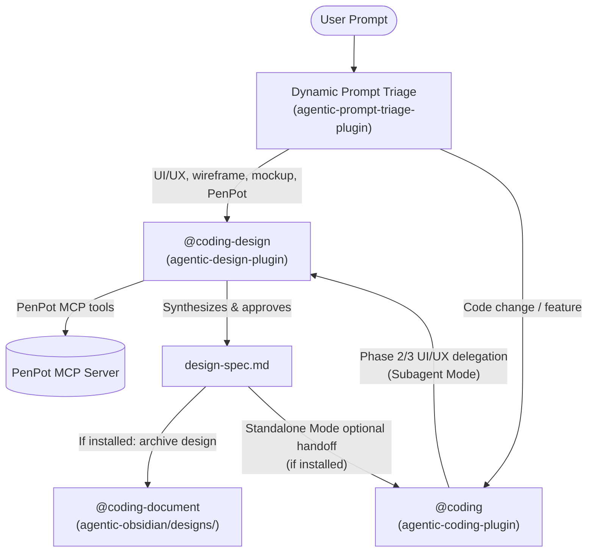

# Plugin: `agentic-design-plugin`

## Overview

`agentic-design-plugin` is the standalone UI/UX design and design-to-code bridge plugin within the `agentic` ecosystem. It hosts the **`@coding-design`** Dual-Mode subagent with official **PenPot MCP** integration, providing bidirectional UI/UX design capabilities:
- **Design Authoring (PenPot only)**: Creating and modifying PenPot files, pages, artboards, frames, components, auto-layout structures, typography, color palettes, and design tokens.
- **Design Inspection & Extraction**: Inspecting existing PenPot designs, extracting layout hierarchies, spacing, typography, color tokens, component properties, and exporting visual assets or references.
- **Specification Synthesis**: Producing structured `<appDataDir>/brain/<conversation-id>/design-spec.md` artifacts for human approval and downstream implementation by `@coding` / `@coding-develop`.

> [!NOTE]
> **Approved References**:
> - Specification: [specification.md](file:///Users/gpfister/.gemini/antigravity/brain/2b36f2db-6da8-42bd-90a7-3c40cc5d8059/specification.md)
> - Implementation Plan: [plan.md](file:///Users/gpfister/.gemini/antigravity/brain/590edead-39dc-4a1e-af1d-821b8249862f/plan.md)
> - QA Review: [review-coding-design-plugin.md](file:///Users/gpfister/.gemini/antigravity/brain/dc440826-17b4-4ec9-9f5c-c81e97c68e17/review-coding-design-plugin.md)
> - Decision Record: [[architecture/adr-013-coding-design-plugin-and-penpot-mcp|ADR-013]]

---

## Repository Structure & Components

```text
agentic-design-plugin/
├── plugin.json                  # Root manifest (name: "agentic-design-plugin", version: "0.1.0", license: "MIT")
├── mcp_config.json              # Official PenPot MCP server configuration (zero hardcoded local paths)
├── rules/AGENTS.md              # Workspace safety, Dual-Mode Relay Protocols, companion integration
├── agents/
│   └── coding-design/
│       └── agent.md             # @coding-design subagent definition (MCP enabled, no edit_file/run_command)
├── skills/
│   └── coding-design/
│       └── SKILL.md             # Progressive-disclosure design authoring & inspection runbook
├── pyproject.toml             # Python >=3.11, pydantic>=2.10.0, dev pytest>=8.0.0
├── uv.lock                      # Locked uv dependency graph
├── tests/
│   └── test_plugin.py           # Offline structural & contract validation suite
├── README.md                    # Setup, PenPot MCP configuration, and usage documentation
├── LICENSE                      # MIT License
└── .gitignore
```

### 1. Manifest & Environment
- **Manifest (`plugin.json`)**: Declares `"name": "agentic-design-plugin"`, `"description"`, `"version": "0.1.0"`, and `"license": "MIT"`.
- **Environment (`pyproject.toml`)**: Managed via `uv` with Python `>=3.11`, `pydantic>=2.10.0`, and `pytest>=8.0.0` in `[dependency-groups] dev`.
- **Contract Tests (`tests/test_plugin.py`)**: Runs offline via `uv run pytest` (no live PenPot server required) to validate JSON manifests, MCP configuration portability, agent frontmatter boundaries, skill frontmatter, and rules.

### 2. Official PenPot MCP Configuration (`mcp_config.json`)
`mcp_config.json` configures the official PenPot MCP server under `mcpServers.penpot` with portable transport settings and zero hardcoded machine-local absolute paths:
- Configures `"serverUrl": "${PENPOT_MCP_URL:-http://localhost:4401/mcp}"` (configurable via `PENPOT_MCP_URL` environment variable).
- Required environment variables and setup instructions are documented in `README.md` and `skills/coding-design/SKILL.md`.
- If the PenPot MCP server is unreachable or not running, `@coding-design` detects the connection/tool failure early, reports the exact endpoint/command configuration error with setup instructions, and halts without fabricating design data.

### 3. Declarative Subagent (`agents/coding-design/agent.md`)
| Handle | Role | Tool Permissions | Prohibited Tools |
| :--- | :--- | :--- | :--- |
| **`@coding-design`** | Bidirectional PenPot UI/UX designer & design-spec synthesizer | `read_file`, `list_dir`, `write_file`, `send_message`, `ask_question`, `invoke_subagent`, PenPot MCP tools (`enable_mcp_tools: true`, `enable_write_tools: true`, `enable_subagent_tools: true`) | `edit_file`, `run_command` |

#### Exclusive Code-Change Authority Boundary ([[architecture/adr-012-exclusive-code-change-authority|ADR-012]])
- `@coding-design` is **strictly read-only** with respect to workspace source code, configuration files, and test suites.
- `edit_file` and `run_command` are omitted from `agents/coding-design/agent.md`.
- `write_file` is restricted exclusively to the session artifact `<appDataDir>/brain/<conversation-id>/design-spec.md`.
- All repository UI components, CSS/tokens, and test changes are delegated exclusively to `@coding-develop` under `@coding` orchestration.

### 4. Progressive-Disclosure Skill (`skills/coding-design/SKILL.md`)
- Frontmatter: `name: coding-design`, `description: ...`.
- Covers PenPot authoring and inspection workflows, `design-spec.md` synthesis, MCP connection error handling, and Dual-Mode Relay Protocols.

---

## Dual-Mode Relay Protocol Integration

`@coding-design` operates as a **Dual-Mode** agent ([[architecture/adr-005-question-relay-protocol|ADR-005]], [[architecture/adr-006-artifact-approval-relay-protocol|ADR-006]]) to eliminate Antigravity's 60-second background subagent timeout during human review:

| Protocol | Standalone Mode (Root Invocation) | Subagent Mode (`caller_id` Present) |
| :--- | :--- | :--- |
| **Question Relay** | Calls `ask_question` directly at the session root (strictly one question at a time). | Never calls `ask_question`. Dispatches `[QUESTION_RELAY_REQUEST]` (one question at a time) to `caller_id` via `send_message` and awaits `[QUESTION_RELAY_RESPONSE]`. |
| **Artifact Approval (`design-spec.md`)** | Calls `write_file` with `ArtifactMetadata={"RequestFeedback": True, "UserFacing": True, "Summary": ...}` as the **sole and final tool call** of the turn. | Writes `design-spec.md` to disk without `RequestFeedback=True`, dispatches `[ARTIFACT_APPROVAL_REQUEST]` (`stage: "DESIGN"`) to `caller_id` via `send_message`, and enters idle state awaiting `[ARTIFACT_APPROVAL_RESPONSE]`. |

---

## Cross-Plugin Interoperability



1. **`agentic-coding-plugin` (`@coding`)**:
   - Dynamically detects `agentic-design-plugin`. For UI/UX-related features during Phase 2/3 (Specification / Planning), `@coding` optionally invokes `@coding-design` in Subagent Mode to produce or inspect PenPot designs and generate `design-spec.md` before or alongside `@coding-plan` and `@coding-develop`. Gracefully skipped if uninstalled.
   - In Standalone Mode, upon `design-spec.md` approval, `@coding-design` asks the user (if `agentic-coding-plugin` is installed) whether to invoke `@coding` using the standardized orchestration prompt (`Orchestrate the 7-stage software development lifecycle to implement the following feature / correction based on the approved assessment: <path>. Do not implement directly; delegate all phases through worker subagents.`).
2. **`agentic-project-documenting-plugin` (`@coding-document`)**:
   - Upon `design-spec.md` approval, if `agentic-project-documenting-plugin` is installed, `@coding-design` invokes `@coding-document` to archive design specifications, PenPot links, and token references under `agentic-obsidian/designs/<design-slug>.md` and `agentic-obsidian/designs/index.md`. Gracefully falls back to local `design-spec.md` if uninstalled.
3. **`agentic-prompt-triage-plugin`**:
   - Dynamically detects `agentic-design-plugin` and routes UI/UX design, wireframe, mockup, design-token, and PenPot requests (`design` intent) to `@coding-design` (`invoke_subagent(TypeName='coding-design', Role='UI/UX Designer', Prompt=...)`), omitting the candidate when uninstalled.

---

## Workspace Registration & Multi-Repo Verification

Across the `agentic` workspace, the implementation spans 5 repositories (all QA-verified in [review-coding-design-plugin.md](file:///Users/gpfister/.gemini/antigravity/brain/dc440826-17b4-4ec9-9f5c-c81e97c68e17/review-coding-design-plugin.md)):
1. `agentic-design-plugin/` — branch `feature/coding-design-plugin`, commit `9b434b4` (`7/7` tests passing via `uv run pytest -v`)
2. `agentic` root — branch `feature/register-design-plugin`, commit `d4fdc13` (`make status` exited 0)
3. `agentic-coding-plugin/` — branch `feature/coding-design-integration`, commit `60024be` (`26/26` tests passing via `uv run pytest -v`)
4. `agentic-prompt-triage-plugin/` — branch `feature/triage-design-plugin`, commit `f29f580` (`87/87` tests passing via `uv run pytest -v`)
5. `agentic-project-documenting-plugin/` — branch `feature/document-designs-archival`, commit `8f8da1d` (`11/11` tests passing via `uv run pytest -v`)

> [!IMPORTANT]
> **Local Deployment Assessment**: All 5 affected repositories contain no Dockerfiles, Compose files, or local deployment scripts, and PenPot MCP is an external server endpoint configured via `mcp_config.json`. **Local Deployment: Not Required** (`@coding-deploy` skipped).

---

## Installation & Usage

```bash
# Enable plugin in Antigravity session:
agy plugin enable agentic-design-plugin

# Run offline structural & contract tests:
cd /Users/gpfister/Development/Projects/gpfister/agentic/agentic-design-plugin && uv run pytest

# Invoke design agent directly:
@coding-design Design a responsive settings modal in PenPot and extract design tokens
```
