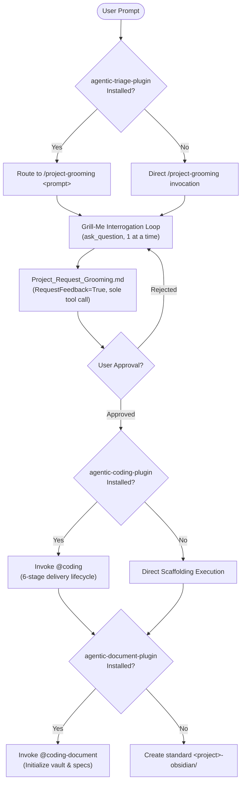

# Plugin: agentic-project-grooming-plugin

## Overview
`agentic-project-grooming-plugin` provides structured, interactive project initialization, scope boundary elicitation, and requirements grooming within the `agentic` workspace. It enables developers to interrogate, refine, and groom project architecture, licensing, tooling, and operational requirements before repository creation or code generation.

The plugin provides the progressive-disclosure skill `/project-grooming` ([`skills/project-grooming/SKILL.md`](file:///Users/gpfister/Development/Projects/gpfister/agentic/agentic-project-grooming-plugin/skills/project-grooming/SKILL.md)), executing a Matt Pocock `/grill-me` style interrogation protocol to gather requirements across 7 core categories and produce an interactive approval gate artifact `Project_Request_Grooming.md` (`RequestFeedback=True`).

Formalized under [[architecture/adr-003-project-grooming-plugin|ADR-003]] and planned in [`plan.md`](file:///Users/gpfister/.gemini/antigravity/brain/401cb359-82fe-40de-a4e6-222c7a01c706/plan.md).

---

## Architecture & Components

### 1. Execution Model: Skill-Only Architecture
- Operates directly within the main agent context via the `/project-grooming` skill.
- No separate subagent handle (`@coding-groom`) is created; this avoids unnecessary process boundaries and round-trips during interactive interview turns.

### 2. Manifest, Metadata & Rules
- **Manifest**: `plugin.json` declaring name `agentic-project-grooming-plugin`, version `0.1.0`, description, and skill registration.
- **Rules**: `rules/AGENTS.md` enforcing:
  - **Relentless Clarification**: Asking one focused question at a time using `ask_question`.
  - **Single Tool Call Gate**: Synthesizing `Project_Request_Grooming.md` with `RequestFeedback=True` as the sole and final tool call of that turn.
  - **Delegation Protocols**: Delegating scaffolding to `@coding` and knowledge base setup to `@coding-document` when companion plugins are active.

### 3. Progressive-Disclosure Skills (`skills/`)
| Skill Name | Path | Description | Invocation |
| :--- | :--- | :--- | :--- |
| `project-grooming` | `skills/project-grooming/SKILL.md` | Interactive multi-repository project initialization, grill-me requirements interrogation across 7 categories, approval artifact authoring, and cross-plugin scaffolding coordination. | Dynamic triage (`/project-grooming`) or direct chat prompt |

---

## The 7 Core Requirements Categories

During the grooming workflow, `/project-grooming` systematically gathers and confirms:

1. **Project Identification**: Project name, filesystem-safe slug, elevator pitch, and problem domain.
2. **Main Goals & Target Audience**: Primary objectives, target user personas, critical use cases, and explicit non-goals.
3. **Known Restrictions & Standards**: Languages, runtimes, package managers, architectural patterns, compliance, and testing standards.
4. **Repository Topology**: Monorepo vs multi-repo federation, sub-packages, service contracts, and directory layouts.
5. **Licensing & Governance**: SPDX license identifier (`Apache-2.0`, `MIT`, etc.), copyright attribution, and dependency guidelines.
6. **Documentation Requirements**: Obsidian vault structure (`<project>-obsidian/`), templates, ADR conventions, and component specs.
7. **Workspace Tooling & Orchestration**: Root [`Makefile`](file:///Users/gpfister/Development/Projects/gpfister/agentic/Makefile) targets, build/lint/test commands, Git worktree setups, and CI/CD pipelines.

---

## Interrogation & Approval Gate Protocol

### 1. Matt Pocock "Grill-Me" Style Interrogation
- Single question at a time using `ask_question` with structured multiple-choice options plus open-ended text input.
- Dynamically adapts subsequent questions based on prior answers.
- Prohibits premature scaffolding or boilerplate writing while interrogating.

### 2. Approval Gate Artifact (`Project_Request_Grooming.md`)
- **Path**: `<appDataDir>/brain/<conversation-id>/Project_Request_Grooming.md`
- **Metadata**: `RequestFeedback=True`, `UserFacing=True`.
- **Sole and Final Tool Call**: Authored as the lone tool call in that turn so Antigravity renders interactive **Approve** and **Reject** buttons cleanly.
- **Handling**:
  - `[GATE_APPROVED]` -> Proceed to cross-plugin scaffolding and repository setup.
  - `[GATE_REJECTED]` -> Re-open interrogation loop to resolve feedback.

---

## Cross-Plugin Handshake Protocols

| Companion Plugin | Integration Protocol when Installed | Graceful Fallback if Not Installed |
| :--- | :--- | :--- |
| **`agentic-triage-plugin`** | Classifies project initiation or grooming prompts and routes them dynamically to `/project-grooming <prompt>`. | User invokes `/project-grooming` manually in chat. |
| **`agentic-coding-plugin`** | Orchestrates 6-stage development lifecycle (`@coding`) for creating repositories, code files, and test infrastructure. | Executes deterministic local file generation, git initialization, and directory setup directly. |
| **`agentic-document-plugin`** | Initializes the project knowledge base vault (`<project>-obsidian/`) and indexes architecture specifications via `@coding-document`. | Directly scaffolds a standard `<project>-obsidian/` directory structure with starter README. |

---

## Workspace Integration Points
- **Root [`Makefile`](file:///Users/gpfister/Development/Projects/gpfister/agentic/Makefile)**: Included in `SUB_REPOS` for workspace-wide synchronization (`make clone`, `make pull`, `make push`, `make status`).
- **Root [`.gitignore`](file:///Users/gpfister/Development/Projects/gpfister/agentic/.gitignore)**: Ignored as an independent Git sub-repository.
- **Root [`AGENTS.md`](file:///Users/gpfister/Development/Projects/gpfister/agentic/AGENTS.md)**: Catalog entry and cross-plugin coordination matrix.
- **Root [`README.md`](file:///Users/gpfister/Development/Projects/gpfister/agentic/README.md)**: Documented as project initialization companion.

---

## Architecture Decisions & Implementation Plan
- **Architecture Decision Record**: [[architecture/adr-003-project-grooming-plugin|ADR-003: Project Grooming Architecture, Skill-Only Execution, Grilling Protocol, Interactive Approval Gate, and Cross-Plugin Delegation]]
- **Multi-Repository Implementation Plan**: [`plan.md`](file:///Users/gpfister/.gemini/antigravity/brain/401cb359-82fe-40de-a4e6-222c7a01c706/plan.md)
- **Git Branch Topology**:
  - `agentic-project-grooming-plugin`: `feature/project-grooming-plugin`
  - `agentic-triage-plugin`: `feature/grooming-triage`
  - `agentic` (root): `feature/add-project-grooming-plugin`

---

## Implementation & Git Status (Phase 4 Completed)
- **Active Feature Branch**: `feature/project-grooming-plugin`
- **Latest Commit**: [`2bbd11f`](file:///Users/gpfister/Development/Projects/gpfister/agentic/agentic-project-grooming-plugin/) (`2bbd11f5f1383fa248c32243805a2f60df5bbe9d`)
- **Automated Test Results**: **8/8 unit tests passing** (100% pass via `uv run pytest`)
- **Created Files**:
  - Manifest & Rules: [`plugin.json`](file:///Users/gpfister/Development/Projects/gpfister/agentic/agentic-project-grooming-plugin/plugin.json), [`rules/AGENTS.md`](file:///Users/gpfister/Development/Projects/gpfister/agentic/agentic-project-grooming-plugin/rules/AGENTS.md)
  - Runbook & Skills: [`skills/project-grooming/SKILL.md`](file:///Users/gpfister/Development/Projects/gpfister/agentic/agentic-project-grooming-plugin/skills/project-grooming/SKILL.md), [`agents/agent.md`](file:///Users/gpfister/Development/Projects/gpfister/agentic/agentic-project-grooming-plugin/agents/agent.md)
  - Tooling & Configuration: [`pyproject.toml`](file:///Users/gpfister/Development/Projects/gpfister/agentic/agentic-project-grooming-plugin/pyproject.toml), [`.gitignore`](file:///Users/gpfister/Development/Projects/gpfister/agentic/agentic-project-grooming-plugin/.gitignore)
  - Documentation & Licensing: [`README.md`](file:///Users/gpfister/Development/Projects/gpfister/agentic/agentic-project-grooming-plugin/README.md), [`LICENSE`](file:///Users/gpfister/Development/Projects/gpfister/agentic/agentic-project-grooming-plugin/LICENSE)
  - Unit Tests: [`tests/test_plugin.py`](file:///Users/gpfister/Development/Projects/gpfister/agentic/agentic-project-grooming-plugin/tests/test_plugin.py)

---

## Detailed Specifications
- Feature Specification & Tracking: [[features/project-grooming-plugin|Project Grooming Plugin & Skill (/project-grooming)]]
