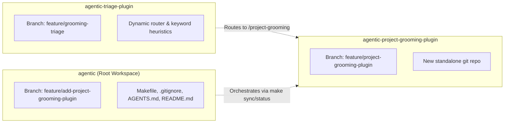

# Project: `agentic-project-grooming-plugin`

## 1. Project Scope & Elevator Summary
The **`agentic-project-grooming-plugin`** is a standalone Google Antigravity companion plugin that introduces structured, interactive project initialization, scope boundary elicitation, and requirements grooming to the `agentic` workspace.

Rather than relying on a separate subagent, the plugin provides the on-demand skill **`/project-grooming`** ([`skills/project-grooming/SKILL.md`](file:///Users/gpfister/Development/Projects/gpfister/agentic/agentic-project-grooming-plugin/skills/project-grooming/SKILL.md)), executing directly in the main agent context. Inspired by Matt Pocock's `/grill-me` pattern, the skill conducts single-question-at-a-time inquiries (`ask_question`) across seven core architectural dimensions before any repository scaffolding or code generation occurs.

Once interrogation converges, the skill authors a structured, interactive approval artifact (`Project_Request_Grooming.md`, `RequestFeedback=True`). Upon user approval, the skill orchestrates multi-repository creation, documentation vault setup, and workspace integration, delegating to `@coding` and `@coding-document` when companion plugins are present.

---

## 2. Multi-Repository Topology & Git Branch Strategy

This project coordinates modifications across three repositories within the workspace:



| Repository | Git Branch | Role / Action | Key Files |
| :--- | :--- | :--- | :--- |
| **`agentic-project-grooming-plugin`** | `master` | Standalone git repository providing the grooming rules and skill | [`plugin.json`](file:///Users/gpfister/Development/Projects/gpfister/agentic/agentic-project-grooming-plugin/plugin.json), [`rules/AGENTS.md`](file:///Users/gpfister/Development/Projects/gpfister/agentic/agentic-project-grooming-plugin/rules/AGENTS.md), [`skills/project-grooming/SKILL.md`](file:///Users/gpfister/Development/Projects/gpfister/agentic/agentic-project-grooming-plugin/skills/project-grooming/SKILL.md), [`README.md`](file:///Users/gpfister/Development/Projects/gpfister/agentic/agentic-project-grooming-plugin/README.md), [`.gitignore`](file:///Users/gpfister/Development/Projects/gpfister/agentic/agentic-project-grooming-plugin/.gitignore), `LICENSE` (MIT) |
| **`agentic-triage-plugin`** | `master` | Dynamic intent classification & routing | [`hooks/prompt_triage.py`](file:///Users/gpfister/Development/Projects/gpfister/agentic/agentic-triage-plugin/hooks/prompt_triage.py), [`rules/AGENTS.md`](file:///Users/gpfister/Development/Projects/gpfister/agentic/agentic-triage-plugin/rules/AGENTS.md), [`tests/test_prompt_triage.py`](file:///Users/gpfister/Development/Projects/gpfister/agentic/agentic-triage-plugin/tests/test_prompt_triage.py) |
| **`agentic` (Root)** | `master` | Multi-repo orchestration & configuration | [`Makefile`](file:///Users/gpfister/Development/Projects/gpfister/agentic/Makefile), [`.gitignore`](file:///Users/gpfister/Development/Projects/gpfister/agentic/.gitignore), [`AGENTS.md`](file:///Users/gpfister/Development/Projects/gpfister/agentic/AGENTS.md), [`README.md`](file:///Users/gpfister/Development/Projects/gpfister/agentic/README.md) |

---

## 3. Architecture & ADR Formalization

The architectural design is governed by **[[architecture/adr-003-project-grooming-plugin|ADR-003]]**:

1. **Skill-Only Execution Model**:
   - Executes in the primary agent context via progressive-disclosure skill `/project-grooming`.
   - Avoids dedicated subagent process overhead, enabling fluid conversational turns.
2. **Matt Pocock "Grill-Me" Interrogation**:
   - Sequential, single-question inquiries using `ask_question`.
   - Structured multiple-choice suggestions with `(Recommended)` prefix, plus freeform text input.
   - Covers 7 dimensions: Identification, Goals/Audience, Restrictions/Standards, Repo Topology, Licensing, Documentation, Tooling.
   - Prohibits premature file or directory generation during interrogation.
3. **Interactive Approval Gate**:
   - Synthesizes `Project_Request_Grooming.md` with `RequestFeedback=True`.
   - Sole and final tool call of that interaction turn to guarantee Antigravity interactive approval buttons render.
4. **Cross-Plugin Scaffolding Delegation**:
   - Code & repo scaffolding delegates to `@coding` (`agentic-coding-plugin`) via the 6-stage lifecycle (`@coding-clarify` through `@coding-merge`).
   - Documentation vault initialization delegates to `@coding-document` (`agentic-document-plugin`).
   - Deterministic self-contained fallback generation when companion plugins are not installed.

---

## 4. Setup, Installation & Verification Procedures

### 4.1 Standalone Plugin Installation
```bash
# In an Antigravity environment:
agy plugin install agentic-project-grooming-plugin
```

### 4.2 Workspace Synchronization
```bash
# Multi-repository status check
make status

# Pull all sub-repositories
make pull
```

### 4.3 Automated Verification
- **Triage Plugin Unit Tests**:
  ```bash
  cd agentic-triage-plugin
  uv run pytest tests/test_prompt_triage.py -v
  ```
- **Manifest Validation & Plugin Unit Tests**:
  ```bash
  cd agentic-project-grooming-plugin
  python3 -m json.tool plugin.json > /dev/null
  uv run pytest
  ```
- **Full Workspace Test Suite**:
  All **117/117 automated unit tests** passed across all plugins.

---

## 5. Lifecycle Progress: Phase 6 Merge & Release Completed
- **Phase 1: Clarification**: Completed & approved across 7 core dimensions.
- **Phase 2: Specification**: Completed & approved in [[features/project-grooming-plugin|Project Grooming Feature Spec]].
- **Phase 3: Planning**: Completed & approved in [`plan.md`](file:///Users/gpfister/.gemini/antigravity/brain/401cb359-82fe-40de-a4e6-222c7a01c706/plan.md) and [[architecture/adr-003-project-grooming-plugin|ADR-003]].
- **Phase 4: Development**: Completed across isolated feature branches; 117/117 automated unit tests passing across all plugins.
- **Phase 5: Review & Audit**: Passed. ReviewReport confirmed 100% acceptance criteria AC-1 through AC-5 satisfied, clean code review passed, and user confirmed merge authorization.
- **Phase 6: Merge & Release**: Completed. Fast-forward merged into `master` across all repositories (`2bbd11f`, `c6fd560`, `d2e11c5`), feature branches deleted, and all 9 repositories on `master` and clean.

---

## 6. Cross-References & Vault Links
- **Architecture Decision Record**: [[architecture/adr-003-project-grooming-plugin|ADR-003: Project Grooming Architecture, Skill-Only Execution, Grilling Protocol, Interactive Approval Gate, and Cross-Plugin Delegation]]
- **Feature Specification**: [[features/project-grooming-plugin|Project Grooming Plugin & Skill (/project-grooming)]]
- **Component Documentation**: [[plugins/agentic-project-grooming-plugin|agentic-project-grooming-plugin]]
- **Workspace Architecture Overview**: [[architecture/overview|Agentic Workspace Architecture Overview]]
- **Implementation Plan**: [`plan.md`](file:///Users/gpfister/.gemini/antigravity/brain/401cb359-82fe-40de-a4e6-222c7a01c706/plan.md)
