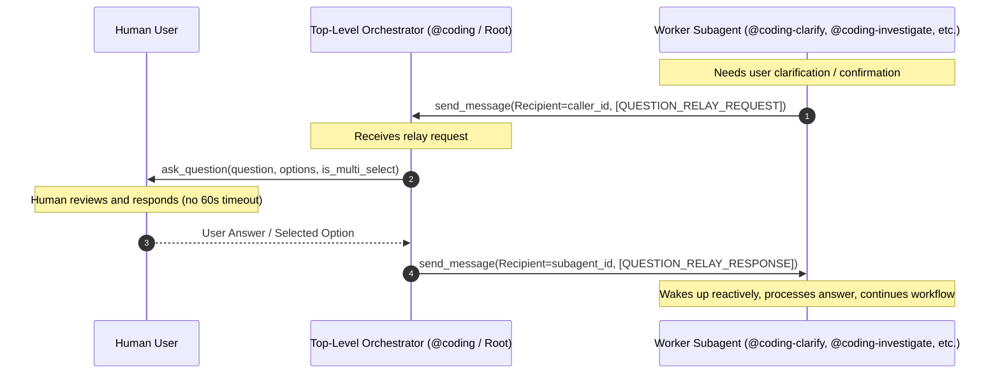
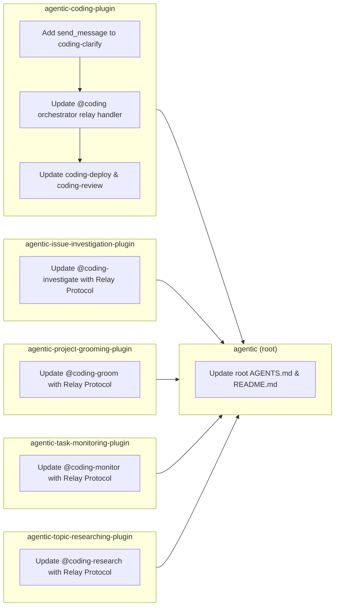

# Multi-Repository Implementation Plan: Question Relay Protocol

## 1. Executive Summary & Problem Formulation

### 1.1 Problem Statement
In Google Antigravity, subagents spawned via `invoke_subagent` face a rigid **60-second host timeout** when executing `ask_question`. If the human user does not provide input within 60 seconds, the tool call fails with a timeout exception, aborting the subagent workflow. Conversely, top-level orchestrators and root conversation sessions run without this constraint and can await human responses indefinitely.

### 1.2 Proposed Architecture: Question Relay Protocol (Option 3)
To eliminate subagent timeouts while preserving interactive human-in-the-loop grilling and confirmation gates, this plan implements a standardized **Question Relay Protocol** across all subagents and orchestrators in the workspace:



### 1.3 Standardized Message Contract
1. **Request Message (`[QUESTION_RELAY_REQUEST]`)**:
   ```text
   [QUESTION_RELAY_REQUEST]
   Question: <Question text>
   Options:
   - (Recommended) <Option 1>
   - <Option 2>
   Context: <Rationale, why this decision matters>
   IsMultiSelect: false
   ```

2. **Response Message (`[QUESTION_RELAY_RESPONSE]`)**:
   ```text
   [QUESTION_RELAY_RESPONSE]
   Answer: <User answer text or selected option>
   ```

3. **Fallback Guard**:
   When an agent runs top-level without an active caller/parent (i.e. no caller ID in context or direct user interaction), it falls back seamlessly to executing `ask_question` directly.

---

## 2. Workspace Local Deployment Assessment

In accordance with workspace standards, every affected repository was audited for local deployment instructions (Dockerfiles, Docker Compose files, local Kubernetes manifests, Helm charts, Terraform configurations, and Makefile deployment targets):

| Repository | Path | Deployment Files Detected | Local Deployment Status |
| :--- | :--- | :--- | :--- |
| **`agentic-coding-plugin`** | [`agentic-coding-plugin/`](file:///Users/gpfister/Development/Projects/gpfister/agentic/agentic-coding-plugin) | None (Python library / plugin definitions) | **Not Required** |
| **`agentic-issue-investigation-plugin`** | [`agentic-issue-investigation-plugin/`](file:///Users/gpfister/Development/Projects/gpfister/agentic/agentic-issue-investigation-plugin) | None (Python library / plugin definitions) | **Not Required** |
| **`agentic-project-grooming-plugin`** | [`agentic-project-grooming-plugin/`](file:///Users/gpfister/Development/Projects/gpfister/agentic/agentic-project-grooming-plugin) | None (Python library / plugin definitions) | **Not Required** |
| **`agentic-task-monitoring-plugin`** | [`agentic-task-monitoring-plugin/`](file:///Users/gpfister/Development/Projects/gpfister/agentic/agentic-task-monitoring-plugin) | None (Python library / plugin definitions) | **Not Required** |
| **`agentic-topic-researching-plugin`** | [`agentic-topic-researching-plugin/`](file:///Users/gpfister/Development/Projects/gpfister/agentic/agentic-topic-researching-plugin) | None (Python library / plugin definitions) | **Not Required** |
| **`agentic` (root)** | [`./`](file:///Users/gpfister/Development/Projects/gpfister/agentic) | None (`Makefile` contains sync/git commands only) | **Not Required** |

> [!NOTE]
> None of the target repositories contain Docker containers, local clusters, or service daemon deployments. Therefore, the `@coding-deploy` phase is explicitly **Not Required** for this multi-repo rollout, and the workflow advances directly from `coding-develop` to `coding-review`.

---

## 3. Work Breakdown Strictly Per Repository



---

### Repository 1: `agentic-coding-plugin`

- **Repository Path**: [`agentic-coding-plugin/`](file:///Users/gpfister/Development/Projects/gpfister/agentic/agentic-coding-plugin)
- **Git Branch**: `feature/question-relay-protocol`
- **Local Deployment**: **Not Required** (No local runtime services or containers)

#### Files to Modify
- [`agents/coding-clarify/agent.md`](file:///Users/gpfister/Development/Projects/gpfister/agentic/agentic-coding-plugin/agents/coding-clarify/agent.md)
- [`agents/coding/agent.md`](file:///Users/gpfister/Development/Projects/gpfister/agentic/agentic-coding-plugin/agents/coding/agent.md)
- [`agents/coding-deploy/agent.md`](file:///Users/gpfister/Development/Projects/gpfister/agentic/agentic-coding-plugin/agents/coding-deploy/agent.md)
- [`agents/coding-review/agent.md`](file:///Users/gpfister/Development/Projects/gpfister/agentic/agentic-coding-plugin/agents/coding-review/agent.md)
- [`skills/coding-orchestrator/SKILL.md`](file:///Users/gpfister/Development/Projects/gpfister/agentic/agentic-coding-plugin/skills/coding-orchestrator/SKILL.md)
- [`rules/AGENTS.md`](file:///Users/gpfister/Development/Projects/gpfister/agentic/agentic-coding-plugin/rules/AGENTS.md)
- [`agents/agent.md`](file:///Users/gpfister/Development/Projects/gpfister/agentic/agentic-coding-plugin/agents/agent.md)
- [`tests/test_plugin.py`](file:///Users/gpfister/Development/Projects/gpfister/agentic/agentic-coding-plugin/tests/test_plugin.py)

#### Detailed Implementation Steps
1. **`agents/coding-clarify/agent.md`**:
   - Add `send_message` to the tools list in frontmatter.
   - Update instructions: When running as a subagent (caller ID present), send questions to the parent orchestrator using `send_message(Recipient="<caller_id>", Message="[QUESTION_RELAY_REQUEST]\nQuestion: ...\nOptions: ...\nContext: ...")`.
   - Wait for `[QUESTION_RELAY_RESPONSE]\nAnswer: ...` and process user answers sequentially.
   - Maintain fallback to direct `ask_question` only if invoked as standalone top-level agent.
2. **`agents/coding/agent.md`**:
   - Add Question Relay Handler protocol to the orchestrator rules:
     * When receiving a message matching `[QUESTION_RELAY_REQUEST]`, parse question, options, and context.
     * Prompt user directly using the top-level `ask_question` tool.
     * Send response back to the subagent using `send_message(Recipient=sender_id, Message="[QUESTION_RELAY_RESPONSE]\nAnswer: <selected_option_or_text>")`.
   - Update flowchart and Phase 1 / Phase 5 / Phase 6 descriptions.
3. **`agents/coding-deploy/agent.md`**:
   - Update multiple-solution prompt logic: Use `[QUESTION_RELAY_REQUEST]` instead of calling `ask_question` directly when running under `@coding`.
4. **`agents/coding-review/agent.md`**:
   - Add `send_message` to tools in frontmatter.
   - Specify that merge confirmation request is either triggered via `[QUESTION_RELAY_REQUEST]` or performed directly by `@coding` in Phase 6.
5. **`skills/coding-orchestrator/SKILL.md` & `rules/AGENTS.md`**:
   - Document Question Relay Protocol rules and subagent timeout mitigation patterns.
6. **`tests/test_plugin.py`**:
   - Add test assertions ensuring `send_message` is present in `coding-clarify` tools.
   - Add test assertions verifying `[QUESTION_RELAY_REQUEST]` and `[QUESTION_RELAY_RESPONSE]` contracts in agent prompts and orchestrator skills.

#### Verification Commands
```bash
cd agentic-coding-plugin
uv run pytest -v
git diff
```

---

### Repository 2: `agentic-issue-investigation-plugin`

- **Repository Path**: [`agentic-issue-investigation-plugin/`](file:///Users/gpfister/Development/Projects/gpfister/agentic/agentic-issue-investigation-plugin)
- **Git Branch**: `feature/question-relay-protocol`
- **Local Deployment**: **Not Required**

#### Files to Modify
- [`agents/coding-investigate/agent.md`](file:///Users/gpfister/Development/Projects/gpfister/agentic/agentic-issue-investigation-plugin/agents/coding-investigate/agent.md)
- [`skills/coding-investigate/SKILL.md`](file:///Users/gpfister/Development/Projects/gpfister/agentic/agentic-issue-investigation-plugin/skills/coding-investigate/SKILL.md)
- [`rules/AGENTS.md`](file:///Users/gpfister/Development/Projects/gpfister/agentic/agentic-issue-investigation-plugin/rules/AGENTS.md)
- [`agents/agent.md`](file:///Users/gpfister/Development/Projects/gpfister/agentic/agentic-issue-investigation-plugin/agents/agent.md)
- [`tests/test_plugin.py`](file:///Users/gpfister/Development/Projects/gpfister/agentic/agentic-issue-investigation-plugin/tests/test_plugin.py)

#### Detailed Implementation Steps
1. **`agents/coding-investigate/agent.md`**:
   - Update Section 3 (User Interrogation & Clarification) and Section 5 (Correction Confirmation Gate):
     * If running as a subagent (invoked by `@coding-deploy`, `@coding-monitor`, or main session orchestrator), relay user questions via `send_message` with `[QUESTION_RELAY_REQUEST]`.
     * Await `[QUESTION_RELAY_RESPONSE]` to receive the human decision.
     * If running top-level (direct user interaction without parent subagent context), invoke `ask_question` directly.
2. **`skills/coding-investigate/SKILL.md` & `rules/AGENTS.md`**:
   - Formalize Question Relay Protocol under Interactive User Interrogation & Approval Gates.
3. **`tests/test_plugin.py`**:
   - Add test cases verifying Question Relay Protocol instructions in `coding-investigate/agent.md` and rules.

#### Verification Commands
```bash
cd agentic-issue-investigation-plugin
uv run pytest -v
git diff
```

---

### Repository 3: `agentic-project-grooming-plugin`

- **Repository Path**: [`agentic-project-grooming-plugin/`](file:///Users/gpfister/Development/Projects/gpfister/agentic/agentic-project-grooming-plugin)
- **Git Branch**: `feature/question-relay-protocol`
- **Local Deployment**: **Not Required**

#### Files to Modify
- [`agents/coding-groom/agent.md`](file:///Users/gpfister/Development/Projects/gpfister/agentic/agentic-project-grooming-plugin/agents/coding-groom/agent.md)
- [`skills/project-grooming/SKILL.md`](file:///Users/gpfister/Development/Projects/gpfister/agentic/agentic-project-grooming-plugin/skills/project-grooming/SKILL.md)
- [`rules/AGENTS.md`](file:///Users/gpfister/Development/Projects/gpfister/agentic/agentic-project-grooming-plugin/rules/AGENTS.md)
- [`agents/agent.md`](file:///Users/gpfister/Development/Projects/gpfister/agentic/agentic-project-grooming-plugin/agents/agent.md)
- [`tests/test_plugin.py`](file:///Users/gpfister/Development/Projects/gpfister/agentic/agentic-project-grooming-plugin/tests/test_plugin.py)

#### Detailed Implementation Steps
1. **`agents/coding-groom/agent.md`**:
   - Update Step 2 (Consistency & User Grilling):
     * When invoked as a subagent under a caller, relay questions strictly one at a time via `send_message` with `[QUESTION_RELAY_REQUEST]`.
     * Await `[QUESTION_RELAY_RESPONSE]` before moving to the next dimension or next question.
     * When running standalone as root agent, invoke `ask_question` directly.
2. **`skills/project-grooming/SKILL.md` & `rules/AGENTS.md`**:
   - Incorporate Question Relay Protocol in the Matt Pocock grilling protocol specifications.
3. **`tests/test_plugin.py`**:
   - Add test coverage for `[QUESTION_RELAY_REQUEST]` and `[QUESTION_RELAY_RESPONSE]` contract documentation.

#### Verification Commands
```bash
cd agentic-project-grooming-plugin
uv run pytest -v
git diff
```

---

### Repository 4: `agentic-task-monitoring-plugin`

- **Repository Path**: [`agentic-task-monitoring-plugin/`](file:///Users/gpfister/Development/Projects/gpfister/agentic/agentic-task-monitoring-plugin)
- **Git Branch**: `feature/question-relay-protocol`
- **Local Deployment**: **Not Required**

#### Files to Modify
- [`agents/coding-monitor/agent.md`](file:///Users/gpfister/Development/Projects/gpfister/agentic/agentic-task-monitoring-plugin/agents/coding-monitor/agent.md)
- [`skills/coding-monitor/SKILL.md`](file:///Users/gpfister/Development/Projects/gpfister/agentic/agentic-task-monitoring-plugin/skills/coding-monitor/SKILL.md)
- [`rules/AGENTS.md`](file:///Users/gpfister/Development/Projects/gpfister/agentic/agentic-task-monitoring-plugin/rules/AGENTS.md)
- [`agents/agent.md`](file:///Users/gpfister/Development/Projects/gpfister/agentic/agentic-task-monitoring-plugin/agents/agent.md)
- [`tests/test_plugin.py`](file:///Users/gpfister/Development/Projects/gpfister/agentic/agentic-task-monitoring-plugin/tests/test_plugin.py)

#### Detailed Implementation Steps
1. **`agents/coding-monitor/agent.md`**:
   - Update Anomaly Detection & Cross-Plugin Investigation Gate:
     * When running as a background subagent with a parent orchestrator, send anomaly alert choices to parent via `send_message` with `[QUESTION_RELAY_REQUEST]`.
     * Await `[QUESTION_RELAY_RESPONSE]` to decide whether to spawn `@coding-investigate`, restart, continue, or abort.
     * Standalone fallback to `ask_question` if executed as top-level session.
2. **`skills/coding-monitor/SKILL.md` & `rules/AGENTS.md`**:
   - Document Question Relay Protocol for stream anomaly intervention gates.
3. **`tests/test_plugin.py`**:
   - Add test assertions verifying Question Relay specifications in `coding-monitor`.

#### Verification Commands
```bash
cd agentic-task-monitoring-plugin
uv run pytest -v
git diff
```

---

### Repository 5: `agentic-topic-researching-plugin`

- **Repository Path**: [`agentic-topic-researching-plugin/`](file:///Users/gpfister/Development/Projects/gpfister/agentic/agentic-topic-researching-plugin)
- **Git Branch**: `feature/question-relay-protocol`
- **Local Deployment**: **Not Required**

#### Files to Modify
- [`agents/coding-research/agent.md`](file:///Users/gpfister/Development/Projects/gpfister/agentic/agentic-topic-researching-plugin/agents/coding-research/agent.md)
- [`skills/coding-research/SKILL.md`](file:///Users/gpfister/Development/Projects/gpfister/agentic/agentic-topic-researching-plugin/skills/coding-research/SKILL.md)
- [`rules/AGENTS.md`](file:///Users/gpfister/Development/Projects/gpfister/agentic/agentic-topic-researching-plugin/rules/AGENTS.md)
- [`agents/agent.md`](file:///Users/gpfister/Development/Projects/gpfister/agentic/agentic-topic-researching-plugin/agents/agent.md)
- [`tests/test_plugin.py`](file:///Users/gpfister/Development/Projects/gpfister/agentic/agentic-topic-researching-plugin/tests/test_plugin.py)

#### Detailed Implementation Steps
1. **`agents/coding-research/agent.md`**:
   - Update Step 1 (Scope Formulation & Clarification):
     * When running as a subagent under a caller, relay research scope questions via `send_message` with `[QUESTION_RELAY_REQUEST]`.
     * Await `[QUESTION_RELAY_RESPONSE]` before querying external sources.
     * Standalone fallback to direct `ask_question`.
2. **`skills/coding-research/SKILL.md` & `rules/AGENTS.md`**:
   - Document Question Relay Protocol for research scope clarification.
3. **`tests/test_plugin.py`**:
   - Add test assertions verifying Question Relay specifications in `coding-research`.

#### Verification Commands
```bash
cd agentic-topic-researching-plugin
uv run pytest -v
git diff
```

---

### Repository 6: `agentic` (Root Workspace)

- **Repository Path**: [`./`](file:///Users/gpfister/Development/Projects/gpfister/agentic)
- **Git Branch**: `feature/question-relay-protocol`
- **Local Deployment**: **Not Required**

#### Files to Modify
- [`AGENTS.md`](file:///Users/gpfister/Development/Projects/gpfister/agentic/AGENTS.md)
- [`README.md`](file:///Users/gpfister/Development/Projects/gpfister/agentic/README.md)

#### Detailed Implementation Steps
1. **`AGENTS.md`**:
   - Add a dedicated subsection under **3. Cross-Plugin Awareness & Interoperability** formalizing the **Question Relay Protocol**:
     * Problem statement (60-second host timeout on subagents).
     * Message formats (`[QUESTION_RELAY_REQUEST]`, `[QUESTION_RELAY_RESPONSE]`).
     * Orchestrator vs subagent roles and state handling.
   - Update Section 4 (**Coding Workflow Pipeline & Decision Flowchart**):
     * Reflect relay interaction in Phase 1 (`@coding-clarify`), Phase 5 (`@coding-deploy`), and Phase 6 (`@coding-review`).
2. **`README.md`**:
   - Reference the Question Relay Protocol under cross-cutting architecture principles.

#### Verification Commands
```bash
make status
make diff
```

---

## 4. End-to-End Verification & Validation Strategy

1. **Automated Test Suite**:
   Execute `uv run pytest` across all 5 plugin repositories to verify frontmatter validity, tool permissions (`send_message`, `ask_question`), and rule contracts:
   ```bash
   for repo in agentic-coding-plugin agentic-issue-investigation-plugin agentic-project-grooming-plugin agentic-task-monitoring-plugin agentic-topic-researching-plugin; do
     echo "=== Testing $repo ==="
     (cd "$repo" && uv run pytest -v)
   done
   ```
2. **Git Integrity & Branch Topology**:
   Verify that all 6 repositories are cleanly on `feature/question-relay-protocol` with zero untracked artifacts:
   ```bash
   make status
   ```

---

## 5. Execution Handoff & Approval Gate

> [!IMPORTANT]
> **Human Approval Gate**:
> This document constitutes the complete implementation plan. Please review the proposed multi-repo breakdown, git branch strategy, and local deployment assessments.
> - Click **Approve** to authorize the orchestrator to proceed to **Phase 4: Development (`coding-develop`)**.
> - Click **Reject** or provide feedback to refine this plan.
