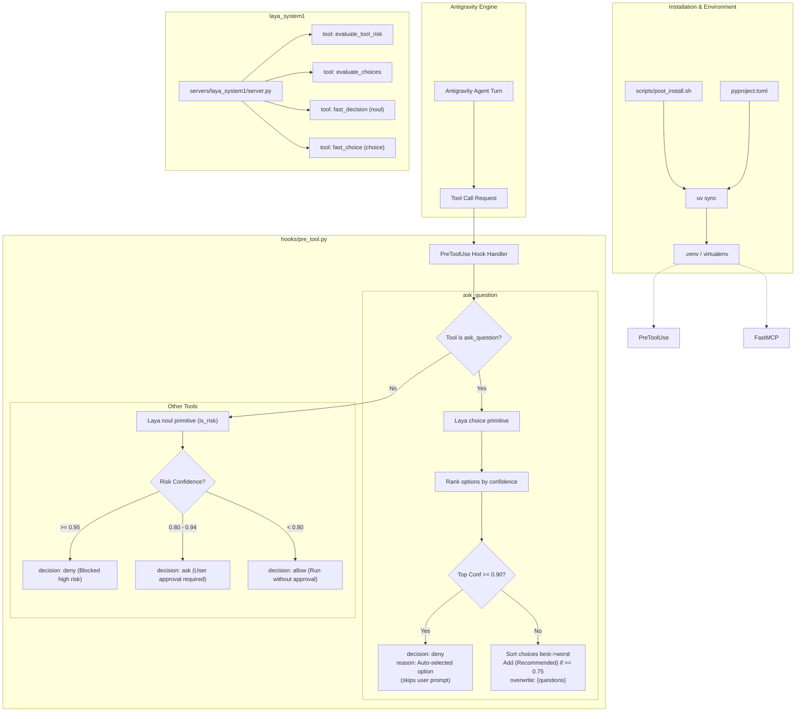

# Implementation Plan: Laya System 1 FastMCP Server, Intelligent Hooks & Post-Install Setup

Integrate the **Laya System 1** decision engine and **FastMCP** into [`gp-coding-plugin`](file:///Users/gpfister/Development/Projects/gpfister/agentic/gp-coding-plugin) alongside automated environment lifecycle management. This plan introduces:
1. **Automated Virtualenv Setup**: A `post_install` script leveraging `uv sync` to generate and manage the virtual environment (`.venv`) from `pyproject.toml`.
2. **`laya_system1` FastMCP Server**: Providing fast, non-autoregressive System 1 decision-making tools.
3. **`PreToolUse` Lifecycle Hook**:
   - Evaluates tool call risk using Laya's `noul` primitive ($\ge 0.95$ block, $0.80 \le \text{conf} < 0.95$ require user approval, $< 0.80$ auto-allow).
   - Intercepts `ask_question` using Laya's `choice` primitive ($\ge 0.90$ auto-picks without prompting user, $< 0.90$ re-ranks options and adds `(Recommended)` if $\ge 0.75$).

---

## User Review Required

> [!IMPORTANT]
> **Hook Mechanism for Auto-Picking `ask_question`:**
> Antigravity's `ask_question` tool halts agent execution to present an interactive modal to the user. When Laya achieves $\ge 0.90$ confidence on the top choice, the hook responds with:
> ```json
> {
>   "decision": "deny",
>   "reason": "Laya System 1 auto-selected: '<choice>' (confidence: 0.93 >= 0.90). Skipping user interaction."
> }
> ```
> This prevents the interactive modal from appearing to the user, and immediately passes the auto-picked answer back to the agent in the rejection reason so it can proceed without delay.

> [!NOTE]
> **Environment Lifecycle (`uv sync`):**
> All dependencies (`fastmcp`, `laya`, `pydantic`, `pytest`) are declared in `pyproject.toml`. The new `scripts/post_install.sh` runs `uv sync`, provisioning `.venv` reproducibly across installations.

---

## Proposed Architecture



---

## Proposed Changes

### Component: Packaging & Post-Install Setup (`gp-coding-plugin/`)

#### [NEW] `gp-coding-plugin/pyproject.toml`
Defines project metadata and dependencies:
```toml
[project]
name = "gp-coding-plugin"
version = "0.1.0"
description = "Antigravity coding companion plugin bundling engineering standards, clean code review, and Laya System 1 decision engine."
readme = "README.md"
requires-python = ">=3.11"
dependencies = [
    "fastmcp>=2.0.0",
    "laya>=0.4.15",
    "pydantic>=2.0.0",
]

[dependency-groups]
dev = [
    "pytest>=8.0.0",
]
```

#### [NEW] `gp-coding-plugin/scripts/post_install.sh`
Automated setup script (executable with `chmod +x`):
- Verifies `uv` is installed (providing actionable instructions if missing).
- Executes `uv sync` in the plugin directory to create/update `.venv` and install all required packages.

#### [MODIFY] `gp-coding-plugin/plugin.json`
Update manifest with post_install script reference and metadata:
```json
{
  "name": "gp-coding-plugin",
  "version": "0.1.0",
  "description": "Antigravity coding companion plugin bundling engineering standards, clean code review skills, and Laya System 1 decision engine.",
  "scripts": {
    "post_install": "scripts/post_install.sh"
  }
}
```

---

### Component: Decision Engine & MCP Server (`gp-coding-plugin/servers/laya_system1/`)

#### [NEW] `gp-coding-plugin/servers/laya_system1/engine.py`
Reusable System 1 Decision Engine:
- Wraps `laya.Router` (with fallback heuristics when offline or model weights downloading).
- Implements `evaluate_tool_risk(tool_name: str, args: dict, context: str = "") -> dict`:
  - Uses `noul` with question: *"Does executing tool '{tool_name}' with arguments {args} pose a destructive risk, irreversible change, data loss, or system instability?"*
  - Returns `{"is_risk": bool, "confidence": float, "decision": "deny" | "ask" | "allow", "reason": str}`.
- Implements `evaluate_choices(question: str, options: list[str], context: str = "") -> dict`:
  - Strips any prior `(Recommended)` labels.
  - Uses `choice` to compute probability distributions across options.
  - Sorts options descending by score.
  - Sets `auto_pick = True` if `top_conf >= 0.90`.
  - Sets `should_recommend = True` if `top_conf >= 0.75`.

#### [NEW] `gp-coding-plugin/servers/laya_system1/server.py`
FastMCP server registering `laya_system1` tools:
- `evaluate_tool_risk(tool_name: str, args: dict, context: str = "") -> dict`
- `evaluate_choices(question: str, options: list[str], context: str = "") -> dict`
- `fast_decision(statement: str, context: str = "") -> dict` (binary `noul` primitive)
- `fast_choice(instructions: str, options: list[str], context: str = "") -> dict` (multi-option `choice` primitive)

#### [MODIFY] `gp-coding-plugin/mcp_config.json`
Register `laya_system1` stdio server invoking the virtualenv python:
```json
{
  "mcpServers": {
    "laya_system1": {
      "command": ".venv/bin/python",
      "args": ["servers/laya_system1/server.py"]
    }
  }
}
```

---

### Component: Lifecycle Hooks (`gp-coding-plugin/hooks/`)

#### [NEW] `gp-coding-plugin/hooks/pre_tool.py`
Executable Python script reading `stdin` JSON payload and emitting `stdout` JSON:
1. **Intercept `ask_question`**:
   - Parses `questions` from `toolCall.args`.
   - Calls `engine.evaluate_choices(...)`.
   - If `best_confidence >= 0.90`:
     - Outputs `{"decision": "deny", "reason": "Laya System 1 auto-selected: '<choice>' (confidence: <conf:.2f> >= 0.90). Skipping user interaction."}`.
   - Else:
     - Formats ranked options with `(Recommended)` on the top option if `best_confidence >= 0.75`.
     - Outputs `{"decision": "allow", "overwrite": {"questions": updated_questions}}`.
2. **All Other Tools**:
   - Evaluates risk via `engine.evaluate_tool_risk(...)`.
   - If `is_risk` and `confidence >= 0.95`:
     - Outputs `{"decision": "deny", "reason": "Blocked by Laya System 1: High risk action detected (confidence: <conf:.2f> >= 0.95)."}`.
   - Else if `is_risk` and `confidence >= 0.80`:
     - Outputs `{"decision": "ask", "reason": "Approval required by Laya System 1: Potential risk detected (confidence: <conf:.2f>)."}`.
   - Else:
     - Outputs `{"decision": "allow"}`.

#### [MODIFY] `gp-coding-plugin/hooks.json`
Configure `PreToolUse` hook with wildcard matcher `*`:
```json
{
  "laya-system1-guard": {
    "enabled": true,
    "PreToolUse": [
      {
        "matcher": "*",
        "hooks": [
          {
            "type": "command",
            "command": ".venv/bin/python hooks/pre_tool.py",
            "timeout": 15
          }
        ]
      }
    ]
  }
}
```

---

### Component: Automated Verification & Documentation

#### [NEW] `gp-coding-plugin/tests/test_laya_system1.py`
Unit and regression tests:
- Test `scripts/post_install.sh` generates `.venv` properly.
- Test risk threshold logic ($<0.80 \to \text{allow}$, $[0.80, 0.95) \to \text{ask}$, $\ge 0.95 \to \text{deny}$).
- Test `ask_question` handling ($\ge 0.90 \to \text{auto-pick / deny with reason}$, $0.75 \le \text{conf} < 0.90 \to \text{re-rank with (Recommended)}$, $<0.75 \to \text{re-rank without recommend}$).
- Test FastMCP tool definitions and schema generation.
- Test hook execution with simulated `stdin` JSON pipelines.

#### [MODIFY] `gp-coding-plugin/README.md`
Update setup instructions with `./scripts/post_install.sh` command.

#### [MODIFY] `obsidian-vault/plugins/gp-coding-plugin.md`
Update documentation with:
- `post_install` workflow and virtual environment management.
- `laya_system1` MCP server capabilities and tool specifications.
- Hook guardrail behavior and confidence thresholds.

---

## Verification Plan

### Automated Tests
```bash
# 1. Run post_install script to sync environment
cd gp-coding-plugin && ./scripts/post_install.sh

# 2. Run test suite using the generated venv
.venv/bin/pytest tests/test_laya_system1.py -v

# 3. Test MCP server initialization
.venv/bin/python servers/laya_system1/server.py --help || .venv/bin/python -m servers.laya_system1.server --help
```

### Manual Verification
1. **Risk Gating Verification**:
   - Pipe simulated stdin with `run_command` (`rm -rf /`) into `.venv/bin/python hooks/pre_tool.py` and verify `decision: "deny"`.
   - Pipe simulated stdin with `run_command` (`git push --force`) and verify `decision: "ask"`.
   - Pipe simulated stdin with safe read commands (`ls -la`) and verify `decision: "allow"`.
2. **`ask_question` Verification**:
   - Pipe an unambiguous choice into `hooks/pre_tool.py` and verify auto-selection `decision: "deny"` when confidence $\ge 0.90$.
   - Pipe a nuanced choice and verify `decision: "allow"` with re-ranked options in `overwrite`.
