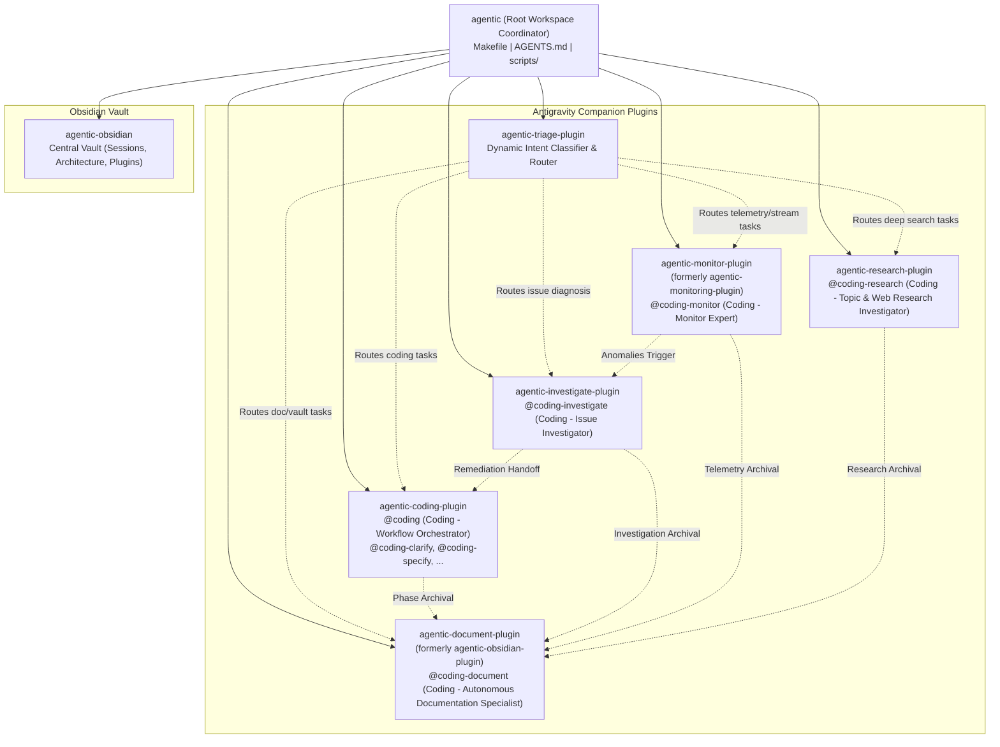

# Technical Specification: Ecosystem Agent Display Name Standardization & Dual Plugin Repository Rename

## 1. Executive Summary & Problem Motivation

### 1.1 Context
The `agentic` workspace is a coordinated multi-repository ecosystem housing specialized Google Antigravity companion plugins (`agentic-coding-plugin`, `agentic-investigate-plugin`, `agentic-monitoring-plugin`, `agentic-obsidian-plugin`, `agentic-research-plugin`, `agentic-triage-plugin`) and a centralized Obsidian knowledge vault (`agentic-obsidian`).

### 1.2 Problem Statement
Two inconsistencies currently exist across the ecosystem:
1. **Agent Display Name Inconsistency**: In chat interfaces and markdown documentation, agent display headings (`# <Title>`) lack a uniform, branded prefix, leading to inconsistent presentation across orchestrator and worker definitions.
2. **Repository Naming Mismatches**:
   - The telemetry plugin directory is named `agentic-monitoring-plugin`, while its primary worker agent is `@coding-monitor` and its remote repository was updated to `agentic-monitor-plugin`.
   - The documentation plugin directory is named `agentic-obsidian-plugin`, which causes naming confusion with the separate documentation vault repository `agentic-obsidian/`. Its primary worker is `@coding-document`, and its remote repository was updated to `agentic-document-plugin`.

### 1.3 Scope of Changes
This specification defines:
- Standardizing all agent markdown display titles to prepend `"Coding - "` while preserving frontmatter `name: <handle>` identifiers for 100% backward compatibility.
- Renaming the local directories `agentic-monitoring-plugin/` to `agentic-monitor-plugin/` and `agentic-obsidian-plugin/` to `agentic-document-plugin/`.
- Updating Git remote origin URLs to match their respective GitHub remotes (`git@github.com:gpfister/agentic-monitor-plugin.git` and `git@github.com:gpfister/agentic-document-plugin.git`).
- Updating root workspace configuration files (`Makefile`, `.gitignore`, `AGENTS.md`, `README.md`).
- Updating plugin manifests (`plugin.json`), project metadata (`pyproject.toml`), documentation, rules, and cross-plugin references across the ecosystem.
- Preserving the `agentic-obsidian/` vault directory without changes.

---

## 2. Functional Requirements

### 2.1 Agent Display Name Standardization
All agent markdown definitions across the ecosystem must have their top-level `# <Title>` heading prefixed with `"Coding - "`. 

> [!IMPORTANT]
> The YAML frontmatter property `name: <handle>` MUST NOT be modified under any circumstances. Preserving the exact handle guarantees that subagent dispatching, `send_message`, `@coding-*` invocations, and tool routing mechanisms remain completely intact.

#### Agent Title & Identifier Mapping Matrix

| Agent Type | File Path | Current Title | Required Display Title (`#`) | YAML Handle (`name:`) |
| :--- | :--- | :--- | :--- | :--- |
| **Orchestrator** | `agentic-coding-plugin/agents/coding.md` | `# Workflow Orchestrator` | `# Coding - Workflow Orchestrator` | `coding` *(Preserved)* |
| **Worker** | `agentic-coding-plugin/agents/coding-clarify.md` | `# Requirement Clarifier` | `# Coding - Requirement Clarifier` | `coding-clarify` *(Preserved)* |
| **Worker** | `agentic-coding-plugin/agents/coding-specify.md` | `# Specification Architect` | `# Coding - Specification Architect` | `coding-specify` *(Preserved)* |
| **Worker** | `agentic-coding-plugin/agents/coding-plan.md` | `# Architecture Planner` | `# Coding - Architecture Planner` | `coding-plan` *(Preserved)* |
| **Worker** | `agentic-coding-plugin/agents/coding-develop.md` | `# Software Engineer` | `# Coding - Software Engineer` | `coding-develop` *(Preserved)* |
| **Worker** | `agentic-coding-plugin/agents/coding-review.md` | `# Quality Assurance Lead` | `# Coding - Quality Assurance Lead` | `coding-review` *(Preserved)* |
| **Worker** | `agentic-coding-plugin/agents/coding-merge.md` | `# Release Engineer` | `# Coding - Release Engineer` | `coding-merge` *(Preserved)* |
| **Worker** | `agentic-monitor-plugin/agents/coding-monitor.md` | `# Monitor Expert` | `# Coding - Monitor Expert` | `coding-monitor` *(Preserved)* |
| **Worker** | `agentic-investigate-plugin/agents/coding-investigate.md` | `# Issue Investigator` | `# Coding - Issue Investigator` | `coding-investigate` *(Preserved)* |
| **Worker** | `agentic-document-plugin/agents/coding-document.md` | `# Autonomous Documentation Specialist` | `# Coding - Autonomous Documentation Specialist` | `coding-document` *(Preserved)* |
| **Worker** | `agentic-research-plugin/agents/coding-research.md` | `# Topic & Web Research Investigator` | `# Coding - Topic & Web Research Investigator` | `coding-research` *(Preserved)* |
| **Catalog** | `agentic-coding-plugin/agents/coding-catalog.md` | `# Coding Catalog` | `# Coding - Catalog` | `coding-catalog` *(Preserved)* |
| **Catalog** | `agentic-investigate-plugin/agents/coding-investigate-catalog.md` | `# Investigate Catalog` | `# Coding - Investigate Catalog` | `coding-investigate-catalog` *(Preserved)* |
| **Catalog** | `agentic-monitor-plugin/agents/coding-monitor-catalog.md` | `# Monitor Catalog` | `# Coding - Monitor Catalog` | `coding-monitor-catalog` *(Preserved)* |
| **Catalog** | `agentic-document-plugin/agents/coding-document-catalog.md` | `# Document Catalog` | `# Coding - Document Catalog` | `coding-document-catalog` *(Preserved)* |
| **Catalog** | `agentic-research-plugin/agents/coding-research-catalog.md` | `# Research Catalog` | `# Coding - Research Catalog` | `coding-research-catalog` *(Preserved)* |

### 2.2 Dual Repository & Directory Rename

#### 2.2.1 Directory Operations
- Rename workspace directory `agentic-monitoring-plugin/` to `agentic-monitor-plugin/`.
- Rename workspace directory `agentic-obsidian-plugin/` to `agentic-document-plugin/`.
- The vault repository directory `agentic-obsidian/` remains strictly unchanged.

#### 2.2.2 Git Remote Origin URLs
Update the Git remotes in each repository's `.git/config`:
- `agentic-monitor-plugin/.git/config`: Set remote `origin` to `git@github.com:gpfister/agentic-monitor-plugin.git`.
- `agentic-document-plugin/.git/config`: Set remote `origin` to `git@github.com:gpfister/agentic-document-plugin.git`.

#### 2.2.3 Plugin Manifests & Metadata
- In `agentic-monitor-plugin/plugin.json`:
  - `"name"`: `"agentic-monitor-plugin"`
- In `agentic-document-plugin/plugin.json`:
  - `"name"`: `"agentic-document-plugin"`
- Update `pyproject.toml` (if present) and README references in both repositories.

### 2.3 Workspace Orchestration Updates

#### 2.3.1 Workspace `Makefile`
Update the sub-repository list in [Makefile](file:///Users/gpfister/Development/Projects/gpfister/agentic/Makefile):
```makefile
REPOS := agentic-coding-plugin agentic-document-plugin agentic-investigate-plugin agentic-monitor-plugin agentic-obsidian agentic-research-plugin agentic-triage-plugin
```

#### 2.3.2 Workspace `.gitignore`
Update [.gitignore](file:///Users/gpfister/Development/Projects/gpfister/agentic/.gitignore) to ignore the renamed sub-repositories:
- Replace `agentic-monitoring-plugin` with `agentic-monitor-plugin`
- Replace `agentic-obsidian-plugin` with `agentic-document-plugin`

#### 2.3.3 Workspace `AGENTS.md` & `README.md`
- Update the workspace directory tree and catalog table in [AGENTS.md](file:///Users/gpfister/Development/Projects/gpfister/agentic/AGENTS.md) and [README.md](file:///Users/gpfister/Development/Projects/gpfister/agentic/README.md).
- Reflect the new repository names in cross-plugin delegation tables and skill paths.

### 2.4 Cross-Plugin Rule & Skill References
- In `agentic-triage-plugin`:
  - Update `hooks/pre_invocation_triage.py` and `rules/AGENTS.md` to reference `agentic-monitor-plugin` and `agentic-document-plugin`.
- In `agentic-coding-plugin`, `agentic-investigate-plugin`, and `agentic-research-plugin`:
  - Update rules (`rules/AGENTS.md`) and documentation cross-references to point to `agentic-monitor-plugin` and `agentic-document-plugin`.

---

## 3. Non-Functional Requirements

### 3.1 Backward Compatibility
- Subagent dispatching in Antigravity relies on the YAML frontmatter `name` attribute. No tool call breakage can occur because all handles remain invariant.
- Existing user prompts referencing `@coding-monitor`, `@coding-document`, `@coding`, etc., continue to function without modification.

### 3.2 Git Synchronization & Workflow Hygiene
- Running `make status`, `make sync`, `make pull`, and `make push` from the root workspace must succeed cleanly across all seven sub-repositories without orphan directory errors.
- Both renamed sub-repositories must have clean git worktrees with updated remotes pointing to their corresponding GitHub repositories.

### 3.3 Documentation Traceability
- All documentation notes in `agentic-obsidian/` referencing the renamed plugins must retain valid relative paths and clickable `file://` links.

---

## 4. Architecture & Workspace Topology



---

## 5. File Modification Matrix

| Target Repository / Path | File | Modification Summary |
| :--- | :--- | :--- |
| **Root Workspace** | [Makefile](file:///Users/gpfister/Development/Projects/gpfister/agentic/Makefile) | Update `REPOS` list to include `agentic-document-plugin` and `agentic-monitor-plugin`. |
| **Root Workspace** | [.gitignore](file:///Users/gpfister/Development/Projects/gpfister/agentic/.gitignore) | Replace ignored entries with `agentic-document-plugin` and `agentic-monitor-plugin`. |
| **Root Workspace** | [AGENTS.md](file:///Users/gpfister/Development/Projects/gpfister/agentic/AGENTS.md) | Update repo tree, cross-plugin table, and catalog references. |
| **Root Workspace** | [README.md](file:///Users/gpfister/Development/Projects/gpfister/agentic/README.md) | Update workspace overview and repository links. |
| **agentic-coding-plugin** | `agents/coding.md` | Display title -> `# Coding - Workflow Orchestrator` |
| **agentic-coding-plugin** | `agents/coding-clarify.md` | Display title -> `# Coding - Requirement Clarifier` |
| **agentic-coding-plugin** | `agents/coding-specify.md` | Display title -> `# Coding - Specification Architect` |
| **agentic-coding-plugin** | `agents/coding-plan.md` | Display title -> `# Coding - Architecture Planner` |
| **agentic-coding-plugin** | `agents/coding-develop.md` | Display title -> `# Coding - Software Engineer` |
| **agentic-coding-plugin** | `agents/coding-review.md` | Display title -> `# Coding - Quality Assurance Lead` |
| **agentic-coding-plugin** | `agents/coding-merge.md` | Display title -> `# Coding - Release Engineer` |
| **agentic-coding-plugin** | `agents/coding-catalog.md` | Display title -> `# Coding - Catalog` |
| **agentic-coding-plugin** | `rules/AGENTS.md` | Update cross-plugin companion names (`agentic-document-plugin`, `agentic-monitor-plugin`). |
| **agentic-monitor-plugin** | `Directory rename` | `agentic-monitoring-plugin/` -> `agentic-monitor-plugin/` |
| **agentic-monitor-plugin** | `.git/config` | Origin remote URL -> `git@github.com:gpfister/agentic-monitor-plugin.git` |
| **agentic-monitor-plugin** | `plugin.json` | Name -> `"agentic-monitor-plugin"` |
| **agentic-monitor-plugin** | `agents/coding-monitor.md` | Display title -> `# Coding - Monitor Expert` |
| **agentic-monitor-plugin** | `agents/coding-monitor-catalog.md` | Display title -> `# Coding - Monitor Catalog` |
| **agentic-monitor-plugin** | `rules/AGENTS.md`, `README.md` | Update self-references and companion references. |
| **agentic-document-plugin** | `Directory rename` | `agentic-obsidian-plugin/` -> `agentic-document-plugin/` |
| **agentic-document-plugin** | `.git/config` | Origin remote URL -> `git@github.com:gpfister/agentic-document-plugin.git` |
| **agentic-document-plugin** | `plugin.json` | Name -> `"agentic-document-plugin"` |
| **agentic-document-plugin** | `agents/coding-document.md` | Display title -> `# Coding - Autonomous Documentation Specialist` |
| **agentic-document-plugin** | `agents/coding-document-catalog.md` | Display title -> `# Coding - Document Catalog` |
| **agentic-document-plugin** | `rules/AGENTS.md`, `README.md` | Update self-references and companion references. |
| **agentic-investigate-plugin** | `agents/coding-investigate.md` | Display title -> `# Coding - Issue Investigator` |
| **agentic-investigate-plugin** | `agents/coding-investigate-catalog.md` | Display title -> `# Coding - Investigate Catalog` |
| **agentic-investigate-plugin** | `rules/AGENTS.md`, `README.md` | Update references to companion plugins. |
| **agentic-research-plugin** | `agents/coding-research.md` | Display title -> `# Coding - Topic & Web Research Investigator` |
| **agentic-research-plugin** | `agents/coding-research-catalog.md` | Display title -> `# Coding - Research Catalog` |
| **agentic-research-plugin** | `rules/AGENTS.md`, `README.md` | Update references to companion plugins. |
| **agentic-triage-plugin** | `hooks/pre_invocation_triage.py` | Update plugin folder detection and routing candidates. |
| **agentic-triage-plugin** | `rules/AGENTS.md`, `README.md` | Update plugin names in triage routing definitions. |
| **agentic-obsidian** | `plugins/agentic-*.md` | Update vault plugin documentation notes for renamed plugins. |

---

## 6. Migration & Execution Protocol

### Step 1: Directory Renaming
Execute filesystem moves at root:
```bash
mv agentic-monitoring-plugin agentic-monitor-plugin
mv agentic-obsidian-plugin agentic-document-plugin
```

### Step 2: Git Remote Configuration
Update git origin URLs for both moved repos:
```bash
git -C agentic-monitor-plugin remote set-url origin git@github.com:gpfister/agentic-monitor-plugin.git
git -C agentic-document-plugin remote set-url origin git@github.com:gpfister/agentic-document-plugin.git
```

### Step 3: Plugin Manifests & Manifest References
- Update `"name": "agentic-monitor-plugin"` in [plugin.json](file:///Users/gpfister/Development/Projects/gpfister/agentic/agentic-monitor-plugin/plugin.json).
- Update `"name": "agentic-document-plugin"` in [plugin.json](file:///Users/gpfister/Development/Projects/gpfister/agentic/agentic-document-plugin/plugin.json).

### Step 4: Display Title Updates Across All Agents
Update `# <Title>` in each target agent markdown file while maintaining `name: <handle>` in YAML frontmatter.

### Step 5: Root Workspace Configuration
Update [Makefile](file:///Users/gpfister/Development/Projects/gpfister/agentic/Makefile), [.gitignore](file:///Users/gpfister/Development/Projects/gpfister/agentic/.gitignore), [AGENTS.md](file:///Users/gpfister/Development/Projects/gpfister/agentic/AGENTS.md), and [README.md](file:///Users/gpfister/Development/Projects/gpfister/agentic/README.md).

### Step 6: Cross-Plugin References & Triage Router
Update cross-plugin documentation rules and `pre_invocation_triage.py` to ensure dynamic routing recognizes the renamed directories.

---

## 7. Verifiable Acceptance Criteria

- [ ] **AC-1 (Directory Layout)**: `ls -d agentic-monitor-plugin agentic-document-plugin` resolves successfully; old paths no longer exist.
- [ ] **AC-2 (Git Remotes)**:
  - `git -C agentic-monitor-plugin remote get-url origin` returns `git@github.com:gpfister/agentic-monitor-plugin.git`.
  - `git -C agentic-document-plugin remote get-url origin` returns `git@github.com:gpfister/agentic-document-plugin.git`.
- [ ] **AC-3 (Agent Display Titles)**: All 16 agent definitions (orchestrators, workers, and catalogs) have `# Coding - <Title>` as their first Markdown heading.
- [ ] **AC-4 (Handle Invariance)**: In all 16 agent definitions, `name:` in frontmatter remains unmodified (e.g., `name: coding`, `name: coding-monitor`, `name: coding-document`).
- [ ] **AC-5 (Root Make Integration)**: Running `make status` from workspace root executes cleanly across all 7 repositories (`agentic-coding-plugin`, `agentic-document-plugin`, `agentic-investigate-plugin`, `agentic-monitor-plugin`, `agentic-obsidian`, `agentic-research-plugin`, `agentic-triage-plugin`).
- [ ] **AC-6 (Vault Preservation)**: `agentic-obsidian/` directory and its git tracking remain untouched.
- [ ] **AC-7 (Triage Router)**: Dynamic triage script successfully detects `agentic-monitor-plugin` and `agentic-document-plugin` and routes intents accurately.
