# Implementation Plan: AC-8 Remediation & Stale Plugin References

**Specification Reference**: `SPEC-2026-PLUGIN-RENAME-001` (Acceptance Criterion AC-8 Remediation)  
**Target Git Branch Conventions**: `bugfix/<issue-name>` across 5 sub-repositories  
**Execution Strategy**: Multi-repository isolated development and verification  

---

## 1. Overview & Root Cause Analysis

The QA review for `SPEC-2026-PLUGIN-RENAME-001` identified discrepancies against AC-8:

1. **Critical Runtime Defect in [agentic-prompt-triage-plugin](file:///Users/gpfister/Development/Projects/gpfister/agentic/agentic-prompt-triage-plugin)**:
   - `hooks/prompt_triage.py` defines `PRIMARY_PLUGINS` with legacy plugin names (`agentic-investigate-plugin`, `agentic-monitor-plugin`, `agentic-document-plugin`, `agentic-research-plugin`).
   - As a consequence, dynamic directory detection evaluates to `False` when the new renamed plugin folders are present, causing `build_dynamic_triage_spec()` to omit routing capabilities for installed plugins.
   - **Remediation**: Update `PRIMARY_PLUGINS` to use official renamed plugin names, introduce `LEGACY_PLUGIN_ALIASES` to maintain full backwards compatibility for environments still referencing legacy names, and update corresponding tests and documentation.

2. **Stale Cross-Plugin References Across Companion Plugins**:
   - `agentic-project-documenting-plugin`: Stale references to `agentic-investigate-plugin`, `agentic-monitor-plugin`, `agentic-research-plugin`.
   - `agentic-issue-investigation-plugin`: Stale references to `agentic-document-plugin`.
   - `agentic-task-monitoring-plugin`: Stale references to `agentic-investigate-plugin` and `agentic-document-plugin`.
   - `agentic-topic-researching-plugin`: Stale references to `agentic-document-plugin`.

---

## 2. Multi-Repository Work Breakdown & Git Topology

```mermaid
flowchart TD
    PlanApproved(["Plan Approved (AC-8)"]) --> ParallelDev["coding-develop (Parallel Branch Execution)"]

    subgraph Repo1 ["agentic-prompt-triage-plugin"]
        B1["Branch: bugfix/prompt-triage-plugin-detection"]
        F1["Update hooks/prompt_triage.py<br/>PRIMARY_PLUGINS & LEGACY_PLUGIN_ALIASES"]
        T1["Update tests/test_prompt_triage.py & tests/test_plugin.py"]
        D1["Update README.md & rules/AGENTS.md"]
        B1 --> F1 --> T1 --> D1
    end

    subgraph Repo2 ["agentic-project-documenting-plugin"]
        B2["Branch: bugfix/documenting-stale-references"]
        F2["Update README.md, rules/AGENTS.md, skills/coding-document/SKILL.md"]
        B2 --> F2
    end

    subgraph Repo3 ["agentic-issue-investigation-plugin"]
        B3["Branch: bugfix/investigation-stale-references"]
        F3["Update README.md, rules/AGENTS.md, agent manifests & tests/test_plugin.py"]
        B3 --> F3
    end

    subgraph Repo4 ["agentic-task-monitoring-plugin"]
        B4["Branch: bugfix/monitoring-stale-references"]
        F4["Update README.md, rules/AGENTS.md, agent manifests & skills/coding-monitor/SKILL.md"]
        B4 --> F4
    end

    subgraph Repo5 ["agentic-topic-researching-plugin"]
        B5["Branch: bugfix/researching-stale-references"]
        F5["Update README.md, rules/AGENTS.md, agent manifests & tests/test_plugin.py"]
        B5 --> F5
    end

    ParallelDev --> Repo1
    ParallelDev --> Repo2
    ParallelDev --> Repo3
    ParallelDev --> Repo4
    ParallelDev --> Repo5

    Repo1 --> Review["coding-review (Verification & Zero-Stale-Match Audit)"]
    Repo2 --> Review
    Repo3 --> Review
    Repo4 --> Review
    Repo5 --> Review
```



---

## 3. Concrete Work Breakdown per Repository

### Work Item 1: `agentic-prompt-triage-plugin`
- **Git Branch**: `bugfix/prompt-triage-plugin-detection`
- **Location**: [`/agentic-prompt-triage-plugin/`](file:///Users/gpfister/Development/Projects/gpfister/agentic/agentic-prompt-triage-plugin/)
- **Files to Modify**:
  - [`hooks/prompt_triage.py`](file:///Users/gpfister/Development/Projects/gpfister/agentic/agentic-prompt-triage-plugin/hooks/prompt_triage.py):
    - Update `PRIMARY_PLUGINS` dictionary / set:
      - `agentic-coding-plugin` (unchanged)
      - `agentic-issue-investigation-plugin` (was `agentic-investigate-plugin`)
      - `agentic-project-documenting-plugin` (was `agentic-document-plugin`)
      - `agentic-project-grooming-plugin` (unchanged)
      - `agentic-task-monitoring-plugin` (was `agentic-monitor-plugin`)
      - `agentic-topic-researching-plugin` (was `agentic-research-plugin`)
    - Introduce `LEGACY_PLUGIN_ALIASES`:
      ```python
      LEGACY_PLUGIN_ALIASES = {
          "agentic-investigate-plugin": "agentic-issue-investigation-plugin",
          "agentic-monitor-plugin": "agentic-task-monitoring-plugin",
          "agentic-document-plugin": "agentic-project-documenting-plugin",
          "agentic-obsidian-plugin": "agentic-project-documenting-plugin",
          "agentic-research-plugin": "agentic-topic-researching-plugin",
      }
      ```
    - Update plugin detection logic to inspect canonical names and resolve aliases so installed plugins are detected under either naming convention.
    - Ensure `build_dynamic_triage_spec()` sets capability flags (`coding`, `issue_investigation`, `task_monitoring`, `project_grooming`, `topic_research`, `documenting`) accurately based on canonical plugin resolution.
  - [`tests/test_prompt_triage.py`](file:///Users/gpfister/Development/Projects/gpfister/agentic/agentic-prompt-triage-plugin/tests/test_prompt_triage.py):
    - Add test cases verifying dynamic detection with new canonical names.
    - Add test cases verifying backwards compatibility via legacy aliases.
    - Assert proper dynamic prompt generation and schema evaluation.
  - [`tests/test_plugin.py`](file:///Users/gpfister/Development/Projects/gpfister/agentic/agentic-prompt-triage-plugin/tests/test_plugin.py):
    - Update test fixtures or assertions that refer to old plugin names.
  - [`README.md`](file:///Users/gpfister/Development/Projects/gpfister/agentic/agentic-prompt-triage-plugin/README.md):
    - Update companion plugin routing tables and directory listings.
  - [`rules/AGENTS.md`](file:///Users/gpfister/Development/Projects/gpfister/agentic/agentic-prompt-triage-plugin/rules/AGENTS.md):
    - Update plugin naming references in the triage rules.
- **Verification Commands**:
  ```bash
  cd agentic-prompt-triage-plugin
  pytest tests/ -v
  python3 -m unittest discover tests/
  ```

---

## 4. Concrete Work Breakdown per Repository (Stale References)

### Work Item 2: `agentic-project-documenting-plugin`
- **Git Branch**: `bugfix/documenting-stale-references`
- **Location**: [`/agentic-project-documenting-plugin/`](file:///Users/gpfister/Development/Projects/gpfister/agentic/agentic-project-documenting-plugin/)
- **Files to Modify**:
  - [`README.md`](file:///Users/gpfister/Development/Projects/gpfister/agentic/agentic-project-documenting-plugin/README.md): Replace occurrences of `agentic-investigate-plugin`, `agentic-monitor-plugin`, `agentic-research-plugin` with their new names.
  - [`rules/AGENTS.md`](file:///Users/gpfister/Development/Projects/gpfister/agentic/agentic-project-documenting-plugin/rules/AGENTS.md): Replace stale companion plugin references.
  - [`skills/coding-document/SKILL.md`](file:///Users/gpfister/Development/Projects/gpfister/agentic/agentic-project-documenting-plugin/skills/coding-document/SKILL.md): Update workflow trigger sections and companion plugin mentions.
- **Verification Commands**:
  ```bash
  cd agentic-project-documenting-plugin
  ! git grep -E "agentic-investigate-plugin|agentic-monitor-plugin|agentic-research-plugin"
  ```

---

### Work Item 3: `agentic-issue-investigation-plugin`
- **Git Branch**: `bugfix/investigation-stale-references`
- **Location**: [`/agentic-issue-investigation-plugin/`](file:///Users/gpfister/Development/Projects/gpfister/agentic/agentic-issue-investigation-plugin/)
- **Files to Modify**:
  - [`README.md`](file:///Users/gpfister/Development/Projects/gpfister/agentic/agentic-issue-investigation-plugin/README.md): Update `agentic-document-plugin` -> `agentic-project-documenting-plugin`.
  - [`rules/AGENTS.md`](file:///Users/gpfister/Development/Projects/gpfister/agentic/agentic-issue-investigation-plugin/rules/AGENTS.md): Update Section 4 (`agentic-document-plugin` -> `agentic-project-documenting-plugin`).
  - [`agents/agent.md`](file:///Users/gpfister/Development/Projects/gpfister/agentic/agentic-issue-investigation-plugin/agents/agent.md): Update document plugin companion reference.
  - [`agents/coding-investigate/agent.md`](file:///Users/gpfister/Development/Projects/gpfister/agentic/agentic-issue-investigation-plugin/agents/coding-investigate/agent.md): Update document plugin companion reference.
  - [`skills/coding-investigate/SKILL.md`](file:///Users/gpfister/Development/Projects/gpfister/agentic/agentic-issue-investigation-plugin/skills/coding-investigate/SKILL.md): Update companion reference.
  - [`tests/test_plugin.py`](file:///Users/gpfister/Development/Projects/gpfister/agentic/agentic-issue-investigation-plugin/tests/test_plugin.py): Update test fixtures/assertions referencing old names.
- **Verification Commands**:
  ```bash
  cd agentic-issue-investigation-plugin
  pytest tests/ -v
  ! git grep -E "agentic-document-plugin|agentic-monitor-plugin|agentic-research-plugin"
  ```

---

### Work Item 4: `agentic-task-monitoring-plugin`
- **Git Branch**: `bugfix/monitoring-stale-references`
- **Location**: [`/agentic-task-monitoring-plugin/`](file:///Users/gpfister/Development/Projects/gpfister/agentic/agentic-task-monitoring-plugin/)
- **Files to Modify**:
  - [`README.md`](file:///Users/gpfister/Development/Projects/gpfister/agentic/agentic-task-monitoring-plugin/README.md): Update `agentic-investigate-plugin` -> `agentic-issue-investigation-plugin`, `agentic-document-plugin` -> `agentic-project-documenting-plugin`.
  - [`rules/AGENTS.md`](file:///Users/gpfister/Development/Projects/gpfister/agentic/agentic-task-monitoring-plugin/rules/AGENTS.md): Update companion references in pause gate and doc archival sections.
  - [`agents/agent.md`](file:///Users/gpfister/Development/Projects/gpfister/agentic/agentic-task-monitoring-plugin/agents/agent.md): Update companion references.
  - [`agents/coding-monitor/agent.md`](file:///Users/gpfister/Development/Projects/gpfister/agentic/agentic-task-monitoring-plugin/agents/coding-monitor/agent.md): Update companion references.
  - [`skills/coding-monitor/SKILL.md`](file:///Users/gpfister/Development/Projects/gpfister/agentic/agentic-task-monitoring-plugin/skills/coding-monitor/SKILL.md): Update companion references.
- **Verification Commands**:
  ```bash
  cd agentic-task-monitoring-plugin
  ! git grep -E "agentic-investigate-plugin|agentic-document-plugin|agentic-research-plugin"
  ```

---

### Work Item 5: `agentic-topic-researching-plugin`
- **Git Branch**: `bugfix/researching-stale-references`
- **Location**: [`/agentic-topic-researching-plugin/`](file:///Users/gpfister/Development/Projects/gpfister/agentic/agentic-topic-researching-plugin/)
- **Files to Modify**:
  - [`README.md`](file:///Users/gpfister/Development/Projects/gpfister/agentic/agentic-topic-researching-plugin/README.md): Update `agentic-document-plugin` -> `agentic-project-documenting-plugin`.
  - [`rules/AGENTS.md`](file:///Users/gpfister/Development/Projects/gpfister/agentic/agentic-topic-researching-plugin/rules/AGENTS.md): Update Section 4 document plugin reference.
  - [`agents/agent.md`](file:///Users/gpfister/Development/Projects/gpfister/agentic/agentic-topic-researching-plugin/agents/agent.md): Update companion references.
  - [`agents/coding-research/agent.md`](file:///Users/gpfister/Development/Projects/gpfister/agentic/agentic-topic-researching-plugin/agents/coding-research/agent.md): Update companion references.
  - [`skills/coding-research/SKILL.md`](file:///Users/gpfister/Development/Projects/gpfister/agentic/agentic-topic-researching-plugin/skills/coding-research/SKILL.md): Update companion references.
  - [`tests/test_plugin.py`](file:///Users/gpfister/Development/Projects/gpfister/agentic/agentic-topic-researching-plugin/tests/test_plugin.py): Update test fixtures/assertions referencing old names.
- **Verification Commands**:
  ```bash
  cd agentic-topic-researching-plugin
  pytest tests/ -v
  ! git grep -E "agentic-document-plugin|agentic-investigate-plugin|agentic-monitor-plugin"
  ```

---

## 5. Phase Verification & Acceptance Criteria Matrix

| Criterion | Target Repository | Verification Command | Expected Outcome |
| :--- | :--- | :--- | :--- |
| **AC-8.1** | `agentic-prompt-triage-plugin` | `pytest tests/test_prompt_triage.py` | New plugin names correctly detected; triage spec properly enables corresponding handlers. |
| **AC-8.2** | `agentic-prompt-triage-plugin` | `pytest tests/test_prompt_triage.py -k test_legacy` | Legacy aliases map cleanly to canonical names without degradation. |
| **AC-8.3** | `agentic-project-documenting-plugin` | `git grep -E "agentic-(investigate|monitor|research)-plugin"` | 0 matches found across docstrings, rules, and markdown. |
| **AC-8.4** | `agentic-issue-investigation-plugin` | `git grep -E "agentic-(document|monitor|research)-plugin"` | 0 matches found across manifests, agents, rules, and tests. |
| **AC-8.5** | `agentic-task-monitoring-plugin` | `git grep -E "agentic-(investigate|document|research)-plugin"` | 0 matches found across manifests, agents, rules, and tests. |
| **AC-8.6** | `agentic-topic-researching-plugin` | `git grep -E "agentic-(document|investigate|monitor)-plugin"` | 0 matches found across manifests, agents, rules, and tests. |
| **AC-8.7** | Workspace-wide Test Suites | `pytest` across all updated plugin test suites | 100% test pass rate with zero regressions. |

---

## 6. Next Steps

Upon approval of this implementation plan, the workflow advances to **Phase 4: Development (`@coding-develop`)** to checkout the respective branches, implement the changes, and verify all test suites.
