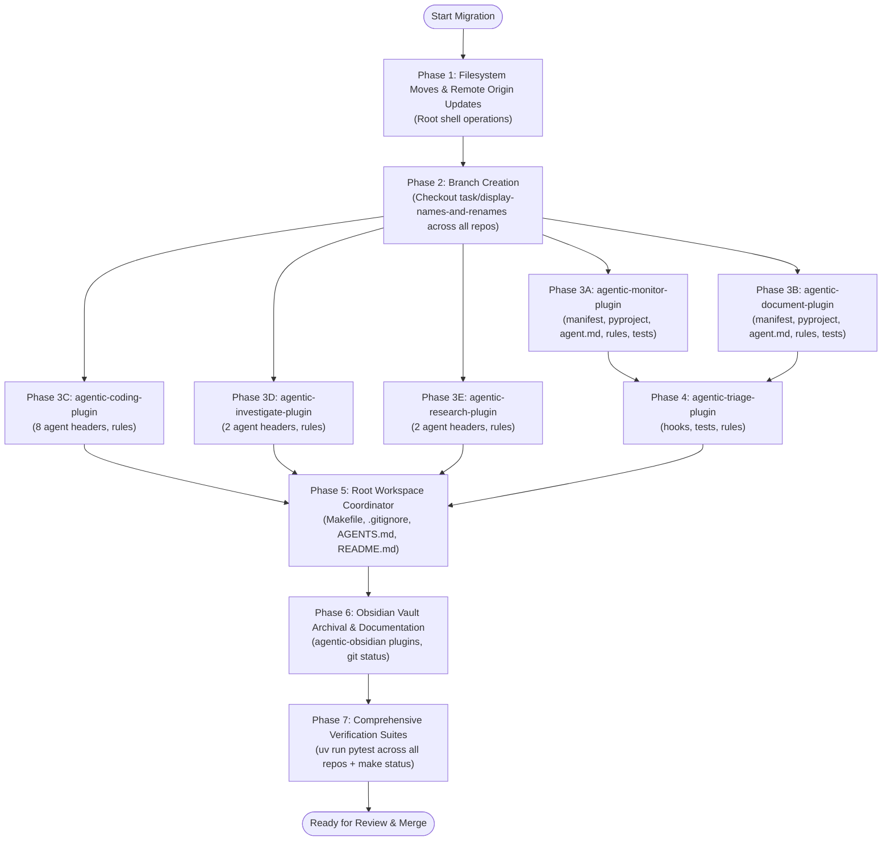

# Implementation Plan: Ecosystem Agent Display Name Standardization & Dual Plugin Repository Rename

> [!NOTE]
> **Specification Reference**: Approved Specification at [`specification.md`](file:///Users/gpfister/.gemini/antigravity/brain/2b726f54-496d-4a46-8461-49d0a86efe79/specification.md)  
> **Vault Feature Note**: [[features/agent-display-names-and-plugin-renames|Agent Display Names & Plugin Renames]]  
> **Architecture Decision Record**: [[architecture/adr-002-agent-display-names-and-plugin-renames|ADR-002: Agent Display Names & Dual Plugin Repository Rename]]

---

## 1. Plan Overview & Objectives

This implementation plan defines the ordered execution strategy to:
1. **Standardize Agent UI Display Headings**: Prepend `"Coding - "` to all top-level Markdown headers (`# <Title>`) across 16 agent definition files while strictly preserving YAML frontmatter `name: <handle>` keys for zero disruption to agent tool dispatching.
2. **Execute Dual Repository & Directory Renames**:
   - `agentic-monitoring-plugin/` $\rightarrow$ `agentic-monitor-plugin/`
   - `agentic-obsidian-plugin/` $\rightarrow$ `agentic-document-plugin/`
3. **Synchronize Git Remote Origins**:
   - `agentic-monitor-plugin/.git/config` $\rightarrow$ `git@github.com:gpfister/agentic-monitor-plugin.git`
   - `agentic-document-plugin/.git/config` $\rightarrow$ `git@github.com:gpfister/agentic-document-plugin.git`
4. **Update Workspace Root Orchestration**:
   - Root [Makefile](file:///Users/gpfister/Development/Projects/gpfister/agentic/Makefile) (`REPOS` list)
   - Root [.gitignore](file:///Users/gpfister/Development/Projects/gpfister/agentic/.gitignore) (sub-repo ignores)
   - Root [AGENTS.md](file:///Users/gpfister/Development/Projects/gpfister/agentic/AGENTS.md) and [README.md](file:///Users/gpfister/Development/Projects/gpfister/agentic/README.md)
5. **Update Cross-Plugin Rules, Triage, and Documentation**:
   - Update `agentic-triage-plugin` detection hooks and tests.
   - Update rules and documentation across companion plugins and the `agentic-obsidian` vault.

---

## 2. Git Branch Strategy & Worktree Isolation

All repositories will branch from their current clean `master` head:

| Repository | Current Branch | New Working Branch | Conventional Type |
| :--- | :--- | :--- | :--- |
| **Root (`agentic`)** | `master` | `task/display-names-and-renames` | Refactor / Task |
| **`agentic-monitor-plugin`** | `master` | `task/display-names-and-renames` | Refactor / Task |
| **`agentic-document-plugin`** | `master` | `task/display-names-and-renames` | Refactor / Task |
| **`agentic-coding-plugin`** | `master` | `task/display-names-and-renames` | Refactor / Task |
| **`agentic-investigate-plugin`** | `master` | `task/display-names-and-renames` | Refactor / Task |
| **`agentic-research-plugin`** | `master` | `task/display-names-and-renames` | Refactor / Task |
| **`agentic-triage-plugin`** | `master` | `task/display-names-and-renames` | Refactor / Task |
| **`agentic-obsidian`** | `master` | `task/display-names-and-renames` | Documentation / Task |

---

## 3. Execution Dependency Flowchart



---

## 4. Detailed Multi-Repo Work Breakdown

### Phase 1: Directory Renames & Git Remotes (Root Workspace)
Execute the initial physical directory renames and remote URL updates from the workspace root:

```bash
# 1. Directory renames
mv agentic-monitoring-plugin agentic-monitor-plugin
mv agentic-obsidian-plugin agentic-document-plugin

# 2. Update Git remote origins
git -C agentic-monitor-plugin remote set-url origin git@github.com:gpfister/agentic-monitor-plugin.git
git -C agentic-document-plugin remote set-url origin git@github.com:gpfister/agentic-document-plugin.git
```

- **Verification Command**:
  ```bash
  test -d agentic-monitor-plugin && test -d agentic-document-plugin && \
  git -C agentic-monitor-plugin remote get-url origin | grep -q "agentic-monitor-plugin" && \
  git -C agentic-document-plugin remote get-url origin | grep -q "agentic-document-plugin"
  ```

---

### Phase 2: Working Branch Initialization
Create and checkout the task branch across all 8 repositories:

```bash
git checkout -b task/display-names-and-renames
for repo in agentic-coding-plugin agentic-document-plugin agentic-investigate-plugin agentic-monitor-plugin agentic-obsidian agentic-research-plugin agentic-triage-plugin; do
    git -C "$repo" checkout -b task/display-names-and-renames
done
```

---

### Phase 3: Plugin-Specific Implementations

#### 3.1 Repository: `agentic-monitor-plugin`
- **Branch**: `task/display-names-and-renames`
- **Files to Modify**:
  1. [`plugin.json`](file:///Users/gpfister/Development/Projects/gpfister/agentic/agentic-monitor-plugin/plugin.json):
     - Update `"name": "agentic-monitor-plugin"`
  2. [`pyproject.toml`](file:///Users/gpfister/Development/Projects/gpfister/agentic/agentic-monitor-plugin/pyproject.toml):
     - Update `name = "agentic-monitor-plugin"`
  3. [`agents/coding-monitor/agent.md`](file:///Users/gpfister/Development/Projects/gpfister/agentic/agentic-monitor-plugin/agents/coding-monitor/agent.md):
     - Update Markdown heading to `# Coding - Monitor Expert (@coding-monitor)`
     - **Strictly preserve frontmatter**: `name: coding-monitor`
  4. [`agents/agent.md`](file:///Users/gpfister/Development/Projects/gpfister/agentic/agentic-monitor-plugin/agents/agent.md):
     - Update Markdown heading to `# Coding - Monitoring Subagents & Telemetry Architecture (agents/agent.md)`
     - Update catalog description and links
  5. [`rules/AGENTS.md`](file:///Users/gpfister/Development/Projects/gpfister/agentic/agentic-monitor-plugin/rules/AGENTS.md):
     - Update rule header and references: `agentic-monitor-plugin`, `agentic-document-plugin`
  6. [`README.md`](file:///Users/gpfister/Development/Projects/gpfister/agentic/agentic-monitor-plugin/README.md) & [`CONTRIBUTING.md`](file:///Users/gpfister/Development/Projects/gpfister/agentic/agentic-monitor-plugin/CONTRIBUTING.md):
     - Update package names and installation guidance
  7. [`tests/test_plugin.py`](file:///Users/gpfister/Development/Projects/gpfister/agentic/agentic-monitor-plugin/tests/test_plugin.py):
     - Update `data.get("name") == "agentic-monitor-plugin"`
     - Update `CONTRIBUTING.md` assertion to check for `"agentic-monitor-plugin"`
     - Update agent heading assertion to check for `"Coding - Monitor Expert"`
- **Verification Command**:
  ```bash
  uv run --directory agentic-monitor-plugin pytest
  ```

---

#### 3.2 Repository: `agentic-document-plugin`
- **Branch**: `task/display-names-and-renames`
- **Files to Modify**:
  1. [`plugin.json`](file:///Users/gpfister/Development/Projects/gpfister/agentic/agentic-document-plugin/plugin.json):
     - Update `"name": "agentic-document-plugin"`
  2. [`pyproject.toml`](file:///Users/gpfister/Development/Projects/gpfister/agentic/agentic-document-plugin/pyproject.toml):
     - Update `name = "agentic-document-plugin"`
  3. [`agents/coding-document/agent.md`](file:///Users/gpfister/Development/Projects/gpfister/agentic/agentic-document-plugin/agents/coding-document/agent.md):
     - Update Markdown heading to `# Coding - Autonomous Documentation Specialist (@coding-document)`
     - **Strictly preserve frontmatter**: `name: coding-document`
  4. [`agents/agent.md`](file:///Users/gpfister/Development/Projects/gpfister/agentic/agentic-document-plugin/agents/agent.md):
     - Update Markdown heading to `# Coding - Obsidian Vault Documentation Subagents & Architecture (agents/agent.md)`
  5. [`rules/AGENTS.md`](file:///Users/gpfister/Development/Projects/gpfister/agentic/agentic-document-plugin/rules/AGENTS.md):
     - Update header and references to `agentic-document-plugin`
  6. [`README.md`](file:///Users/gpfister/Development/Projects/gpfister/agentic/agentic-document-plugin/README.md) & [`CONTRIBUTING.md`](file:///Users/gpfister/Development/Projects/gpfister/agentic/agentic-document-plugin/CONTRIBUTING.md):
     - Update package references and documentation paths
  7. [`tests/test_plugin.py`](file:///Users/gpfister/Development/Projects/gpfister/agentic/agentic-document-plugin/tests/test_plugin.py):
     - Update assertions for `"agentic-document-plugin"` in manifest, `pyproject.toml`, `README.md`, `CONTRIBUTING.md`
- **Verification Command**:
  ```bash
  uv run --directory agentic-document-plugin pytest
  ```

---

#### 3.3 Repository: `agentic-coding-plugin`
- **Branch**: `task/display-names-and-renames`
- **Files to Modify**:
  1. [`agents/coding/agent.md`](file:///Users/gpfister/Development/Projects/gpfister/agentic/agentic-coding-plugin/agents/coding/agent.md):
     - Display title $\rightarrow$ `# Coding - Workflow Orchestrator (@coding)`
     - Preserve `name: coding`
  2. [`agents/coding-clarify/agent.md`](file:///Users/gpfister/Development/Projects/gpfister/agentic/agentic-coding-plugin/agents/coding-clarify/agent.md):
     - Display title $\rightarrow$ `# Coding - Requirement Clarifier (coding-clarify)`
     - Preserve `name: coding-clarify`
  3. [`agents/coding-specify/agent.md`](file:///Users/gpfister/Development/Projects/gpfister/agentic/agentic-coding-plugin/agents/coding-specify/agent.md):
     - Display title $\rightarrow$ `# Coding - Specification Architect (coding-specify)`
     - Preserve `name: coding-specify`
  4. [`agents/coding-plan/agent.md`](file:///Users/gpfister/Development/Projects/gpfister/agentic/agentic-coding-plugin/agents/coding-plan/agent.md):
     - Display title $\rightarrow$ `# Coding - Architecture Planner (coding-plan)`
     - Preserve `name: coding-plan`
  5. [`agents/coding-develop/agent.md`](file:///Users/gpfister/Development/Projects/gpfister/agentic/agentic-coding-plugin/agents/coding-develop/agent.md):
     - Display title $\rightarrow$ `# Coding - Software Engineer (coding-develop)`
     - Preserve `name: coding-develop`
  6. [`agents/coding-review/agent.md`](file:///Users/gpfister/Development/Projects/gpfister/agentic/agentic-coding-plugin/agents/coding-review/agent.md):
     - Display title $\rightarrow$ `# Coding - Quality Assurance Lead (coding-review)`
     - Preserve `name: coding-review`
  7. [`agents/coding-merge/agent.md`](file:///Users/gpfister/Development/Projects/gpfister/agentic/agentic-coding-plugin/agents/coding-merge/agent.md):
     - Display title $\rightarrow$ `# Coding - Release Engineer (coding-merge)`
     - Preserve `name: coding-merge`
  8. [`agents/agent.md`](file:///Users/gpfister/Development/Projects/gpfister/agentic/agentic-coding-plugin/agents/agent.md):
     - Display title $\rightarrow$ `# Coding - Agentic Coding Subagents & Workflow (agents/agent.md)`
     - Preserve `name: coding-catalog`
  9. [`rules/AGENTS.md`](file:///Users/gpfister/Development/Projects/gpfister/agentic/agentic-coding-plugin/rules/AGENTS.md):
     - Update companion plugin references: `agentic-document-plugin` (or `agentic-obsidian-plugin`), `agentic-monitor-plugin`
- **Verification Command**:
  ```bash
  uv run --directory agentic-coding-plugin pytest
  ```

---

#### 3.4 Repository: `agentic-investigate-plugin`
- **Branch**: `task/display-names-and-renames`
- **Files to Modify**:
  1. [`agents/coding-investigate/agent.md`](file:///Users/gpfister/Development/Projects/gpfister/agentic/agentic-investigate-plugin/agents/coding-investigate/agent.md):
     - Display title $\rightarrow$ `# Coding - Issue Investigator (@coding-investigate)`
     - Preserve `name: coding-investigate`
  2. [`agents/agent.md`](file:///Users/gpfister/Development/Projects/gpfister/agentic/agentic-investigate-plugin/agents/agent.md):
     - Display title $\rightarrow$ `# Coding - Issue Investigation Subagents & Architecture (agents/agent.md)`
     - Preserve `name: coding-investigate-catalog`
  3. [`rules/AGENTS.md`](file:///Users/gpfister/Development/Projects/gpfister/agentic/agentic-investigate-plugin/rules/AGENTS.md) & [`README.md`](file:///Users/gpfister/Development/Projects/gpfister/agentic/agentic-investigate-plugin/README.md):
     - Update references to `agentic-document-plugin`
- **Verification Command**:
  ```bash
  uv run --directory agentic-investigate-plugin pytest
  ```

---

#### 3.5 Repository: `agentic-research-plugin`
- **Branch**: `task/display-names-and-renames`
- **Files to Modify**:
  1. [`agents/coding-research/agent.md`](file:///Users/gpfister/Development/Projects/gpfister/agentic/agentic-research-plugin/agents/coding-research/agent.md):
     - Display title $\rightarrow$ `# Coding - Topic & Web Research Investigator (@coding-research)`
     - Preserve `name: coding-research`
  2. [`agents/agent.md`](file:///Users/gpfister/Development/Projects/gpfister/agentic/agentic-research-plugin/agents/agent.md):
     - Display title $\rightarrow$ `# Coding - Topic & Web Research Subagents & Architecture (agents/agent.md)`
     - Preserve `name: coding-research-catalog`
  3. [`rules/AGENTS.md`](file:///Users/gpfister/Development/Projects/gpfister/agentic/agentic-research-plugin/rules/AGENTS.md) & [`README.md`](file:///Users/gpfister/Development/Projects/gpfister/agentic/agentic-research-plugin/README.md):
     - Update companion references to `agentic-document-plugin`
- **Verification Command**:
  ```bash
  uv run --directory agentic-research-plugin pytest
  ```

---

### Phase 4: Dynamic Triage Router (`agentic-triage-plugin`)
- **Branch**: `task/display-names-and-renames`
- **Files to Modify**:
  1. [`hooks/prompt_triage.py`](file:///Users/gpfister/Development/Projects/gpfister/agentic/agentic-triage-plugin/hooks/prompt_triage.py):
     - Update primary plugin candidates to `agentic-monitor-plugin` and `agentic-document-plugin` while keeping legacy compatibility checks.
  2. [`rules/AGENTS.md`](file:///Users/gpfister/Development/Projects/gpfister/agentic/agentic-triage-plugin/rules/AGENTS.md) & [`README.md`](file:///Users/gpfister/Development/Projects/gpfister/agentic/agentic-triage-plugin/README.md):
     - Update plugin routing tables to list `agentic-monitor-plugin` and `agentic-document-plugin`.
  3. [`tests/test_prompt_triage.py`](file:///Users/gpfister/Development/Projects/gpfister/agentic/agentic-triage-plugin/tests/test_prompt_triage.py) & [`tests/test_plugin.py`](file:///Users/gpfister/Development/Projects/gpfister/agentic/agentic-triage-plugin/tests/test_plugin.py):
     - Ensure test fixtures cover both new and legacy names seamlessly.
- **Verification Command**:
  ```bash
  uv run --directory agentic-triage-plugin pytest
  ```

---

### Phase 5: Root Workspace Configuration (`agentic`)
- **Branch**: `task/display-names-and-renames`
- **Files to Modify**:
  1. [`Makefile`](file:///Users/gpfister/Development/Projects/gpfister/agentic/Makefile):
     - Update `REPOS` list:
       ```makefile
       REPOS := agentic-coding-plugin agentic-document-plugin agentic-investigate-plugin agentic-monitor-plugin agentic-obsidian agentic-research-plugin agentic-triage-plugin
       ```
  2. [`.gitignore`](file:///Users/gpfister/Development/Projects/gpfister/agentic/.gitignore):
     - Replace `/agentic-monitoring-plugin/` $\rightarrow$ `/agentic-monitor-plugin/`
     - Replace `/agentic-obsidian-plugin/` $\rightarrow$ `/agentic-document-plugin/`
  3. [`AGENTS.md`](file:///Users/gpfister/Development/Projects/gpfister/agentic/AGENTS.md):
     - Update workspace layout diagram with new directory names.
     - Update Plugin Ecosystem Catalog (Section 2.3) and Interoperability Matrix (Section 3).
  4. [`README.md`](file:///Users/gpfister/Development/Projects/gpfister/agentic/README.md):
     - Update sub-repo listings and quick-start links.
- **Verification Command**:
  ```bash
  make status
  ```

---

### Phase 6: Obsidian Vault Archival & Documentation Updates (`agentic-obsidian`)
- **Branch**: `task/display-names-and-renames`
- **Files to Modify**:
  1. [`plugins/index.md`](file:///Users/gpfister/Development/Projects/gpfister/agentic/agentic-obsidian/plugins/index.md) (or corresponding vault plugin notes):
     - Update plugin note links from `agentic-monitoring-plugin` to `agentic-monitor-plugin` and `agentic-obsidian-plugin` to `agentic-document-plugin`.
  2. [`git-status.md`](file:///Users/gpfister/Development/Projects/gpfister/agentic/agentic-obsidian/git-status.md):
     - Reflect the active `task/display-names-and-renames` branches and new remote origin URLs across all repositories.

---

## 5. Verification & Acceptance Criteria Matrix

| Checkpoint | Target | Expected Result | Verification Command |
| :--- | :--- | :--- | :--- |
| **AC-1** | Filesystem Directories | `agentic-monitor-plugin` and `agentic-document-plugin` exist; old folders gone | `ls -d agentic-monitor-plugin agentic-document-plugin` |
| **AC-2** | Git Remotes | Remote origin URLs match GitHub SSH endpoints | `git -C agentic-monitor-plugin remote get-url origin` <br/> `git -C agentic-document-plugin remote get-url origin` |
| **AC-3** | Agent Titles (`#`) | All 16 agent definitions start with `# Coding - <Title>` | `for f in $(find agentic-*-plugin/agents -name "*.md"); do grep -E '^# ' "$f" \| grep -v '^# Coding - ' && exit 1; done; echo "All agent headings valid"` |
| **AC-4** | Handle Invariance | All YAML frontmatter `name:` handles match exact canonical names | `grep -rh '^name:' agentic-*-plugin/agents/` |
| **AC-5** | Test Suites | All unit tests pass cleanly in every repository | `for p in agentic-coding-plugin agentic-document-plugin agentic-investigate-plugin agentic-monitor-plugin agentic-research-plugin agentic-triage-plugin; do uv run --directory "$p" pytest || exit 1; done` |
| **AC-6** | Root Workspace Sync | `make status` detects all 7 repositories cleanly | `make status` |
| **AC-7** | Vault Integrity | `agentic-obsidian/` directory remains clean and unaffected | `git -C agentic-obsidian status` |

---

## 6. Risk Assessment & Contingency Plan

| Risk | Impact | Likelihood | Mitigation Strategy |
| :--- | :--- | :--- | :--- |
| **Orphaned Untracked Files** during directory rename | High | Low | Use standard `mv` on whole git repository trees without moving `.git` separately. |
| **Remote Push Mismatch** | Medium | Low | Explicitly test `git remote -v` in both repos before committing. |
| **Subagent Tool Breakage** | Critical | Very Low | Handlers rely exclusively on frontmatter `name:` which is strictly preserved across all 16 files. |
| **Reversion / Rollback** | Low | Low | If aborted, simple reverse `mv agentic-monitor-plugin agentic-monitoring-plugin` and `mv agentic-document-plugin agentic-obsidian-plugin` restores previous state. |

---

## 7. User Approval Gate

> [!IMPORTANT]
> This plan is presented for user verification and confirmation. Proceeding will trigger `@coding-develop` to execute Phase 1 through Phase 7 systematically.
