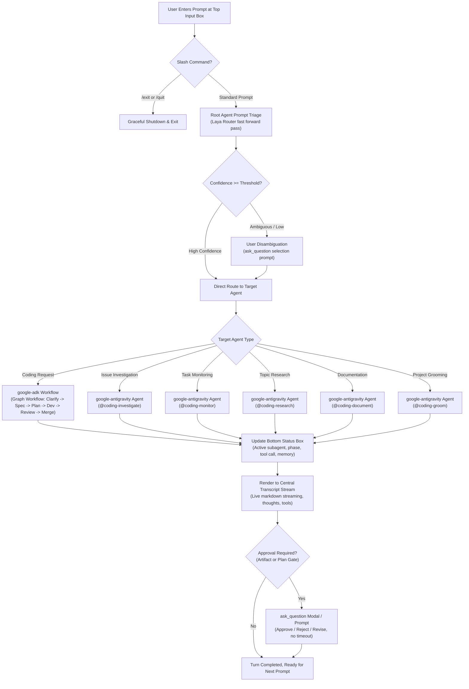
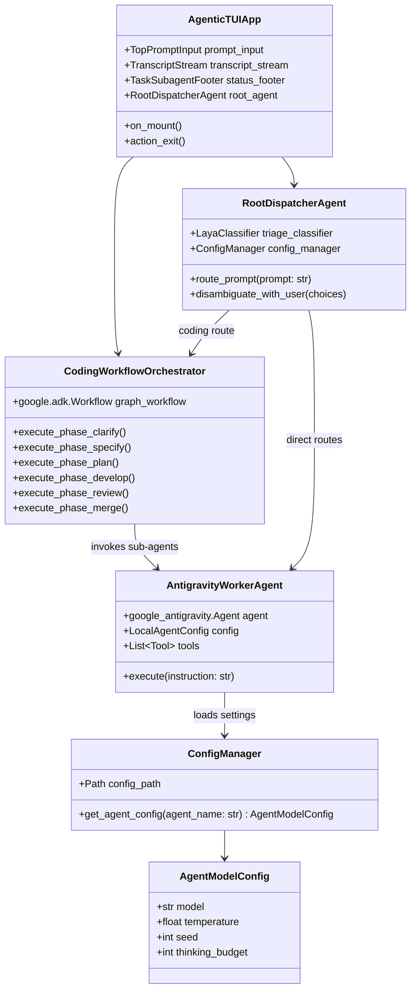
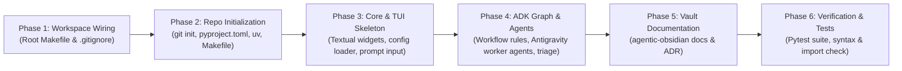

# Project Request Grooming: `agentic-code-tui`

> [!IMPORTANT]
> **Approval Gate**: Review this groomed specification. Once approved (`[GATE_APPROVED]`), scaffolding will proceed automatically across the workspace via `@coding` and `@coding-document`.

---

## 1. Executive Summary & Identification

| Attribute | Specification |
| :--- | :--- |
| **Project Name** | `agentic-code-tui` |
| **Tagline** | Terminal-native AI coding assistant combining Google Antigravity and Google ADK workflows |
| **Primary Repository** | `agentic-code-tui` (Sub-repo within `agentic` multi-repo workspace) |
| **Target Runtime** | Python 3.11+ |
| **TUI Engine** | [Textual](https://textual.textualize.io/) (Asynchronous, reactive CSS-styled terminal UI) |
| **Agent Frameworks** | [Google ADK](https://github.com/google/adk) (Graph workflow engine) & [Google Antigravity SDK](https://github.com/google) (`Agent`, `LocalAgentConfig`, native tools) |
| **Intent Classifier** | Laya Router System 1 model (Fast non-autoregressive prompt triage) |
| **License** | MIT License (Copyright &copy; 2026 Greg PFISTER) |

### 1.1 Problem Statement
While the individual `agentic-*-plugin` suite provides specialized capabilities (coding lifecycle, issue investigation, documentation, monitoring, research, and project grooming) inside Antigravity sessions, users lack a standalone, interactive, terminal-based application that unifies all these capabilities into a single executable TUI experience outside the full IDE environment.

`agentic-code-tui` bridges this gap by delivering a dedicated, full-screen Terminal User Interface (TUI) that integrates the complete capability catalog of the agentic ecosystem into a coherent, high-performance Python application powered by `google-adk` graph workflows and `google-antigravity` agents.

---

## 2. Goals & User Journeys

### 2.1 Target Personas
- **Autonomous Software Engineers**: Developers who operate entirely from the terminal and need structured, multi-stage coding workflows (clarify, specify, plan, develop, review, merge).
- **DevOps & Platform Engineers**: Operators managing builds, repository maintenance, telemetry monitoring, and issue diagnostics from terminal sessions.
- **Researchers & Architects**: Technical leads conducting deep web research, code investigations, and documentation curation directly in terminal environments.

### 2.2 Core User Journeys



### 2.3 User Experience & Acceptance Criteria
1. **Layout Simplicity**:
   - **Top Panel**: Clean, persistent command/prompt input box with command history, autocomplete, and slash command support (`/exit`, `/quit`, `/help`, `/clear`).
   - **Central Area**: Rich scrollable conversation stream with live Markdown syntax highlighting, collapsible tool executions, and thought reasoning traces.
   - **Bottom Panel**: Live task status, active subagent indicator, token metrics, model configuration, and background worker progress.
2. **Tool Support**:
   - Supports standard Antigravity tools: `run_command`, `read_file`, `write_file`, `edit_file`, `list_dir`, `search_web`, `ask_question`, `schedule`, `manage_task`.
   - Excludes `invoke_agent` (agent routing and orchestration handled explicitly by `google-adk` workflow and root dispatcher).
3. **Approval Gates Without Timeout**:
   - Artifact approval requests (`specification.md`, `plan.md`, `Project_Request_Grooming.md`, `research-report.md`, `issue-assessment.md`) render interactive decision controls without timing out.
4. **Graceful Exit**:
   - Typing `/exit` or `/quit` (or `Ctrl+C` / `Ctrl+Q`) cleanly stops running subagent workers and terminates the application.

---

## 3. Architecture & Technical Standards

### 3.1 Component Architecture



### 3.2 Orchestration Engine (`google-adk Workflow`)
- The `coding` orchestrator is modeled as a deterministic graph workflow using `google.adk.Workflow`.
- Enforces the 6-stage lifecycle through explicit state transition rules:
  1. **Phase 1: Clarification** (`coding-clarify`): Resolves ambiguities; halts until zero questions remain.
  2. **Phase 2: Specification** (`coding-specify`): Authors `specification.md`; pauses at human approval gate.
  3. **Phase 3: Architecture Planning** (`coding-plan`): Authors `plan.md`; pauses at human approval gate.
  4. **Phase 4: Development** (`coding-develop`): Isolated repo execution; code authoring, linting, unit testing.
  5. **Phase 5: Review & Audit** (`coding-review`): Verification against specification; pre-merge documentation tidy-up.
  6. **Phase 6: Merge & Release** (`coding-merge`): Git merge / pull request release and post-merge git status recording.

### 3.3 Worker Agents (`google-antigravity Agent`)
All domain workers are instantiated as `google_antigravity.Agent` instances with custom `LocalAgentConfig`:
- **`coding-clarify`**, **`coding-specify`**, **`coding-plan`**, **`coding-develop`**, **`coding-review`**, **`coding-merge`**
- **`coding-investigate`** (Issue investigation & root-cause diagnosis)
- **`coding-monitor`** (Telemetry & stream surveillance)
- **`coding-research`** (Deep web & literature research)
- **`coding-document`** (Obsidian vault documentation specialist)
- **`project-grooming`** (Workspace gap analysis & Matt Pocock 7-dimension grilling)

### 3.4 Model Selection & Configuration Management
Configuration lives in `config/agents.yaml` with environment variable and CLI overrides:

```yaml
# config/agents.yaml
default:
  model: "gemini-2.5-flash"
  temperature: 0.2
  seed: 42

agents:
  root_triage:
    model: "gemini-2.5-flash"
    temperature: 0.0
    seed: 42
  coding_orchestrator:
    model: "gemini-3.8-pro"
    temperature: 0.2
    seed: 100
  coding_plan:
    model: "gemini-3.8-pro"
    temperature: 0.1
    seed: 100
  coding_develop:
    model: "gemini-3.8-pro"
    temperature: 0.1
    seed: 200
  coding_review:
    model: "gemini-3.8-pro"
    temperature: 0.0
    seed: 300
  coding_investigate:
    model: "gemini-3.8-pro"
    temperature: 0.1
    seed: 400
  coding_research:
    model: "gemini-2.5-flash"
    temperature: 0.3
    seed: 500
  coding_document:
    model: "gemini-2.5-flash"
    temperature: 0.2
    seed: 600
  coding_monitor:
    model: "gemini-2.5-flash"
    temperature: 0.0
    seed: 700
```

---

## 4. Repository Topology & Workspace Integration

### 4.1 New Repository Layout
The repository `agentic-code-tui/` will be organized cleanly:

```text
agentic-code-tui/
├── .git/
├── .gitignore
├── LICENSE
├── README.md
├── CONTRIBUTING.md
├── pyproject.toml
├── uv.lock
├── Makefile
├── config/
│   └── agents.yaml
├── src/
│   └── agentic_code_tui/
│       ├── __init__.py
│       ├── __main__.py
│       ├── cli.py
│       ├── config.py
│       ├── app.py                # Textual App definition & widgets
│       ├── ui/
│       │   ├── __init__.py
│       │   ├── prompt_input.py   # Top prompt input widget
│       │   ├── transcript.py     # Central scrollable transcript widget
│       │   ├── status_bar.py     # Bottom task & running subagent widget
│       │   └── dialogs.py        # ask_question modal dialogs
│       ├── core/
│       │   ├── __init__.py
│       │   ├── triage.py         # Laya Router prompt intent triage
│       │   ├── dispatcher.py     # Root agent & intent router
│       │   └── tools.py          # Antigravity tool binding & execution
│       ├── workflows/
│       │   ├── __init__.py
│       │   ├── coding_graph.py   # google-adk Workflow graph implementation
│       │   └── rules.py          # Strict workflow transition rules
│       └── agents/
│           ├── __init__.py
│           ├── factory.py        # google-antigravity Agent factory
│           ├── coding_agents.py  # Clarify, Specify, Plan, Develop, Review, Merge
│           ├── investigate.py    # Issue investigation agent
│           ├── monitor.py        # Monitoring agent
│           ├── research.py       # Research agent
│           ├── document.py       # Documentation agent
│           └── grooming.py       # Project grooming agent
└── tests/
    ├── __init__.py
    ├── test_config.py
    ├── test_triage.py
    ├── test_workflow.py
    └── test_ui.py
```

### 4.2 Workspace Orchestration Updates
- **Root `Makefile`**: Add `agentic-code-tui` to the `REPOS` list.
- **Root `.gitignore`**: Add `/agentic-code-tui/` to sub-repositories list.
- **Git Initialization**: `git init` inside `agentic-code-tui` on branch `master`.

---

## 5. Licensing & Governance

- **License**: MIT License
- **Copyright**: Copyright &copy; 2026 Greg PFISTER
- **Author Email**: `gregory.pfister@gmail.com`

---

## 6. Documentation & Vault Strategy

- **Central Vault Integration**: Create `agentic-obsidian/plugins/agentic-code-tui.md` detailing the TUI architecture, workflow graphs, and user guide.
- **Architecture Decision Record**: Add `agentic-obsidian/architecture/ADR-008-agentic-code-tui-architecture.md` recording the selection of Textual, `google-adk` graph runtime, and `google-antigravity` agent binding.

---

## 7. Workspace Tooling & Automation

- **Dependency Management**: `uv` (`pyproject.toml`, Python `>=3.11`)
- **Key Dependencies**:
  - `textual>=1.0.0`
  - `google-adk>=2.0.0`
  - `google-antigravity>=0.1.0`
  - `laya>=0.4.15`
  - `pydantic>=2.10.0`
  - `pyyaml>=6.0`
  - `rich>=13.0.0`
- **Development Tooling**:
  - `pytest>=8.0.0`
  - `pytest-asyncio>=0.23.0`
  - `ruff>=0.8.0`
- **Sub-repo `Makefile` Targets**:
  - `make run`: Launch the TUI app
  - `make test`: Run pytest suite
  - `make lint`: Run ruff check
  - `make format`: Run ruff format
  - `make clean`: Remove build and virtualenv caches

---

## 8. Phased Scaffolding Plan



---

> [!NOTE]
> Please approve this grooming plan (`[GATE_APPROVED]`) to initiate the repository scaffolding and code generation.
