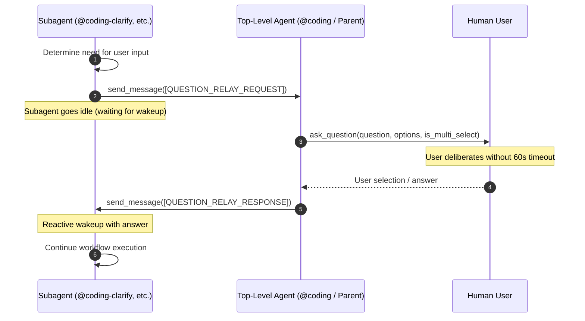

# Technical Specification: Question Relay Protocol for Subagent User Prompts

## 1. Summary & Problem Motivation

### 1.1 Problem Statement
In Google Antigravity and agentic orchestration architectures, worker subagents run as background processes spawned by a caller/orchestrator agent. When a worker subagent attempts to gather human clarification or confirmation by executing `ask_question` directly, the host agent runtime enforces a strict 60-second tool execution timeout on background turns.

If human users require more than 60 seconds to review, deliberate, and answer multi-choice inquiries, the subagent tool invocation fails with a timeout exception, terminating the execution turn and aborting active workflows (e.g. clarification grilling, pause gates during monitoring, issue remediation confirmation, or merge approvals).

### 1.2 Proposed Solution (Option 3: Relaying Questions Through Top-Level Agent)
Instead of subagents invoking `ask_question` directly:
1. Subagents dispatch structured `[QUESTION_RELAY_REQUEST]` messages to their parent orchestrator via `send_message`.
2. The orchestrator receives the relay request, executes `ask_question` within the top-level turn (which is not subject to subagent background turn timeouts), and receives the user's interactive response.
3. The orchestrator packages the answer into `[QUESTION_RELAY_RESPONSE]` and sends it back to the subagent via `send_message`.
4. The subagent automatically resumes execution reactively upon receiving the message.

---

## 2. Architecture & Message Sequence



---

## 3. Protocol Specification

### 3.1 Request: `[QUESTION_RELAY_REQUEST]`
Subagents submit clarification or confirmation queries using the following standardized envelope:

**Message Header:** `[QUESTION_RELAY_REQUEST]`  
**Format:** JSON string payload following header or formatted markdown block.

```json
{
  "type": "QUESTION_RELAY_REQUEST",
  "questions": [
    {
      "question": "Which architecture pattern should we follow for the relay handler?",
      "options": [
        "(Recommended) Event-driven message listener hook in orchestrator loop",
        "Synchronous subagent blocking loop with sleep",
        "Direct callback via shared memory"
      ],
      "is_multi_select": false
    }
  ],
  "context": "Clarification needed for orchestrator-subagent interaction design."
}
```

#### Field Schema
| Field | Type | Required | Description |
| :--- | :--- | :--- | :--- |
| `type` | string | Yes | Fixed value `"QUESTION_RELAY_REQUEST"`. |
| `questions` | array | Yes | Non-empty list of question objects (strictly 1 question per request to comply with single-question rules). |
| `questions[i].question` | string | Yes | Prompt text displayed to the human user. |
| `questions[i].options` | array[string] | Yes | List of selectable choices (recommended choice prefixed with `(Recommended)`). |
| `questions[i].is_multi_select`| boolean | No | Defaults to `false`. If `true`, permits multiple choices. |
| `context` | string | No | Optional contextual rationale or background for the orchestrator/user. |

### 3.2 Response: `[QUESTION_RELAY_RESPONSE]`
The orchestrator relays the user's decision back to the subagent using the response envelope:

**Message Header:** `[QUESTION_RELAY_RESPONSE]`  
**Format:** JSON string payload.

```json
{
  "type": "QUESTION_RELAY_RESPONSE",
  "answers": [
    "(Recommended) Event-driven message listener hook in orchestrator loop"
  ],
  "status": "COMPLETED"
}
```

#### Field Schema
| Field | Type | Required | Description |
| :--- | :--- | :--- | :--- |
| `type` | string | Yes | Fixed value `"QUESTION_RELAY_RESPONSE"`. |
| `answers` | array[string] | Yes | Selected option string(s) or custom user input text. |
| `status` | string | Yes | `"COMPLETED"`, `"REJECTED"`, or `"CANCELLED"`. |

---

## 4. Subagent Operational Modes

### 4.1 Pure Subagents
Subagents that strictly run under an orchestrator and are never invoked standalone:
- **Agents:** `@coding-clarify`, `@coding-review`, `@coding-deploy` (and intermediate coding subagents).
- **Tool Access:** Remove `ask_question` tool from subagent declaration / instructions if present; rely exclusively on `send_message`.
- **Behavior:**
  - Must NEVER call `ask_question`.
  - Always issue `[QUESTION_RELAY_REQUEST]` addressed to the parent orchestrator (`<caller_id>`).
  - Rely on Antigravity reactive wakeups upon message arrival.

### 4.2 Dual-Mode Agents
Agents that may be invoked directly as top-level session workers or delegated as subagents:
- **Agents:** `@coding-investigate` (`agentic-issue-investigation-plugin`), `/project-grooming` (`agentic-project-grooming-plugin`), `@coding-monitor` (`agentic-task-monitoring-plugin`), `@coding-research` (`agentic-topic-researching-plugin`).
- **Detection Logic:**
  - Check whether a parent/caller context exists (`caller` ID present in prompt/environment/session metadata).
  - **Subagent Mode:** If invoked by a caller, send `[QUESTION_RELAY_REQUEST]` via `send_message` to the caller.
  - **Standalone Mode:** If operating at the top level with no caller, invoke `ask_question` directly to prompt the user.

---

## 5. Orchestrator Responsibilities

The top-level orchestrator (e.g. `@coding` in `agentic-coding-plugin` and root session handlers):
1. **Message Interception:** Monitor incoming agent messages for `[QUESTION_RELAY_REQUEST]`.
2. **Execution in Top-Level Context:** Extract `questions`, invoke `ask_question` using native parameters.
3. **Response Relay:** Format results into `[QUESTION_RELAY_RESPONSE]` and send to requesting subagent via `send_message(Recipient="<subagent_id>", Message=...)`.
4. **Resumption:** Allow subagent to continue without orchestrator interference.

---

## 6. Affected Repositories & Files

| Repository | Files Affected | Changes Required |
| :--- | :--- | :--- |
| **`agentic-coding-plugin`** | `agents/coding/agent.md`<br>`agents/coding-clarify/agent.md`<br>`agents/coding-review/agent.md`<br>`rules/AGENTS.md`<br>`skills/coding-orchestrator/SKILL.md`<br>`tests/` | Orchestrator handles `[QUESTION_RELAY_REQUEST]`; subagents update to protocol; remove direct `ask_question` in subagent rules. |
| **`agentic-issue-investigation-plugin`** | `agents/agent.md`<br>`agents/coding-investigate/agent.md`<br>`rules/AGENTS.md`<br>`skills/coding-investigate/SKILL.md`<br>`tests/` | Add dual-mode question handling; send `[QUESTION_RELAY_REQUEST]` when called by `@coding` or parent. |
| **`agentic-project-grooming-plugin`** | `agents/agent.md`<br>`rules/AGENTS.md`<br>`skills/project-grooming/SKILL.md`<br>`tests/` | Dual-mode interrogation logic during 7-category grill-me sessions. |
| **`agentic-task-monitoring-plugin`** | `agents/agent.md`<br>`agents/coding-monitor/agent.md`<br>`rules/AGENTS.md`<br>`skills/coding-monitor/SKILL.md`<br>`tests/` | Dual-mode pause gate handling on anomaly detection. |
| **`agentic-topic-researching-plugin`** | `agents/agent.md`<br>`agents/coding-research/agent.md`<br>`rules/AGENTS.md`<br>`skills/coding-research/SKILL.md`<br>`tests/` | Dual-mode scope clarification handling. |
| **Root Workspace** | `AGENTS.md` | Document the Question Relay Protocol across ecosystem workflows and multi-agent interaction standards. |

---

## 7. Edge Cases & Mitigations

1. **User Inactivity & Deliberation:**
   - *Mitigation:* Because `ask_question` executes in top-level agent context, background tool timeout timers do not terminate the session. The turn awaits human response indefinitely.
2. **Malformed Relay Payload:**
   - *Mitigation:* Orchestrator validates `questions` array before tool invocation; if invalid, returns `[QUESTION_RELAY_RESPONSE]` with error status so the subagent can reformat.
3. **One-Question-At-A-Time Enforcement:**
   - *Mitigation:* Even if a subagent requires multiple answers, `[QUESTION_RELAY_REQUEST]` must issue exactly one question per round-trip turn to honor Matt Pocock interrogation style and system rules.
4. **Parent Identification in Dual-Mode:**
   - *Mitigation:* If subagent cannot determine parent ID or caller is absent, default securely to direct `ask_question` invocation.

---

## 8. Verifiable Acceptance Criteria

- [ ] **AC 1: Standardized Envelopes:** `[QUESTION_RELAY_REQUEST]` and `[QUESTION_RELAY_RESPONSE]` specifications and schemas documented across workspace rules.
- [ ] **AC 2: Pure Subagent Compliance:** `@coding-clarify`, `@coding-review`, and other internal coding subagents never invoke `ask_question` directly; all user inquiries are dispatched via `send_message`.
- [ ] **AC 3: Dual-Mode Subagent Support:** `@coding-investigate`, `@coding-groom`, `@coding-monitor`, and `@coding-research` correctly branch: use relay request when running under caller, direct `ask_question` when running standalone.
- [ ] **AC 4: Orchestrator Relay Execution:** Orchestrator agent (`@coding`) intercepts `[QUESTION_RELAY_REQUEST]`, triggers `ask_question` at top level, and dispatches `[QUESTION_RELAY_RESPONSE]` back to subagent without host 60-second timeouts.
- [ ] **AC 5: Workspace Documentation & Consistency:** Root `AGENTS.md` and plugin-specific `rules/AGENTS.md` updated to reflect the new protocol without conflicting instructions.
- [ ] **AC 6: Automated Test Verification:** Unit/integration tests added or updated in each plugin repo validating envelope serialization, deserialization, and handler routing.
