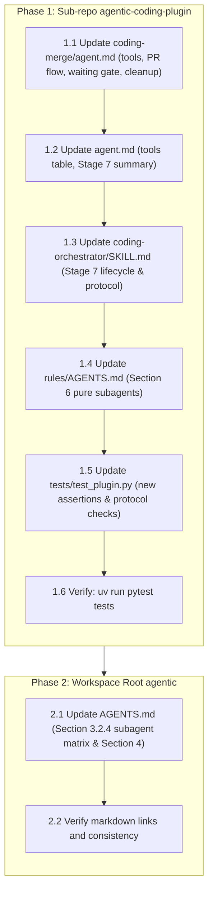

# Implementation Plan: Remote PR Creation, Waiting Gate, and Post-Merge Synchronization for `@coding-merge`

- **Specification Reference**: [specification.md](file:///Users/gpfister/.gemini/antigravity/brain/7408dcce-9644-4ba0-af51-bd171ed61a54/specification.md)
- **Status**: Draft (Awaiting Approval Gate)
- **Proposed Git Branch**: `feature/coding-merge-pr-waiting-gate`

---

## 1. Executive Summary & Architectural Scope

The purpose of this work is to modernize the release engineering phase (Stage 7: `@coding-merge`) within `agentic-coding-plugin` and synchronize workspace-level protocol definitions across `agentic`.

Specifically, `@coding-merge` will be updated to:
1. **Detect Git Remotes & Verify GitHub CLI**: Distinguish between local-only repositories and repositories with configured remotes (`origin`). For remote repositories, push the feature branch (`git push -u origin <branch>`) and verify GitHub CLI authentication (`gh auth status`).
2. **Pull Request Creation & Fallback URL**: If `gh` is authenticated, create a PR via `gh pr create` with structured metadata. If `gh` is unauthenticated or missing, generate a GitHub web compare URL (`https://github.com/<owner>/<repo>/compare/<base>...<branch>?expand=1`) and prompt the user via the Question Relay Protocol.
3. **Subagent-Safe PR Waiting Gate**: Inspect PR state using `gh pr view --json state,reviewDecision,mergedAt,url`. To avoid Google Antigravity's 60-second subagent execution timeout, never block or sleep in subagent worker processes; instead, relay review decisions to `@coding` using `[QUESTION_RELAY_REQUEST]` with options:
   - `(Recommended) Re-check PR status`
   - `Enable GitHub auto-merge (gh pr merge --auto --merge) and re-check`
   - `Proceed without waiting (mark PR pending)`
4. **Post-Merge Workspace Synchronization**: When the PR is merged, switch to the base branch (`git checkout <base>`), fast-forward pull changes (`git pull --ff-only origin <base>`), and delete the local feature branch (`git branch -d <branch>`).
5. **Tooling & Pure Subagent Categorization**: Add `send_message` to `coding-merge/agent.md` frontmatter tools, update agent catalog, orchestrator skills, rules, and add comprehensive unit test coverage in `tests/test_plugin.py`. Update workspace root `AGENTS.md` to classify `@coding-merge` as a Pure Subagent.

---

## 2. Multi-Repository Work Breakdown



---

### Repository 1: `agentic-coding-plugin` (Sub-repo)

- **Target Path**: [`agentic-coding-plugin/`](file:///Users/gpfister/Development/Projects/gpfister/agentic/agentic-coding-plugin/)
- **Git Branch**: `feature/coding-merge-pr-waiting-gate`
- **Local Deployment Assessment**:
  - **Inspection**: Inspected `agentic-coding-plugin/` for Dockerfiles, `docker-compose.yml`, local deployment scripts in `scripts/`, terraform, Kubernetes manifests, or `deploy-local` make targets.
  - **Findings**: Only standard plugin assets (`plugin.json`, markdown agents, skills, rules) and python test suite exist.
  - **Local Deployment**: **Not Required**.

#### Work Items & Step-by-Step Implementation

1. **Step 1.1 — Update `agents/coding-merge/agent.md`**
   - **File**: [`agentic-coding-plugin/agents/coding-merge/agent.md`](file:///Users/gpfister/Development/Projects/gpfister/agentic/agentic-coding-plugin/agents/coding-merge/agent.md)
   - **Frontmatter**: Add `send_message` to `tools` list:
     ```yaml
     tools:
       - run_command
       - read_file
       - list_dir
       - ask_question
       - send_message
     ```
   - **Protocol Instructions**:
     - Detail Pure Subagent role under `@coding`: must NOT call `ask_question` directly when caller ID is present; use `send_message` with `[QUESTION_RELAY_REQUEST]` and await `[QUESTION_RELAY_RESPONSE]`.
     - Define Remote Repository Detection (`git remote -v` / `git remote get-url origin`).
     - Define Local Release Strategy (`git checkout <base>`, `git merge <branch>`).
     - Define Remote Release Strategy:
       * Push branch: `git push -u origin <branch>`
       * GitHub CLI authentication check: `gh auth status`
       * PR Creation: `gh pr create --base <base> --head <branch> --title "<title>" --body "<body>"`
       * Fallback compare URL when `gh` fails/missing: `https://github.com/<owner>/<repo>/compare/<base>...<branch>?expand=1` relayed via `[QUESTION_RELAY_REQUEST]`.
     - Define Hybrid Check & Question Relay Gate:
       * Query status: `gh pr view <pr_number> --json state,reviewDecision,mergedAt,url`
       * If `state == "MERGED"`: proceed to cleanup.
       * If `state == "OPEN"`: relay question to user via `[QUESTION_RELAY_REQUEST]` with choices (Re-check, Enable GitHub auto-merge, Proceed without waiting).
     - Define Post-Merge Base Synchronization & Local Cleanup:
       * `git checkout <base>`
       * `git pull --ff-only origin <base>`
       * `git branch -d <branch>`
       * Produce structured `MergeReport` (status, pr_number, pr_url, base_branch, merged_branch, cleanup).

2. **Step 1.2 — Update `agents/agent.md`**
   - **File**: [`agentic-coding-plugin/agents/agent.md`](file:///Users/gpfister/Development/Projects/gpfister/agentic/agentic-coding-plugin/agents/agent.md)
   - In Section 1 subagent table: Update `@coding-merge` tools column to include `send_message`.
   - In Section 2 Stage 7 (`coding-merge`): Update summary to describe PR creation, fallback compare URL, Question Relay waiting gate, and post-merge base branch sync & local branch deletion.

3. **Step 1.3 — Update `skills/coding-orchestrator/SKILL.md`**
   - **File**: [`agentic-coding-plugin/skills/coding-orchestrator/SKILL.md`](file:///Users/gpfister/Development/Projects/gpfister/agentic/agentic-coding-plugin/skills/coding-orchestrator/SKILL.md)
   - Update Stage 7 section to describe the PR waiting gate, GitHub CLI validation, compare URL fallback, and post-merge synchronization (`git pull --ff-only origin <base>`, `git branch -d <branch>`).
   - Update Section 1 Question Relay Protocol to reference `@coding-merge` as a subagent using the relay protocol.

4. **Step 1.4 — Update `rules/AGENTS.md`**
   - **File**: [`agentic-coding-plugin/rules/AGENTS.md`](file:///Users/gpfister/Development/Projects/gpfister/agentic/agentic-coding-plugin/rules/AGENTS.md)
   - In Section 6 (Question Relay Protocol & Interactive Gates):
     - Update worker subagents list to include `@coding-merge` (`worker subagents (@coding-clarify, @coding-deploy, @coding-review, @coding-merge)`).

5. **Step 1.5 — Update `tests/test_plugin.py`**
   - **File**: [`agentic-coding-plugin/tests/test_plugin.py`](file:///Users/gpfister/Development/Projects/gpfister/agentic/agentic-coding-plugin/tests/test_plugin.py)
   - Add `PLUGIN_ROOT / "agents" / "coding-merge" / "agent.md"` to `files_to_check` in `test_question_relay_protocol_contracts`.
   - Update `test_subagent_tool_configurations` to verify `send_message` in `coding-merge`.
   - Add dedicated unit test `test_coding_merge_pr_waiting_and_sync()` verifying:
     * `coding-merge/agent.md` includes `gh pr create` and `gh pr view`
     * `coding-merge/agent.md` includes `[QUESTION_RELAY_REQUEST]` and `[QUESTION_RELAY_RESPONSE]`
     * `coding-merge/agent.md` includes post-merge cleanup commands (`git pull --ff-only`, `git branch -d`)
     * `coding-merge/agent.md` includes compare URL fallback (`github.com`)

6. **Step 1.6 — Test Execution & Verification**
   - **Verification Command**:
     ```bash
     cd /Users/gpfister/Development/Projects/gpfister/agentic/agentic-coding-plugin && uv run pytest tests
     ```
   - **Expected Outcome**: All tests pass (17+ passed, 0 failures).

---

### Repository 2: `agentic` (Workspace Root)

- **Target Path**: [`agentic/`](file:///Users/gpfister/Development/Projects/gpfister/agentic/)
- **Git Branch**: `feature/coding-merge-pr-waiting-gate`
- **Local Deployment Assessment**:
  - **Inspection**: Workspace coordinator repository. No local deployment manifests or targets.
  - **Local Deployment**: **Not Required**.

#### Work Items & Step-by-Step Implementation

1. **Step 2.1 — Update workspace root `AGENTS.md`**
   - **File**: [`AGENTS.md`](file:///Users/gpfister/Development/Projects/gpfister/agentic/AGENTS.md)
   - **Section 2.3**: Update `@coding-merge` description in catalog to mention PR creation, Question Relay waiting gate, and post-merge branch synchronization.
   - **Section 3.2.4 (Pure Subagents vs. Dual-Mode Subagents Matrix)**:
     - Update Pure Subagents list to include `@coding-merge`:
       `@coding-clarify`<br>`@coding-deploy`<br>`@coding-review`<br>`@coding-merge`
   - **Section 4 (Coding Workflow Pipeline)**:
     - Update Stage 7 description in text and flowchart explanations to detail PR creation, waiting gate, and post-merge sync.

2. **Step 2.2 — Workspace Verification**
   - **Verification Command**:
     ```bash
     git diff --check
     ```
   - Verify link formatting, syntax, and alignment with `agentic-coding-plugin`.

---

## 3. Local Deployment Summary

| Repository | Deployment Required? | Rationale | Deployment Trigger |
| :--- | :---: | :--- | :--- |
| `agentic-coding-plugin` | **No** | Pure Antigravity plugin manifest, agent markdown definitions, skills, rules, and python test suite. No containers or services. | None (`Local Deployment: Not Required`) |
| `agentic` (Root) | **No** | Multi-repo orchestration and documentation workspace. No deployable artifacts. | None (`Local Deployment: Not Required`) |

> [!NOTE]
> Because neither repository requires local deployment, `@coding-deploy` is not triggered for this feature. The lifecycle transitions directly from `coding-develop` to `coding-review`.

---

## 4. Execution Sequence & Dependency Order

1. **Phase 1: Develop `agentic-coding-plugin`**
   - Checkout branch `feature/coding-merge-pr-waiting-gate` in `agentic-coding-plugin`.
   - Implement Steps 1.1 through 1.5.
   - Run `uv run pytest tests` to confirm full pass.
2. **Phase 2: Develop Workspace Root `agentic`**
   - Checkout branch `feature/coding-merge-pr-waiting-gate` in root `agentic`.
   - Implement Step 2.1.
   - Run verification checks (`git diff --check`).
3. **Phase 3: Review (`coding-review`)**
   - Verify all acceptance criteria against `specification.md`.
4. **Phase 4: Release & Merge (`coding-merge`)**
   - Test the newly upgraded `@coding-merge` capabilities during the release of this feature!

---

## 5. Risk Assessment & Mitigations

| Risk | Impact | Mitigation Strategy |
| :--- | :--- | :--- |
| **Antigravity 60s Timeout During PR Review** | Subagent failure during waiting | `@coding-merge` never blocks or polls synchronously; it delegates status checks to `@coding` using `[QUESTION_RELAY_REQUEST]`. Orchestrator runs indefinitely without timeouts. |
| **`gh` CLI Not Available on Developer Machine** | PR creation failure | Early fallback detects failure and generates web compare URL (`https://github.com/<owner>/<repo>/compare/...`) for manual browser creation. |
| **Base Branch Conflict on Pull** | Post-merge local sync failure | `@coding-merge` strictly uses `git pull --ff-only origin <base>`. If not fast-forwardable, it warns user rather than creating unexpected merge commits. |
| **Unmerged Commits on Branch Deletion** | Accidental code loss | `@coding-merge` uses `git branch -d` (safe delete). Never uses `-D` (force delete). |
