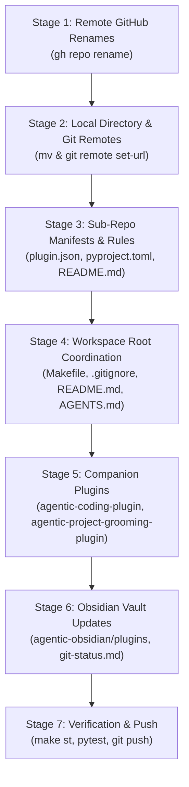

# Implementation Plan: SPEC-2026-PLUGIN-RENAME-001

**Specification**: `SPEC-2026-PLUGIN-RENAME-001`  
**Target Branch**: `master` across all workspaces and sub-repositories  
**Scope**: 5 Sub-Repositories Renamed, 3 Sub-Repositories Updated, 1 Root Workspace Updated

---

## 1. Overview & Architecture Strategy

This plan executes the synchronized renaming of 5 Antigravity plugin repositories across GitHub remotes, local directory structures, git remotes, plugin manifests, workspace configurations, cross-plugin documentation, and Obsidian vault notes.

### Repository Rename Matrix

| Current Name | New Name | GitHub Remote (`gpfister/`) | Subagent Handles (Unchanged) |
| :--- | :--- | :--- | :--- |
| `agentic-triage-plugin` | `agentic-prompt-triage-plugin` | `agentic-prompt-triage-plugin` | Prompt Triage Hook |
| `agentic-investigate-plugin` | `agentic-issue-investigation-plugin` | `agentic-issue-investigation-plugin` | `@coding-investigate` |
| `agentic-monitor-plugin` | `agentic-task-monitoring-plugin` | `agentic-task-monitoring-plugin` | `@coding-monitor` |
| `agentic-research-plugin` | `agentic-topic-researching-plugin` | `agentic-topic-researching-plugin` | `@coding-research` |
| `agentic-document-plugin` | `agentic-project-documenting-plugin` | `agentic-project-documenting-plugin` | `@coding-document` |

> [!IMPORTANT]
> Subagent invocation handles (`@coding-document`, `@coding-investigate`, `@coding-monitor`, `@coding-research`), agent roles, and skill directory names (`skills/coding-document/`, `skills/coding-investigate/`, etc.) remain **strictly unchanged** to maintain runtime stability and backward compatibility.

---

## 2. Multi-Repo Work Breakdown & Sequence



---

## 3. Detailed Repository Work Items

### Stage 1: GitHub Remote Repositories (`gh repo rename`)

Execute remote rename commands via GitHub CLI:
1. `gh repo rename agentic-prompt-triage-plugin --repo gpfister/agentic-triage-plugin --yes`
2. `gh repo rename agentic-issue-investigation-plugin --repo gpfister/agentic-investigate-plugin --yes`
3. `gh repo rename agentic-task-monitoring-plugin --repo gpfister/agentic-monitor-plugin --yes`
4. `gh repo rename agentic-topic-researching-plugin --repo gpfister/agentic-research-plugin --yes`
5. `gh repo rename agentic-project-documenting-plugin --repo gpfister/agentic-document-plugin --yes`

**Verification**:
```bash
gh repo view gpfister/agentic-prompt-triage-plugin --json name
gh repo view gpfister/agentic-issue-investigation-plugin --json name
gh repo view gpfister/agentic-task-monitoring-plugin --json name
gh repo view gpfister/agentic-topic-researching-plugin --json name
gh repo view gpfister/agentic-project-documenting-plugin --json name
```

---

### Stage 2: Local Directory Renames & Git Remotes

Rename local workspace directories and adjust origin URLs:
1. `mv agentic-triage-plugin agentic-prompt-triage-plugin`
2. `mv agentic-investigate-plugin agentic-issue-investigation-plugin`
3. `mv agentic-monitor-plugin agentic-task-monitoring-plugin`
4. `mv agentic-research-plugin agentic-topic-researching-plugin`
5. `mv agentic-document-plugin agentic-project-documenting-plugin`

Update git remote URLs:
1. `git -C agentic-prompt-triage-plugin remote set-url origin git@github.com:gpfister/agentic-prompt-triage-plugin.git`
2. `git -C agentic-issue-investigation-plugin remote set-url origin git@github.com:gpfister/agentic-issue-investigation-plugin.git`
3. `git -C agentic-task-monitoring-plugin remote set-url origin git@github.com:gpfister/agentic-task-monitoring-plugin.git`
4. `git -C agentic-topic-researching-plugin remote set-url origin git@github.com:gpfister/agentic-topic-researching-plugin.git`
5. `git -C agentic-project-documenting-plugin remote set-url origin git@github.com:gpfister/agentic-project-documenting-plugin.git`

**Verification**:
```bash
for r in agentic-prompt-triage-plugin agentic-issue-investigation-plugin agentic-task-monitoring-plugin agentic-topic-researching-plugin agentic-project-documenting-plugin; do
  echo "=== $r ===" && git -C "$r" remote -v
done
```

---

### Stage 3: Renamed Sub-Repositories Internal Updates

#### 3.1 Repository: `agentic-prompt-triage-plugin`
- **Files to Modify**:
  - `plugin.json`: `"name": "agentic-prompt-triage-plugin"`
  - `pyproject.toml` (if present): `name = "agentic-prompt-triage-plugin"`
  - `README.md`: Update title, installation references, and plugin name.
  - `rules/AGENTS.md`: Update header and rule identifier comments.
- **Verification**:
  - `git -C agentic-prompt-triage-plugin diff`
  - Run tests if present: `uv run pytest` (or `pytest`)

#### 3.2 Repository: `agentic-issue-investigation-plugin`
- **Files to Modify**:
  - `plugin.json`: `"name": "agentic-issue-investigation-plugin"`
  - `pyproject.toml` (if present): `name = "agentic-issue-investigation-plugin"`
  - `README.md`: Update plugin name and installation commands.
  - `rules/AGENTS.md`: Update references from `agentic-investigate-plugin` to `agentic-issue-investigation-plugin`.
- **Verification**:
  - `git -C agentic-issue-investigation-plugin diff`

#### 3.3 Repository: `agentic-task-monitoring-plugin`
- **Files to Modify**:
  - `plugin.json`: `"name": "agentic-task-monitoring-plugin"`
  - `pyproject.toml` (if present): `name = "agentic-task-monitoring-plugin"`
  - `README.md`: Update plugin name and installation guides.
  - `rules/AGENTS.md`: Update rule header and references.
- **Verification**:
  - `git -C agentic-task-monitoring-plugin diff`

#### 3.4 Repository: `agentic-topic-researching-plugin`
- **Files to Modify**:
  - `plugin.json`: `"name": "agentic-topic-researching-plugin"`
  - `pyproject.toml` (if present): `name = "agentic-topic-researching-plugin"`
  - `README.md`: Update plugin name and usage instructions.
  - `rules/AGENTS.md`: Update rule header and references.
- **Verification**:
  - `git -C agentic-topic-researching-plugin diff`

#### 3.5 Repository: `agentic-project-documenting-plugin`
- **Files to Modify**:
  - `plugin.json`: `"name": "agentic-project-documenting-plugin"`
  - `pyproject.toml` (if present): `name = "agentic-project-documenting-plugin"`
  - `README.md`: Update plugin name and instructions.
  - `rules/AGENTS.md`: Update rule header and references.
- **Verification**:
  - `git -C agentic-project-documenting-plugin diff`

---

### Stage 4: Workspace Root (`agentic`)

- **Files to Modify**:
  - [Makefile](file:///Users/gpfister/Development/Projects/gpfister/agentic/Makefile):
    - Update `REPOS` list:
      ```makefile
      REPOS := agentic-coding-plugin agentic-issue-investigation-plugin agentic-obsidian agentic-project-documenting-plugin agentic-project-grooming-plugin agentic-prompt-triage-plugin agentic-task-monitoring-plugin agentic-topic-researching-plugin
      ```
  - [.gitignore](file:///Users/gpfister/Development/Projects/gpfister/agentic/.gitignore):
    - Update Sub-repositories section to reflect all new paths:
      ```gitignore
      # Sub-repositories
      /agentic-coding-plugin/
      /agentic-issue-investigation-plugin/
      /agentic-obsidian/
      /agentic-project-documenting-plugin/
      /agentic-project-grooming-plugin/
      /agentic-prompt-triage-plugin/
      /agentic-task-monitoring-plugin/
      /agentic-topic-researching-plugin/
      ```
  - [README.md](file:///Users/gpfister/Development/Projects/gpfister/agentic/README.md):
    - Update plugin directory tree, overview table, and clone links.
  - [AGENTS.md](file:///Users/gpfister/Development/Projects/gpfister/agentic/AGENTS.md):
    - Update workspace tree structure, Plugin Ecosystem Catalog, and Cross-Plugin Awareness table.
  - [scripts/worktree.py](file:///Users/gpfister/Development/Projects/gpfister/agentic/scripts/worktree.py) (if repo list is hardcoded):
    - Audit and update repository list.
- **Verification**:
  - Run `make st` to verify all 8 repositories + root are detected and evaluated correctly.
  - Run `git status -s` on root.

---

### Stage 5: Companion Plugins Updates

#### 5.1 Repository: `agentic-coding-plugin`
- **Files to Modify**:
  - `rules/AGENTS.md`: Update cross-plugin companion mentions (referencing `agentic-project-documenting-plugin`, `agentic-issue-investigation-plugin`, etc.).
  - `README.md`: Update documentation integration notes.
- **Verification**:
  - `git -C agentic-coding-plugin diff`

#### 5.2 Repository: `agentic-project-grooming-plugin`
- **Files to Modify**:
  - `rules/AGENTS.md`: Update cross-plugin section mentions.
  - `README.md`: Update companion plugin table.
- **Verification**:
  - `git -C agentic-project-grooming-plugin diff`

---

### Stage 6: Obsidian Vault (`agentic-obsidian`)

- **Files to Rename / Move**:
  - `plugins/agentic-document-plugin.md` -> `plugins/agentic-project-documenting-plugin.md`
  - `plugins/agentic-investigate-plugin.md` -> `plugins/agentic-issue-investigation-plugin.md`
  - `plugins/agentic-monitor-plugin.md` -> `plugins/agentic-task-monitoring-plugin.md`
  - `plugins/agentic-research-plugin.md` -> `plugins/agentic-topic-researching-plugin.md`
  - `plugins/agentic-triage-plugin.md` -> `plugins/agentic-prompt-triage-plugin.md`
- **Files to Modify**:
  - Update note titles, frontmatter, and headings within each renamed plugin note.
  - `git-status.md`: Update repository table and branch entries with the new repository names and paths.
  - Any notes in `sessions/`, `architecture/`, or `templates/` linking to the old plugin note names.
- **Verification**:
  - `git -C agentic-obsidian status`
  - Validate wikilinks.

---

### Stage 7: Final Verification & Git Commits

1. Run workspace health checks:
   ```bash
   make status
   make diff
   ```
2. Commit changes within each modified repository on `master`:
   ```bash
   # In each sub-repo:
   git -C <subrepo> add . && git -C <subrepo> commit -m "chore: rename plugin repository to <new-name>"
   # In root repo:
   git add Makefile .gitignore README.md AGENTS.md scripts/ && git commit -m "chore: synchronize workspace for renamed plugin repositories"
   ```
3. Push changes to origin remotes:
   ```bash
   make push
   ```

---

## 4. Definition of Done

- [ ] All 5 GitHub repositories renamed on GitHub via `gh repo rename`.
- [ ] All 5 local directories renamed and git `origin` remotes point to the new URLs.
- [ ] Manifests (`plugin.json`, `pyproject.toml`) and internal `README.md` / `rules/AGENTS.md` reflect the new names.
- [ ] Root `Makefile`, `.gitignore`, `AGENTS.md`, and `README.md` updated and operational (`make st` passes cleanly).
- [ ] Companion plugins (`agentic-coding-plugin`, `agentic-project-grooming-plugin`) references updated.
- [ ] Obsidian vault notes in `agentic-obsidian/` renamed and cross-references updated.
- [ ] All changes committed and pushed to `master` across all repositories.
