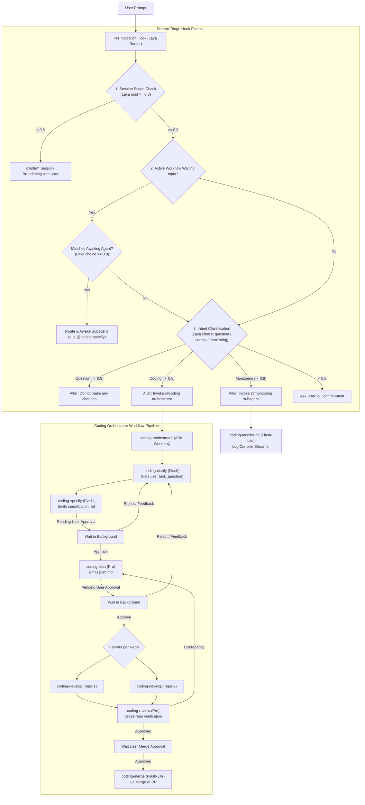

# Implementation Plan: Subagents & Pre-Prompt Triage Hooks for `gp-coding-plugin`

This plan establishes the architecture, schemas, and implementation steps to add the **Coding Orchestrator workflow**, **worker subagents**, **monitoring subagents**, and a **Laya Router prompt triage hook** to [`gp-coding-plugin`](file:///Users/gpfister/Development/Projects/gpfister/agentic/gp-coding-plugin).

---

## 1. Goal Description

Enhance `gp-coding-plugin` with an enterprise-grade agentic workflow architecture:
1. **Coding Orchestrator Subagent (`@coding` / `coding-orchestrator`)**:
   - Built with **Google ADK 2.0 (`Workflow`)** for graph-based deterministic routing and state transitions.
   - Enforces a single active coding workflow at any time with persistent state tracking.
   - Composes 6 specialized worker subagents implemented with **`google-antigravity` SDK (`LocalAgentConfig` + `Agent`)**:
     - `coding-clarify`: Grilling agent based on Matt Pocock's `/grill-me` pattern, using `ask_question`.
     - `coding-specify`: Consolidates clarifications into `specification.md` (Artifact), awaits user approval/rejection/feedback.
     - `coding-plan`: Generates multi-repo implementation plan in `plan.md` (Artifact) with branch strategies (`feature/`, `task/`, `bugfix/`), awaits approval.
     - `coding-develop`: Per-repo isolated development agent (code, unit test, linting, docs, CI/CD). Parallel execution across repos (`coding-develop-<repo>`).
     - `coding-review`: Cross-repo verification agent, compares output to spec. Routes back to `coding-plan` on discrepancies; seeks user approval to merge.
     - `coding-merge`: Branch merging or Pull Request submission with approval gating.
2. **Coding Monitoring Subagent (`@monitoring` / `coding-monitoring`)**:
   - Standalone background agent for streaming logs and serial console surveillance.
   - Error detection engine that pauses and prompts the user for intervention upon failures. Multiple instances can run concurrently with distinct instance identifiers.
3. **Structured Outputs & Formatting**:
   - Rigid Pydantic JSON schemas for inter-agent communication and telemetry.
   - Markdown converters to render human-readable messages, callouts, and artifacts.
4. **Pre-Invocation Prompt Triage Hook**:
   - Executes via `hooks.json` on `PreInvocation` using **Laya Router** (System 1 non-autoregressive decision engine):
     - Stage 1: Evaluates session scope relevance (threshold $\ge 0.80$). Prompts user if out-of-scope.
     - Stage 2: Checks if workflow subagents are waiting on user input (threshold $\ge 0.80$) and routes messages directly.
     - Stage 3: Classifies prompt intent (Question vs. Coding vs. Monitoring) with $\ge 0.80$ auto-dispatch or user confirmation, altering prompts appropriately.
5. **Main Agent Awareness**:
   - Updated `rules/AGENTS.md` and manifests declaring `@coding`, `@monitoring`, and subagent capabilities so the main agent seamlessly uses `invoke_subagent` and routes `@subagent` mentions.

---

## 2. Architecture & System Flow



---

## 3. Component Details & Model Tiering

| Subagent Name | Role / Function | Implementation SDK | Recommended Model | Integration Tools |
| :--- | :--- | :--- | :--- | :--- |
| **`coding-orchestrator`** (`@coding`) | Workflow Coordinator & State Gatekeeper | Google ADK 2.0 (`Workflow`) | N/A (Deterministic Graph) | `manage_subagents`, `state.json` |
| **`coding-clarify`** | Matt Pocock `/grill-me` requirement interviewer | `google-antigravity` `Agent` | `gemini-3.8-flash` | `ask_question`, `read_file` |
| **`coding-specify`** | Consolidates requirement spec artifact | `google-antigravity` `Agent` | `gemini-3.8-flash` | `write_file` (Artifact `specification.md`) |
| **`coding-plan`** | Multi-repo architecture planner & branch strategist | `google-antigravity` `Agent` | `gemini-3.8-pro` | `write_file` (Artifact `plan.md`), git check |
| **`coding-develop`** | Isolated code/test developer (scoped per repo) | `google-antigravity` `Agent` | `gemini-3.8-pro` | `run_command`, `edit_file`, `write_file` |
| **`coding-review`** | Multi-repo quality gatekeeper & discrepancy finder | `google-antigravity` `Agent` | `gemini-3.8-pro` | `read_file`, `run_command` |
| **`coding-merge`** | Git merge / Pull Request creator & approval wait | `google-antigravity` `Agent` | `gemini-3.8-flash-lite` | `run_command` (git / gh CLI) |
| **`coding-monitoring`** (`@monitoring`) | Background log / serial monitor with anomaly pause | `google-antigravity` `Agent` | `gemini-3.8-flash-lite` | `run_command`, `schedule`, `ask_question` |

---

## 4. Proposed Changes

### Directory Structure to Add in `gp-coding-plugin`

```text
gp-coding-plugin/
├── pyproject.toml                         # Updated with google-antigravity, google-adk, laya, pydantic
├── hooks.json                             # Declares PreInvocation hook
├── rules/
│   └── AGENTS.md                          # Main agent awareness for @coding, @monitoring, and subagent routing
├── hooks/
│   └── prompt_triage.py                   # Laya Router-driven 3-stage prompt triage
├── src/
│   └── gp_coding/
│       ├── __init__.py
│       ├── state.py                       # Single-workflow state management & lockfile
│       ├── schemas.py                     # Pydantic schemas & Markdown converters
│       ├── agents/
│       │   ├── __init__.py
│       │   ├── orchestrator.py            # ADK Workflow graph definition
│       │   ├── clarify.py                 # coding-clarify worker
│       │   ├── specify.py                 # coding-specify worker
│       │   ├── plan.py                    # coding-plan worker
│       │   ├── develop.py                 # coding-develop worker
│       │   ├── review.py                  # coding-review worker
│       │   ├── merge.py                   # coding-merge worker
│       │   └── monitoring.py              # coding-monitoring standalone worker
│       └── utils/
│           ├── __init__.py
│           └── markdown.py                # Schema -> Markdown formatting helpers
├── skills/
│   ├── coding-orchestrator/
│   │   └── SKILL.md                       # Orchestrator documentation & command triggers
│   └── coding-monitoring/
│       └── SKILL.md                       # Monitoring documentation & parameters
└── tests/
    ├── test_state.py                      # Tests single active workflow locking & transitions
    ├── test_schemas.py                    # Tests JSON schema validation & Markdown converters
    ├── test_prompt_triage.py              # Tests Laya router prompt triage stages
    └── test_agents.py                     # Tests subagent configs, prompts, and ADK workflow graph
```

---

### File Modifications & Additions

#### [MODIFY] [`pyproject.toml`](file:///Users/gpfister/Development/Projects/gpfister/agentic/gp-coding-plugin/pyproject.toml)
Add runtime dependencies:
```toml
dependencies = [
    "google-antigravity>=0.1.22",
    "google-adk>=2.13.0",
    "laya>=0.4.15",
    "pydantic>=2.10.0",
]
```

#### [NEW] [`hooks.json`](file:///Users/gpfister/Development/Projects/gpfister/agentic/gp-coding-plugin/hooks.json)
Register the PreInvocation hook handler:
```json
{
  "prompt-triage": {
    "PreInvocation": [
      {
        "type": "command",
        "command": "python3 hooks/prompt_triage.py",
        "timeout": 15
      }
    ]
  }
}
```

#### [NEW] [`hooks/prompt_triage.py`](file:///Users/gpfister/Development/Projects/gpfister/agentic/gp-coding-plugin/hooks/prompt_triage.py)
Reads `stdin` (`conversationId`, `lastUserInput`, `artifactDirectoryPath`, `invocationNum`), executes Laya Router triage:
1. **Scope Check**: If `invocationNum > 1`, evaluates `state={"user_input": lastUserInput}` with Laya `noul` decision:
   - If probability $< 0.8$, injects guidance prompting user to confirm scope expansion or stop.
2. **Waiting Subagent Check**: Queries `WorkflowState.load(...)`.
   - If an agent is in `WAITING_USER_INPUT` (e.g. `coding-specify` awaiting spec approval, or `coding-plan`), checks if input addresses that step (Laya choice $\ge 0.8$).
   - If matched, rewrites instruction to deliver response directly to the awaiting subagent.
3. **Intent Triage**:
   - Classifies `choice` (`question`, `coding`, `monitoring`).
   - If confidence $\ge 0.8$:
     - `question` $\rightarrow$ Appends `"Do not make any changes."` to prompt.
     - `coding` $\rightarrow$ Rewrites to instruct invocation of `@coding` orchestrator (or notes existing active workflow).
     - `monitoring` $\rightarrow$ Rewrites to invoke `@monitoring` subagent.
   - If confidence $< 0.8$: Injects step asking the user to clarify intent.
- Writes `{ "injectSteps": [...] }` to `stdout`.

#### [NEW] [`src/gp_coding/state.py`](file:///Users/gpfister/Development/Projects/gpfister/agentic/gp-coding-plugin/src/gp_coding/state.py)
- `WorkflowStatus` enum: `IDLE`, `CLARIFYING`, `SPECIFYING`, `AWAITING_SPEC_APPROVAL`, `PLANNING`, `AWAITING_PLAN_APPROVAL`, `DEVELOPING`, `REVIEWING`, `AWAITING_MERGE_APPROVAL`, `MERGING`, `COMPLETED`, `FAILED`.
- `WorkflowState` model:
  - Tracks `workflow_id`, `current_step`, `waiting_agent`, `repositories`, `active_develop_agents`, `artifacts` dict.
  - Implements concurrency lock: raises error if attempting to start a second coding workflow while one is active.
  - Persists to `<artifactDirectoryPath>/workflow_state.json` or `.agents/state/`.

#### [NEW] [`src/gp_coding/schemas.py`](file:///Users/gpfister/Development/Projects/gpfister/agentic/gp-coding-plugin/src/gp_coding/schemas.py)
- Pydantic models for structured inter-agent data:
  - `ClarificationSummary`: questions, answers, edge cases, scope boundaries.
  - `SpecificationDocument`: feature overview, requirements, API specs, testing criteria.
  - `PlanDocument`: multi-repo breakdown, branch names (`feature/`, `bugfix/`, `task/`), work items per repo.
  - `DevelopReport`: repo name, files modified, tests run/passed, lint status, documentation updates.
  - `ReviewReport`: cross-repo validation, spec compliance assessment, discrepancy list, merge readiness.
  - `MergeReport`: branch, target, merge mode (direct merge vs PR link), approval status.
  - `MonitoringAlert`: timestamp, source, log snippet, severity, proposed action.
- Markdown converters for each schema to format clean, user-friendly markdown and artifacts.

#### [NEW] Worker Subagents (`src/gp_coding/agents/`)
- `clarify.py`: Configures `LocalAgentConfig` with Matt Pocock `/grill-me` guidelines. Interviews user via `ask_question` one question at a time.
- `specify.py`: Produces `specification.md` artifact. Sets state to `AWAITING_SPEC_APPROVAL`. If rejected or feedback given, re-engages clarify.
- `plan.py`: Identifies involved repos, assigns branch names (`feature/xyz`, etc.), outputs `plan.md` artifact. Sets state to `AWAITING_PLAN_APPROVAL`.
- `develop.py`: Configurable with repo path and repo-specific subagent name (e.g. `coding-develop-frontend`, `coding-develop-backend`). Runs development tasks in parallel isolated contexts.
- `review.py`: Aggregates all develop reports. Confirms all tests pass and requirements met. If issues found, transitions back to `coding-plan`. If all clear, requests merge confirmation.
- `merge.py`: Checks git remotes; if remote exists, creates PR via `gh` and waits; otherwise merges to master locally.
- `monitoring.py`: Takes target (log file, docker container, serial port) and alert threshold. Stream-monitors and raises `ask_question` when critical errors are intercepted.

#### [NEW] [`src/gp_coding/agents/orchestrator.py`](file:///Users/gpfister/Development/Projects/gpfister/agentic/gp-coding-plugin/src/gp_coding/agents/orchestrator.py)
- Implements ADK 2.0 `Workflow` graph:
  - Nodes: `clarify_node`, `specify_node`, `plan_node`, `develop_fanout_node`, `review_node`, `merge_node`.
  - Condition routes evaluating approval events, feedback loops, and discrepancy signals.

#### [MODIFY] [`rules/AGENTS.md`](file:///Users/gpfister/Development/Projects/gpfister/agentic/gp-coding-plugin/rules/AGENTS.md)
Document subagents, mention handles (`@coding`, `@monitoring`, `@coding-specify`, etc.), messaging protocol (`send_message`), and state transitions for the main agent.

---

## 5. Verification Plan

### Automated Tests
1. **Plugin Manifest & Hooks Validation**:
   ```bash
   pytest gp-coding-plugin/tests/test_plugin.py
   ```
2. **Schema & Markdown Converter Tests**:
   ```bash
   pytest gp-coding-plugin/tests/test_schemas.py
   ```
3. **Workflow State & Concurrency Lock Tests**:
   ```bash
   pytest gp-coding-plugin/tests/test_state.py
   ```
   - Verify only one workflow runs at a time.
   - Verify state transitions and waking up awaiting subagents.
4. **Laya Router Prompt Triage Tests**:
   ```bash
   pytest gp-coding-plugin/tests/test_prompt_triage.py
   ```
   - Test session scope gate (confidence $\ge 0.8$ pass, $< 0.8$ ask).
   - Test waiting subagent routing (`@coding-specify` vs general chat).
   - Test intent classification (question with "Do not make any changes", coding request alteration, monitoring request).
5. **ADK Graph & Antigravity Agent Configuration Tests**:
   ```bash
   pytest gp-coding-plugin/tests/test_agents.py
   ```

### Manual Verification
1. Run `python3 hooks/prompt_triage.py` with mock stdin payloads to verify JSON stdout `injectSteps`.
2. Trigger `@coding` with a mock feature request and observe the clarification questionnaire.
3. Test artifact approval and rejection loop between `coding-specify` and `coding-clarify`.
4. Trigger `@monitoring` on a sample log file and trigger an error to observe the intervention pause.

---

## User Review Required

> [!IMPORTANT]
> **Subagent Runtime Isolation & Communication**:
> In Antigravity, subagents run in isolated conversation contexts. When subagents are in background awaiting user feedback (e.g. `coding-specify` waiting for artifact approval), the user or triage hook routes input by messaging the subagent using `send_message` with its `conversationId`. The state store (`workflow_state.json`) maps active subagent names to their respective `conversationId`s so the triage hook and main agent can always deliver feedback directly.
>
> **Laya Decision Model Weights**:
> Laya uses lightweight ModernBERT-based encoder backbones (~322M params). We will implement a resilient wrapper that loads the pretrained Laya router checkpoints when available, and includes a deterministic zero-shot fallback rule-engine during unit test runs or offline environments.
