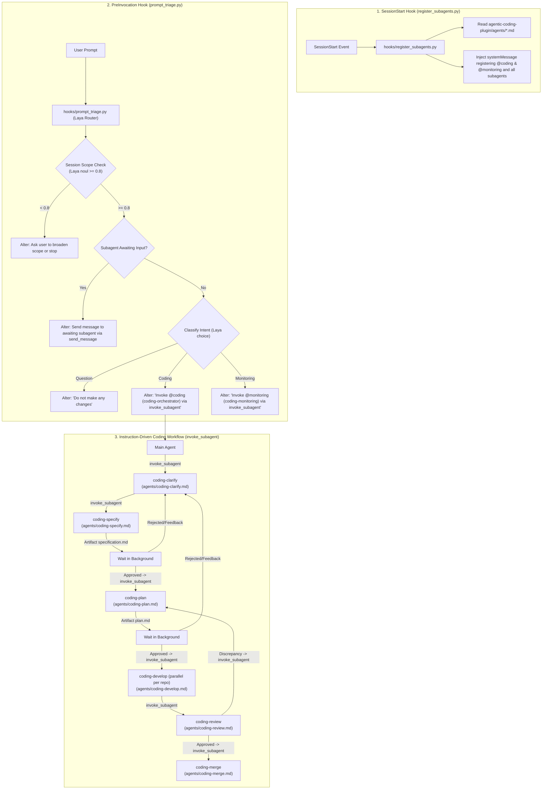

# Implementation Plan: Markdown-Defined Subagents & SessionStart Registration Hook

This plan details the updated architectural design for [`agentic-coding-plugin`](file:///Users/gpfister/Development/Projects/gpfister/agentic/agentic-coding-plugin):
1. **Markdown Agent Declarations**: Subagent definitions are located as modular markdown files directly in [`agentic-coding-plugin/agents/<agent_name>.md`](file:///Users/gpfister/Development/Projects/gpfister/agentic/agentic-coding-plugin/agents/).
2. **Instruction-Driven Orchestration**: Workflows are translated to prompt instructions, directing the orchestrator and worker agents to transition phases using `invoke_subagent`.
3. **PreInvocation Prompt Triage Hook**: Uses [`hooks/prompt_triage.py`](file:///Users/gpfister/Development/Projects/gpfister/agentic/agentic-coding-plugin/hooks/prompt_triage.py) (Laya Router) to rewrite prompts and instruct the main agent on how to handle the result of the triage.
4. **SessionStart Registration Hook**: Implements [`hooks/register_subagents.py`](file:///Users/gpfister/Development/Projects/gpfister/agentic/agentic-coding-plugin/hooks/register_subagents.py) as a `SessionStart` hook to read the agent definitions in `agentic-coding-plugin/agents/` and register `@coding` and `@monitoring` subagents into the session context.

---

## 1. Goal Description

Transition `agentic-coding-plugin` subagent architecture:
- Author subagents as declarative markdown files in `agentic-coding-plugin/agents/<agent_name>.md`.
- Enable the main agent and subagents to drive the 6-phase coding lifecycle (`coding-clarify` $\rightarrow$ `coding-specify` $\rightarrow$ `coding-plan` $\rightarrow$ `coding-develop` $\rightarrow$ `coding-review` $\rightarrow$ `coding-merge`) via `invoke_subagent` and `send_message`.
- Register [`hooks/register_subagents.py`](file:///Users/gpfister/Development/Projects/gpfister/agentic/agentic-coding-plugin/hooks/register_subagents.py) under `SessionStart` in `hooks.json` to configure subagents and inject guidance mapping `@coding` $\rightarrow$ `coding-orchestrator` and `@monitoring` $\rightarrow$ `coding-monitoring`.
- Retain Laya Router triage in [`hooks/prompt_triage.py`](file:///Users/gpfister/Development/Projects/gpfister/agentic/agentic-coding-plugin/hooks/prompt_triage.py) (`PreInvocation`), updating injected prompt alterations to direct the main agent to invoke `@coding` / `@monitoring` via `invoke_subagent` or forward messages to awaiting subagents via `send_message`.

---

## 2. Architecture & Lifecycle Overview



---

## 3. Subagent Declarations (`agentic-coding-plugin/agents/<agent_name>.md`)

Each subagent will be defined in `agentic-coding-plugin/agents/<agent_name>.md` with YAML frontmatter:

| File Path | Subagent Name | Role & Handoff Directive |
| :--- | :--- | :--- |
| `agentic-coding-plugin/agents/coding-orchestrator.md` | `coding-orchestrator` | Top-level workflow coordinator. Orchestrates phases by executing `invoke_subagent` at each stage transition. |
| `agentic-coding-plugin/agents/coding.md` | `coding` | Alias file for `@coding`, routing directly to `coding-orchestrator`. |
| `agentic-coding-plugin/agents/coding-clarify.md` | `coding-clarify` | Interrogates requirements via `ask_question` (Matt Pocock `/grill-me`). When resolved, outputs `ClarificationSummary` and invokes `coding-specify`. |
| `agentic-coding-plugin/agents/coding-specify.md` | `coding-specify` | Consolidates requirements into `specification.md` (Artifact). Awaits user approval. If approved, invokes `coding-plan`; if rejected, re-invokes `coding-clarify`. |
| `agentic-coding-plugin/agents/coding-plan.md` | `coding-plan` | Architecture planning per repository, branch naming (`feature/*`, `task/*`, `bugfix/*`), emits `plan.md` (Artifact). Awaits approval. If approved, invokes `coding-develop` per repo. |
| `agentic-coding-plugin/agents/coding-develop.md` | `coding-develop` | Per-repo isolated coder. Author of code, unit tests, linters, repo docs, CI/CD. Invoked with repo workdir. Reports back to `coding-review`. |
| `agentic-coding-plugin/agents/coding-review.md` | `coding-review` | Cross-repo verification & spec compliance auditor. On discrepancy, invokes `coding-plan`. On clean review, asks user merge approval and invokes `coding-merge`. |
| `agentic-coding-plugin/agents/coding-merge.md` | `coding-merge` | Release engineer: merges locally if no remote origin, or creates GitHub Pull Request (`gh pr create`) and awaits approval. |
| `agentic-coding-plugin/agents/coding-monitoring.md` | `coding-monitoring` | Standalone telemetry monitor for serial ports and application logs with pause gates on error. |
| `agentic-coding-plugin/agents/monitoring.md` | `monitoring` | Alias file for `@monitoring`, routing directly to `coding-monitoring`. |

---

## 4. Proposed Changes

### Component 1: Plugin Manifest & Hooks Configuration

#### [MODIFY] [`hooks.json`](file:///Users/gpfister/Development/Projects/gpfister/agentic/agentic-coding-plugin/hooks.json)
Update hook registration to declare both `SessionStart` and `PreInvocation`:
```json
{
  "gp-coding-companion": {
    "SessionStart": [
      {
        "type": "command",
        "command": ".venv/bin/python hooks/register_subagents.py",
        "timeout": 30
      }
    ],
    "PreInvocation": [
      {
        "type": "command",
        "command": ".venv/bin/python hooks/prompt_triage.py",
        "timeout": 20
      }
    ]
  }
}
```

---

### Component 2: SessionStart Registration Hook

#### [NEW] [`hooks/register_subagents.py`](file:///Users/gpfister/Development/Projects/gpfister/agentic/agentic-coding-plugin/hooks/register_subagents.py)
A standalone executable hook script that:
1. Reads `stdin` JSON (`conversationId`, `workspacePaths`).
2. Discovers and parses all markdown agent definitions from `agentic-coding-plugin/agents/*.md`.
3. Constructs and outputs `injectSteps` on `stdout`:
   - Injects a system message declaring `@coding` (`coding-orchestrator`), `@monitoring` (`coding-monitoring`), and the individual worker subagents.
   - Instructs the main agent on how to call `invoke_subagent` and route mentions (`@coding`, `@monitoring`, `@coding-specify`).

---

### Component 3: Markdown Agent Definitions in `agentic-coding-plugin/agents/`

Author all agent definition files directly in [`agentic-coding-plugin/agents/`](file:///Users/gpfister/Development/Projects/gpfister/agentic/agentic-coding-plugin/agents/):
- [`coding-orchestrator.md`](file:///Users/gpfister/Development/Projects/gpfister/agentic/agentic-coding-plugin/agents/coding-orchestrator.md): Coordinates the 6 phases using `invoke_subagent`.
- [`coding.md`](file:///Users/gpfister/Development/Projects/gpfister/agentic/agentic-coding-plugin/agents/coding.md): Alias mapping `@coding` $\rightarrow$ `coding-orchestrator`.
- [`coding-clarify.md`](file:///Users/gpfister/Development/Projects/gpfister/agentic/agentic-coding-plugin/agents/coding-clarify.md): `/grill-me` requirement questionnaire instructions.
- [`coding-specify.md`](file:///Users/gpfister/Development/Projects/gpfister/agentic/agentic-coding-plugin/agents/coding-specify.md): Specification synthesis & artifact creation instructions.
- [`coding-plan.md`](file:///Users/gpfister/Development/Projects/gpfister/agentic/agentic-coding-plugin/agents/coding-plan.md): Multi-repo branch and task breakdown instructions.
- [`coding-develop.md`](file:///Users/gpfister/Development/Projects/gpfister/agentic/agentic-coding-plugin/agents/coding-develop.md): Scoped single-repo implementation and test instructions.
- [`coding-review.md`](file:///Users/gpfister/Development/Projects/gpfister/agentic/agentic-coding-plugin/agents/coding-review.md): Cross-repo validation and discrepancy loop instructions.
- [`coding-merge.md`](file:///Users/gpfister/Development/Projects/gpfister/agentic/agentic-coding-plugin/agents/coding-merge.md): Branch merging / PR creation instructions.
- [`coding-monitoring.md`](file:///Users/gpfister/Development/Projects/gpfister/agentic/agentic-coding-plugin/agents/coding-monitoring.md): Log / serial surveillance instructions.
- [`monitoring.md`](file:///Users/gpfister/Development/Projects/gpfister/agentic/agentic-coding-plugin/agents/monitoring.md): Alias mapping `@monitoring` $\rightarrow$ `coding-monitoring`.

---

### Component 4: PreInvocation Prompt Triage Hook Refactoring

#### [MODIFY] [`hooks/prompt_triage.py`](file:///Users/gpfister/Development/Projects/gpfister/agentic/agentic-coding-plugin/hooks/prompt_triage.py) & [`src/gp_coding/triage.py`](file:///Users/gpfister/Development/Projects/gpfister/agentic/agentic-coding-plugin/src/gp_coding/triage.py)
Ensure injected prompt alterations cleanly direct the main agent:
- **Scope Mismatch**: Injects directive to ask the user if they want to broaden scope or stop.
- **Waiting Subagent Match**: Injects instruction for the main agent to deliver input directly to the awaiting subagent (`send_message`).
- **Question**: Injects `"Prompt Triage Directive: Do not make any changes."`
- **Coding Request**: Injects instruction:
  *"Prompt Triage Directive: Coding request identified. Please invoke `@coding` (`coding-orchestrator`) using `invoke_subagent` to begin the development lifecycle."*
- **Monitoring Request**: Injects instruction:
  *"Prompt Triage Directive: Monitoring request identified. Please invoke `@monitoring` (`coding-monitoring`) using `invoke_subagent`."*

---

### Component 5: Tests & Rules Update

#### [MODIFY] [`rules/AGENTS.md`](file:///Users/gpfister/Development/Projects/gpfister/agentic/agentic-coding-plugin/rules/AGENTS.md)
Update documentation to explain that subagents are defined in `agents/*.md` and invoked via `invoke_subagent`.

#### [MODIFY] [`tests/test_plugin.py`](file:///Users/gpfister/Development/Projects/gpfister/agentic/agentic-coding-plugin/tests/test_plugin.py) & [NEW] `tests/test_register_subagents.py`
Add tests verifying:
1. `hooks.json` declares both `SessionStart` and `PreInvocation`.
2. `hooks/register_subagents.py` discovers `agentic-coding-plugin/agents/*.md` and outputs valid `injectSteps` registering `@coding` and `@monitoring`.
3. All `agents/*.md` files exist, have valid YAML frontmatter (`name`, `description`), and specify `invoke_subagent` handoffs.
4. `prompt_triage.py` correctly alters prompts for the main agent.

---

## 5. Verification Plan

### Automated Tests
```bash
cd agentic-coding-plugin && .venv/bin/pytest -v
```
- `tests/test_plugin.py`: Validates manifest and hook declarations.
- `tests/test_register_subagents.py`: Validates `register_subagents.py` execution, markdown agent discovery in `agentic-coding-plugin/agents/`, and `SessionStart` JSON output.
- `tests/test_prompt_triage.py`: Validates Laya Router scope check, waiting subagent routing, and prompt alteration injection.
- `tests/test_schemas.py`: Validates schemas and markdown formatting.
- `tests/test_state.py`: Validates workflow state locking and transitions.

### Manual Verification
1. Test SessionStart hook directly:
   ```bash
   echo '{"conversationId":"test-sess-001"}' | .venv/bin/python hooks/register_subagents.py
   ```
   Verify JSON `injectSteps` outputs registration and guidance for `@coding`, `@monitoring`, and worker agents found in `agentic-coding-plugin/agents/`.
2. Test PreInvocation hook directly:
   ```bash
   echo '{"lastUserInput":"Please implement a feature","invocationNum":1}' | .venv/bin/python hooks/prompt_triage.py
   ```
   Verify stdout contains `injectSteps` instructing the main agent to invoke `coding-orchestrator` via `invoke_subagent`.
